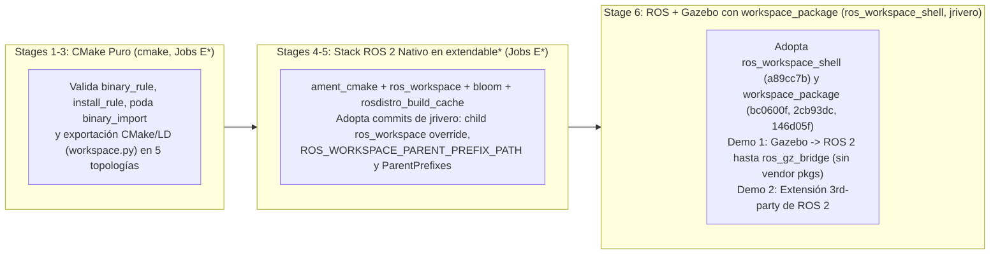

# Guía de Ejecución REP-159: Familia de Distribuciones `extendable*` (`E*`) en `build.test.ros2.org`

Procedimiento secuencial, diagramas de arquitectura y matriz de evidencia empírica verificada en la buildfarm oficial (`https://build.test.ros2.org` y `http://repo.test.ros2.org`) para la familia de distribuciones **`extendable*`** (`E*`).

> [!NOTE]
> **Referencias Cruzadas**:
> - **Plan de Rollout & Alineación con `jrivero`**: **[`ROLLOUT_PLAN.md`](ROLLOUT_PLAN.md)**
> - **Stage 4 (`ros_workspace` + `ament_cmake` + `bloom` en `E*`)**: **[`STAGE4_COMPOSABLE_WORKSPACE_PLAN.md`](STAGE4_COMPOSABLE_WORKSPACE_PLAN.md)**
> - **Stage 5 (`rosdistro_build_cache` + `bloom` en `E*`)**: **[`STAGE5_CACHE_AND_BLOOM_PLAN.md`](STAGE5_CACHE_AND_BLOOM_PLAN.md)**
> - **Stage 6 (`ROS + Gazebo`: `lyrical/jetty` & `rolling/rotary` en `E*`)**: **[`STAGE6_ROS_GAZEBO_PLAN.md`](STAGE6_ROS_GAZEBO_PLAN.md)**

---

## 1. Evolución de la Suite `extendable*` (`E*`) hacia ROS + Gazebo



| Distribución (`extendable*` Suite) | Padre(s) (`extends`) | Método | Paquetes Propios | Prefijo de Instalación | Jobs Jenkins (`build.test.ros2.org`) |
|---|---|---|---|---|---|
| **`extendable`** | *(Raíz)* | *(Base)* | `upstream_{a,b,c}` (+ `ament_package`, `ament_cmake_core`, `ros_workspace` en Stage 4) | `/opt/ros/extendable` (S1/S3/S4)<br>`/opt/vendor/extendable` (S2) | `Esrc_uR__*`, `Ebin_uR64__*`, `Erel_sync-*`, `Eci__nightly-release`, `Eci__source-branches`, `Eci__release-branches`, `Eci__workspace-release`, `extendable_rosdistro-cache` |
| **`extendablesrc`** | `extendable` | `source_rebuild` | `downstream_src_a` | `/opt/ros/extendablesrc` | `Eci__source-rebuild_ubuntu_resolute_amd64` |
| **`extendablebin`** | `extendable` | `binary_import` | `downstream_bin_a` (+ child `ros_workspace` en Stage 4) | `/opt/vendor/extendablebin` (S2)<br>`/opt/ros/extendablebin` (S3/S4) | `Eci__binary-import`, `Esrc_uR__downstream_bin_a*`, `Ebin_uR64__downstream_bin_a*`, `Esrc_uR__extbin_*`, `Ebin_uR64__extbin_*`, `Erel_extbin_sync-*`, `Eci__workspace-binary-import`, `extendablebin_rosdistro-cache` |
| **`extendablechain` (Option A)** | `extendablebin` | `source_rebuild` | `downstream_chain_a` | `/opt/ros/extendablechain` | `Eci__chained-import_ubuntu_resolute_amd64` (`#3`) |
| **`extendablechain` (Option B)** | `extendablebin` | `binary_import` | `downstream_chain_a` | `/opt/ros/extendablechain` | `Eci__chained-import_ubuntu_resolute_amd64` (`#4`) |
| **`extendablemixed`** | `extendablebin` | `binary_import` (+ `upstream_c` en CI) | `downstream_chain_a` | `/opt/ros/extendablemixed` | `Eci__mixed-chain_ubuntu_resolute_amd64` (`#1`, `#2`) |
| **`extendablediamond`** | `[extendablebin, extendablesrc]` | `binary_import` + `source_rebuild` | `downstream_chain_a` | `/opt/ros/extendablediamond` | `Eci__diamond-chain_ubuntu_resolute_amd64` (`#1`, `#3`) |
| **`extendablejetty` (Stage 6 Step 6B-1)** | *(Raíz Gazebo LTS)* | *(Base)* | `ros_workspace_shell` (`0.1.0`), `gz-cmake` (`5.1.1`), `gz-utils` (`4.0.0`), `gz-math` (`9.3.0`) | `/opt/ros/extendablejetty` (`ros-extendablejetty-*`) | `Esrc_uR__extjetty_*`, `Ebin_uR64__extjetty_*`, `Erel_extjetty_sync-*`, `Eci__gazebo-jetty-release` |
| **`extendablelyricalsrc` (Stage 6 Step 6B-1)** | `extendablejetty` | `source_rebuild` | `gz-demo-math` (`1.0.1`) (+ `ros_workspace_shell`, `gz-cmake`, `gz-utils`, `gz-math` desde git) | `/opt/ros/extendablelyricalsrc` | `Eci__gazebo-lyrical-source-rebuild` |
| **`extendablelyrical` (Stage 6 Step 6B-1)** | `extendablejetty` | `binary_import` | `ros_workspace_shell` (`0.1.0`, override), `gz-demo-math` (`1.0.1`) | `/opt/ros/extendablelyrical` (`ros-extendablelyrical-*`) | `Esrc_uR__extlyrical_*`, `Ebin_uR64__extlyrical_*`, `Erel_extlyrical_sync-*`, `Eci__gazebo-lyrical-binary-import` |

---

## 2. Matriz de Ramas Semánticas por Etapa (Stages 1–5)

| Submódulo | Stage 1 (`binary_rule`) | Stage 2 (`install_rule` `/opt/vendor/{distro}`) | Stage 3 (Multi-Tier, Mixed & Diamond) | Stages 4 & 5 (`ros_workspace` + `bloom` + Caches) |
|---|---|---|---|---|
| **`rep159-rosdistro`** | `feat/extendable-binary-naming` (`b2882ed`) | `feat/extendable-install-rule` (`6bc24b1`) | `feat/chained-extensions` (`69afb27`)<br>`feat/binary-chained` (`e63a90a`)<br>`feat/mixed-extensions` (`3e66c48`)<br>`feat/diamond-extensions` (`7ab72c6`) | `feat/extendable-workspace` (`ab0400c`) |
| **`ros_buildfarm_config`** | `feat/extendable-binary-naming` (`30a7f90`) | `feat/extendable-install-rule` (`f8751e6`) | `feat/chained-extensions` (`7fa2b40`)<br>`feat/binary-chained` (`0f308af`)<br>`feat/mixed-extensions` (`6fc8b81`)<br>`feat/diamond-extensions` (`84064ae`) | `feat/extendable-workspace` (`3322225`) |
| **`rosdistro`** | `feature/rep159-binary-naming-regex` (`bfde799`, [`#1`](https://github.com/rep159-testing/rosdistro/pull/1)) | `feat/rep159-install-rule` (`a8f5543`) | `feat/rep159-install-rule` (`a8f5543`) | `feat/rep159-install-rule` (`a8f5543`) |
| **`rosdep`** | `feat/rep159-binary-lookup` (`5661779`) / testbed `rep159` (`3d52dad`) | `feat/rep159-binary-lookup` (`5661779`) | `feat/rep159-binary-lookup` (`5661779`) | `feat/rep159-binary-lookup` (`5661779`) |
| **`reprepro-updater`** | `feat/package-prefix` (`93ed2dc`) | `feat/package-prefix` (`93ed2dc`) | `feat/package-prefix` (`93ed2dc`) | `feat/package-prefix` (`93ed2dc`) |
| **`ros_workspace`** | N/A | N/A | N/A | `feat/rep159-parent-chaining` (`4997f85`) |
| **`bloom`** | N/A | N/A | N/A | `feat/rep159-rules-support` (`7af7034`) |
| **`ros_buildfarm`** | Clean PR 3C: `feat/rep159-binary-naming` (`a271be1`)<br>Testbed: `feat/binary-naming-rule` (`797d771`) | Clean PR 3A (`486b579`) + PR 3B (`a4a5bbd`)<br>Testbed: `feat/binary-naming-rule` (`797d771`) | Clean PRs 3A (`486b579`) + 3B (`a4a5bbd`) + 3C (`a271be1`)<br>Testbed: `feat/binary-naming-rule` (`797d771`) | Clean PRs 3A–3C<br>Testbed: `feat/extendable-workspace` (`ca13954`) |
| **Release Tracks (`*-release`)** | `upstream_{a,b,c}-release`:<br>`debian/vendor-extendable/resolute/upstream_*` (`d290d17`, `65280fc`, `ad6c0e8`) | `upstream_{a,b,c}-release`:<br>`debian/vendor-extendable-install-rule/resolute/upstream_*` (`ad87f5b`, `8c33a3d`, `eef2f2b`) | `upstream_{a,b,c}-release`: `debian/vendor-extendable/resolute/upstream_*`<br>`downstream_bin_a-release`: `debian/extendablebin/resolute/downstream_bin_a` (`ed6daa8`) | `ament_package-release`: `1b551c8`<br>`ament_cmake_core-release`: `32bc461`<br>`ros_workspace-release`: `f063a4d` (root), `bea31df` (child)<br>`downstream_bin_a-release`: `9f8ba47` (`vendor-extendablebin`) |

---

## 3. Evidencia Empírica en `build.test.ros2.org` & `repo.test.ros2.org`

### 3.1 Stage 1: Renombrado Binario (`vendor-extendable-*`) y Pipeline de Release (`/opt/ros/extendable`)

| Fase | Job en `build.test.ros2.org` | Build & Consola | Estado | Artefacto / Resultado Verificado |
|---|---|---|:---:|---|
| **Sourcedeb** | `Esrc_uR__upstream_a__ubuntu_resolute__source`<br>`Esrc_uR__upstream_b__ubuntu_resolute__source`<br>`Esrc_uR__upstream_c__ubuntu_resolute__source` | [#2](https://build.test.ros2.org/job/Esrc_uR__upstream_a__ubuntu_resolute__source/2/) / [#4](https://build.test.ros2.org/job/Esrc_uR__upstream_a__ubuntu_resolute__source/4/) ([Log](https://build.test.ros2.org/job/Esrc_uR__upstream_a__ubuntu_resolute__source/4/console))<br>[#1](https://build.test.ros2.org/job/Esrc_uR__upstream_b__ubuntu_resolute__source/1/) / [#3](https://build.test.ros2.org/job/Esrc_uR__upstream_b__ubuntu_resolute__source/3/) ([Log](https://build.test.ros2.org/job/Esrc_uR__upstream_b__ubuntu_resolute__source/3/console))<br>[#1](https://build.test.ros2.org/job/Esrc_uR__upstream_c__ubuntu_resolute__source/1/) / [#3](https://build.test.ros2.org/job/Esrc_uR__upstream_c__ubuntu_resolute__source/3/) ([Log](https://build.test.ros2.org/job/Esrc_uR__upstream_c__ubuntu_resolute__source/3/console)) | **SUCCESS** | Genera `.dsc` y `.orig.tar.gz` con nombre `vendor-extendable-upstream-{a,b,c}` |
| **Binarydeb** | `Ebin_uR64__upstream_a__ubuntu_resolute_amd64__binary`<br>`Ebin_uR64__upstream_b__ubuntu_resolute_amd64__binary`<br>`Ebin_uR64__upstream_c__ubuntu_resolute_amd64__binary` | [#1](https://build.test.ros2.org/job/Ebin_uR64__upstream_a__ubuntu_resolute_amd64__binary/1/) / [#3](https://build.test.ros2.org/job/Ebin_uR64__upstream_a__ubuntu_resolute_amd64__binary/3/) ([Log](https://build.test.ros2.org/job/Ebin_uR64__upstream_a__ubuntu_resolute_amd64__binary/3/console))<br>[#1](https://build.test.ros2.org/job/Ebin_uR64__upstream_b__ubuntu_resolute_amd64__binary/1/) / [#4](https://build.test.ros2.org/job/Ebin_uR64__upstream_b__ubuntu_resolute_amd64__binary/4/) ([Log](https://build.test.ros2.org/job/Ebin_uR64__upstream_b__ubuntu_resolute_amd64__binary/4/console))<br>[#1](https://build.test.ros2.org/job/Ebin_uR64__upstream_c__ubuntu_resolute_amd64__binary/1/) / [#3](https://build.test.ros2.org/job/Ebin_uR64__upstream_c__ubuntu_resolute_amd64__binary/3/) ([Log](https://build.test.ros2.org/job/Ebin_uR64__upstream_c__ubuntu_resolute_amd64__binary/3/console)) | **SUCCESS** | Publica `.deb` en `/opt/ros/extendable`:<br>• [`pool/main/v/vendor-extendable-upstream-a/`](http://repo.test.ros2.org/ubuntu/testing/pool/main/v/vendor-extendable-upstream-a/)<br>• [`pool/main/v/vendor-extendable-upstream-b/`](http://repo.test.ros2.org/ubuntu/testing/pool/main/v/vendor-extendable-upstream-b/)<br>• [`pool/main/v/vendor-extendable-upstream-c/`](http://repo.test.ros2.org/ubuntu/testing/pool/main/v/vendor-extendable-upstream-c/) |
| **APT Sync** | `Erel_sync-packages-to-testing_resolute_amd64` | [#8](https://build.test.ros2.org/job/Erel_sync-packages-to-testing_resolute_amd64/8/) / [#10](https://build.test.ros2.org/job/Erel_sync-packages-to-testing_resolute_amd64/10/) ([Log](https://build.test.ros2.org/job/Erel_sync-packages-to-testing_resolute_amd64/10/console)) | **SUCCESS** | `FilterFormula: Package (% vendor-extendable-*)` promueve los 3 paquetes a `testing` |
| **Root CI** | `Eci__nightly-release_ubuntu_resolute_amd64`<br>`Eci__source-branches_ubuntu_resolute_amd64`<br>`Eci__release-branches_ubuntu_resolute_amd64` | [#2](https://build.test.ros2.org/job/Eci__nightly-release_ubuntu_resolute_amd64/2/) ([Log](https://build.test.ros2.org/job/Eci__nightly-release_ubuntu_resolute_amd64/2/console))<br>[#2](https://build.test.ros2.org/job/Eci__source-branches_ubuntu_resolute_amd64/2/) ([Log](https://build.test.ros2.org/job/Eci__source-branches_ubuntu_resolute_amd64/2/console))<br>[#2](https://build.test.ros2.org/job/Eci__release-branches_ubuntu_resolute_amd64/2/) ([Log](https://build.test.ros2.org/job/Eci__release-branches_ubuntu_resolute_amd64/2/console)) | **SUCCESS** | 3/3 suites CTest aprobadas en las 3 modalidades de CI |

---

### 3.2 Stage 2: Prefijos Personalizados (`install_rule: '/opt/vendor/{distro}'`) y Poda `binary_import`

| Fase | Job en `build.test.ros2.org` | Build & Consola | Estado | Invariante Verificado |
|---|---|---|:---:|---|
| **Release & Sync (`/opt/vendor/extendable`)** | `Esrc_uR__upstream_{a,b,c}__ubuntu_resolute__source`<br>`Ebin_uR64__upstream_{a,b,c}__ubuntu_resolute_amd64__binary`<br>`Erel_sync-packages-to-testing_resolute_amd64` | [`a #3`](https://build.test.ros2.org/job/Esrc_uR__upstream_a__ubuntu_resolute__source/3/), [`b #2`](https://build.test.ros2.org/job/Esrc_uR__upstream_b__ubuntu_resolute__source/2/), [`c #2`](https://build.test.ros2.org/job/Esrc_uR__upstream_c__ubuntu_resolute__source/2/)<br>[`a #2`](https://build.test.ros2.org/job/Ebin_uR64__upstream_a__ubuntu_resolute_amd64__binary/2/), [`b #2`](https://build.test.ros2.org/job/Ebin_uR64__upstream_b__ubuntu_resolute_amd64__binary/2/), [`c #2`](https://build.test.ros2.org/job/Ebin_uR64__upstream_c__ubuntu_resolute_amd64__binary/2/)<br>[`sync #9`](https://build.test.ros2.org/job/Erel_sync-packages-to-testing_resolute_amd64/9/) ([Log](https://build.test.ros2.org/job/Erel_sync-packages-to-testing_resolute_amd64/9/console)) | **SUCCESS** | Empaqueta e instala `vendor-extendable-upstream-{a,b,c}` en `/opt/vendor/extendable` usando tracks dedicados `debian/vendor-extendable-install-rule/resolute/upstream_*` |
| **CI `binary_import`** | `Eci__binary-import_ubuntu_resolute_amd64` | [#5](https://build.test.ros2.org/job/Eci__binary-import_ubuntu_resolute_amd64/5/) ([Log](https://build.test.ros2.org/job/Eci__binary-import_ubuntu_resolute_amd64/5/console)) | **SUCCESS** | `ReleaseAndSourceDependencyWalker` clona solo `downstream_bin_a`; APT instala `vendor-extendable-upstream-c`; exporta `ROS_BUILDFARM_PARENT_RESULT_SPACES=/opt/vendor/extendable` y `CMAKE_PREFIX_PATH`/`LD_LIBRARY_PATH` (1/1 tests green) |
| **CI `source_rebuild`** | `Eci__source-rebuild_ubuntu_resolute_amd64` | [#2](https://build.test.ros2.org/job/Eci__source-rebuild_ubuntu_resolute_amd64/2/) ([Log](https://build.test.ros2.org/job/Eci__source-rebuild_ubuntu_resolute_amd64/2/console)) | **SUCCESS** | Clona y compila los 4 paquetes desde fuentes (`upstream_{a,b,c}` + `downstream_src_a`, 4/4 tests green) |

---

### 3.3 Stage 3: Topologías Multicapa, Híbridas y Diamante (`build.test.ros2.org`)

| Topología | Job en `build.test.ros2.org` | Build & Consola | Estado | Invariante Verificado |
|---|---|---|:---:|---|
| **Option A: 3-Tier `source_rebuild`** ($A \xrightarrow{\text{src}} B \xrightarrow{\text{src}} C$) | `Eci__chained-import_ubuntu_resolute_amd64` | [#3](https://build.test.ros2.org/job/Eci__chained-import_ubuntu_resolute_amd64/3/) ([Log](https://build.test.ros2.org/job/Eci__chained-import_ubuntu_resolute_amd64/3/console)) | **SUCCESS** | Clona y compila los 5 paquetes en cascada (`upstream_{a,b,c}`, `downstream_bin_a`, `downstream_chain_a`), 5/5 CTest green |
| **Option B: Release Intermedio (`extendablebin`)** | `Esrc_uR__downstream_bin_a__ubuntu_resolute__source`<br>`Ebin_uR64__downstream_bin_a__ubuntu_resolute_amd64__binary`<br>`Erel_sync-packages-to-testing_resolute_amd64` | [#1](https://build.test.ros2.org/job/Esrc_uR__downstream_bin_a__ubuntu_resolute__source/1/) ([Log](https://build.test.ros2.org/job/Esrc_uR__downstream_bin_a__ubuntu_resolute__source/1/console))<br>[#1](https://build.test.ros2.org/job/Ebin_uR64__downstream_bin_a__ubuntu_resolute_amd64__binary/1/) ([Log](https://build.test.ros2.org/job/Ebin_uR64__downstream_bin_a__ubuntu_resolute_amd64__binary/1/console))<br>[#7](https://build.test.ros2.org/job/Erel_sync-packages-to-testing_resolute_amd64/7/) ([Log](https://build.test.ros2.org/job/Erel_sync-packages-to-testing_resolute_amd64/7/console)) | **SUCCESS** | Publica [`ros-extendablebin-downstream-bin-a`](http://repo.test.ros2.org/ubuntu/testing/pool/main/r/ros-extendablebin-downstream-bin-a/) en `/opt/ros/extendablebin` |
| **Option B: 3-Tier `binary_import`** ($A \xrightarrow{\text{bin}} B \xrightarrow{\text{bin}} C$) | `Eci__chained-import_ubuntu_resolute_amd64` | [#4](https://build.test.ros2.org/job/Eci__chained-import_ubuntu_resolute_amd64/4/) ([Log](https://build.test.ros2.org/job/Eci__chained-import_ubuntu_resolute_amd64/4/console)) | **SUCCESS** | Clona solo `downstream_chain_a`, instala `ros-extendablebin-downstream-bin-a` y `vendor-extendable-upstream-c` vía APT, inyecta `/opt/ros/extendable:/opt/ros/extendablebin` (1/1 CTest green) |
| **Topology 2: Hybrid Mixed (`extendablemixed`)** | `Eci__mixed-chain_ubuntu_resolute_amd64` | [#1](https://build.test.ros2.org/job/Eci__mixed-chain_ubuntu_resolute_amd64/1/) / [#2](https://build.test.ros2.org/job/Eci__mixed-chain_ubuntu_resolute_amd64/2/) ([Log](https://build.test.ros2.org/job/Eci__mixed-chain_ubuntu_resolute_amd64/2/console)) | **SUCCESS** | `rosdep --ignore-src` omite `upstream_c` en APT y compila `upstream_c` + `downstream_chain_a` en el workspace junto al binario `ros-extendablebin-downstream-bin-a` (2/2 CTest green) |
| **Topology 3: Multi-Parent Diamond (`extendablediamond`)** | `Eci__diamond-chain_ubuntu_resolute_amd64` | [#1](https://build.test.ros2.org/job/Eci__diamond-chain_ubuntu_resolute_amd64/1/) / [#3](https://build.test.ros2.org/job/Eci__diamond-chain_ubuntu_resolute_amd64/3/) ([Log](https://build.test.ros2.org/job/Eci__diamond-chain_ubuntu_resolute_amd64/3/console)) | **SUCCESS** | Deduplica underlays convergentes (`/opt/ros/extendable:/opt/ros/extendablebin`) y compila `downstream_src_a` + `downstream_chain_a` (2/2 CTest green) |

---

### 3.4 Stages 4 & 5: Stack `ros_workspace` + `bloom` & Ciclo de Vida de Cachés (`extendable` & `extendablebin` / `extbin`)

| Fase | Job en `build.test.ros2.org` | Build & Consola | Estado | Invariante Verificado |
|---|---|---|:---:|---|
| **Stage 5 Cachés (`extendable` & `extendablebin`)** | `extendable_rosdistro-cache`<br>`extendablebin_rosdistro-cache` | [#139](https://build.test.ros2.org/job/extendable_rosdistro-cache/139/) ([Log](https://build.test.ros2.org/job/extendable_rosdistro-cache/139/console))<br>[#138](https://build.test.ros2.org/job/extendablebin_rosdistro-cache/138/) ([Log](https://build.test.ros2.org/job/extendablebin_rosdistro-cache/138/console)) | **SUCCESS** | Genera `extendable-cache.yaml.gz` (6 paquetes) y `extendablebin-cache.yaml.gz` (poda `- REMOVE` de 5 paquetes padre, conservando `ros_workspace` + `downstream_bin_a`) |
| **Stage 4 Root Release (`extendable`)** | `Esrc_uR__ament_package__ubuntu_resolute__source` $\to$ `Ebin_uR64__ament_package__ubuntu_resolute_amd64__binary`<br>`Esrc_uR__ament_cmake_core__ubuntu_resolute__source` $\to$ `Ebin_uR64__ament_cmake_core__ubuntu_resolute_amd64__binary`<br>`Esrc_uR__ros_workspace__ubuntu_resolute__source` $\to$ `Ebin_uR64__ros_workspace__ubuntu_resolute_amd64__binary` | [#1](https://build.test.ros2.org/job/Esrc_uR__ament_package__ubuntu_resolute__source/1/) $\to$ [#1](https://build.test.ros2.org/job/Ebin_uR64__ament_package__ubuntu_resolute_amd64__binary/1/)<br>[#1](https://build.test.ros2.org/job/Esrc_uR__ament_cmake_core__ubuntu_resolute__source/1/) $\to$ [#2](https://build.test.ros2.org/job/Ebin_uR64__ament_cmake_core__ubuntu_resolute_amd64__binary/2/)<br>[#1](https://build.test.ros2.org/job/Esrc_uR__ros_workspace__ubuntu_resolute__source/1/) $\to$ [#1](https://build.test.ros2.org/job/Ebin_uR64__ros_workspace__ubuntu_resolute_amd64__binary/1/) | **SUCCESS** | Publica `vendor-extendable-{ament-package,ament-cmake-core,ros-workspace}` en `/opt/ros/extendable` |
| **Stage 4 Root Sync & CI (`extendable`)** | `Erel_sync-packages-to-testing_resolute_amd64`<br>`Eci__workspace-release_ubuntu_resolute_amd64` | [#12](https://build.test.ros2.org/job/Erel_sync-packages-to-testing_resolute_amd64/12/) ([Log](https://build.test.ros2.org/job/Erel_sync-packages-to-testing_resolute_amd64/12/console))<br>[#2](https://build.test.ros2.org/job/Eci__workspace-release_ubuntu_resolute_amd64/2/) ([Log](https://build.test.ros2.org/job/Eci__workspace-release_ubuntu_resolute_amd64/2/console)) | **SUCCESS** | Promueve los 6 paquetes `vendor-extendable-*` a `testing` y valida CI del workspace raíz (5/5 paquetes green) |
| **Stage 4 Child Release (`extendablebin` / `extbin`)** | `Esrc_uR__extbin_ros_workspace__ubuntu_resolute__source` $\to$ `Ebin_uR64__extbin_ros_workspace__ubuntu_resolute_amd64__binary`<br>`Esrc_uR__extbin_downstream_bin_a__ubuntu_resolute__source` $\to$ `Ebin_uR64__extbin_downstream_bin_a__ubuntu_resolute_amd64__binary` | [#1](https://build.test.ros2.org/job/Esrc_uR__extbin_ros_workspace__ubuntu_resolute__source/1/) $\to$ [#2](https://build.test.ros2.org/job/Ebin_uR64__extbin_ros_workspace__ubuntu_resolute_amd64__binary/2/)<br>[#1](https://build.test.ros2.org/job/Esrc_uR__extbin_downstream_bin_a__ubuntu_resolute__source/1/) $\to$ [#2](https://build.test.ros2.org/job/Ebin_uR64__extbin_downstream_bin_a__ubuntu_resolute_amd64__binary/2/) | **SUCCESS** | Empaqueta `vendor-extendablebin-ros-workspace` (`ROS_WORKSPACE_PARENT_PREFIX_PATH=/opt/ros/extendable`) y `vendor-extendablebin-downstream-bin-a` (`bloom` con `ParentPrefixes`) |
| **Stage 4 Child Sync & CI (`extendablebin` / `extbin`)** | `Erel_extbin_sync-packages-to-testing_resolute_amd64`<br>`Eci__workspace-binary-import_ubuntu_resolute_amd64` | [#3](https://build.test.ros2.org/job/Erel_extbin_sync-packages-to-testing_resolute_amd64/3/) ([Log](https://build.test.ros2.org/job/Erel_extbin_sync-packages-to-testing_resolute_amd64/3/console))<br>[#1](https://build.test.ros2.org/job/Eci__workspace-binary-import_ubuntu_resolute_amd64/1/) ([Log](https://build.test.ros2.org/job/Eci__workspace-binary-import_ubuntu_resolute_amd64/1/console)) | **SUCCESS** | Promueve `vendor-extendablebin-*` a `testing` y valida sourcing recursivo `/opt/ros/extendablebin/setup.sh` $\to$ `/opt/ros/extendable` en CI |

---

### 3.5 Stage 6 Step 6B-1: `workspace_package: ros_workspace_shell` + Gazebo (`extendablejetty` $\to$ `extendablelyrical` / `extendablelyricalsrc`)

| Fase | Job en `build.test.ros2.org` | Build & Consola | Estado | Invariante Verificado |
|---|---|---|:---:|---|
| **Root Gazebo Sourcedeb (`extendablejetty` / `extjetty`)** | `Esrc_uR__extjetty_ros_workspace_shell__ubuntu_resolute__source`<br>`Esrc_uR__extjetty_gz-cmake__ubuntu_resolute__source`<br>`Esrc_uR__extjetty_gz-utils__ubuntu_resolute__source`<br>`Esrc_uR__extjetty_gz-math__ubuntu_resolute__source` | [#1](https://build.test.ros2.org/job/Esrc_uR__extjetty_ros_workspace_shell__ubuntu_resolute__source/1/) ([Log](https://build.test.ros2.org/job/Esrc_uR__extjetty_ros_workspace_shell__ubuntu_resolute__source/1/console))<br>[#1](https://build.test.ros2.org/job/Esrc_uR__extjetty_gz-cmake__ubuntu_resolute__source/1/) ([Log](https://build.test.ros2.org/job/Esrc_uR__extjetty_gz-cmake__ubuntu_resolute__source/1/console))<br>[#1](https://build.test.ros2.org/job/Esrc_uR__extjetty_gz-utils__ubuntu_resolute__source/1/) ([Log](https://build.test.ros2.org/job/Esrc_uR__extjetty_gz-utils__ubuntu_resolute__source/1/console))<br>[#1](https://build.test.ros2.org/job/Esrc_uR__extjetty_gz-math__ubuntu_resolute__source/1/) ([Log](https://build.test.ros2.org/job/Esrc_uR__extjetty_gz-math__ubuntu_resolute__source/1/console)) | **SUCCESS** | Genera `.dsc` de `ros-extendablejetty-{ros-workspace-shell,gz-cmake,gz-utils,gz-math}` sin paquetes `ament` |
| **Root Gazebo Binarydeb & Sync (`extendablejetty` / `extjetty`)** | `Ebin_uR64__extjetty_ros_workspace_shell__ubuntu_resolute_amd64__binary`<br>`Ebin_uR64__extjetty_gz-cmake__ubuntu_resolute_amd64__binary`<br>`Ebin_uR64__extjetty_gz-utils__ubuntu_resolute_amd64__binary`<br>`Ebin_uR64__extjetty_gz-math__ubuntu_resolute_amd64__binary`<br>`Erel_extjetty_sync-packages-to-testing_resolute_amd64` | [#1](https://build.test.ros2.org/job/Ebin_uR64__extjetty_ros_workspace_shell__ubuntu_resolute_amd64__binary/1/) ([Log](https://build.test.ros2.org/job/Ebin_uR64__extjetty_ros_workspace_shell__ubuntu_resolute_amd64__binary/1/console))<br>[#2](https://build.test.ros2.org/job/Ebin_uR64__extjetty_gz-cmake__ubuntu_resolute_amd64__binary/2/) ([Log](https://build.test.ros2.org/job/Ebin_uR64__extjetty_gz-cmake__ubuntu_resolute_amd64__binary/2/console))<br>[#2](https://build.test.ros2.org/job/Ebin_uR64__extjetty_gz-utils__ubuntu_resolute_amd64__binary/2/) ([Log](https://build.test.ros2.org/job/Ebin_uR64__extjetty_gz-utils__ubuntu_resolute_amd64__binary/2/console))<br>[#2](https://build.test.ros2.org/job/Ebin_uR64__extjetty_gz-math__ubuntu_resolute_amd64__binary/2/) ([Log](https://build.test.ros2.org/job/Ebin_uR64__extjetty_gz-math__ubuntu_resolute_amd64__binary/2/console))<br>[#2](https://build.test.ros2.org/job/Erel_extjetty_sync-packages-to-testing_resolute_amd64/2/) ([Log](https://build.test.ros2.org/job/Erel_extjetty_sync-packages-to-testing_resolute_amd64/2/console)) | **SUCCESS** | Compila y sincroniza `ros-extendablejetty-*` en `/opt/ros/extendablejetty` a `repo.test.ros2.org/ubuntu/testing` |
| **Child Release & Sync (`extendablelyrical` / `extlyrical`)** | `Esrc_uR__extlyrical_ros_workspace_shell__ubuntu_resolute__source` $\to$ `Ebin_uR64__extlyrical_ros_workspace_shell__ubuntu_resolute_amd64__binary`<br>`Esrc_uR__extlyrical_gz-demo-math__ubuntu_resolute__source` $\to$ `Ebin_uR64__extlyrical_gz-demo-math__ubuntu_resolute_amd64__binary`<br>`Erel_extlyrical_sync-packages-to-testing_resolute_amd64` | [#1](https://build.test.ros2.org/job/Esrc_uR__extlyrical_ros_workspace_shell__ubuntu_resolute__source/1/) $\to$ [#2](https://build.test.ros2.org/job/Ebin_uR64__extlyrical_ros_workspace_shell__ubuntu_resolute_amd64__binary/2/)<br>[#1](https://build.test.ros2.org/job/Esrc_uR__extlyrical_gz-demo-math__ubuntu_resolute__source/1/) $\to$ [#3](https://build.test.ros2.org/job/Ebin_uR64__extlyrical_gz-demo-math__ubuntu_resolute_amd64__binary/3/)<br>[#2](https://build.test.ros2.org/job/Erel_extlyrical_sync-packages-to-testing_resolute_amd64/2/) ([Log](https://build.test.ros2.org/job/Erel_extlyrical_sync-packages-to-testing_resolute_amd64/2/console)) | **SUCCESS** | Empaqueta `ros-extendablelyrical-ros-workspace-shell` (`-DROS_WORKSPACE_PARENT_PREFIX_PATH="/opt/ros/extendablejetty"`) y `ros-extendablelyrical-gz-demo-math` consumiendo `ros-extendablejetty-gz-math` vía `binary_import` |
| **CI Suite (`extendablejetty`, `extendablelyricalsrc`, `extendablelyrical`)** | `Eci__gazebo-jetty-release_ubuntu_resolute_amd64`<br>`Eci__gazebo-lyrical-source-rebuild_ubuntu_resolute_amd64`<br>`Eci__gazebo-lyrical-binary-import_ubuntu_resolute_amd64` | [#1](https://build.test.ros2.org/job/Eci__gazebo-jetty-release_ubuntu_resolute_amd64/1/) ([Log](https://build.test.ros2.org/job/Eci__gazebo-jetty-release_ubuntu_resolute_amd64/1/console))<br>[#1](https://build.test.ros2.org/job/Eci__gazebo-lyrical-source-rebuild_ubuntu_resolute_amd64/1/) ([Log](https://build.test.ros2.org/job/Eci__gazebo-lyrical-source-rebuild_ubuntu_resolute_amd64/1/console))<br>[#2](https://build.test.ros2.org/job/Eci__gazebo-lyrical-binary-import_ubuntu_resolute_amd64/2/) ([Log](https://build.test.ros2.org/job/Eci__gazebo-lyrical-binary-import_ubuntu_resolute_amd64/2/console)) | **SUCCESS** | Valida CI raíz de Gazebo (4 paquetes), `source_rebuild` completo (5 paquetes) y `binary_import` de `gz-demo-math` consumiendo `ros-extendablejetty-gz-math` desde APT |

---

## 4. Herramientas de Automatización por Etapa en [`tools/`](tools/)

Todos los scripts de configuración de ramas, generación de paquetes Debian con `bloom`, y orquestación de jobs en `https://build.test.ros2.org` están versionados en el directorio [`tools/`](tools/) del repositorio base:

```bash
# Listar todas las etapas REP-159, sus ramas de submódulos y olas de jobs en Jenkins
./tools/stage_runner.py --list-stages

# Verificar o hacer checkout de las ramas exactas de una etapa
./tools/stage_runner.py --stage stage6-gazebo-step1 --verify-branches
./tools/stage_runner.py --stage stage6-gazebo-step1 --checkout

# Consultar el estado en vivo de todos los jobs de la etapa en build.test.ros2.org
./tools/stage_runner.py --stage stage6-gazebo-step1 --status

# Regenerar jobs de Jenkins (--dry-run para previsualizar) y ejecutar la pipeline completa por olas
./tools/stage_runner.py --stage stage6-gazebo-step1 --generate-jobs --dry-run
./tools/stage_runner.py --stage stage6-gazebo-step1 --run-pipeline

# Regenerar los tracks GBP / Debian de Stage 6 con bloom y publicarlos en origin
./tools/bloom_stage6_gazebo.py --push
```
