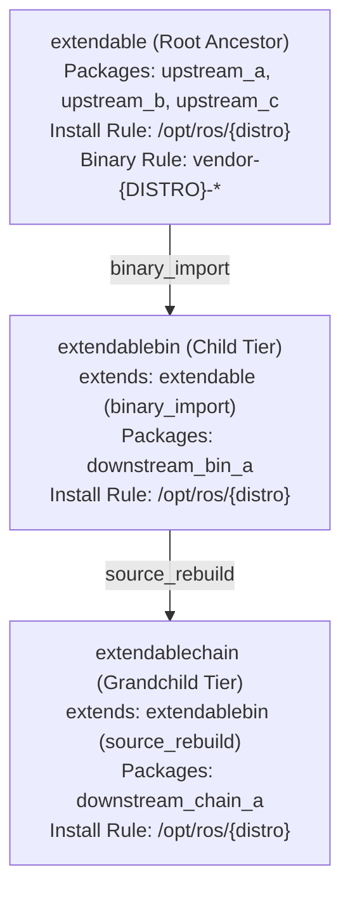
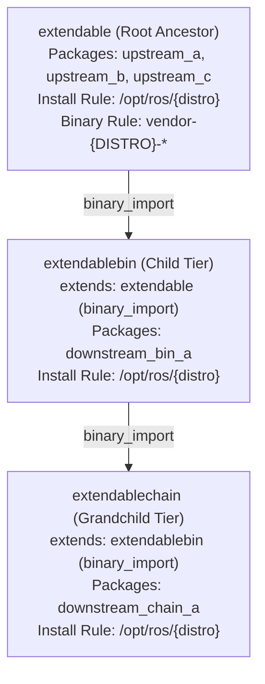
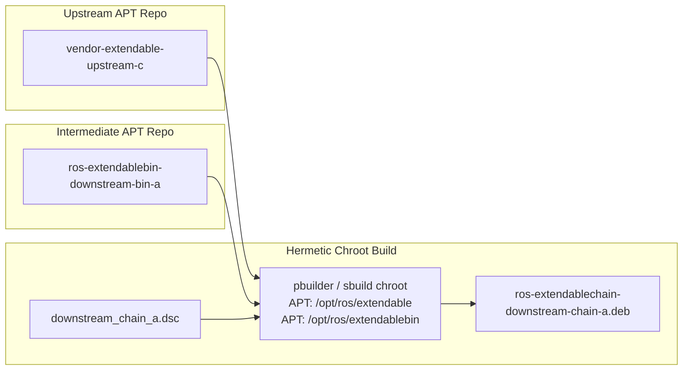
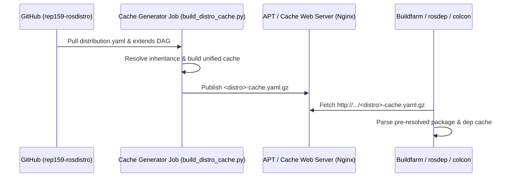
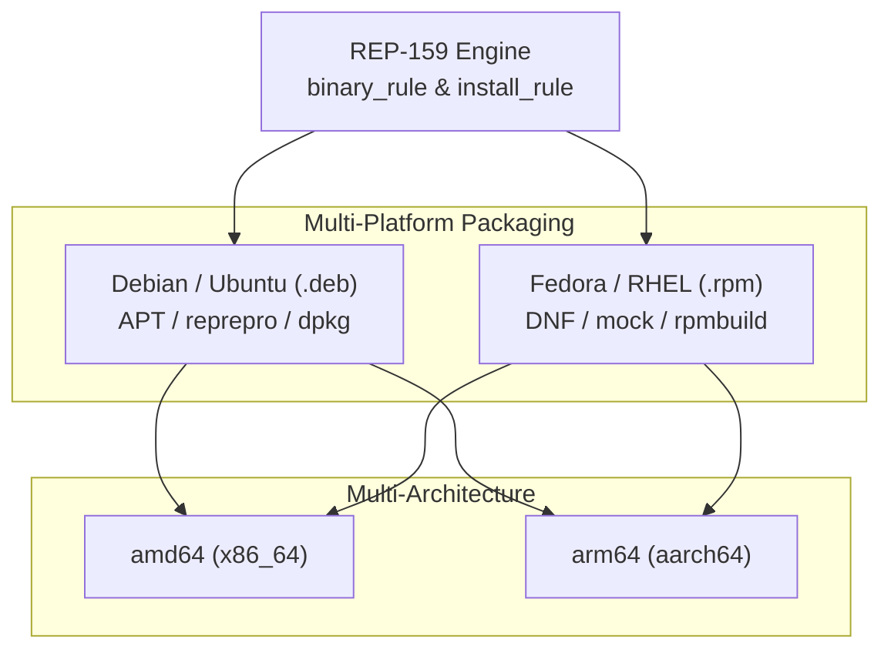

# Guía de Ejecución REP-159: Distribución Aislada `extendable` (Local y Remoto por Etapas)

Este documento define el procedimiento general y secuencial por etapas para validar la implementación de **REP-159** utilizando la distribución aislada **`extendable`**.

El proceso se ejecuta en dos etapas consecutivas:
1. **Etapa 1 (Cluster Local)**: Validación completa en el entorno local aislado (`192.168.30.206` Jenkins, `192.168.30.202` Reprepro).
2. **Etapa 2 (Buildfarm Remota)**: Validación en la buildfarm oficial de pruebas (`build.test.ros2.org`, `repo.test.ros2.org`).

---

## 1. Arquitectura de Distribución y Nomenclatura

Para evitar cualquier conflicto o sobreescritura con las pruebas de otros desarrolladores (jobs `Uci`, `Sci`, `Bci`, `Urel`), se utiliza el prefijo de distribución **`extendable`** (`E`):

| Distribución | Rol | Mecanismo REP-159 | Prefijo Jobs Jenkins |
|---|---|---|---|
| **`extendable`** | Raíz / Base | Cadena base con release pipeline (`upstream_a` ➔ `upstream_b` ➔ `upstream_c`) | **`Esrc`**, **`Ebin`**, **`Erel`**, **`Eci`** |
| **`extendablesrc`** | Extensión Fuentes | `source_rebuild` (`downstream_src_a` recompila todo desde fuentes) | **`Esci`** |
| **`extendablebin`** | Extensión Binarios | `binary_import` (`downstream_bin_a` consume `.deb` vía APT de `extendable`) | **`Ebci`** |

*Notificaciones por email*: `federico.rossi@creativa77.com.ar`.

---

## Etapa 1: Cluster Local

### Prueba A: Baseline REP-159 en Distribución `extendable` (FEAT-0 Local)

#### 1. Descripción
Valida el ciclo completo de empaquetado, release pipeline, sincronización y los 5 jobs de integración continua en el cluster local (`192.168.30.206:8080` Jenkins, `192.168.30.202:8088` Reprepro):
* Release pipeline: `upstream_a` ➔ `upstream_b` ➔ `upstream_c` (generación de `.dsc` e importación de `.deb` a `building`).
* Promoción: Sincronización de paquetes debian a `testing`.
* Integración continua:
  * **`Eci`** (3 jobs): nightly-release, source-branches, release-branches.
  * **`Esci`**: `source_rebuild` de `downstream_src_a` junto con la cadena base.
  * **`Ebci`**: `binary_import` instalando `ros-extendable-upstream-c` vía APT desde el reprepro local.

---

#### 2. Set de Ramas en Git

Ejecuta los siguientes comandos para posicionar cada repositorio en sus ramas correspondientes:

```bash
# 1. Configuración de Buildfarm (rama con definiciones extendable e index-local.yaml)
git -C submodules/ros_buildfarm_config checkout feat/extendable-distro

# 2. Metadatos de Distribución (rama con extendable, extendablesrc, extendablebin)
git -C submodules/rep159-rosdistro checkout feat/extendable-distro

# 3. Herramientas de Buildfarm con soporte REP-159 y plantillas de release format 3
git -C submodules/ros_buildfarm checkout feat/binary-naming-rule
git -C submodules/rosdistro checkout rep159
git -C submodules/rosdep checkout rep159

# 4. Paquetes de Código (ramas principales)
git -C submodules/upstream_a checkout main
git -C submodules/upstream_b checkout main
git -C submodules/upstream_c checkout main
git -C submodules/downstream_src_a checkout main
git -C submodules/downstream_bin_a checkout main
```

---

#### 3. Cargar Jobs a Jenkins (Local)

##### Paso 3.1: Desplegar configuración al servidor de repositorios local (.202)
```bash
tar -cz -C submodules/ros_buildfarm_config --exclude='.git' . | ssh root@192.168.30.202 'tar -xz -C /var/repos/ros_buildfarm_config'
```

##### Paso 3.2: Generar Release Pipeline de `extendable`
```bash
.venv/bin/python3 submodules/ros_buildfarm/scripts/release/generate_release_jobs.py \
  http://192.168.30.202:8088/ros_buildfarm_config/index-local.yaml extendable default
```

##### Paso 3.3: Generar los 5 Jobs de CI
```bash
# Jobs CI de la distribución raíz (extendable)
.venv/bin/python3 submodules/ros_buildfarm/scripts/ci/generate_ci_jobs.py \
  http://192.168.30.202:8088/ros_buildfarm_config/index-local.yaml extendable nightly-release

.venv/bin/python3 submodules/ros_buildfarm/scripts/ci/generate_ci_jobs.py \
  http://192.168.30.202:8088/ros_buildfarm_config/index-local.yaml extendable source-branches

.venv/bin/python3 submodules/ros_buildfarm/scripts/ci/generate_ci_jobs.py \
  http://192.168.30.202:8088/ros_buildfarm_config/index-local.yaml extendable release-branches

# Job CI de extensión por fuentes (extendablesrc)
.venv/bin/python3 submodules/ros_buildfarm/scripts/ci/generate_ci_jobs.py \
  http://192.168.30.202:8088/ros_buildfarm_config/index-local.yaml extendablesrc source-rebuild

# Job CI de extensión por binarios (extendablebin)
.venv/bin/python3 submodules/ros_buildfarm/scripts/ci/generate_ci_jobs.py \
  http://192.168.30.202:8088/ros_buildfarm_config/index-local.yaml extendablebin binary-import
```

---

#### 4. Lanzar Jobs (Staged Trigger Instructions)

> [!IMPORTANT]
> **Sequential Triggering Requirement**:
> Release pipeline jobs must be executed sequentially stage by stage. Each downstream package requires the binary debian package of its upstream dependency to be already present in the reprepro repository.
> CI jobs must only be triggered after the sync job promotes the binary packages to the `testing` repository.

##### Stage 1: Build Debian Packages for `upstream_a`
`upstream_a` has no internal ROS dependencies and must be built first.
```bash
# Step 1.1: Build source package (.dsc)
.venv/bin/python3 tools/trigger_buildfarm_job.py --url http://192.168.30.206:8080 --job Esrc_uR__upstream_a__ubuntu_resolute__source

# Step 1.2: Build binary package (.deb)
.venv/bin/python3 tools/trigger_buildfarm_job.py --url http://192.168.30.206:8080 --job Ebin_uR64__upstream_a__ubuntu_resolute_amd64__binary
```
*(Wait until `Ebin_uR64__upstream_a` completes with status **SUCCESS** before proceeding).*

##### Stage 2: Build Debian Packages for `upstream_b`
Requires `ros-extendable-upstream-a` in the `building` repository.
```bash
# Step 2.1: Build source package (.dsc)
.venv/bin/python3 tools/trigger_buildfarm_job.py --url http://192.168.30.206:8080 --job Esrc_uR__upstream_b__ubuntu_resolute__source

# Step 2.2: Build binary package (.deb)
.venv/bin/python3 tools/trigger_buildfarm_job.py --url http://192.168.30.206:8080 --job Ebin_uR64__upstream_b__ubuntu_resolute_amd64__binary
```
*(Wait until `Ebin_uR64__upstream_b` completes with status **SUCCESS** before proceeding).*

##### Stage 3: Build Debian Packages for `upstream_c`
Requires `ros-extendable-upstream-b` and `ros-extendable-upstream-a` in the `building` repository.
```bash
# Step 3.1: Build source package (.dsc)
.venv/bin/python3 tools/trigger_buildfarm_job.py --url http://192.168.30.206:8080 --job Esrc_uR__upstream_c__ubuntu_resolute__source

# Step 3.2: Build binary package (.deb)
.venv/bin/python3 tools/trigger_buildfarm_job.py --url http://192.168.30.206:8080 --job Ebin_uR64__upstream_c__ubuntu_resolute_amd64__binary
```
*(Wait until `Ebin_uR64__upstream_c` completes with status **SUCCESS**).*

##### Stage 4: Sync Packages to Testing Repository
Promotes `ros-extendable-upstream-{a,b,c}` from `building` to `testing`:
```bash
.venv/bin/python3 tools/trigger_buildfarm_job.py --url http://192.168.30.206:8080 --job Erel_sync-packages-to-testing_resolute_amd64
```
*(Ensure all 3 packages are present in `http://192.168.30.202:8088/ubuntu/testing/dists/resolute/main/binary-amd64/Packages.gz`).*

##### Stage 5: Trigger CI Validation Jobs
Run the 5 CI validation jobs against the local repository:
```bash
# 5.1 Root distribution CI builds
.venv/bin/python3 tools/trigger_buildfarm_job.py --url http://192.168.30.206:8080 --job Eci__nightly-release_ubuntu_resolute_amd64
.venv/bin/python3 tools/trigger_buildfarm_job.py --url http://192.168.30.206:8080 --job Eci__source-branches_ubuntu_resolute_amd64
.venv/bin/python3 tools/trigger_buildfarm_job.py --url http://192.168.30.206:8080 --job Eci__release-branches_ubuntu_resolute_amd64

# 5.2 source_rebuild extension (builds entire source tree with downstream_src_a)
.venv/bin/python3 tools/trigger_buildfarm_job.py --url http://192.168.30.206:8080 --job Eci__source-rebuild_ubuntu_resolute_amd64

# 5.3 binary_import extension (installs debian package from testing and builds downstream_bin_a)
.venv/bin/python3 tools/trigger_buildfarm_job.py --url http://192.168.30.206:8080 --job Eci__binary-import_ubuntu_resolute_amd64
```

---

### Prueba B: Renombrado Declarativo de Paquetes Binarios (FEAT-1 & FEAT-3 Local)

#### 1. Descripción
Valida el renombramiento arbitrario de paquetes binarios (`.deb`) mediante `binary_rule` en la distribución `extendable` manteniendo la ruta de instalación estándar en `/opt/ros/extendable`:
* **Regla de nombres (`binary_rule`)**: Se define `{search: '^', replace: 'vendor-{DISTRO}-'}` en `extendable.yaml`. Todos los binarios se empaquetan con prefijo `vendor-extendable-*` (ej: `vendor-extendable-upstream-a`).
* **Release Pipeline**: `Esrc` y `Ebin` generan paquetes debian con el nuevo nombre y los importan a `http://192.168.30.202:8088/ubuntu/building/pool/main/v/vendor-extendable-*/`.
* **Resolución de dependencias**: `upstream_b` y `upstream_c` declaran `Depends: vendor-extendable-upstream-*` y `ros_buildfarm` resuelve correctamente las dependencias en Docker.
* **Sincronización**: `Erel_sync` valida criterios y promueve la cadena renombrada a `http://192.168.30.202:8088/ubuntu/testing`.
* **CI Downstream (`binary_import`)**: `Eci__binary-import` invoca `rosdep` para resolver dependencias a `vendor-extendable-upstream-c`, lo instala vía APT desde `testing` y compila/testea `downstream_bin_a` contra `/opt/ros/extendable`.

---

#### 2. Set de Ramas en Git

Ejecuta los siguientes comandos para posicionar cada repositorio en las ramas de FEAT-1 y FEAT-3:

```bash
# 1. Metadatos de Distribución (rama con binary_rule en extendable)
git -C submodules/rep159-rosdistro checkout feat/extendable-binary-naming

# 2. Configuración de Buildfarm (rama apuntando a feat/extendable-binary-naming)
git -C submodules/ros_buildfarm_config checkout feat/extendable-binary-naming

# 3. Herramientas de Buildfarm con soporte de binary naming
git -C submodules/ros_buildfarm checkout feat/binary-naming-rule
git -C submodules/rosdistro checkout feature/rep159-binary-naming-regex
git -C submodules/rosdep checkout rep159
git -C submodules/reprepro-updater checkout feat/package-prefix

# 4. Repositorios de Release (tracks con Package: vendor-extendable-*)
git -C submodules/upstream_a-release checkout debian/vendor-extendable/resolute/upstream_a
git -C submodules/upstream_b-release checkout debian/vendor-extendable/resolute/upstream_b
git -C submodules/upstream_c-release checkout debian/vendor-extendable/resolute/upstream_c

# 5. Paquetes de Código Downstream
git -C submodules/downstream_bin_a checkout main
```

---

#### 3. Cargar Jobs a Jenkins (Local)

##### Paso 3.1: Desplegar configuración al servidor de repositorios local (.202)
```bash
tar -cz -C submodules/ros_buildfarm_config --exclude='.git' . | ssh root@192.168.30.202 'tar -xz -C /var/repos/ros_buildfarm_config'
```

##### Paso 3.2: Regenerar Release Pipeline de `extendable`
```bash
.venv/bin/python3 submodules/ros_buildfarm/scripts/release/generate_release_jobs.py \
  http://192.168.30.202:8088/ros_buildfarm_config/index-local.yaml extendable default
```

##### Paso 3.3: Regenerar Job de CI Downstream (`binary_import`)
```bash
.venv/bin/python3 submodules/ros_buildfarm/scripts/ci/generate_ci_jobs.py \
  http://192.168.30.202:8088/ros_buildfarm_config/index-local.yaml extendablebin binary-import
```

---

#### 4. Lanzar Jobs (Staged Trigger Instructions)

> [!IMPORTANT]
> **Sequential Triggering Requirement**:
> Release pipeline jobs must be executed sequentially stage by stage. Each downstream package requires the binary debian package of its upstream dependency to be already present in the reprepro repository.
> CI jobs must only be triggered after the sync job promotes the binary packages to the `testing` repository.

##### Stage 1: Build Debian Packages for `upstream_a` (renamed to `vendor-extendable-upstream-a`)
`upstream_a` has no internal ROS dependencies and must be built first.
```bash
# Step 1.1: Build source package (.dsc)
.venv/bin/python3 tools/trigger_buildfarm_job.py --url http://192.168.30.206:8080 --job Esrc_uR__upstream_a__ubuntu_resolute__source

# Step 1.2: Build binary package (.deb)
.venv/bin/python3 tools/trigger_buildfarm_job.py --url http://192.168.30.206:8080 --job Ebin_uR64__upstream_a__ubuntu_resolute_amd64__binary
```
*(Wait until `Ebin_uR64__upstream_a` completes with status **SUCCESS**. Verify that `vendor-extendable-upstream-a` is imported into `http://192.168.30.202:8088/ubuntu/building/pool/main/v/vendor-extendable-upstream-a/` before proceeding).*

##### Stage 2: Build Debian Packages for `upstream_b`
Requires `vendor-extendable-upstream-a` in the `building` repository.
```bash
# Step 2.1: Build source package (.dsc)
.venv/bin/python3 tools/trigger_buildfarm_job.py --url http://192.168.30.206:8080 --job Esrc_uR__upstream_b__ubuntu_resolute__source

# Step 2.2: Build binary package (.deb)
.venv/bin/python3 tools/trigger_buildfarm_job.py --url http://192.168.30.206:8080 --job Ebin_uR64__upstream_b__ubuntu_resolute_amd64__binary
```
*(Wait until `Ebin_uR64__upstream_b` completes with status **SUCCESS**. Verify that `dpkg-buildpackage` installed `vendor-extendable-upstream-a` as a build dependency).*

##### Stage 3: Build Debian Packages for `upstream_c`
Requires `vendor-extendable-upstream-b` and `vendor-extendable-upstream-a` in the `building` repository.
```bash
# Step 3.1: Build source package (.dsc)
.venv/bin/python3 tools/trigger_buildfarm_job.py --url http://192.168.30.206:8080 --job Esrc_uR__upstream_c__ubuntu_resolute__source

# Step 3.2: Build binary package (.deb)
.venv/bin/python3 tools/trigger_buildfarm_job.py --url http://192.168.30.206:8080 --job Ebin_uR64__upstream_c__ubuntu_resolute_amd64__binary
```
*(Wait until `Ebin_uR64__upstream_c` completes with status **SUCCESS**).*

##### Stage 4: Sync Renamed Packages to Testing Repository
Promotes `vendor-extendable-upstream-{a,b,c}` from `building` to `testing`:
```bash
.venv/bin/python3 tools/trigger_buildfarm_job.py --url http://192.168.30.206:8080 --job Erel_sync-packages-to-testing_resolute_amd64
```
*(Ensure all 3 packages are present in `http://192.168.30.202:8088/ubuntu/testing/dists/resolute/main/binary-amd64/Packages.gz`).*

##### Stage 5: Trigger CI `binary_import` Validation Job
Run the downstream binary import job against the renamed packages:
```bash
.venv/bin/python3 tools/trigger_buildfarm_job.py --url http://192.168.30.206:8080 --job Eci__binary-import_ubuntu_resolute_amd64
```
*(Verify in the Jenkins console log that `rosdep` installs `vendor-extendable-upstream-c` from the APT repository and `downstream_bin_a` compiles and tests successfully against it).*

---

### Prueba C: Prefijos de Instalación y Underlays Dinámicos (FEAT-2 Local, Acumulado con FEAT-1/3)

#### 1. Descripción
Valida la especificación declarativa de prefijos de instalación (`install_rule`) y la resolución automática de underlays (`ROS_BUILDFARM_PARENT_RESULT_SPACES`), **construyendo sobre la base de renombrado binario (`vendor-extendable-*`) validada en la Prueba B**:
* **Regla de instalación (`install_rule`)**: Se define en el bloque `extends` de `extendablebin/distribution.yaml`:
  ```yaml
  extends:
  - distro_name: extendable
    extension_method: binary_import
    install_rule: '/opt/ros/{distro}'
  ```
* **Resolución de underlays**: `ros_buildfarm` inspecciona `install_rule` de la distribución padre y calcula dinámicamente el prefijo de instalación correspondiente.
* **Inyección en contenedor**: La tarea de CI inyecta la variable de entorno:
  `ENV ROS_BUILDFARM_PARENT_RESULT_SPACES=/opt/ros/extendable`
* **Compilación y Linqueo de Downstream**: `colcon` localiza el script de entorno del underlay e invoca:
  `. /opt/ros/extendable/setup.sh && colcon build ...`
  compilando y testeando `downstream_bin_a` contra las librerías binarias instaladas por `vendor-extendable-upstream-c`.

---

#### 2. Set de Ramas en Git (Construidas sobre Binary Renaming)

Todas las ramas de esta prueba incorporan los cambios de FEAT-1/3 para mantener compatibilidad total con los `.deb` renombrados:

```bash
# 1. Parser de rosdistro (rama que contiene feature/rep159-binary-naming-regex + install_rule)
git -C submodules/rosdistro checkout feature/rep159-install-rule

# 2. Herramientas de Buildfarm (rama con naming rule + underlay resolution + reprepro prefix)
git -C submodules/ros_buildfarm checkout feat/binary-naming-rule
git -C submodules/rosdep checkout rep159
git -C submodules/reprepro-updater checkout feat/package-prefix

# 3. Metadatos de Distribución (rama basada en feat/extendable-binary-naming con install_rule)
git -C submodules/rep159-rosdistro checkout feat/extendable-install-rule

# 4. Configuración de Buildfarm (apuntando a feat/extendable-install-rule)
git -C submodules/ros_buildfarm_config checkout feat/extendable-install-rule

# 5. Repositorios de Release (mantener tracks con Package: vendor-extendable-*)
git -C submodules/upstream_a-release checkout debian/vendor-extendable/resolute/upstream_a
git -C submodules/upstream_b-release checkout debian/vendor-extendable/resolute/upstream_b
git -C submodules/upstream_c-release checkout debian/vendor-extendable/resolute/upstream_c

# 6. Paquetes de Código Downstream
git -C submodules/downstream_bin_a checkout main
```

---

#### 3. Cargar Jobs a Jenkins (Local)

##### Paso 3.1: Desplegar configuración al servidor de repositorios local (.202)
```bash
tar -cz -C submodules/ros_buildfarm_config --exclude='.git' . | ssh root@192.168.30.202 'tar -xz -C /var/repos/ros_buildfarm_config'
```

##### Paso 3.2: Regenerar Job de CI Downstream (`binary_import`)
```bash
.venv/bin/python3 submodules/ros_buildfarm/scripts/ci/generate_ci_jobs.py \
  http://192.168.30.202:8088/ros_buildfarm_config/index-local.yaml extendablebin binary-import
```

---

#### 4. Lanzar Jobs (Validación de Underlays Dinámicos)

Dado que los paquetes `vendor-extendable-upstream-{a,b,c}` ya fueron compilados e importados en el repositorio APT `testing` durante la Prueba B, se procede directamente a lanzar el job de validación de CI:

```bash
.venv/bin/python3 tools/trigger_buildfarm_job.py --url http://192.168.30.206:8080 --job Eci__binary-import_ubuntu_resolute_amd64
```

##### Criterios de Verificación en la Consola de Jenkins:
1. **Inyección de Variable de Underlay**:
   ```text
   ENV ROS_BUILDFARM_PARENT_RESULT_SPACES=/opt/ros/extendable
   ```
2. **Resolución de Nombres e Instalación APT**:
   ```text
   Setting up vendor-extendable-upstream-a ...
   Setting up vendor-extendable-upstream-b ...
   Setting up vendor-extendable-upstream-c ...
   ```
3. **Encadenamiento Dinámico con `colcon`**:
   ```text
   Invoking '. /opt/ros/extendable/setup.sh && colcon build ...' in '/tmp/ws'
   [100%] Built target test_downstream_bin_a
   ```
4. **Ejecución Exitosa de Tests**:
   ```text
   Invoking '. /opt/ros/extendable/setup.sh && colcon test ...'
   1/1 Test #1: test_downstream_bin_a ............   Passed
   ```

---

## Etapa 2: Buildfarm Remota

### Prueba D: Baseline REP-159 en Distribución `extendable` (FEAT-0 Remoto)

#### 1. Descripción
Valida el ciclo de vida completo de REP-159 en la infraestructura oficial de pruebas (`build.test.ros2.org` y `repo.test.ros2.org`):
* Utiliza configuraciones remotas servidas directamente desde GitHub (`raw.githubusercontent.com`).
* Genera los jobs de release y los 5 jobs de CI con prefijo `E*` en `build.test.ros2.org`.
* Compila y publica binarios en `repo.test.ros2.org/ubuntu/building` y promueve a `repo.test.ros2.org/ubuntu/testing`.
* Valida `source_rebuild` (`Esci`) y `binary_import` (`Ebci`) en los agentes remotos (`ci-agent`).

---

#### 2. Set de Ramas en Git

Asegúrate de que las siguientes ramas estén empujadas y activas en GitHub:

| Submódulo | Rama | Commit / Estado | URL Raw de Configuración |
|---|---|---|---|
| **`rep159-rosdistro`** | `feat/extendable-distro` | Pushed a `origin` | `https://raw.githubusercontent.com/rep159-testing/rep159-rosdistro/feat/extendable-distro/index-v4.yaml` |
| **`ros_buildfarm_config`** | `feat/extendable-distro` | Pushed a `origin` | `https://raw.githubusercontent.com/rep159-testing/ros_buildfarm_config/feat/extendable-distro/index-rep159.yaml` |
| **`ros_buildfarm`** | `rep159` | Baseline local | Código de generación de jobs |

---

#### 3. Cargar Jobs a Jenkins (Remoto `build.test.ros2.org`)

Configura tus credenciales de Jenkins remoto y genera los jobs apuntando al índice remoto:

```bash
# Exportar credenciales para build.test.ros2.org (o configurar ~/.buildfarm/jenkins.ini)
export JENKINS_URL="https://build.test.ros2.org"
export JENKINS_USER="kmom88"
export JENKINS_TOKEN="<TU_TOKEN_DE_JENKINS_REMOTO>"

INDEX_URL="https://raw.githubusercontent.com/rep159-testing/ros_buildfarm_config/feat/extendable-distro/index-rep159.yaml"

# 1. Generar Release Pipeline de extendable en el Jenkins remoto
.venv/bin/python3 submodules/ros_buildfarm/scripts/release/generate_release_jobs.py \
  "$INDEX_URL" extendable default

# 2. Generar Jobs de CI en el Jenkins remoto
.venv/bin/python3 submodules/ros_buildfarm/scripts/ci/generate_ci_jobs.py \
  "$INDEX_URL" extendable nightly-release

.venv/bin/python3 submodules/ros_buildfarm/scripts/ci/generate_ci_jobs.py \
  "$INDEX_URL" extendable source-branches

.venv/bin/python3 submodules/ros_buildfarm/scripts/ci/generate_ci_jobs.py \
  "$INDEX_URL" extendable release-branches

.venv/bin/python3 submodules/ros_buildfarm/scripts/ci/generate_ci_jobs.py \
  "$INDEX_URL" extendablesrc source-rebuild

.venv/bin/python3 submodules/ros_buildfarm/scripts/ci/generate_ci_jobs.py \
  "$INDEX_URL" extendablebin binary-import
```

---

#### 4. Lanzar Jobs (Staged Trigger Instructions)

> [!IMPORTANT]
> **Sequential Triggering Requirement for Remote Buildfarm**:
> Staged execution order on `build.test.ros2.org` mirrors the local flow.
> Wait for each binary build to finish with status **SUCCESS** before triggering its dependent.

##### Stage 1: Build Debian Packages for `upstream_a` on Remote Buildfarm
```bash
# Step 1.1: Build source package (.dsc)
.venv/bin/python3 tools/trigger_buildfarm_job.py --url https://build.test.ros2.org --job Esrc_uR__upstream_a__ubuntu_resolute__source

# Step 1.2: Build binary package (.deb)
.venv/bin/python3 tools/trigger_buildfarm_job.py --url https://build.test.ros2.org --job Ebin_uR64__upstream_a__ubuntu_resolute_amd64__binary
```
*(Wait until `Ebin_uR64__upstream_a` completes with status **SUCCESS**).*

##### Stage 2: Build Debian Packages for `upstream_b` on Remote Buildfarm
```bash
# Step 2.1: Build source package (.dsc)
.venv/bin/python3 tools/trigger_buildfarm_job.py --url https://build.test.ros2.org --job Esrc_uR__upstream_b__ubuntu_resolute__source

# Step 2.2: Build binary package (.deb)
.venv/bin/python3 tools/trigger_buildfarm_job.py --url https://build.test.ros2.org --job Ebin_uR64__upstream_b__ubuntu_resolute_amd64__binary
```
*(Wait until `Ebin_uR64__upstream_b` completes with status **SUCCESS**).*

##### Stage 3: Build Debian Packages for `upstream_c` on Remote Buildfarm
```bash
# Step 3.1: Build source package (.dsc)
.venv/bin/python3 tools/trigger_buildfarm_job.py --url https://build.test.ros2.org --job Esrc_uR__upstream_c__ubuntu_resolute__source

# Step 3.2: Build binary package (.deb)
.venv/bin/python3 tools/trigger_buildfarm_job.py --url https://build.test.ros2.org --job Ebin_uR64__upstream_c__ubuntu_resolute_amd64__binary
```
*(Wait until `Ebin_uR64__upstream_c` completes with status **SUCCESS**).*

##### Stage 4: Sync Remote Packages to Testing Repository
Promotes `ros-extendable-upstream-{a,b,c}` on `repo.test.ros2.org`:
```bash
.venv/bin/python3 tools/trigger_buildfarm_job.py --url https://build.test.ros2.org --job Erel_sync-packages-to-testing_resolute_amd64
```
*(Verify packages are published in `http://repo.test.ros2.org/ubuntu/testing`).*

##### Stage 5: Trigger Remote CI Validation Jobs
Run the 5 CI validation jobs in `build.test.ros2.org`:
```bash
# 5.1 Root distribution CI builds
.venv/bin/python3 tools/trigger_buildfarm_job.py --url https://build.test.ros2.org --job Eci__nightly-release_ubuntu_resolute_amd64
.venv/bin/python3 tools/trigger_buildfarm_job.py --url https://build.test.ros2.org --job Eci__source-branches_ubuntu_resolute_amd64
.venv/bin/python3 tools/trigger_buildfarm_job.py --url https://build.test.ros2.org --job Eci__release-branches_ubuntu_resolute_amd64

# 5.2 source_rebuild extension
.venv/bin/python3 tools/trigger_buildfarm_job.py --url https://build.test.ros2.org --job Eci__source-rebuild_ubuntu_resolute_amd64

# 5.3 binary_import extension
.venv/bin/python3 tools/trigger_buildfarm_job.py --url https://build.test.ros2.org --job Eci__binary-import_ubuntu_resolute_amd64
```

---

### Prueba E: Renombrado Declarativo de Paquetes Binarios (FEAT-1 & FEAT-3 Remoto)

#### 1. Descripción
Valida el renombrado declarativo de binarios (`vendor-extendable-*`) en la infraestructura remota (`build.test.ros2.org` y `repo.test.ros2.org`):
* Utiliza la configuración con `binary_rule: {search: '^', replace: 'vendor-{DISTRO}-'}` servida desde la rama `feat/extendable-binary-naming`.
* Empaqueta binarios como `vendor-extendable-upstream-{a,b,c}` en `repo.test.ros2.org/ubuntu/building`.
* Sincroniza los paquetes renombrados a `repo.test.ros2.org/ubuntu/testing` mediante el filtro `--package-prefix vendor-extendable-`.
* Valida el consumo downstream en `Eci__binary-import_ubuntu_resolute_amd64` instalando `vendor-extendable-upstream-c` vía APT en los runners remotos de ROS 2.

---

#### 2. Set de Ramas en Git para FEAT-1 & FEAT-3 Remoto

| Submódulo | Rama | Commit / Estado | URL Raw de Configuración |
|---|---|---|---|
| **`rep159-rosdistro`** | `feat/extendable-binary-naming` | Pushed a `origin` | `https://raw.githubusercontent.com/rep159-testing/rep159-rosdistro/feat/extendable-binary-naming/index-v4.yaml` |
| **`ros_buildfarm_config`** | `feat/extendable-binary-naming` | Pushed a `origin` | `https://raw.githubusercontent.com/rep159-testing/ros_buildfarm_config/feat/extendable-binary-naming/index-rep159.yaml` |
| **`ros_buildfarm`** | `feat/binary-naming-rule` | Pushed a `origin` | Generador de jobs con soporte `--package-prefix` |
| **`reprepro-updater`** | `feat/package-prefix` | Pushed a `origin` | Soporte de filtro por prefijo en sync |

---

#### 3. Cargar Jobs a Jenkins Remoto con Binary Naming

```bash
export JENKINS_URL="https://build.test.ros2.org"
export JENKINS_USER="kmom88"
export JENKINS_TOKEN="<TU_TOKEN_DE_JENKINS_REMOTO>"

INDEX_URL="https://raw.githubusercontent.com/rep159-testing/ros_buildfarm_config/feat/extendable-binary-naming/index-rep159.yaml"

# 1. Regenerar Release Pipeline en Jenkins remoto
.venv/bin/python3 submodules/ros_buildfarm/scripts/release/generate_release_jobs.py \
  "$INDEX_URL" extendable default

# 2. Regenerar CI Jobs en Jenkins remoto
.venv/bin/python3 submodules/ros_buildfarm/scripts/ci/generate_ci_jobs.py \
  "$INDEX_URL" extendablebin binary-import

.venv/bin/python3 submodules/ros_buildfarm/scripts/ci/generate_ci_jobs.py \
  "$INDEX_URL" extendablesrc source-rebuild
```

---

#### 4. Lanzar Jobs en Remoto (Staged Trigger Instructions)

##### Stage 1: Build Debian Packages for `upstream_a` (`vendor-extendable-upstream-a`)
```bash
# Step 1.1: Build source package (.dsc)
.venv/bin/python3 tools/trigger_buildfarm_job.py --url https://build.test.ros2.org --job Esrc_uR__upstream_a__ubuntu_resolute__source

# Step 1.2: Build binary package (.deb)
.venv/bin/python3 tools/trigger_buildfarm_job.py --url https://build.test.ros2.org --job Ebin_uR64__upstream_a__ubuntu_resolute_amd64__binary
```
*(Wait until `Ebin_uR64__upstream_a` completes with status **SUCCESS**. Verify `vendor-extendable-upstream-a` in `http://repo.test.ros2.org/ubuntu/building/pool/main/v/vendor-extendable-upstream-a/`).*

##### Stage 2: Build Debian Packages for `upstream_b`
```bash
# Step 2.1: Build source package (.dsc)
.venv/bin/python3 tools/trigger_buildfarm_job.py --url https://build.test.ros2.org --job Esrc_uR__upstream_b__ubuntu_resolute__source

# Step 2.2: Build binary package (.deb)
.venv/bin/python3 tools/trigger_buildfarm_job.py --url https://build.test.ros2.org --job Ebin_uR64__upstream_b__ubuntu_resolute_amd64__binary
```
*(Wait until `Ebin_uR64__upstream_b` completes with status **SUCCESS**).*

##### Stage 3: Build Debian Packages for `upstream_c`
```bash
# Step 3.1: Build source package (.dsc)
.venv/bin/python3 tools/trigger_buildfarm_job.py --url https://build.test.ros2.org --job Esrc_uR__upstream_c__ubuntu_resolute__source

# Step 3.2: Build binary package (.deb)
.venv/bin/python3 tools/trigger_buildfarm_job.py --url https://build.test.ros2.org --job Ebin_uR64__upstream_c__ubuntu_resolute_amd64__binary
```
*(Wait until `Ebin_uR64__upstream_c` completes with status **SUCCESS**).*

##### Stage 4: Sync Renamed Packages to Remote Testing Repository
Promotes `vendor-extendable-upstream-{a,b,c}` to `repo.test.ros2.org/ubuntu/testing`:
```bash
.venv/bin/python3 tools/trigger_buildfarm_job.py --url https://build.test.ros2.org --job Erel_sync-packages-to-testing_resolute_amd64
```
*(Verify packages are published in `http://repo.test.ros2.org/ubuntu/testing/dists/resolute/main/binary-amd64/Packages.gz`).*

##### Stage 5: Trigger CI `binary_import` Validation Job on Remote
```bash
.venv/bin/python3 tools/trigger_buildfarm_job.py --url https://build.test.ros2.org --job Eci__binary-import_ubuntu_resolute_amd64
```
*(Verify in Jenkins console log that `rosdep` installs `vendor-extendable-upstream-c` from `repo.test.ros2.org/ubuntu/testing` and `downstream_bin_a` compiles and tests successfully).*

---

### Prueba F: Prefijos de Instalación y Underlays Dinámicos (FEAT-2 Remoto, Acumulado con FEAT-1/3)

#### 1. Descripción
Valida la especificación declarativa de `install_rule` y la resolución dinámica de underlays en los runners remotos de la infraestructura oficial (`build.test.ros2.org`), **construyendo sobre los binarios renombrados (`vendor-extendable-*`)**:
* **Regla de instalación (`install_rule`)**: Declarada en `extendablebin/distribution.yaml` y `extendable/distribution.yaml`:
  ```yaml
  install_rule: '/opt/ros/{distro}'
  ```
* **Resolución de Underlay en Remoto**: `ros_buildfarm` detecta `install_rule` en `extends` y configura en el job remoto:
  `ROS_BUILDFARM_PARENT_RESULT_SPACES=/opt/ros/extendable`
* **Validación CI**: El job `Eci__binary-import_ubuntu_resolute_amd64` corre en los nodos `ci-agent` remotos, instala `vendor-extendable-upstream-c` vía APT desde `repo.test.ros2.org/ubuntu/testing`, hace `source /opt/ros/extendable/setup.sh` y compila `downstream_bin_a` contra ese prefijo con éxito.

---

#### 2. Set de Ramas en Git para FEAT-2 Remoto

| Submódulo | Rama | Commit / Estado | URL Raw de Configuración |
|---|---|---|---|
| **`rep159-rosdistro`** | `feat/extendable-install-rule` | Pushed a `origin` | `https://raw.githubusercontent.com/rep159-testing/rep159-rosdistro/feat/extendable-install-rule/index-v4.yaml` |
| **`ros_buildfarm_config`** | `feat/extendable-install-rule` | Pushed a `origin` | `https://raw.githubusercontent.com/rep159-testing/ros_buildfarm_config/feat/extendable-install-rule/index-rep159.yaml` |
| **`ros_buildfarm`** | `feat/binary-naming-rule` | Pushed a `origin` | Código de generación de jobs con soporte underlays |

---

#### 3. Cargar Jobs a Jenkins Remoto con Install Rule

```bash
export JENKINS_URL="https://build.test.ros2.org"
export JENKINS_USER="kmom88"
export JENKINS_TOKEN="<TU_TOKEN_DE_JENKINS_REMOTO>"

INDEX_URL="https://raw.githubusercontent.com/rep159-testing/ros_buildfarm_config/feat/extendable-install-rule/index-rep159.yaml"

# 1. Regenerar Job de CI Downstream (binary_import) en Jenkins remoto
.venv/bin/python3 submodules/ros_buildfarm/scripts/ci/generate_ci_jobs.py \
  "$INDEX_URL" extendablebin binary-import

# 2. (Opcional) Regenerar Job de CI (source_rebuild) en Jenkins remoto
.venv/bin/python3 submodules/ros_buildfarm/scripts/ci/generate_ci_jobs.py \
  "$INDEX_URL" extendablesrc source-rebuild
```

---

#### 4. Lanzar Jobs en Remoto (Validación de Underlays Dinámicos)

Dado que los paquetes `vendor-extendable-upstream-{a,b,c}` ya fueron promovidos a `repo.test.ros2.org/ubuntu/testing` en la Prueba E:

```bash
.venv/bin/python3 tools/trigger_buildfarm_job.py --url https://build.test.ros2.org --job Eci__binary-import_ubuntu_resolute_amd64
```

##### Criterios de Verificación en la Consola del Agente Remoto (`ci-agent`):
1. **Inyección de Variable de Underlay**:
   ```text
   ENV ROS_BUILDFARM_PARENT_RESULT_SPACES=/opt/ros/extendable
   ```
2. **Instalación APT**: `vendor-extendable-upstream-c` descargado e instalado desde `repo.test.ros2.org/ubuntu/testing`.
3. **Encadenamiento Dinámico con `colcon`**:
   ```text
   Invoking '. /opt/ros/extendable/setup.sh && colcon build ...'
   [100%] Built target test_downstream_bin_a
   ```
4. **Ejecución Exitosa de Tests**:
   ```text
   Invoking '. /opt/ros/extendable/setup.sh && colcon test ...'
   1/1 Test #1: test_downstream_bin_a ............   Passed
   ```

---

## 5. Criterios de Éxito Generales

| Criterio | Etapa 1 (Local) | Etapa 2 (Remoto) |
|---|---|---|
| **Aislamiento** | Cero impacto en jobs `U*`, `S*`, `B*` existentes. | Cero conflicto con jobs de otros desarrolladores en `build.test.ros2.org`. |
| **Pipeline de Release** | `Esrc`, `Ebin` y `Erel_sync` finalizan en **SUCCESS**. | `Esrc`, `Ebin` y `Erel_sync` finalizan en **SUCCESS** en `repo.test.ros2.org`. |
| **Jobs Eci (Raíz)** | 3 jobs en **SUCCESS** compilando `upstream_{a,b,c}`. | 3 jobs en **SUCCESS** en nodos `ci-agent`. |
| **Job Eci (source_rebuild)** | Workspace colcon con las fuentes de `downstream_src_a` y `upstream_{a,b,c}` en **SUCCESS**. | Idem en runners de `build.test.ros2.org`. |
| **Job Eci (binary_import)** | Descarga `.deb` de `ros-extendable-upstream-c` vía APT desde reprepro y compila `downstream_bin_a` en **SUCCESS**. | Descarga `.deb` desde `repo.test.ros2.org/ubuntu/testing` y compila en **SUCCESS**. |
| **Renombrado Binario (FEAT-1/3)** | Paquetes `.deb` generados y publicados como `vendor-extendable-*`. `rosdep` resuelve e instala el paquete vendor en `binary_import`. | Idem en repositorio y runners de `build.test.ros2.org`. |

---

## 6. Stage 3: Chained Extensions Execution Guide (Local & Remote)

### 6.1 Topology Overview

### 6.1 Topology & Strategy Overview

Stage 3 validates multi-tier chained extension resolution ($A \to B \to C$) without flattening repository configurations. Chained topologies are evaluated in two structured phases:

#### Option A: `source_rebuild` Chaining (Current Execution)



* **Grandchild Distribution**: `extendablechain` extends `extendablebin` with `source_rebuild`.
* **Intermediate Tier**: `extendablebin` extends `extendable` with `binary_import`.
* **Leaf Package**: [downstream_chain_a](https://github.com/rep159-testing/downstream_chain_a) consumes `downstream_bin_a` directly and transitively depends on `upstream_c`.
* **Execution Characteristics**:
  - The colcon workspace checks out all source repositories in the chain (`downstream_chain_a`, `downstream_bin_a`, `upstream_a`, `upstream_b`, `upstream_c`).
  - `--ignore-src` ensures `rosdep` ignores workspace packages and only pulls external system dependencies (`gtest`, `libyaml-dev`).
  - Validates source rebuilding atop chained binary distributions without requiring intermediate Debian packaging.

#### Option B: Full `binary_import` Chaining (Follow-Up Phase)



* **Grandchild Distribution**: `extendablechain` extends `extendablebin` with `binary_import`.
* **Prerequisites for Option B**:
  - Intermediate package `downstream_bin_a` must be bloomed into `downstream_bin_a-release`.
  - Release jobs on Jenkins (`Ebin_uR64__downstream_bin_a`) build Debian `.deb` packages and publish to `http://192.168.30.202:8088/ubuntu/building` and `testing`.
  - Dedicated branch `feat/stage3-binary-chained` will be created to configure and test full binary debian importation and transitive underlay sourcing.

---

### 6.2 Required Branches for Stage 3 Chained Extension Testing

Before executing, verify the active checkout in each submodule:

```bash
git -C submodules/rep159-rosdistro checkout feat/stage3-chained-extensions
git -C submodules/ros_buildfarm_config checkout feat/stage3-chained-extensions
git -C submodules/ros_buildfarm checkout feat/binary-naming-rule
git -C submodules/downstream_chain_a checkout main
git -C submodules/downstream_bin_a checkout main
git -C submodules/rosdistro checkout feature/rep159-install-rule
git -C submodules/rosdep checkout rep159
```

| Submodule | Target Branch | Purpose / Role in Test |
|---|---|---|
| **`rep159-rosdistro`** | `feat/stage3-chained-extensions` | Contains `extendablechain/distribution.yaml` (`source_rebuild`), `index-v4.yaml`, and regenerated caches. |
| **`ros_buildfarm_config`** | `feat/stage3-chained-extensions` | Defines `extendablechain/ci-nightly-release*.yaml` with `chained-import` build target and source repository dependencies. |
| **`ros_buildfarm`** | `feat/binary-naming-rule` | Provides recursive ancestor underlay resolution (`common.py`), GitHub tarball Docker templates, and unique view naming. |
| **`downstream_chain_a`** | `main` | Grandchild leaf package source code consuming `downstream_bin_a`. |
| **`downstream_bin_a`** | `main` | Intermediate source package consumed by `downstream_chain_a`. |
| **`rosdistro`** | `feature/rep159-install-rule` | Installed in `.venv`, provides Format 3 parser and regex/install rules. |
| **`rosdep`** | `rep159` | Installed in `.venv`, provides delegated binary name resolution. |

---

### 6.3 Local Cluster Validation (Step-by-Step for Option A)

#### Step 1: Deploy Configuration to Local Repository Server (.202)

Copy the updated configuration (including `extendablechain/` and `index-local.yaml`) to the local Nginx repository server:
```bash
tar -cz -C submodules/ros_buildfarm_config --exclude='.git' . | ssh root@192.168.30.202 'tar -xz -C /var/repos/ros_buildfarm_config'
```

#### Step 2: Generate the Chained CI Job on Local Jenkins

Generate the job XML against the local repository configuration URL:
```bash
.venv/bin/python3 submodules/ros_buildfarm/scripts/ci/generate_ci_jobs.py \
  http://192.168.30.202:8088/ros_buildfarm_config/index-local.yaml \
  extendablechain chained-import
```

This creates/updates job `Eci__chained-import_ubuntu_resolute_amd64` in the `Eci` view without colliding with existing jobs.

#### Step 3: Trigger Job on Local Jenkins

Launch the CI job via the automated trigger script:
```bash
.venv/bin/python3 tools/trigger_buildfarm_job.py \
  --url http://192.168.30.206:8080 \
  --job Eci__chained-import_ubuntu_resolute_amd64
```

##### Success Checkpoints in Build Console (Option A):
1. **Dynamic Chained Underlay Injected**:
   ```text
   ENV ROS_BUILDFARM_PARENT_RESULT_SPACES=/opt/ros/extendable:/opt/ros/extendablebin
   ```
2. **Workspace Setup & Dependencies**:
   * Clones all 5 source repositories: `downstream_chain_a`, `downstream_bin_a`, `upstream_a`, `upstream_b`, `upstream_c`.
   * `rosdep install --from-paths /tmp/ws/src --ignore-src` installs system dependencies (`gtest`, `libyaml-dev`).
3. **Colcon Multi-Package Build**:
   ```text
   [100%] Built target upstream_a
   [100%] Built target upstream_b
   [100%] Built target upstream_c
   [100%] Built target downstream_bin_a
   [100%] Built target downstream_chain_a
   ```
4. **Unit Tests Passed**:
   ```text
   1/1 Test #1: test_downstream_bin_a ............   Passed
   1/1 Test #1: test_downstream_chain_a ..........   Passed
   ```

---

### 6.4 Remote Cluster Validation (`build.test.ros2.org`)

#### 6.4.1 Remote Testfarm Architecture & Runner Mapping
* **Jenkins Master**: `https://build.test.ros2.org`
* **Assigned Runner Label**: `ci-agent` (runs inside containerized Ubuntu 24.04 Resolute environments).
* **Target Repositories**:
  - `http://repos.ros.org/repos/ros_bootstrap`
  - `http://repo.test.ros2.org/ubuntu/building`
  - `http://repo.test.ros2.org/ubuntu/testing`
* **Configuration Index**: [index-rep159.yaml](file:///home/fede/github/kmom88/rep159-testing/submodules/ros_buildfarm_config/index-rep159.yaml) hosted at `https://raw.githubusercontent.com/rep159-testing/ros_buildfarm_config/feat/stage3-chained-extensions/index-rep159.yaml`.

#### 6.4.2 Authentication & Credentials
Authentication against `build.test.ros2.org` is handled automatically via:
1. `~/.buildfarm/jenkins.ini` (standard location read by `ros_buildfarm.jenkins_credentials`).
2. Environment variables fallback:
   ```bash
   export JENKINS_URL="https://build.test.ros2.org"
   export JENKINS_USER="kmom88"
   export JENKINS_TOKEN="<YOUR_REMOTE_JENKINS_TOKEN>"
   ```

#### 6.4.3 Step 1: Generate the Chained CI Job on Remote Jenkins

Generate or update the job XML definition on `build.test.ros2.org`:

```bash
INDEX_URL="https://raw.githubusercontent.com/rep159-testing/ros_buildfarm_config/feat/stage3-chained-extensions/index-rep159.yaml"

.venv/bin/python3 submodules/ros_buildfarm/scripts/ci/generate_ci_jobs.py \
  "$INDEX_URL" extendablechain chained-import
```

##### Expected Output:
```text
Connecting to https://build.test.ros2.org
...
Updating job 'Eci__chained-import_ubuntu_resolute_amd64'
Job successfully updated in view 'Eci'
```

#### 6.4.4 Step 2: Trigger & Monitor the Job on Remote Jenkins

Trigger the CI job using the automated CLI helper:

```bash
.venv/bin/python3 tools/trigger_buildfarm_job.py \
  --url https://build.test.ros2.org \
  --job Eci__chained-import_ubuntu_resolute_amd64 \
  --watch
```

* **Web UI Job Link**: [https://build.test.ros2.org/job/Eci__chained-import_ubuntu_resolute_amd64/](https://build.test.ros2.org/job/Eci__chained-import_ubuntu_resolute_amd64/)
* **Console Output Link**: [https://build.test.ros2.org/job/Eci__chained-import_ubuntu_resolute_amd64/lastBuild/console](https://build.test.ros2.org/job/Eci__chained-import_ubuntu_resolute_amd64/lastBuild/console)

#### 6.4.5 Success Checkpoints in Remote `ci-agent` Console (Option A)

Verify each stage in the remote console log:

1. **Host-level Checkout & Wrapper Script**:
   ```text
   # BEGIN SECTION: Clone ros_buildfarm
   Invoking 'git clone --depth 1 -b feat/binary-naming-rule https://github.com/rep159-testing/ros_buildfarm.git ros_buildfarm'
   # END SECTION
   ```
   *(Note: Any transient network drops are automatically retried by `wrapper_scripts/git.py`).*

2. **Docker Container Image Generation**:
   * Downloads Python dependencies via GitHub `.tar.gz` stream without git blob stalls.
   * Container installs `rosdep`, `colcon`, `vcs`, `ccache`.

3. **Workspace Preparation (`create_workspace.py`)**:
   ```text
   # BEGIN SUBSECTION: clone repositories
   === /tmp/ws/src/downstream_chain_a (git) ===
   === /tmp/ws/src/downstream_bin_a (git) ===
   === /tmp/ws/src/upstream_a (git) ===
   === /tmp/ws/src/upstream_b (git) ===
   === /tmp/ws/src/upstream_c (git) ===
   # END SUBSECTION
   ```

4. **Dependency Resolution**:
   * `rosdep install --from-paths /tmp/ws/src --ignore-src` resolves system dependencies (`libyaml-dev`, `gtest`).
   * Because of `--ignore-src`, internal packages are not queried against APT.

5. **Colcon Multi-Package Build**:
   ```text
   Starting >>> upstream_a
   Finished <<< upstream_a
   Starting >>> upstream_b
   Finished <<< upstream_b
   Starting >>> upstream_c
   Finished <<< upstream_c
   Starting >>> downstream_bin_a
   -- Installing: /tmp/ws/install_isolated/downstream_bin_a/lib/cmake/downstream_bin_a/downstream_bin_aConfig.cmake
   Finished <<< downstream_bin_a
   Starting >>> downstream_chain_a
   -- Found downstream_bin_a: /tmp/ws/install_isolated/downstream_bin_a/lib/cmake/downstream_bin_a/downstream_bin_aConfig.cmake (found version "0.2.0")
   [100%] Built target downstream_chain_a
   Finished <<< downstream_chain_a
   ```

6. **Test Suite Execution**:
   ```text
   1/1 Test #1: test_upstream_a .................   Passed
   1/1 Test #1: test_upstream_b .................   Passed
   1/1 Test #1: test_upstream_c .................   Passed
   1/1 Test #1: test_downstream_bin_a ............   Passed
   1/1 Test #1: test_downstream_chain_a ..........   Passed
   
   Build status: SUCCESS
   ```

---

### 6.5 Technical Notes & Architectural Insights

#### 1. Resolution of Docker GnuTLS Error (-110)
In Docker build containers, installing python dependencies via `pip3 install git+https://...` triggered frequent `fatal: unable to access ... GnuTLS recv error (-110): The TLS connection was non-properly terminated`. This was caused by GitHub rate-limiting partial/shallow git clone handshakes inside containerized runners.
* **Resolution**: Replaced git URL references across all `ros_buildfarm` Docker templates (`create_workspace.Dockerfile.em`, `binarypkg_create_task.Dockerfile.em`, etc.) with GitHub tarball archive URLs (`https://github.com/<org>/<repo>/archive/<branch>.tar.gz`). Tarball streams download instantly without git handshakes and install equivalent Python source code.

#### 2. Architecture Scope: Why `rospkg` Does Not Require a Fork
Questions may arise whether `rospkg` requires patching or forking for REP-159:
* **Scope of `rospkg`**: Strictly limited to host operating system detection (`rospkg.os_detect`, e.g., identifying `ubuntu:resolute`) and legacy ROS 1 package manifests (`manifest.xml` / `ROS_PACKAGE_PATH`).
* **Scope of REP-159**: All distribution models, inheritance semantics (`extends`), regex package renaming (`binary_rule`), install location prefixes (`install_rule`), and APT package mappings are fully encapsulated within `rosdistro` and `rosdep` (`gbpdistro_support.py`). ROS 2 build tooling (`colcon`, `catkin_pkg`) relies on standard `package.xml` Format 3.
* **Conclusion**: `rospkg` is completely decoupled and does **not** require any fork or modification.

#### 3. Packaging & Environment Scope: Pure CMake Packages vs. `ros_workspace` & `setup.sh`
* **Current Focus**: All test packages in `rep159-testing` across all topologies (pure source rebuild, pure binary chaining, mixed extension, and diamond graphs) are defined as **pure CMake packages** (`<build_type>cmake</build_type>` in `package.xml`).
* **No `setup.sh` Generation**: Pure CMake packages do not generate prefix-level ROS environment files (`setup.sh`, `local_setup.sh`, or environment hooks) under `/opt/ros/<distro>/`.
* **Underlay Sourcing Mechanism**: In `ros_buildfarm`, chained underlays for pure CMake packages are handled cleanly by injecting environment variables directly into the build environment:
  - `CMAKE_PREFIX_PATH` and `COLCON_PREFIX_PATH` set to `/opt/ros/<parent_a>:/opt/ros/<parent_b>...`
  - Multiarch library search paths added to `LD_LIBRARY_PATH` (`/opt/ros/<distro>/lib/<arch>:/opt/ros/<distro>/lib`)
  - Binary search paths added to `PATH` (`/opt/ros/<distro>/bin`)
  - CMake `find_package()` locates target `<pkg>Config.cmake` files directly via `CMAKE_PREFIX_PATH`.
* **Future Integration**: Full integration of `ros_workspace` (providing automatic prefix sourcing scripts `setup.sh` and ament environment hooks) and ament CMake packages is deferred to Stage 4. This deliberate decoupling ensures that early stage validation isolates core topological resolution, inheritance semantics, APT package name generation, and dynamic underlay injection from ament shell-hook complexities.

---

## 7. Stage 3 (Phase 2): Chained Binary Import & Mixed Topologies Plan

### 7.1 Status Summary: Option A Validation Complete
* **Local Cluster (`192.168.30.206:8080`)**: Job `Eci__chained-import_ubuntu_resolute_amd64` executed to completion with status **SUCCESS** (Build #3).
  - Colcon compiled all five packages (`upstream_a`, `upstream_b`, `upstream_c`, `downstream_bin_a`, `downstream_chain_a`).
  - Unit tests passed for all targets: `test_upstream_a`, `test_upstream_b`, `test_upstream_c`, `test_downstream_bin_a`, `test_downstream_chain_a`.
* **Remote Testfarm (`build.test.ros2.org`)**: Job `Eci__chained-import_ubuntu_resolute_amd64` executed to completion with status **SUCCESS** (Build #2).
  - Validated multi-tier source rebuild pipeline across public `ci-agent` workers.
  - All 5 packages compiled in isolated workspace and all unit tests passed.

---

### 7.2 Phase 2 Goals: Chained Binary Import & Mixed Topologies

While Option A proved end-to-end source compilation across multi-tier extension trees, the full power of REP-159 lies in **consuming intermediate tiers as pre-built binary Debian packages from APT repositories** while resolving cascading underlays and mixed extension strategies.

```mermaid
graph TD
    subgraph Topology 1 [Pure Binary Chaining (A -> B -> C)]
        E1["extendable (Root APT Repo)<br>vendor-extendable-upstream-{a,b,c}<br>Prefix: /opt/ros/extendable"]
        EB1["extendablebin (Child APT Repo)<br>extends: extendable (binary_import)<br>ros-extendablebin-downstream-bin-a<br>Prefix: /opt/ros/extendablebin"]
        EC1["extendablechain (Grandchild Workspace)<br>extends: extendablebin (binary_import)<br>downstream_chain_a (Source)<br>Underlays: /opt/ros/extendable:/opt/ros/extendablebin"]
        E1 -->|binary_import| EB1
        EB1 -->|binary_import| EC1
    end

    subgraph Topology 2 [Mixed / Hybrid Diamond Extension]
        E2["extendable (Root APT Repo)<br>vendor-extendable-upstream-{a,b,c}"]
        EB2["extendablebin<br>extends: extendable (binary_import)"]
        ES2["extendablesrc<br>extends: extendable (source_rebuild)"]
        ED2["extendablediamond (Multi-Parent)<br>extends: [extendablebin (binary_import), extendablesrc (source_rebuild)]"]
        E2 -->|binary_import| EB2
        E2 -->|source_rebuild| ES2
        EB2 -->|binary_import| ED2
        ES2 -->|source_rebuild| ED2
    end
```

---

### 7.3 Topology 1: Pure Binary Import Chaining ($A \xrightarrow{\text{bin}} B \xrightarrow{\text{bin}} C$ — Option B)

#### 7.3.1 Arquitectura y Objetivos
1. **Empaquetado de Nivel Intermedio**: El paquete `downstream_bin_a` de la distribución intermedia `extendablebin` es empaquetado como Debian binario (`ros-extendablebin-downstream-bin-a`) y publicado en los repositorios APT (`building` y `testing`).
2. **Distribución Hoja (`extendablechain`)**: Declara `extension_method: binary_import` extendiendo `extendablebin`:
   ```yaml
   extends:
   - distro_name: extendablebin
     extension_method: binary_import
     install_rule: '/opt/ros/{distro}'
   ```
3. **Workspace Aislado**: El espacio de trabajo en CI contiene **únicamente** el paquete hoja `downstream_chain_a`.
4. **Resolución APT Multicapa**: `rosdep` resuelve e instala tanto `ros-extendablebin-downstream-bin-a` (de `extendablebin`) como `vendor-extendable-upstream-c` (de `extendable`) directamente desde APT.
5. **Underlays Dinámicos Encadenados**: `ros_buildfarm` inyecta automáticamente la jerarquía de ancestros:
   ```text
   ENV ROS_BUILDFARM_PARENT_RESULT_SPACES=/opt/ros/extendable:/opt/ros/extendablebin
   ```
6. **Linqueo en Runtime**: `downstream_chain_a` compila y corre tests unitarios contra las librerías dinámicas ubicadas en `/opt/ros/extendablebin/lib` y `/opt/ros/extendable/lib`.

---

#### 7.3.2 Set de Ramas Requeridas en Git

```bash
git -C submodules/rep159-rosdistro checkout feat/stage3-binary-chained
git -C submodules/ros_buildfarm_config checkout feat/stage3-binary-chained
git -C submodules/ros_buildfarm checkout feat/binary-naming-rule
git -C submodules/downstream_chain_a checkout main
git -C submodules/downstream_bin_a checkout main
git -C submodules/rosdistro checkout feature/rep159-install-rule
git -C submodules/rosdep checkout rep159
```

---

#### 7.3.3 Validación en Cluster Local (`http://192.168.30.206:8080`)

##### Paso 1: Desplegar configuración al servidor de repositorios local (.202)
```bash
tar -cz -C submodules/ros_buildfarm_config --exclude='.git' . | ssh root@192.168.30.202 'tar -xz -C /var/repos/ros_buildfarm_config'
```

##### Paso 2: Generar Jobs de Release (`extendablebin`) y CI (`extendablechain`)
```bash
# 1. Pipeline de Release para empaquetar downstream_bin_a
.venv/bin/python3 submodules/ros_buildfarm/scripts/release/generate_release_jobs.py \
  http://192.168.30.202:8088/ros_buildfarm_config/index-local.yaml extendablebin default

# 2. Job de CI para extendablechain
.venv/bin/python3 submodules/ros_buildfarm/scripts/ci/generate_ci_jobs.py \
  http://192.168.30.202:8088/ros_buildfarm_config/index-local.yaml extendablechain chained-import
```

##### Paso 3: Empaquetar y Promover `downstream_bin_a` a Repositorio APT
```bash
# 3.1 Construir Source Package (.dsc)
.venv/bin/python3 tools/trigger_buildfarm_job.py \
  --url http://192.168.30.206:8080 \
  --job Esrc_uR__downstream_bin_a__ubuntu_resolute__source \
  --watch

# 3.2 Construir Binary Package (.deb)
.venv/bin/python3 tools/trigger_buildfarm_job.py \
  --url http://192.168.30.206:8080 \
  --job Ebin_uR64__downstream_bin_a__ubuntu_resolute_amd64__binary \
  --watch

# 3.3 Sincronizar a testing
.venv/bin/python3 tools/trigger_buildfarm_job.py \
  --url http://192.168.30.206:8080 \
  --job Erel_sync-packages-to-testing_resolute_amd64 \
  --watch
```
*(Verificar que `ros-extendablebin-downstream-bin-a` esté disponible en `http://192.168.30.202:8088/ubuntu/testing/dists/resolute/main/binary-amd64/Packages.gz`).*

##### Paso 4: Lanzar Job de CI Chained Binary Import
```bash
.venv/bin/python3 tools/trigger_buildfarm_job.py \
  --url http://192.168.30.206:8080 \
  --job Eci__chained-import_ubuntu_resolute_amd64 \
  --watch
```

##### Criterios de Verificación en Consola Local:
1. **Instalación de paquetes APT**:
   ```text
   Invoking 'apt-get install -q -y cmake libgtest-dev pkg-config ros-extendablebin-downstream-bin-a'
   Setting up vendor-extendable-upstream-c ...
   Setting up ros-extendablebin-downstream-bin-a ...
   ```
2. **Inyección de Underlays Encadenados**:
   ```text
   ENV ROS_BUILDFARM_PARENT_RESULT_SPACES=/opt/ros/extendable:/opt/ros/extendablebin
   ```
3. **Compilación y Test**:
   ```text
   [100%] Built target test_downstream_chain_a
   1/1 Test #1: test_downstream_chain_a ..........   Passed
   Finished: SUCCESS
   ```

---

#### 7.3.4 Validación en Testfarm Remota (`build.test.ros2.org`)

##### Paso 1: Configurar Credenciales e Índice Remoto
```bash
export JENKINS_URL="https://build.test.ros2.org"
export JENKINS_USER="kmom88"
export JENKINS_TOKEN="<TU_TOKEN_DE_JENKINS_REMOTO>"

INDEX_URL="https://raw.githubusercontent.com/rep159-testing/ros_buildfarm_config/feat/stage3-binary-chained/index-rep159.yaml"
```

##### Paso 2: Generar Jobs en Jenkins Remoto
```bash
# 1. Pipeline de Release para extendablebin
.venv/bin/python3 submodules/ros_buildfarm/scripts/release/generate_release_jobs.py \
  "$INDEX_URL" extendablebin default

# 2. Job de CI chained-import para extendablechain
.venv/bin/python3 submodules/ros_buildfarm/scripts/ci/generate_ci_jobs.py \
  "$INDEX_URL" extendablechain chained-import
```

##### Paso 3: Empaquetar y Promover `downstream_bin_a` en Repositorio Remoto
```bash
# 3.1 Construir Source Package (.dsc)
.venv/bin/python3 tools/trigger_buildfarm_job.py \
  --url https://build.test.ros2.org \
  --job Esrc_uR__downstream_bin_a__ubuntu_resolute__source \
  --watch

# 3.2 Construir Binary Package (.deb)
.venv/bin/python3 tools/trigger_buildfarm_job.py \
  --url https://build.test.ros2.org \
  --job Ebin_uR64__downstream_bin_a__ubuntu_resolute_amd64__binary \
  --watch

# 3.3 Sincronizar paquete a repo.test.ros2.org/ubuntu/testing
.venv/bin/python3 tools/trigger_buildfarm_job.py \
  --url https://build.test.ros2.org \
  --job Erel_sync-packages-to-testing_resolute_amd64 \
  --watch
```

##### Paso 4: Lanzar y Monitorear Job de CI Remoto
```bash
.venv/bin/python3 tools/trigger_buildfarm_job.py \
  --url https://build.test.ros2.org \
  --job Eci__chained-import_ubuntu_resolute_amd64 \
  --watch
```

---

#### 7.3.5 Hallazgos Técnicos e Invariantes Clave Resueltas (Option B)

1. **Fallback de Underlays (`dd2825e`)**: En `build_and_install.py`, si `--parent-result-space` está vacío se realiza fallback automático a `get_default_parent_result_spaces()`.
2. **Exportación de Prefijos CMake sin `setup.sh` (`12982be`)**: Los `.deb` de paquetes CMake puros no generan `/opt/ros/<distro>/setup.sh`. En `workspace.py`, para prefijos que carecen de `setup.sh`, se exportan automáticamente `CMAKE_PREFIX_PATH` y `COLCON_PREFIX_PATH`.
3. **Directorio Multiarch en `LD_LIBRARY_PATH` (`2a869d8`)**: La librería `libdownstream_bin_a.so` se instala en `/opt/ros/extendablebin/lib/x86_64-linux-gnu`. `workspace.py` exporta multiarch en `LD_LIBRARY_PATH` para garantizar que el enlazador dinámico resuelva los símbolos en runtime durante `colcon test`.

---

### 7.4 Topology 2: Mixed / Hybrid Extension (`extendablemixed`)

#### 7.4.1 Arquitectura y Objetivos
* **Distribución dedicada**: `extendablemixed` (en rama `feat/stage3-mixed`).
* **Relación de extensión**: Extiende `extendablebin` mediante `extension_method: binary_import`.
* **Workspace Híbrido**:
  - `downstream_chain_a`: paquete hoja compilado en el workspace.
  - `upstream_c`: ancestro recompilado desde código fuente en el workspace (source overlay).
  - `downstream_bin_a`: consumido como binario precompilado instalado desde APT (`ros-extendablebin-downstream-bin-a`) bajo el underlay `/opt/ros/extendablebin`.
* **Invariante REP-159**:
  `distribution.yaml` prohíbe re-declarar repositorios heredados de padres `binary_import` (para proteger compatibilidad ABI). Por lo tanto, `upstream_c` se hereda limpiamente y el override a nivel de código fuente se especifica en la configuración del job CI (`repository_names: [downstream_chain_a, upstream_c]`).
* **Comportamiento de `rosdep`**: Con `--ignore-src`, omite la instalación APT de `upstream_c` pero instala limpiamente `ros-extendablebin-downstream-bin-a`.

---

#### 7.4.2 Set de Ramas Requeridas en Git

```bash
git -C submodules/rep159-rosdistro checkout feat/stage3-mixed
git -C submodules/ros_buildfarm_config checkout feat/stage3-mixed
git -C submodules/ros_buildfarm checkout feat/binary-naming-rule
git -C submodules/downstream_chain_a checkout main
git -C submodules/upstream_c checkout main
git -C submodules/rosdistro checkout feature/rep159-install-rule
git -C submodules/rosdep checkout rep159
```

---

#### 7.4.3 Validación en Cluster Local (`http://192.168.30.206:8080`)

##### Paso 1: Desplegar configuración al servidor de repositorios local (.202)
```bash
tar -cz -C submodules/ros_buildfarm_config --exclude='.git' . | ssh root@192.168.30.202 'tar -xz -C /var/repos/ros_buildfarm_config'
```

##### Paso 2: Generar Job de CI Híbrido (`extendablemixed`)
```bash
.venv/bin/python3 submodules/ros_buildfarm/scripts/ci/generate_ci_jobs.py \
  http://192.168.30.202:8088/ros_buildfarm_config/index-local.yaml \
  extendablemixed mixed-chain
```

##### Paso 3: Lanzar Job de CI en Jenkins Local
```bash
.venv/bin/python3 tools/trigger_buildfarm_job.py \
  --url http://192.168.30.206:8080 \
  --job Eci__mixed-chain_ubuntu_resolute_amd64 \
  --watch
```

##### Criterios de Verificación en Consola Local:
1. **Underlays Inyectados**:
   ```text
   ENV ROS_BUILDFARM_PARENT_RESULT_SPACES=/opt/ros/extendable:/opt/ros/extendablebin
   ```
2. **Clonado de fuentes en workspace**:
   ```text
   === /tmp/ws/src/downstream_chain_a (git) ===
   === /tmp/ws/src/upstream_c (git) ===
   ```
3. **Instalación Selectiva APT**: `rosdep` ignora `upstream_c` del APT repo e instala únicamente el paquete binario intermedio `ros-extendablebin-downstream-bin-a`.
4. **Compilación y Test Cruzado**:
   - `upstream_c` se compila desde fuentes en el workspace.
   - `downstream_chain_a` se compila enlazando contra `upstream_c` del workspace y contra `libdownstream_bin_a.so` de `/opt/ros/extendablebin`.
   - `colcon test` reporta 2 suites ejecutadas con 100% de éxito:
     ```text
     INFO: [CTest-Version 3.x (default)] - 2 test report file(s) were found
     INFO: Setting the build status to SUCCESS
     Finished: SUCCESS
     ```

---

#### 7.4.4 Validación en Testfarm Remota (`build.test.ros2.org`)

##### Paso 1: Configurar Credenciales e Índice Remoto
```bash
export JENKINS_URL="https://build.test.ros2.org"
export JENKINS_USER="kmom88"
export JENKINS_TOKEN="<TU_TOKEN_DE_JENKINS_REMOTO>"

INDEX_URL="https://raw.githubusercontent.com/rep159-testing/ros_buildfarm_config/feat/stage3-mixed/index-rep159.yaml"
```

##### Paso 2: Generar Job en Jenkins Remoto
```bash
.venv/bin/python3 submodules/ros_buildfarm/scripts/ci/generate_ci_jobs.py \
  "$INDEX_URL" extendablemixed mixed-chain
```

##### Paso 3: Lanzar y Monitorear Job en Jenkins Remoto
```bash
.venv/bin/python3 tools/trigger_buildfarm_job.py \
  --url https://build.test.ros2.org \
  --job Eci__mixed-chain_ubuntu_resolute_amd64 \
  --watch
```

---

### 7.5 Topology 3: Multi-Parent Diamond Extension (`extendablediamond`)

#### 7.5.1 Arquitectura y Objetivos
* **Estructura DAG Convergente**:
  ```mermaid
  graph TD
      EXT["extendable (Root Ancestor)<br>vendor-extendable-upstream-*<br>Prefix: /opt/ros/extendable"]
      EXTBIN["extendablebin (Padre 1)<br>extends: extendable (binary_import)<br>Prefix: /opt/ros/extendablebin"]
      EXTSRC["extendablesrc (Padre 2)<br>extends: extendable (source_rebuild)"]
      EXTDIAMOND["extendablediamond (Hijo Diamante)<br>extends: [extendablebin (binary_import), extendablesrc (source_rebuild)]"]

      EXT -->|binary_import| EXTBIN
      EXT -->|source_rebuild| EXTSRC
      EXTBIN -->|binary_import| EXTDIAMOND
      EXTSRC -->|source_rebuild| EXTDIAMOND
  ```
* **Declaración Multi-Parent**:
  ```yaml
  extends:
  - distro_name: extendablebin
    extension_method: binary_import
  - distro_name: extendablesrc
    extension_method: source_rebuild
  ```
* **Validaciones Clave**:
  1. `rosdistro`: resolución y deduplicación de grafos acíclicos dirigidos (DAGs) con múltiples ancestros.
  2. `ros_buildfarm`: cálculo recursivo de underlays en múltiples ramas (`get_binary_import_underlays` $\to$ `['/opt/ros/extendable', '/opt/ros/extendablebin']`).
  3. Coexistencia sinérgica de binarios instalados por APT (`ros-extendablebin-downstream-bin-a`) con paquetes construidos desde fuentes (`downstream_src_a` y `downstream_chain_a`).

---

#### 7.5.2 Set de Ramas Requeridas en Git

```bash
git -C submodules/rep159-rosdistro checkout feat/stage3-diamond
git -C submodules/ros_buildfarm_config checkout feat/stage3-diamond
git -C submodules/ros_buildfarm checkout feat/binary-naming-rule
git -C submodules/downstream_chain_a checkout main
git -C submodules/downstream_src_a checkout main
git -C submodules/rosdistro checkout feature/rep159-install-rule
git -C submodules/rosdep checkout rep159
```

---

#### 7.5.3 Validación en Cluster Local (`http://192.168.30.206:8080`)

##### Paso 1: Desplegar configuración al servidor de repositorios local (.202)
```bash
tar -cz -C submodules/ros_buildfarm_config --exclude='.git' . | ssh root@192.168.30.202 'tar -xz -C /var/repos/ros_buildfarm_config'
```

##### Paso 2: Generar Job de CI Diamante (`extendablediamond`)
```bash
.venv/bin/python3 submodules/ros_buildfarm/scripts/ci/generate_ci_jobs.py \
  http://192.168.30.202:8088/ros_buildfarm_config/index-local.yaml \
  extendablediamond diamond-chain
```

##### Paso 3: Lanzar Job de CI en Jenkins Local
```bash
.venv/bin/python3 tools/trigger_buildfarm_job.py \
  --url http://192.168.30.206:8080 \
  --job Eci__diamond-chain_ubuntu_resolute_amd64 \
  --watch
```

##### Criterios de Verificación en Consola Local:
1. **Deduplicación de Underlays Inyectada**:
   ```text
   ENV ROS_BUILDFARM_PARENT_RESULT_SPACES=/opt/ros/extendable:/opt/ros/extendablebin
   ```
2. **Instalación APT**: `rosdep` instala `ros-extendablebin-downstream-bin-a` y sus dependencias transitivas de `extendable`.
3. **Workspace de Fuentes**: Clona `downstream_chain_a` y `downstream_src_a`.
4. **Construcción y Test Multi-Paquete**:
   - `colcon build`: Compila `downstream_src_a` y `downstream_chain_a`.
   - `colcon test`: Ambas suites ejecutan con 100% de éxito (0 fallos).
   - Build status: **SUCCESS**.

---

#### 7.5.4 Validación en Testfarm Remota (`build.test.ros2.org`)

##### Paso 1: Configurar Credenciales e Índice Remoto
```bash
export JENKINS_URL="https://build.test.ros2.org"
export JENKINS_USER="kmom88"
export JENKINS_TOKEN="<TU_TOKEN_DE_JENKINS_REMOTO>"

INDEX_URL="https://raw.githubusercontent.com/rep159-testing/ros_buildfarm_config/feat/stage3-diamond/index-rep159.yaml"
```

##### Paso 2: Generar Job en Jenkins Remoto
```bash
.venv/bin/python3 submodules/ros_buildfarm/scripts/ci/generate_ci_jobs.py \
  "$INDEX_URL" extendablediamond diamond-chain
```

##### Paso 3: Lanzar y Monitorear Job en Jenkins Remoto
```bash
.venv/bin/python3 tools/trigger_buildfarm_job.py \
  --url https://build.test.ros2.org \
  --job Eci__diamond-chain_ubuntu_resolute_amd64 \
  --watch
```

##### Criterios de Verificación en Agente Remoto (`ci-agent`):
- Resolución topológica de dependencias sin ciclos ni advertencias de duplicación.
- Descarga desde `repo.test.ros2.org/ubuntu/testing` de `ros-extendablebin-downstream-bin-a`.
- Enlazado de librerías en tiempo de compilación y runtime a través de ambos underlays remotos.
- Finalización con status **SUCCESS**.

---

## 8. Stage 4: Downstream Leaf Release Lifecycle (`extendablechain`)

### 8.1 Objective
Move beyond CI test jobs (`ci_builds`) by exercising the **complete release and binary packaging pipeline** on packages belonging to the most downstream tier (`extendablechain`).



### 8.2 Execution Plan
1. **Bloom Release for Leaf Packages**:
   - Create packaging branch `debian/extendablechain/resolute/downstream_chain_a` in `downstream_chain_a-release`.
   - Configure `debian/control` with `Build-Depends: debhelper, cmake, libgtest-dev, pkg-config, ros-extendablebin-downstream-bin-a`.
   - Configure `debian/rules` with `-DCMAKE_INSTALL_PREFIX="/opt/ros/extendablechain"`.
2. **Hermetic Sourcedeb & Binarydeb Build**:
   - Generate release jobs for `extendablechain` (`Echain_src_...` and `Echain_bin_...`).
   - Validate that the chroot builder (`pbuilder`/`sbuild`/`cowbuilder`) installs both `ros-extendablebin-downstream-bin-a` and `vendor-extendable-upstream-c` from the APT repositories inside the clean build container.
3. **Repository Promotion & End-to-End Installation**:
   - Import debian package into reprepro `building` and promote to `testing`.
   - Verify that running `apt-get install ros-extendablechain-downstream-chain-a` installs the complete cascading chain of packages automatically.
4. **Standard ROS Environment & `ros_workspace` Packaging**:
   - Release and package `ros_workspace` alongside its minimal prerequisites (`ament_package` and `ament_cmake_core`) into the distribution hierarchy under REP-159 rules.
   - Verify that the resulting Debian package generates `/opt/ros/<distro>/setup.sh` (or custom prefix from `install_rule`).
   - Validate that downstream packages source this `setup.sh` natively from the underlay, proving seamless interoperability between pure CMake packages and standard Ament/ROS workspace environments with `AMENT_PREFIX_PATH` chaining.

---

## 9. Stage 5: Live Distribution Cache Architecture & Validation

### 9.1 Objective
Verify distribution cache generation and live HTTP consumption, transitioning from local file overrides to standard buildfarm HTTP cache URLs.

### 9.2 Architecture
In standard ROS buildfarm operations, clients (`rosdep`, `bloom`, `colcon`, and Docker generation scripts) do not crawl raw YAML distribution files; they query compressed cache files:
$$\texttt{<distro>-cache.yaml.gz}$$



### 9.3 Execution Plan
1. **Local Dynamic Cache Generation**:
   - Execute `build_distro_cache.py` or Jenkins cache generation jobs for `extendable`, `extendablebin`, and `extendablechain`.
   - Publish generated `*-cache.yaml.gz` to the local web server (`http://192.168.30.202:8088/cache/`).
2. **Buildfarm Live Cache Testing**:
   - Configure `distribution_cache` in `submodules/ros_buildfarm_config/index-local.yaml` to point to the live HTTP URL.
   - Validate that Docker runner templates download and uncompress the cache without falling back to local files.
3. **Remote Buildfarm Cache Parity**:
   - Test cache consumption on `build.test.ros2.org` using raw GitHub URLs (`https://raw.githubusercontent.com/rep159-testing/rep159-rosdistro/...`).
   - Validate cache invalidation and re-building when version tags or dependencies change.

---

## 10. Stage 6: Multi-Platform & Multi-Architecture Extensions (RPM/Fedora & ARM64)

### 10.1 Objective
Demonstrate that REP-159 inheritance semantics, declarative regex rules (`binary_rule`), and dynamic underlays (`install_rule`) are package-manager agnostic and architecture-neutral.



### 10.2 Execution Plan

#### 10.2.1 RPM Packaging & Fedora / RHEL Validation
1. **RPM Naming Conventions**:
   - Verify declarative `binary_rule` behavior under RPM spec naming requirements:
     - Example: `ros2-{distro}-{package}` or `vendor-{distro}-{package}.rpm`.
2. **Mock Chroot Hermetic Builds**:
   - Verify `ros_buildfarm` RPM release templates and `mock` build environment.
   - Ensure `install_rule` sets `%_prefix` and `/opt/ros/{distro}` correctly in the RPM spec.
3. **Rosdep RPM Rule Mappings**:
   - Verify `rosdep` resolves `<depend>` tags to RPM package names for extended distributions.

#### 10.2.2 Multi-Architecture Support (ARM64 / AArch64)
1. **Runner Configuration**:
   - Configure Jenkins nodes or Docker `buildx` / QEMU emulation for `linux/arm64`.
2. **ARM Binarydeb Generation**:
   - Trigger binarydeb jobs targeting `resolute` on `arm64`.
   - Verify cross-compilation / emulated compilation of libraries with custom underlay links.
3. **Multi-Arch Repository Hosting**:
   - Update reprepro configuration in `192.168.30.202:8088` to include `Architectures: amd64 arm64 source`.
   - Verify dual-architecture package pools and index generation.


