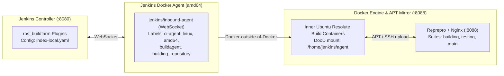

# Local ROS Buildfarm Replica Setup & Historical Execution Reference

Isolated reference for the **local ROS Buildfarm replica cluster** (`<local-jenkins-host>:8080` Jenkins Controller & `<local-apt-host>:8088` Reprepro/Nginx APT Mirror) used for rapid iteration prior to official verification on `https://build.test.ros2.org`.

---

## 1. Local Replica Architecture & Configuration Matrix

| Component | Parameter | Configuration Value |
|---|---|---|
| **Jenkins Controller** | Endpoint & Plugins | `http://<local-jenkins-host>:8080` (`git`, `github`, `matrix-project`, `xunit`, `parameterized-trigger`, `ansicolor`, `PrioritySorter`, `description-setter`, `dashboard-view`, `publish-over-ssh`, `ssh-agent`, `timestamper`, `build-timeout`, `groovy`, `groovy-postbuild`, `copyartifact`) |
| **Agent Node** | `ci-agent-amd64` | 4 executors, root `/home/jenkins/agent` (host-matched DooD path), labels `ci-agent amd64 linux buildagent building_repository` |
| **Local APT Mirror** | `reprepro` + Nginx | `http://<local-apt-host>:8088/ubuntu/{building,testing,main}` (`resolute` & `focal`), GPG key `http://<local-apt-host>:8088/ubuntu/ros-local-buildfarm.asc` |
| **Host Maintenance** | `/etc/cron.d/docker-cleanup` | Runs `/usr/local/bin/docker-cleanup.sh` every 6 hours (`0 */6 * * *`) pruning stopped containers and dangling images |

---

## 2. Local Cluster Operations Cheat Sheet

| Operation | Command |
|---|---|
| **Sync Config & Distro to Local Mirror** | `tar -cz -C submodules/ros_buildfarm_config --exclude='.git' . \| ssh root@<local-apt-host> 'tar -xz -C /var/repos/ros_buildfarm_config'` `tar -cz -C submodules/rep159-rosdistro --exclude='.git' . \| ssh root@<local-apt-host> 'tar -xz -C /var/repos/rep159-rosdistro'` |
| **Generate Release Jobs** | `.venv/bin/python3 submodules/ros_buildfarm/scripts/release/generate_release_jobs.py "http://<local-apt-host>:8088/ros_buildfarm_config/index-local.yaml" extendable default` |
| **Generate CI Jobs** | `.venv/bin/python3 submodules/ros_buildfarm/scripts/ci/generate_ci_jobs.py "http://<local-apt-host>:8088/ros_buildfarm_config/index-local.yaml" extendable nightly-release` |
| **Generate Cache Jobs** | `.venv/bin/python3 submodules/ros_buildfarm/scripts/misc/generate_rosdistro_cache_jobs.py "http://<local-apt-host>:8088/ros_buildfarm_config/index-local.yaml" cachebase` |
| **Trigger & Watch Job** | `.venv/bin/python3 tools/trigger_buildfarm_job.py --url http://<local-jenkins-host>:8080 --job <JOB_NAME> --watch` |

---

## 3. Historical Local Buildfarm Execution Log

| Job | Build # | Date | Tested Branch | Result | Execution Notes |
|:---|:---:|:---:|:---|:---:|:---|
| `Uci__nightly-release...` | #4 | 2026-10-16 | `rep159` | **SUCCESS** | Upstream baseline CI verification. |
| `Uci__source-branches...` | #1 | 2026-10-16 | `rep159` | **SUCCESS** | Bootstrap source build validation. |
| `Uci__release-branches...` | #1 | 2026-10-16 | `rep159` | **SUCCESS** | Release tag dependency walk validation. |
| `Sci__nightly-release...` | #1 | 2026-10-16 | `rep159` | **SUCCESS** | `source_rebuild` crosses distribution boundary and compiles all packages. |
| `Bci__nightly-release...` | #1 | 2026-10-16 | `rep159` | **SUCCESS** | `binary_import` with baseline underlay prefix. |
| `Bci__nightly-release...` | #2 | 2026-10-17 | `test/rep159-install-prefixes` `feature/rep159-install-rule` | **SUCCESS** | **FEAT-2 validated**: Dynamic underlay resolution via `ROS_BUILDFARM_PARENT_RESULT_SPACES`. |
| `Usrc_uR__upstream_{a,b,c}__ubuntu_resolute__source` | #10/#1/#1 | 2026-10-19 | `test/rep159-release-pipeline` | **SUCCESS** | Sourcedebs built, transferred via SSH, and ingested into `building`. |
| `Ubin_uR64__upstream_{a,b,c}__ubuntu_resolute_amd64__binary` | #4/#1/#2 | 2026-10-19 | `test/rep159-release-pipeline` | **SUCCESS** | Binary debs built and ingested into `building`. |
| `Urel_sync-packages-to-testing_resolute_amd64` | #4 | 2026-10-19 | `test/rep159-release-pipeline` | **SUCCESS** | `ros-upstream-upstream-{a,b,c}` published to `testing`. |
| `Bci__nightly-release_ubuntu_resolute_amd64` | #4 | 2026-10-19 | `test/rep159-release-pipeline` | **SUCCESS** | `downstream_bin_a` installed upstream binaries from `testing`, compiled, and passed tests 100% green. |
| `Usrc_uR__upstream_a__ubuntu_resolute__source` | #11 | 2026-10-19 | `feat/binary-naming-rule` | **SUCCESS** | **FEAT-3 sourcedeb**: Built and imported `vendor-upstream-upstream-a 0.1.0-1resolute` into `building`. |
| `Ubin_uR64__upstream_a__ubuntu_resolute_amd64__binary` | #7 | 2026-10-19 | `feat/binary-naming-rule` | **SUCCESS** | **FEAT-3 binarydeb**: Built `vendor-upstream-upstream-a_0.1.0-1resolute..._amd64.deb`, imported 100% green. |
| `Urel_sync-packages-to-testing_resolute_amd64` | #8 | 2026-10-19 | `test/rep159-release-pipeline` | **SUCCESS** | `vendor-upstream-upstream-a` promoted to `testing`. |
| `Bci__nightly-release_ubuntu_resolute_amd64` | #7 | 2026-10-19 | `feat/install-rule` | **SUCCESS** | Dynamic injection of `ROS_BUILDFARM_PARENT_RESULT_SPACES=/opt/vendor/upstream`. |
| `Eci__chained-import_ubuntu_resolute_amd64` | #3 | 2026-10-20 | `feat/stage3-chained-extensions` | **SUCCESS** | **Stage 3 Option A**: Multi-package build across all 5 source repos in colcon workspace. |
| `Esrc_uR__downstream_bin_a__ubuntu_resolute__source` | #1 | 2026-10-20 | `feat/stage3-binary-chained` | **SUCCESS** | **Stage 3 Option B Sourcedeb**: Built `ros-extendablebin-downstream-bin-a_0.2.0-1resolute.dsc`. |
| `Ebin_uR64__downstream_bin_a__ubuntu_resolute_amd64__binary` | #1 | 2026-10-20 | `feat/stage3-binary-chained` | **SUCCESS** | **Stage 3 Option B Binarydeb**: Built binary deb under `/opt/ros/extendablebin`. |
| `Erel_sync-packages-to-testing_resolute_amd64` | #9 | 2026-10-20 | `feat/stage3-binary-chained` | **SUCCESS** | Promoted `ros-extendablebin-downstream-bin-a` to `testing`. |
| `Eci__chained-import_ubuntu_resolute_amd64` | #13 | 2026-10-20 | `feat/stage3-binary-chained` | **SUCCESS** | **Stage 3 Option B (Chained Binary Import)**: Cascading `CMAKE_PREFIX_PATH` and multiarch `LD_LIBRARY_PATH`. |
| `Eci__mixed-chain_ubuntu_resolute_amd64` | #2 | 2026-10-21 | `feat/stage3-mixed` | **SUCCESS** | **Stage 3 Topology 2 (Hybrid Binary + Source)**: `downstream_bin_a` from APT; `upstream_c` in workspace (`--ignore-src`). |
| `Csrc_uR__ros_workspace__ubuntu_resolute__source` | #5 | 2026-10-28 | `debian/vendor-composable/resolute/ros_workspace` | **SUCCESS** | **Stage 4 / FEAT-7**: Built `vendor-composable-ros-workspace_1.0.4-1resolute.dsc` with prefix `/opt/ros/composable`. |
| `Cbin_uR64__ros_workspace__ubuntu_resolute_amd64__binary` | #3 | 2026-10-28 | `debian/vendor-composable/resolute/ros_workspace` | **SUCCESS** | **Stage 4 / FEAT-7**: Built `vendor-composable-ros-workspace_1.0.4-1resolute_amd64.deb` chaining `/opt/ros/upstream`. |
| `Csrc_uR__upstream_{a,b,c}__ubuntu_resolute__source` | #1 | 2026-10-28 | `debian/vendor-composable/resolute/upstream_{a,b,c}` | **SUCCESS** | Built sourcedebs `vendor-composable-upstream-{a,b,c}_0.1.0-1resolute.dsc`. |
| `Cbin_uR64__upstream_{a,b,c}__ubuntu_resolute_amd64__binary` | #2/#3 | 2026-10-28 | `debian/vendor-composable/resolute/upstream_{a,b,c}` | **SUCCESS** | Built and ingested `vendor-composable-upstream-{a,b,c}_0.1.0-1resolute_amd64.deb`. |
| `Crel_sync-packages-to-testing_resolute_amd64` | #5 | 2026-10-28 | `feat/composable-distro` | **SUCCESS** | Promoted `vendor-composable-ros-workspace` and `vendor-composable-upstream-{a,b,c}` to `testing`. |
| `Cci__nightly-release_ubuntu_resolute_amd64` | #3 | 2026-10-28 | `feat/composable-distro` | **SUCCESS** | **Stage 4 Root Distro Validated**: Compiled `upstream_{a,b,c}` sourcing `. /opt/ros/composable/setup.sh`. |
| `Csrc_uR__downstream_bin_a__ubuntu_resolute__source` | #2 | 2026-10-28 | `debian/vendor-composablebin/resolute/downstream_bin_a` | **SUCCESS** | Built `vendor-composablebin-downstream-bin-a_0.2.0-1resolute.dsc`. |
| `Cbin_uR64__downstream_bin_a__ubuntu_resolute_amd64__binary` | #1 | 2026-10-28 | `debian/vendor-composablebin/resolute/downstream_bin_a` | **SUCCESS** | Built binary deb under `/opt/ros/composablebin`. |
| `Crel_sync-packages-to-testing_resolute_amd64` | #6 | 2026-10-28 | `feat/composable-distro` | **SUCCESS** | Promoted `vendor-composablebin-downstream-bin-a` to `testing` (`Package (% vendor-composablebin-*)`). |
| `Cci__binary-import_ubuntu_resolute_amd64` | #4 | 2026-10-28 | `feat/composable-distro` | **SUCCESS** | **Stage 4 Composablebin Validated**: Sourced `. /opt/ros/composable/setup.sh` across build and test phases. |
| `cachebase_rosdistro-cache` | #7..#18 | 2026-10-28 | `feat/cache-lifecycle-test` `feat/cache-job-rep159` | **SUCCESS** | **Stage 5 / FEAT-8**: Built `cachebase-cache.yaml.gz` and validated manifest update detection (`0.1.0` $\to$ `0.1.1`). |
| `cachechild_rosdistro-cache` | #4..#18 | 2026-10-28 | `feat/cache-lifecycle-test` `feat/cache-job-rep159` | **SUCCESS** | **Stage 5 / FEAT-8**: Queried parent cache `cachebase-cache.yaml.gz`, stripped parent packages (`- REMOVE upstream_{a,b,c}`), and published `cachechild-cache.yaml.gz`. |
