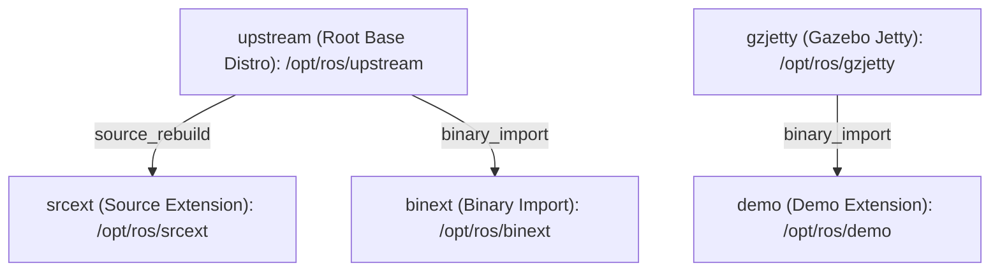
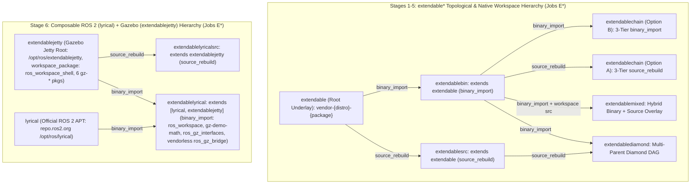

# REP-159 Testing Workspace

A unified meta-repository aggregating all repositories from the [`rep159-testing`](https://github.com/rep159-testing) GitHub organization as git submodules, serving as the complete reference implementation, CI harness, and topological validation environment for **[REP 159](https://github.com/openrobotics/reps/pull/32)** (*ROS Enhancement Proposal: rosdistro extension mechanism*).

---

## 1. Documentation Index & Quick Links

| Document | Purpose & Scope |
|---|---|
| **[ROLLOUT_PLAN.md](ROLLOUT_PLAN.md)** | **Stacked PR Rollout Plan & Collaborator Alignment**: Complete branch-by-branch rollout strategy separating production upstream PR commits from pre-release testfarm bootstrap overrides, and documenting the adoption of Jose Luis Rivero's (`jrivero`) implementations. |
| **[roadmap/README.md](roadmap/README.md)** | **Upstream Merge & Release Roadmap**: Master plan of upstream PRs, semantic branches, features, and release dependency graph across all 6 stages. |
| **[roadmap/stage1_binary_naming_and_format3.md](roadmap/stage1_binary_naming_and_format3.md)** | **Stage 1 Roadmap**: Format 3 `extends`, `binary_rule` regex engine, `rosdep` delegation, `reprepro-updater` `--package-prefix`, and `ros_buildfarm` release naming. |
| **[roadmap/stage2_install_rule_and_underlays.md](roadmap/stage2_install_rule_and_underlays.md)** | **Stage 2 Roadmap**: Custom installation prefixes (`install_rule`), recursive `get_binary_import_underlays()`, and `ReleaseAndSourceDependencyWalker` boundary pruning. |
| **[roadmap/stage3_topological_extensions.md](roadmap/stage3_topological_extensions.md)** | **Stage 3 Roadmap**: Multi-tier 3-tier `source_rebuild` & `binary_import`, Hybrid Mixed, and Multi-Parent Diamond DAGs with pure-CMake `workspace.py` env exports. |
| **[roadmap/stage4_composable_workspace.md](roadmap/stage4_composable_workspace.md)** | **Stage 4 Roadmap**: Native ROS 2 `ros_workspace` underlay chaining (`ROS_WORKSPACE_PARENT_PREFIX_PATH`), child `ros_workspace` override, and automated `bloom` Debian generation. |
| **[roadmap/stage5_cache_lifecycle_and_bloom_release.md](roadmap/stage5_cache_lifecycle_and_bloom_release.md)** | **Stage 5 Roadmap**: Distribution cache lifecycle (`extendable_rosdistro-cache`, `extendablebin_rosdistro-cache`), parent inheritance, and `- REMOVE` isolation. |
| **[roadmap/stage6_ros_gazebo_and_eol.md](roadmap/stage6_ros_gazebo_and_eol.md)** | **Stage 6 Roadmap**: Index v4 `distribution_eol_date`, `rosdistro-reviewer`, `workspace_package: ros_workspace_shell` (Gazebo Jetty), and Multi-Parent `[lyrical, extendablejetty]` + vendorless `ros_gz_bridge`. |
| **[EXECUTION_EXTENDABLE.md](EXECUTION_EXTENDABLE.md)** | **Master Execution & Operations Guide**: End-to-end instructions and empirical logs for launching CI, Source, and Release jobs on the official ROS 2 testfarm (`build.test.ros2.org` & `repo.test.ros2.org`) across all `extendable*` (`E*`) stages. |
| **[STAGE_PR_AND_ISSUE_MAP.md](STAGE_PR_AND_ISSUE_MAP.md)** | **Upstream Roadmap & Staged PR DAG**: Multi-stage dependency graph, upstream issue/PR tracking, and cross-tooling implementation milestones. |
| **[PR_TITLES_AND_DESCRIPTIONS.md](PR_TITLES_AND_DESCRIPTIONS.md)** | **Upstream Submission Manifests**: Ready-to-publish PR titles, descriptions, and commit manifests for upstream contributions (`reps`, `rosdistro`, `rosdistro-reviewer`, `reprepro-updater`, `rosdep`, `ros_workspace`, `ros_workspace_shell`, `bloom`, `ros_buildfarm`, `ros_gz`). |
| **[TOPOLOGICAL_TESTING_EVIDENCE_GIST.md](TOPOLOGICAL_TESTING_EVIDENCE_GIST.md)** | **Topological Testing & Validation Evidence**: Verification matrix, job status, package naming evidence, and build logs across all test topologies on `build.test.ros2.org` (mirrored to GitHub Gist [`86156fbcb44120995b92b74a67e39af9`](https://gist.github.com/KmoM88/86156fbcb44120995b92b74a67e39af9)). |
| **[FEATURE_BRANCH_REGISTRY.md](FEATURE_BRANCH_REGISTRY.md)** | **Submodule Git Branch Matrix**: Chronological tracking of semantic feature branches, clean upstream PR branches, and build records across all submodules. |

---

## 2. Overview & Unified `extendable*` (`E*`) Validation Architecture

REP-159 introduces a standardized specification allowing a ROS distribution to extend one or more parent distributions using two primary methods:
- **`source_rebuild`**: The downstream distribution rebuilds all required upstream dependencies from source in an isolated workspace.
- **`binary_import`**: The downstream distribution directly imports and consumes pre-built Debian/RPM binary packages released by parent distributions (installed under underlay prefixes such as `/opt/ros/<parent>` or `/opt/vendor/<parent>`), without rebuilding them.

To verify standalone CMake ecosystems, full ROS 2 `ament` distributions, and multi-parent ROS 2 + Gazebo stacks on `https://build.test.ros2.org` without stepping on collaborator test suites (`upstream` / `srcext` / `binext` / `gzjetty` / `demo` $\to$ `U*` / `S*` / `B*` / `G*` / `D*`, or `cargotest` $\to$ `C*`), all stages are unified under the **`extendable*` (`E*`)** distribution family:

### 1. Stages 1–3 (`extendable*`, Jenkins Prefix `E*`: Pure CMake & Topological Isolation)
- **Package Type**: Pure CMake packages (`<build_type>cmake</build_type>`: `upstream_a` $\to$ `upstream_b` $\to$ `upstream_c` $\to$ `downstream_bin_a` / `downstream_src_a` $\to$ `downstream_chain_a`).
- **Validated Invariants**:
  - **[Stage 1 (`binary_rule`)](roadmap/stage1_binary_naming_and_format3.md)**: Declarative regex binary renaming (`search: '^'`, `replace: 'vendor-{distro}-'`) across `rosdistro`, `rosdep`, `reprepro-updater` (`--package-prefix`), and `ros_buildfarm`.
  - **[Stage 2 (`install_rule` & Workspace Boundary Walk)](roadmap/stage2_install_rule_and_underlays.md)**: Custom installation prefixes (`/opt/vendor/{distro}`), recursive `get_binary_import_underlays()`, `ROS_BUILDFARM_PARENT_RESULT_SPACES` injection, and `ReleaseAndSourceDependencyWalker` halting source checkouts at `binary_import` boundaries.
  - **[Stage 3 (Multi-Tier & Convergent Topologies)](roadmap/stage3_topological_extensions.md)**: Pure CMake underlays lack `/opt/ros/<distro>/setup.sh`; `ros_buildfarm/workspace.py` automatically exports `CMAKE_PREFIX_PATH`, `COLCON_PREFIX_PATH`, `PATH`, and multiarch `LD_LIBRARY_PATH` across 3-tier source rebuild ($A \xrightarrow{\text{src}} B \xrightarrow{\text{src}} C$), 3-tier binary import ($A \xrightarrow{\text{bin}} B \xrightarrow{\text{bin}} C$), hybrid binary+source overlays, and multi-parent diamond DAGs.

### 2. Stages 4–5 (`extendable` & `extendablebin`, Jenkins Prefix `E*`: Native ROS 2 `ros_workspace`, `bloom` & Cache Lifecycle)
- **Package Type**: Native ROS 2 `ament_cmake` / `ros_workspace` stack (`ament_package`, `ament_cmake_core`, `ros_workspace`, plus application packages).
- **Validated Invariants**:
  - **[Stage 4 (`ros_workspace` & `bloom`)](roadmap/stage4_composable_workspace.md)**: Adopts Jose Luis Rivero's `BINARY_IMPORT_OVERRIDABLE = frozenset(['ros_workspace'])` (`aefe17c`, `a8f5543`), `ros_workspace` parent underlay chaining (`12f93e9` + `4997f85`), and `bloom` `ParentPrefixes` + `binary_rule` / `install_rule` (`7af7034`).
  - **[Stage 5 (`rosdistro_build_cache`)](roadmap/stage5_cache_lifecycle_and_bloom_release.md)**: `extendable_rosdistro-cache` (`#139`) and `extendablebin_rosdistro-cache` (`#138`) validate parent cache loading (`46a7580`) and strip inherited parent packages (`- REMOVE`) from child cache artifacts.

### 3. Stage 6 (`extendablejetty`, `extendablelyricalsrc` & `extendablelyrical`, Jenkins Prefix `E*`: `workspace_package: ros_workspace_shell` & Multi-Parent ROS 2 + Gazebo)
- **Package Type**: 6 plain-CMake Gazebo Jetty packages (`gz-cmake`, `gz-utils`, `gz-math`, `gz-tools2`, `gz-msgs`, `gz-transport`) + `ros_workspace_shell` (`0.1.0`) in root `extendablejetty`, extended by `extendablelyrical` (`extends: [lyrical, extendablejetty]`) building `ros_workspace` (`1.0.4`), `gz-demo-math` (`1.0.1`), `ros_gz_interfaces` (`3.0.12`), and vendorless `ros_gz_bridge` (`3.0.12`).
- **Validated Invariants**:
  - **[Stage 6 (`ros_workspace_shell`, `distribution_eol_date` & Multi-Parent `ros_gz_bridge`)](roadmap/stage6_ros_gazebo_and_eol.md)**: Validates Index v4 `distribution_eol_date` (`5ec62f9`, `3e6ab56`), plain-CMake `workspace_package: ros_workspace_shell` (`3670bd8`, `b6a8195`, `ec0bcca`, `e54594c`), `CMAKE_PREFIX_PATH` and `unset AMENT_CURRENT_PREFIX` isolation across multi-parent setups (`274640b`), and vendorless `ros_gz_bridge` (`08645e3`) consuming official ROS 2 `lyrical` packages from `repo.ros2.org` alongside Gazebo Jetty packages from `repo.test.ros2.org`.

---

## 3. Distribution Topologies on `build.test.ros2.org`

### A. Collaborator Foundational Suite (`upstream` / `srcext` / `binext` / `gzjetty` / `demo` — Jobs `U*`, `S*`, `B*`, `G*`, `D*` Untouched)


### B. Unified `extendable*` Suite (Stages 1–6 — Jobs `E*`)


---

## 4. Repository & Submodule Organization

| Repository | Clean Upstream PR Branch(es) (`@ SHA`) | Testbed / Collaborator Branch(es) | Description |
|---|---|---|---|
| [`reps`](https://github.com/KmoM88/reps) | [`openrobotics/reps#31`](https://github.com/openrobotics/reps/pull/31) (**MERGED**)<br>[`openrobotics/reps#35`](https://github.com/openrobotics/reps/pull/35) (**MERGED** `f683ccc`)<br>`feature/rep-159-install-rule` (`1aef980`)<br>`feature/rep-159-workspace-package` (`0905caa`) | N/A | Formal REP-159 specification (`openrobotics/reps:rosdistro_extension` feeding [`#32`](https://github.com/openrobotics/reps/pull/32)) for `extends`, `binary_rule`, `install_rule`, `workspace_package`, `distribution_eol_date`, and multi-tier DAGs. |
| [`rosdistro`](https://github.com/rep159-testing/rosdistro) | `feature/rep159-binary-naming-regex` (`bfde799`, [`#1`](https://github.com/rep159-testing/rosdistro/pull/1))<br>`feat/rep159-install-rule` (`a8f5543`)<br>`feat/rep159-eol-date` (`5ec62f9`)<br>`feat/rep159-workspace-package` (`3670bd8`, **106/106 tests**) | `rep159` (`46a7580`), `rep159-child-ros-workspace` (`78c7db8`), `rep159-shell` (`bc0600f`) | Format 3 distribution parsing, parent cache loading (`46a7580`), `binary_rule`, `install_rule`, `BINARY_IMPORT_OVERRIDABLE`, `distribution_eol_date` (`5ec62f9`), `workspace_package` (`5d4a392`), and hyphenated package lookup (`3670bd8`). |
| [`rosdistro-reviewer`](https://github.com/rep159-testing/rosdistro-reviewer) | `feat/rep159-eol-date` (`3e6ab56`, **200/200 tests**) | `feat/rep159-eol-date` (`3e6ab56`) | Validates optional ISO 8601 `YYYY-MM-DD` `distribution_eol_date` metadata in `index-v4.yaml`. |
| [`ros_workspace`](https://github.com/rep159-testing/ros_workspace) | `feat/rep159-parent-chaining` (`4997f85`) | `rep159-parent-chain` (`12f93e9`) | Built directly on Jose's `12f93e9` commit: multi-prefix `ament_package` discovery across `ROS_WORKSPACE_PARENT_PREFIX_PATH` and `parent_prefix_path` ament index registration. |
| [`ros_workspace_shell`](https://github.com/rep159-testing/ros_workspace_shell) | `feat/rep159-unset-current-prefix` (`b6a8195`) | `main` (`a89cc7b`, tag `0.1.0`) | Built on Jose's `a89cc7b` plain-CMake setup files without Ament; unsets `AMENT_CURRENT_PREFIX` after sourcing parent prefixes (`b6a8195`). |
| [`bloom`](https://github.com/rep159-testing/bloom) | `feat/rep159-rules-support` (`7af7034`, 26/26 tests)<br>`feat/rep159-workspace-package` (`ec0bcca`, **37/37 tests**) | `rep159` (`2877687`), `rep159-shell` (`2cb93dc`) | Stacked on Jose's `rep159` (`2877687`) & `rep159-shell` (`2cb93dc`): combines `ParentPrefixes`, `binary_rule`, `install_rule`, `workspace_package`, `get_distribution_file()` `extends` resolution, and `unset AMENT_CURRENT_PREFIX`. |
| [`ros_buildfarm`](https://github.com/rep159-testing/ros_buildfarm) | • **PR 3A**: `feat/rep159-workspace-walk` (`486b579`, 7/7)<br>• **PR 3B**: `feat/rep159-underlays` (`274640b`, 11/11)<br>• **PR 3C**: `feat/rep159-binary-naming` (`a271be1`, 6/6)<br>• **PR 3D**: `feat/rep159-workspace-package` (`e54594c`) | `feat/binary-naming-rule` (`797d771`), `feat/extendable-workspace` (`ca13954`), `feat/extendable-workspace-package` (`b242685`, **34/34 tests**) | Four clean PR branches off `origin/master` (`7daa2b1`, 0 Dockerfile pip hacks) adopting Jose's `ReleaseAndSourceDependencyWalker`, `get_binary_import_distros`, and `get_workspace_package` plus `install_rule`, `CMAKE_PREFIX_PATH` / `AMENT_CURRENT_PREFIX` multi-parent isolation, and `binary_rule` release/sync support. |
| [`rosdep`](https://github.com/rep159-testing/rosdep) | `feat/rep159-binary-lookup` (`5661779`, [`#2`](https://github.com/rep159-testing/rosdep/pull/2)) | `rep159` (`3d52dad`) | Delegates Debian/Ubuntu binary package name calculations directly to `rosdistro.get_binary_package_name()`. |
| [`reprepro-updater`](https://github.com/rep159-testing/reprepro-updater) | `feat/package-prefix` (`93ed2dc`) | `master` (`1e7aa5c` / upstream `refactor`) | APT repository management and prefix-filtered synchronization scripts (`--package-prefix`). |
| [`ros_gz`](https://github.com/rep159-testing/ros_gz) | `feat/rep159-vendorless-bridge` (`08645e3`, 3-file diff off `3.0.12`) | `feat/rep159-no-vendor` (`efec554`) | Builds `ros_gz_interfaces` and `ros_gz_bridge` directly against native Gazebo `gz-*` packages without `gz_*_vendor` wrapper packages. |
| [`rep159-rosdistro`](https://github.com/rep159-testing/rep159-rosdistro) & [`ros_buildfarm_config`](https://github.com/rep159-testing/ros_buildfarm_config) | `feat/extendable-binary-naming`, `feat/extendable-install-rule`, `feat/chained-extensions`, `feat/binary-chained`, `feat/mixed-extensions`, `feat/diamond-extensions`, `feat/extendable-workspace`, `feat/extendable-gazebo` (`f3891ce` / `5bdad6b`) | `main`, `rep159`, `rep159-setup-chain` | Distribution manifests and Jenkins job configs for `build.test.ros2.org` (`index-rep159.yaml`). |

---

## 5. Working with Submodules & Stage Automation

```bash
# Clone with all submodules
git clone --recurse-submodules git@github.com:KmoM88/rep159-testing.git

# List all REP-159 stages, submodule branches, and Jenkins job waves
./tools/stage_runner.py --list-stages

# Verify submodule branches or check live Jenkins status for any stage
./tools/stage_runner.py --stage stage6-gazebo-step2 --verify-branches
./tools/stage_runner.py --stage stage6-gazebo-step2 --status
```
