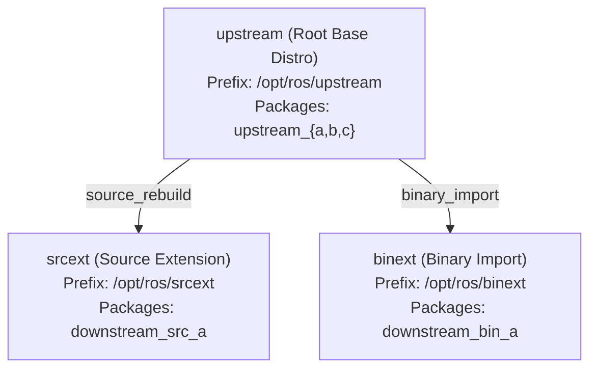
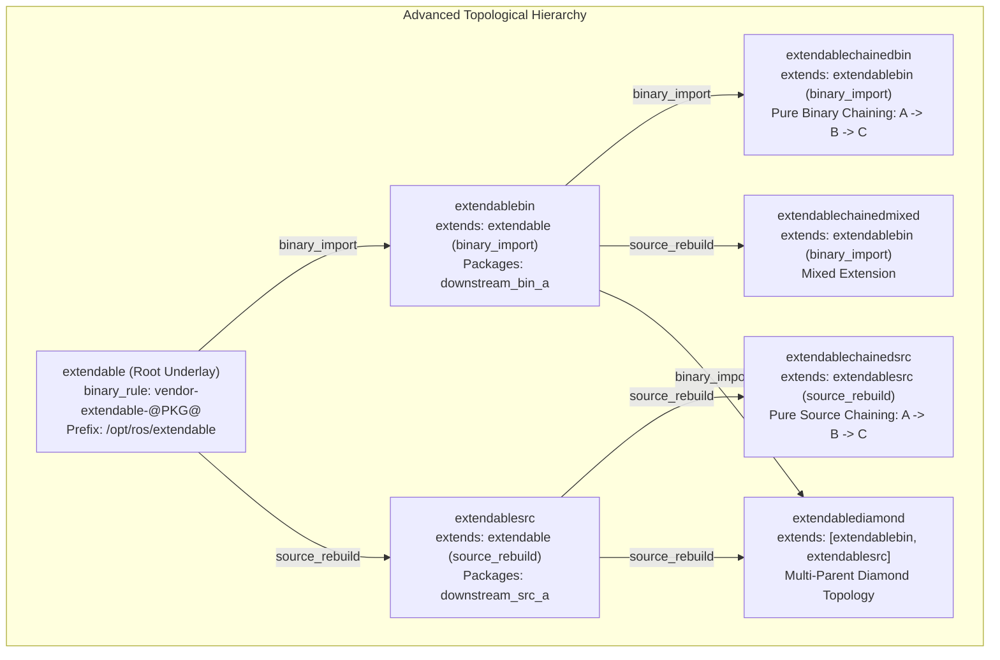

# REP-159 Testing Workspace

A unified meta-repository aggregating all repositories from the [`rep159-testing`](https://github.com/rep159-testing) GitHub organization as git submodules, serving as the complete reference implementation, CI harness, and topological validation environment for **[REP 159](https://github.com/openrobotics/reps/pull/32)** (*ROS Enhancement Proposal: rosdistro extension mechanism*).

---

## 1. Documentation Index & Quick Links

All documentation has been consolidated into specialized master guides:

| Document | Purpose & Scope |
|---|---|
| 🎯 **[roadmap/README.md](roadmap/README.md)** | **Upstream Merge & Release Roadmap**: Master plan of upstream PRs, branches, features, and release dependency graph across all 5 stages, distinguishing core implementation from testing tweaks. |
| 📖 **[EXECUTION_EXTENDABLE.md](EXECUTION_EXTENDABLE.md)** | **Master Execution & Operations Guide**: End-to-end instructions for launching CI, Source, and Release jobs on the local cluster (`192.168.30.206`) and remote testfarm (`build.test.ros2.org`). Includes detailed topological test procedures for binary chaining, mixed extension, and diamond graphs. |
| 🗺️ **[STAGE_PR_AND_ISSUE_MAP.md](STAGE_PR_AND_ISSUE_MAP.md)** | **Upstream Roadmap & Staged PR DAG**: Multi-stage dependency graph, upstream issue/PR tracking, and cross-tooling implementation milestones. |
| 🛠️ **[STAGE4_COMPOSABLE_WORKSPACE_PLAN.md](STAGE4_COMPOSABLE_WORKSPACE_PLAN.md)** | **Stage 4 Architecture & Execution Plan**: Technical roadmap for the `composable` distribution suite, testing `ros_workspace` underlay chaining, custom install prefixes, and dedicated `bloom` packaging fork. |
| 📦 **[STAGE5_CACHE_AND_BLOOM_PLAN.md](STAGE5_CACHE_AND_BLOOM_PLAN.md)** | **Stage 5 Architecture & Execution Plan**: Distribution cache lifecycle investigation (`rosdistro_build_cache`), parent inheritance/isolation, invalidation mechanics, and automated Bloom release generation. |
| 📝 **[PR_TITLES_AND_DESCRIPTIONS.md](PR_TITLES_AND_DESCRIPTIONS.md)** | **Upstream Submission Manifests**: Ready-to-publish PR titles, descriptions, and commit manifests for upstream contributions (`reps`, `rosdistro`, etc.). |
| 📊 **[TOPOLOGICAL_TESTING_EVIDENCE_GIST.md](TOPOLOGICAL_TESTING_EVIDENCE_GIST.md)** | **Topological Testing & Validation Evidence**: Verification matrix, job status, package naming evidence, and build logs across all 5 test topologies. |
| 🏗️ **[LOCAL_BUILDFARM_SETUP.md](LOCAL_BUILDFARM_SETUP.md)** | **Local Cluster Infrastructure Reference**: Architecture and setup of the local Jenkins master (`192.168.30.206`) and Reprepro repository server (`192.168.30.202`). |
| 🌿 **[FEATURE_BRANCH_REGISTRY.md](FEATURE_BRANCH_REGISTRY.md)** | **Submodule Git Branch Matrix**: Chronological tracking of feature branches, clean upstream PR branches, and build records across all submodules. |

---

## 2. Overview & Context

REP-159 introduces a standardized specification allowing a ROS distribution to extend one or more parent distributions using two primary methods:
- **`source_rebuild`**: The downstream distribution rebuilds all required upstream dependencies from source in an isolated workspace.
- **`binary_import`**: The downstream distribution directly imports and consumes pre-built Debian/RPM binary packages released by parent distributions (installed under underlay prefixes such as `/opt/ros/<parent>`), without rebuilding them.

The `rep159-testing` harness is self-contained and operates independently of official ROS releases, providing isolated testing for cache generation, dependency resolution, bloom releases, and buildfarm CI workflows.

> [!NOTE]
> **Packaging Scope**: Stages 1–3 validate topological configurations using **pure CMake packages** (`<build_type>cmake</build_type>`), where underlays without `setup.sh` are chained automatically via `ros_buildfarm` environment fallbacks (`CMAKE_PREFIX_PATH`, `LD_LIBRARY_PATH`, `PATH`). Stages 4 and 5 extend validation to full **`ros_workspace` (`setup.sh` / `.dsv`) underlay chaining**, **`rosdistro_build_cache` hierarchy isolation**, and **automated `bloom` Debian generation**.

---

## 3. Distribution Architecture & Topologies

The test harness defines two distribution suites within [`rep159-rosdistro`](https://github.com/rep159-testing/rep159-rosdistro):

### A. Foundational Suite (`upstream` / `srcext` / `binext`)


### B. Advanced Topological Suite (`extendable` Family)
Designed for testing multi-tier chaining, custom package renaming rules (`binary_rule`), custom prefix installation (`install_rule`), and diamond inheritance:



| Distribution | Extends | Extension Method | Key Packages | Role / Verification Target |
|---|---|---|---|---|
| **`extendable`** | *(None)* | *(Root distribution)* | `upstream_a`, `upstream_b`, `upstream_c` | Base underlay with custom package name templating (`vendor-extendable-*`). |
| **`extendablebin`** | `extendable` | `binary_import` | `downstream_bin_a` | Imports base binaries; packaged into APT for downstream chaining. |
| **`extendablesrc`** | `extendable` | `source_rebuild` | `downstream_src_a` | Rebuilds root chain from source in CI. |
| **`extendablechainedbin`** | `extendablebin` | `binary_import` | `downstream_chain_a` | Multi-tier binary chaining ($A \xrightarrow{\text{bin}} B \xrightarrow{\text{bin}} C$). |
| **`extendablechainedsrc`** | `extendablesrc` | `source_rebuild` | `downstream_chain_a` | Multi-tier source chaining ($A \xrightarrow{\text{src}} B \xrightarrow{\text{src}} C$). |
| **`extendablechainedmixed`** | `extendablebin` | `source_rebuild` | `downstream_chain_a` | Mixed extension ($A \xrightarrow{\text{bin}} B \xrightarrow{\text{src}} C$). |
| **`extendablediamond`** | `extendablebin`, `extendablesrc` | Hybrid | `downstream_chain_a` | Multi-parent diamond inheritance. |

### C. Composable Workspace Suite (`composable` Family — Stage 4)
Expands on the topological models above by integrating **`ros_workspace`** (prefix `/opt/ros/<distro>/setup.sh` and environment hooks), custom install prefixes (`install_rule`), and release generation via a dedicated **Bloom fork**:
- **Job Identifier**: Prefix **`C*`** (`Cci`, `Csrc`, `Cbin`, `Crel`) on Jenkins.
- **Underlay Chaining**: Native `setup.sh` environment inheritance without manual environment variable injection.
- **Tooling Support**: Parameterized Debian packaging via `rep159-testing/bloom`.
- Detailed roadmap: **[STAGE4_COMPOSABLE_WORKSPACE_PLAN.md](STAGE4_COMPOSABLE_WORKSPACE_PLAN.md)**.

---

## 4. Repository & Submodule Organization

The workspace aggregates 25 submodule repositories categorized into four functional groups:

### 1. Specification & Core Distribution Manifests
| Repository | Description |
|---|---|
| [`reps`](https://github.com/KmoM88/reps) | Formal REP-159 specification (`openrobotics/reps#32` & `#35`) and `binary_rule` / `install_rule` proposal documents. |
| [`rep159-rosdistro`](https://github.com/rep159-testing/rep159-rosdistro) | Central rosdistro index, distribution definitions, cache generation scripts, and validation test suites. |

### 2. Infrastructure & Tooling Forks
| Repository | Active Tracking Branch(es) | Description |
|---|---|---|
| [`rosdistro`](https://github.com/rep159-testing/rosdistro) | `feature/rep159-install-rule`<br>*(stacked on [`rosdistro#1`](https://github.com/rep159-testing/rosdistro/pull/1) / `rep159`)* | Format 3 distribution parsing, multi-index resolution, `binary_rule` regex evaluation, and `install_rule` prefix support. |
| [`ros_buildfarm`](https://github.com/rep159-testing/ros_buildfarm) | `feat/binary-naming-rule` + `rep159` + `feat/cache-job-rep159` | CI, Release, and Cache job orchestration supporting dynamic underlay sourcing, pure-CMake fallbacks, child release isolation, and templated package names. |
| [`rosdep`](https://github.com/rep159-testing/rosdep) | `rep159` | Package resolution delegating Debian binary names directly to `rosdistro.get_binary_package_name`. |
| [`ros_buildfarm_config`](https://github.com/rep159-testing/ros_buildfarm_config) | `feat/composable-distro`, `feat/cache-lifecycle-test`, `feat/stage3-diamond` | Cluster deployment configuration and job definitions for local and remote buildfarms. |
| [`reprepro-updater`](https://github.com/rep159-testing/reprepro-updater) | `feat/package-prefix`<br>*(base: `master` / upstream `refactor`)* | APT repository management and prefix-filtered synchronization scripts (`--package-prefix`). |
| [`bloom`](https://github.com/rep159-testing/bloom) | `feat/rep159-rules-support`<br>*(base: `rep159`)* | Release automation generating Debian packaging (`debian/rules`, `debian/control`) supporting `binary_rule`, `install_rule`, and chained underlays. |


### 3. Source Packages
| Repository | Build Type | Description |
|---|---|---|
| [`upstream_a`](https://github.com/rep159-testing/upstream_a) | CMake | Root package: XML parsing and element counting using `libxml2`. |
| [`upstream_b`](https://github.com/rep159-testing/upstream_b) | CMake | Mid package: Depends on `upstream_a` to summarize XML documents. |
| [`upstream_c`](https://github.com/rep159-testing/upstream_c) | CMake | Top package: Depends on `upstream_b` to label XML summaries. |
| [`downstream_src_a`](https://github.com/rep159-testing/downstream_src_a) | CMake | Downstream package: Consumes `upstream_c` via source rebuild. |
| [`downstream_bin_a`](https://github.com/rep159-testing/downstream_bin_a) | CMake | Downstream package: Consumes `upstream_c` via binary underlays. |
| [`downstream_chain_a`](https://github.com/rep159-testing/downstream_chain_a) | CMake | Leaf package: Consumes `downstream_bin_a` / `downstream_src_a` to test multi-tier chaining. |
| [`ament_package`](https://github.com/rep159-testing/ament_package) | Python | Standalone ament package manifest parser. |
| [`ament_cmake_core`](https://github.com/rep159-testing/ament_cmake_core) | CMake | Core macros for the ament buildsystem. |
| [`ros_workspace`](https://github.com/rep159-testing/ros_workspace) | CMake | Environment setup files for Stage 4 workspace integration. |

### 4. Bloom Release Repositories
Repositories storing bloom tracks, debian release tags, and packaging metadata used by release build jobs:
- `ament_package-release`, `ament_cmake_core-release`, `ros_workspace-release`
- `upstream_a-release`, `upstream_b-release`, `upstream_c-release`
- `downstream_src_a-release`, `downstream_bin_a-release`

---

## 5. Working with Submodules

### Cloning with All Submodules
```bash
git clone --recurse-submodules git@github.com:KmoM88/rep159-testing.git
```

### Initializing Submodules in an Existing Clone
```bash
git submodule update --init --recursive
```

### Updating All Submodules to Latest Remote Commits
```bash
git submodule update --remote --merge
```

---

## 6. Execution Quick Start

To run tests or launch buildfarm jobs, consult **[EXECUTION_EXTENDABLE.md](EXECUTION_EXTENDABLE.md)** for detailed procedures:
- **Local Validation**: Run local Docker test containers or manual `colcon` builds against underlays.
- **Cluster Deployment**: Deploy configuration to the local repository server (`192.168.30.202`) and generate jobs on Jenkins (`192.168.30.206`).
- **Remote Testfarm**: Execute CI and Release pipelines on `build.test.ros2.org`.
