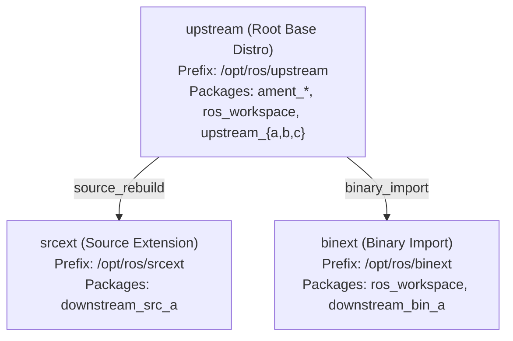

# REP-159 Testing Workspace

A unified meta-repository aggregating all repositories from the [`rep159-testing`](https://github.com/rep159-testing) GitHub organization as git submodules, serving as the complete reference implementation, CI harness, and topological validation environment for **[REP 159](https://github.com/openrobotics/reps/pull/32)** (*ROS Enhancement Proposal: rosdistro extension mechanism*).

---

## 1. Documentation Index & Quick Links

| Document | Purpose & Scope |
|---|---|
| **[ROLLOUT_PLAN.md](ROLLOUT_PLAN.md)** | **Stacked PR Rollout Plan & Collaborator Alignment**: Complete branch-by-branch rollout strategy separating production upstream PR commits from pre-release testfarm bootstrap overrides, and documenting the adoption of Jose Luis Rivero's (`jrivero`) implementations. |
| **[roadmap/README.md](roadmap/README.md)** | **Upstream Merge & Release Roadmap**: Master plan of upstream PRs, semantic branches, features, and release dependency graph across all stages. |
| **[EXECUTION_EXTENDABLE.md](EXECUTION_EXTENDABLE.md)** | **Master Execution & Operations Guide**: End-to-end instructions and empirical logs for launching CI, Source, and Release jobs on the official ROS 2 testfarm (`build.test.ros2.org` & `repo.test.ros2.org`) across all `extendable*` (`E*`) stages. |
| **[STAGE_PR_AND_ISSUE_MAP.md](STAGE_PR_AND_ISSUE_MAP.md)** | **Upstream Roadmap & Staged PR DAG**: Multi-stage dependency graph, upstream issue/PR tracking, and cross-tooling implementation milestones. |
| **[STAGE4_COMPOSABLE_WORKSPACE_PLAN.md](STAGE4_COMPOSABLE_WORKSPACE_PLAN.md)** | **Stage 4 Architecture & Execution Plan**: Technical roadmap for `extendable` & `extendablebin` (`E*`) native `ros_workspace` underlay chaining (`ROS_WORKSPACE_PARENT_PREFIX_PATH`), custom install prefixes, and automated `bloom` Debian generation. |
| **[STAGE5_CACHE_AND_BLOOM_PLAN.md](STAGE5_CACHE_AND_BLOOM_PLAN.md)** | **Stage 5 Architecture & Execution Plan**: Distribution cache lifecycle (`extendable_rosdistro-cache`, `extendablebin_rosdistro-cache`), parent inheritance/isolation (`- REMOVE`), and automated Bloom release generation on `build.test.ros2.org`. |
| **[STAGE6_ROS_GAZEBO_PLAN.md](STAGE6_ROS_GAZEBO_PLAN.md)** | **Stage 6 Architecture & Execution Plan**: Explains how Stages 1–3 (pure CMake), Stages 4–5 (full `ros_workspace`), and Stage 6+ (`workspace_package: ros_workspace_shell` adopted from Jose Luis Rivero) solve workspace setup and underlay chaining, and plans the ROS + Gazebo (`ros_gz_bridge` without vendor packages) and 3rd-party ROS extension demonstrations on `build.test.ros2.org`. |
| **[PR_TITLES_AND_DESCRIPTIONS.md](PR_TITLES_AND_DESCRIPTIONS.md)** | **Upstream Submission Manifests**: Ready-to-publish PR titles, descriptions, and commit manifests for upstream contributions (`reps`, `rosdistro`, `rosdep`, `ros_workspace`, `bloom`, `ros_buildfarm`). |
| **[TOPOLOGICAL_TESTING_EVIDENCE_GIST.md](TOPOLOGICAL_TESTING_EVIDENCE_GIST.md)** | **Topological Testing & Validation Evidence**: Verification matrix, job status, package naming evidence, and build logs across all test topologies on `build.test.ros2.org` (mirrored to GitHub Gist [`86156fbcb44120995b92b74a67e39af9`](https://gist.github.com/KmoM88/86156fbcb44120995b92b74a67e39af9)). |
| **[FEATURE_BRANCH_REGISTRY.md](FEATURE_BRANCH_REGISTRY.md)** | **Submodule Git Branch Matrix**: Chronological tracking of semantic feature branches, clean upstream PR branches, and build records across all submodules. |

---

## 2. Overview & Unified `extendable*` (`E*`) Validation Architecture

REP-159 introduces a standardized specification allowing a ROS distribution to extend one or more parent distributions using two primary methods:
- **`source_rebuild`**: The downstream distribution rebuilds all required upstream dependencies from source in an isolated workspace.
- **`binary_import`**: The downstream distribution directly imports and consumes pre-built Debian/RPM binary packages released by parent distributions (installed under underlay prefixes such as `/opt/ros/<parent>` or `/opt/vendor/<parent>`), without rebuilding them.

To verify both standalone CMake/vendor ecosystems and full ROS 2 `ament` distributions on `https://build.test.ros2.org` without stepping on collaborator test suites (`upstream` / `srcext` / `binext` $\to$ `U*` / `S*` / `B*`, or `cargotest` $\to$ `C*`), all stages are unified under the **`extendable*` (`E*`)** distribution family:

### 1. Stages 1–3 (`extendable*`, Jenkins Prefix `E*`: Pure CMake & Topological Isolation)
- **Package Type**: Pure CMake packages (`<build_type>cmake</build_type>`: `upstream_a` $\to$ `upstream_b` $\to$ `upstream_c` $\to$ `downstream_bin_a` / `downstream_src_a` $\to$ `downstream_chain_a`).
- **Validated Invariants**:
  - **Stage 1 (`binary_rule`)**: Declarative regex binary renaming (`search: '^'`, `replace: 'vendor-{distro}-'`) across `rosdistro`, `rosdep`, `reprepro-updater` (`--package-prefix`), and `ros_buildfarm`.
  - **Stage 2 (`install_rule` & Workspace Boundary Walk)**: Custom installation prefixes (`/opt/vendor/{distro}`), recursive `get_binary_import_underlays()`, `ROS_BUILDFARM_PARENT_RESULT_SPACES` injection, and `ReleaseAndSourceDependencyWalker` halting source checkouts at `binary_import` boundaries.
  - **Stage 3 (Multi-Tier & Convergent Topologies)**: Pure CMake underlays lack `/opt/ros/<distro>/setup.sh`; `ros_buildfarm/workspace.py` automatically exports `CMAKE_PREFIX_PATH`, `COLCON_PREFIX_PATH`, `PATH`, and multiarch `LD_LIBRARY_PATH` across 3-tier source rebuild ($A \xrightarrow{\text{src}} B \xrightarrow{\text{src}} C$), 3-tier binary import ($A \xrightarrow{\text{bin}} B \xrightarrow{\text{bin}} C$), hybrid binary+source overlays, and multi-parent diamond DAGs.

### 2. Stages 4–5 (`extendable` & `extendablebin`, Jenkins Prefix `E*`: Native ROS 2 `ros_workspace`, `bloom` & Cache Lifecycle)
- **Package Type**: Native ROS 2 `ament_cmake` / `ros_workspace` stack (`ament_package`, `ament_cmake_core`, `ros_workspace`, plus application packages).
- **Collaborative Implementation Adopted from Jose Luis Rivero (`jrivero`)**:
  - **`rosdistro` Child `ros_workspace` Override (`aefe17c`, `a8f5543`)**: Enforces `BINARY_IMPORT_OVERRIDABLE = frozenset(['ros_workspace'])` so a `binary_import` child distribution (`extendablebin`) is allowed and required to release its own `ros_workspace` Debian package while keeping all other inherited parent packages immutable for ABI safety.
  - **`ros_workspace` Parent Underlay Chaining (`12f93e9` + `4997f85`)**: Searches `${CMAKE_INSTALL_PREFIX};${ROS_WORKSPACE_PARENT_PREFIX_PATH}` for `ament_package` templates and registers parent underlay prefixes into the ament index (`parent_prefix_path`), so sourcing `/opt/ros/extendablebin/setup.sh` automatically chains `/opt/ros/extendable/local_setup.sh`.
  - **`bloom` Automated Debian Generation (`0189046`..`2877687` + `7af7034`)**: Combines `get_binary_import_parents()`, `ParentPrefixes` sourcing loops in `debian/rules`, `-DROS_WORKSPACE_PARENT_PREFIX_PATH`, `get_ros_workspace_dependencies()`, and `binary_rule` / `install_rule` evaluation in `debian/control` and `debian/rules`.
  - **`rosdistro_build_cache` Parent Merge & Isolation (`46a7580`)**: `extendable_rosdistro-cache` and `extendablebin_rosdistro-cache` validate parent cache loading and strip inherited parent packages (`- REMOVE`) from child cache artifacts.

---

## 3. Distribution Topologies on `build.test.ros2.org`

### A. Collaborator Foundational Suite (`upstream` / `srcext` / `binext` — Jobs `U*`, `S*`, `B*` Untouched)


### B. Unified `extendable*` Suite (Stages 1–5 — Jobs `E*`)
```mermaid
graph TD
    subgraph Suite [extendable* Topological & Native Workspace Hierarchy (Jobs E*)]
        E["extendable (Root Underlay)<br>binary_rule: vendor-{distro}-{package}<br>Prefix: /opt/ros/extendable or /opt/vendor/extendable<br>Packages: ament_package, ament_cmake_core, ros_workspace, upstream_{a,b,c}"]
        
        EB["extendablebin<br>extends: extendable (binary_import)<br>Packages: ros_workspace (override), downstream_bin_a"]
        ES["extendablesrc<br>extends: extendable (source_rebuild)<br>Packages: downstream_src_a"]
        
        ECB["extendablechain (Option B)<br>extends: extendablebin (binary_import)<br>Pure Binary Chaining: A -> B -> C"]
        ECS["extendablechain (Option A)<br>extends: extendablebin (source_rebuild)<br>Pure Source Chaining: A -> B -> C"]
        ECM["extendablemixed<br>extends: extendablebin (binary_import)<br>Hybrid Binary + Source Overlay"]
        
        ED["extendablediamond<br>extends: [extendablebin, extendablesrc]<br>Multi-Parent Diamond Topology"]

        E -->|binary_import| EB
        E -->|source_rebuild| ES
        
        EB -->|binary_import| ECB
        EB -->|source_rebuild| ECS
        EB -->|binary_import + workspace src| ECM
        
        EB -->|binary_import| ED
        ES -->|source_rebuild| ED
    end
```

| Distribution | Extends | Extension Method | Key Packages | Role / Verification Target |
|---|---|---|---|---|
| **`extendable`** | *(None)* | *(Root distribution)* | `ament_package`, `ament_cmake_core`, `ros_workspace`, `upstream_{a,b,c}` | Base underlay with regex binary naming (`vendor-extendable-*`), configurable `install_rule`, and root `ros_workspace`. |
| **`extendablebin`** | `extendable` | `binary_import` | `ros_workspace` (override), `downstream_bin_a` | Imports base binaries; validates child `ros_workspace` (`ROS_WORKSPACE_PARENT_PREFIX_PATH=/opt/ros/extendable`) and `bloom` `ParentPrefixes`. |
| **`extendablesrc`** | `extendable` | `source_rebuild` | `downstream_src_a` | Rebuilds root chain from source in CI. |
| **`extendablechain` (Option A)** | `extendablebin` | `source_rebuild` | `downstream_chain_a` | Multi-tier source chaining ($A \xrightarrow{\text{src}} B \xrightarrow{\text{src}} C$). |
| **`extendablechain` (Option B)** | `extendablebin` | `binary_import` | `downstream_chain_a` | Multi-tier binary chaining ($A \xrightarrow{\text{bin}} B \xrightarrow{\text{bin}} C$). |
| **`extendablemixed`** | `extendablebin` | `binary_import` | `downstream_chain_a` (+ `upstream_c` in workspace) | Hybrid extension ($A \xrightarrow{\text{bin}} B \xrightarrow{\text{src}} C$). |
| **`extendablediamond`** | `extendablebin`, `extendablesrc` | Hybrid (`binary_import` + `source_rebuild`) | `downstream_chain_a`, `downstream_src_a` | Multi-parent diamond inheritance and underlay deduplication. |

---

## 4. Repository & Submodule Organization

### 1. Specification & Core Distribution Manifests
| Repository | Active Semantic Branch(es) & Status | Description |
|---|---|---|
| [`reps`](https://github.com/KmoM88/reps) | [`openrobotics/reps#31`](https://github.com/openrobotics/reps/pull/31) (**MERGED**)<br>[`openrobotics/reps#35`](https://github.com/openrobotics/reps/pull/35) (**MERGED** `f683ccc`)<br>`feature/rep-159-install-rule` (`1aef980`, branch ready) | Formal REP-159 specification (`openrobotics/reps:rosdistro_extension` feeding [`#32`](https://github.com/openrobotics/reps/pull/32)) for `extends`, `binary_rule`, `install_rule`, `ros_workspace` override, and multi-tier DAGs. |
| [`rep159-rosdistro`](https://github.com/rep159-testing/rep159-rosdistro) | `feat/extendable-binary-naming` (`b2882ed`)<br>`feat/extendable-install-rule` (`6bc24b1`)<br>`feat/chained-extensions`, `feat/binary-chained`, `feat/mixed-extensions`, `feat/diamond-extensions`<br>`feat/extendable-workspace` (`ab0400c`) | Central rosdistro index, distribution definitions, and cache archives (strictly canonical lowercase `{distro}`, `{package}`, `{origin_distro}`). |

### 2. Infrastructure & Tooling Forks (Aligned with Jose Luis Rivero's `jrivero` Commits)
| Repository | Clean Upstream PR Branch(es) (`@ SHA`) | Testbed / Collaborator Branch(es) | Description |
|---|---|---|---|
| [`rosdistro`](https://github.com/rep159-testing/rosdistro) | `feature/rep159-binary-naming-regex` (`bfde799`, [`rosdistro#1`](https://github.com/rep159-testing/rosdistro/pull/1))<br>`feat/rep159-install-rule` (`a8f5543`, stacked) | `rep159` (`46a7580`), `rep159-child-ros-workspace` (`78c7db8`) | Format 3 distribution parsing, parent cache loading (`46a7580`), `BINARY_IMPORT_OVERRIDABLE = frozenset(['ros_workspace'])` (`aefe17c`, `a8f5543`), `binary_rule` regex engine, and `install_rule` prefix resolution. |
| [`ros_workspace`](https://github.com/rep159-testing/ros_workspace) | `feat/rep159-parent-chaining` (`4997f85`) | `rep159-parent-chain` (`12f93e9`) | Built directly on Jose's `12f93e9` commit: multi-prefix `ament_package` discovery across `ROS_WORKSPACE_PARENT_PREFIX_PATH`, `parent_prefix_path` ament index registration, and `PARENT_PREFIX_PATH` alias (`4997f85`). |
| [`bloom`](https://github.com/rep159-testing/bloom) | `feat/rep159-rules-support` (`7af7034`) | `rep159` (`2877687`) | Stacked directly on Jose's `rep159` (`0189046`..`2877687`): combines `get_binary_import_parents()`, `ParentPrefixes` in `debian/rules`, and `get_ros_workspace_dependencies()` with `binary_rule` and `install_rule` support. |
| [`ros_buildfarm`](https://github.com/rep159-testing/ros_buildfarm) | • **PR 3A**: `feat/rep159-workspace-walk` (`486b579`)<br>• **PR 3B**: `feat/rep159-underlays` (`a4a5bbd`)<br>• **PR 3C**: `feat/rep159-binary-naming` (`a271be1`) | `feat/binary-naming-rule` (`797d771`)<br>`feat/extendable-workspace` (`ca13954`)<br>`rep159` (`9736140`) | Three clean PR branches off `origin/master` (`7daa2b1`) with zero Dockerfile pip hacks, adopting Jose's `ReleaseAndSourceDependencyWalker` (`1334bf9`, `486b579`) and `get_binary_import_distros` (`83fd534`) plus `install_rule`, pure-CMake fallbacks, and `binary_rule` release/sync support. |
| [`rosdep`](https://github.com/rep159-testing/rosdep) | `feat/rep159-binary-lookup` (`5661779`) | `rep159` (`3d52dad`) | Delegates Debian/Ubuntu binary package name calculations directly to `rosdistro.get_binary_package_name()`. |
| [`reprepro-updater`](https://github.com/rep159-testing/reprepro-updater) | `feat/package-prefix` (`93ed2dc`) | `master` (`1e7aa5c` / upstream `refactor`) | APT repository management and prefix-filtered synchronization scripts (`--package-prefix`). |
| [`ros_buildfarm_config`](https://github.com/rep159-testing/ros_buildfarm_config) | `feat/extendable-*`, `feat/chained-extensions`, `feat/binary-chained`, `feat/mixed-extensions`, `feat/diamond-extensions` | `rep159` | Job definitions for `build.test.ros2.org` (`index-rep159.yaml`). |

### 3. Source Packages & Bloom Release Repositories
- **Source Packages**: `upstream_a`, `upstream_b`, `upstream_c`, `downstream_src_a`, `downstream_bin_a`, `downstream_chain_a`, `ament_package`, `ament_cmake_core`, `ros_workspace`.
- **Release Repositories (`*-release`)**: `ament_package-release`, `ament_cmake_core-release`, `ros_workspace-release`, `upstream_{a,b,c}-release`, `downstream_src_a-release`, `downstream_bin_a-release`.

---

## 5. Working with Submodules

```bash
# Clone with all submodules
git clone --recurse-submodules git@github.com:KmoM88/rep159-testing.git

# Initialize submodules in an existing clone
git submodule update --init --recursive

# Update all submodules to latest remote commits
git submodule update --remote --merge
```
