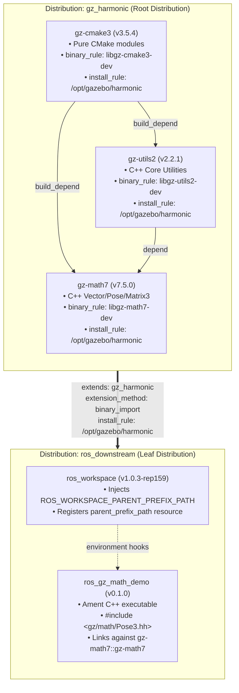
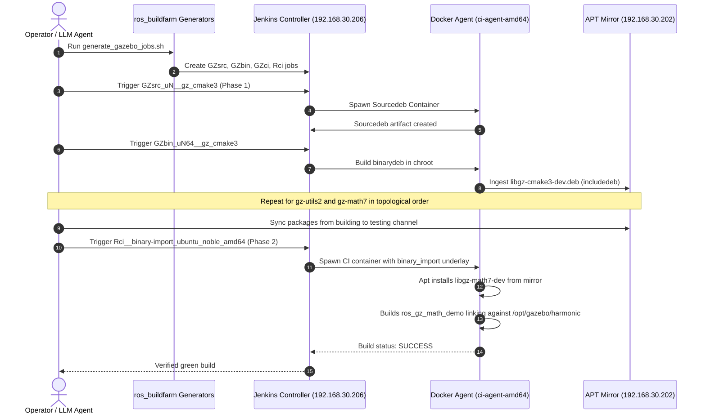

# Real-World Cross-Ecosystem Topology: Gazebo Harmonic + ROS 2

## 1. Executive Summary & Problem Statement

This document details the configuration, deployment, and validation pipeline for testing **[REP-159](https://github.com/openrobotics/reps/pull/32)** using **real-world packages** from the **Gazebo** and **ROS 2** ecosystems. 

### Why Real Packages?
Previous testing stages (Stages 1 through 5) successfully validated all topological properties using synthetic test packages (`upstream_{a,b,c}`, `downstream_bin_a`, `downstream_chain_a`). While synthetic packages prove graph correctness and boundary walk integrity, real-world deployment requires validating:
1. **Real-world CMake & C++ Build Systems**: Complex multi-library dependencies with nested CMake exports, pkg-config files, and template instantiations.
2. **Cross-Ecosystem Binary Naming**: Gazebo libraries using native Debian naming (`libgz-cmake3-dev`, `libgz-utils2-dev`, `libgz-math7-dev`) installed to `/opt/gazebo/harmonic` alongside ROS packages (`ros-jazzy-*`) in `/opt/ros/jazzy`.
3. **Underlay Chaining with `ros_workspace`**: A downstream ROS 2 C++ application linking dynamically against Gazebo Harmonic shared libraries (`libgz-math7.so`, `libgz-utils2.so`) via parent underlays resolved at build and runtime.

> [!NOTE]
> **Operator / LLM Execution Context**:
> When running from an environment without direct network routing to the local Jenkins cluster (`192.168.30.206:8080`) or local APT mirror (`192.168.30.202:8088`), use the local Docker test harness (`tests/real_world_gazebo/run_docker_test.sh`).
> When running from an environment with direct cluster access, follow the turnkey instructions in **Section 4** to execute the pipeline on the Jenkins cluster.

---

## 2. Architecture & Topology Specification



### 2.1 Distribution Definitions
- **Gazebo Distribution (`gz_harmonic`)**:
  - `install_rule`: `/opt/gazebo/harmonic`
  - `binary_rule`:
    ```yaml
    search: '^(.*)$'
    replace: 'lib{package}-dev'
    ```
  - Packages: `gz-cmake3`, `gz-utils2`, `gz-math7`
  - Native release tags: Official upstream Gazebo Git tags.
- **Downstream ROS Distribution (`ros_downstream`)**:
  - `extends`:
    ```yaml
    - distro_name: gz_harmonic
      extension_method: binary_import
      install_rule: /opt/gazebo/harmonic
    ```
  - `install_rule`: `/opt/ros/{distro}`
  - `binary_rule`:
    ```yaml
    search: '^'
    replace: 'ros-{distro}-'
    ```
  - Packages: `ros_workspace`, `ros_gz_math_demo`

---

## 3. Local Docker Test Harness (Offline / Standalone)

For quick, hermetic verification without Jenkins, a standalone Docker test harness is provided in `tests/real_world_gazebo/`.

### 3.1 Components
- `tests/real_world_gazebo/Dockerfile`: Clean `ubuntu:noble` container.
- `tests/real_world_gazebo/packages/ros_gz_math_demo`: Real C++ ROS 2 package utilizing `gz::math::Vector3d`, `gz::math::Pose3d`, and `gz::math::Quaterniond`.
- `tests/real_world_gazebo/entrypoint.sh`: Automated pipeline compiling Gazebo core, installing `ros_workspace` with parent chaining, compiling `ros_gz_math_demo`, and executing the binary.
- `tests/real_world_gazebo/validate_metadata.py`: Unit test verifying Format 3 schema parsing and reverse lookup.

### 3.2 Running the Standalone Test
```bash
# 1. Run the metadata verification
.venv/bin/python tests/real_world_gazebo/validate_metadata.py

# 2. Run the full Docker compilation and execution test
./tests/real_world_gazebo/run_docker_test.sh
```

---

## 4. Local Buildfarm Execution Guide (For Jenkins Operators & Autonomous LLMs)

When executing in an environment that has network access to the Jenkins master (`192.168.30.206:8080`) and APT mirror (`192.168.30.202:8088`), follow these exact instructions.



### 4.1 Pre-Flight Environment Setup
```bash
# 1. Activate target farm environment variables
source scripts/switch_target_farm.sh local

# 2. Verify Jenkins controller reachability
curl -s -o /dev/null -w "%{http_code}\n" "${JENKINS_URL}/api/json"
# Expected response: 200 or 403 (Forbidden if unauthenticated, confirms route is open)

# 3. Verify APT mirror reachability
curl -s -o /dev/null -w "%{http_code}\n" "${APT_REPO_URL}"
# Expected response: 200 or 301
```

### 4.2 Job Generation on Jenkins
Generate the release and CI jobs using the configuration index `buildfarm/real_world_gazebo/index-local-gazebo.yaml`:

```bash
# Generate Gazebo Harmonic release jobs (Sourcedeb & Binarydeb)
.venv/bin/python -m ros_buildfarm.scripts.release.generate_release_jobs \
    "file://$(pwd)/buildfarm/real_world_gazebo/index-local-gazebo.yaml" \
    gz_harmonic \
    default

# Generate Gazebo Harmonic CI job
.venv/bin/python -m ros_buildfarm.scripts.ci.generate_ci_jobs \
    "file://$(pwd)/buildfarm/real_world_gazebo/index-local-gazebo.yaml" \
    gz_harmonic

# Generate Downstream ROS 2 CI job (binary_import extending Gazebo)
.venv/bin/python -m ros_buildfarm.scripts.ci.generate_ci_jobs \
    "file://$(pwd)/buildfarm/real_world_gazebo/index-local-gazebo.yaml" \
    ros_downstream
```

### 4.3 Pipeline Execution Sequence (Order of Operations)

Because `gz-utils2` depends on `gz-cmake3`, and `gz-math7` depends on both, builds must be triggered in topological order:

#### Step 1: Release `gz-cmake3`
```bash
# Trigger Sourcedeb build
.venv/bin/python buildfarm/real_world_gazebo/trigger_gazebo_jobs.py \
    --job GZsrc_uN__gz_cmake3__ubuntu_noble__source --watch

# Trigger Binarydeb build
.venv/bin/python buildfarm/real_world_gazebo/trigger_gazebo_jobs.py \
    --job GZbin_uN64__gz_cmake3__ubuntu_noble_amd64__binary --watch
```

#### Step 2: Release `gz-utils2`
```bash
# Trigger Sourcedeb build
.venv/bin/python buildfarm/real_world_gazebo/trigger_gazebo_jobs.py \
    --job GZsrc_uN__gz_utils2__ubuntu_noble__source --watch

# Trigger Binarydeb build
.venv/bin/python buildfarm/real_world_gazebo/trigger_gazebo_jobs.py \
    --job GZbin_uN64__gz_utils2__ubuntu_noble_amd64__binary --watch
```

#### Step 3: Release `gz-math7`
```bash
# Trigger Sourcedeb build
.venv/bin/python buildfarm/real_world_gazebo/trigger_gazebo_jobs.py \
    --job GZsrc_uN__gz_math7__ubuntu_noble__source --watch

# Trigger Binarydeb build
.venv/bin/python buildfarm/real_world_gazebo/trigger_gazebo_jobs.py \
    --job GZbin_uN64__gz_math7__ubuntu_noble_amd64__binary --watch
```

#### Step 4: Sync Mirror from `building` to `testing`
Ensure all built packages (`libgz-cmake3-dev`, `libgz-utils2-dev`, `libgz-math7-dev`) are available in the testing channel:
```bash
ssh buildfarm@192.168.30.202 "reprepro -b /root/config/apt-repo/ubuntu/testing copysrc noble noble libgz-cmake3-dev libgz-utils2-dev libgz-math7-dev"
```

#### Step 5: Execute Downstream CI Job (`Rci`)
```bash
.venv/bin/python buildfarm/real_world_gazebo/trigger_gazebo_jobs.py \
    --job Rci__binary-import_ubuntu_noble_amd64 --watch
```

---

## 5. Verification Checklist & Success Criteria

An LLM or developer inspecting the build must verify the following log outputs:

| Verification Stage | Expected Log Pattern | Significance |
|---|---|---|
| **Binary deb naming** | `dpkg-deb: building package 'libgz-math7-dev' in '../libgz-math7-dev_7.5.0-1noble_amd64.deb'` | Validates `binary_rule` override in `release_build` |
| **Install prefix** | `-- Installing: /opt/gazebo/harmonic/lib/libgz-math7.so` | Validates `install_rule` applied during `debian/rules` install |
| **Underlay injection in CI** | `Invoking 'colcon build' with ... CMAKE_PREFIX_PATH=/opt/gazebo/harmonic` | Confirms `binary_import` underlay propagation |
| **Ament index parent discovery** | `cat .../parent_prefix_path/ros_workspace` outputs `/opt/gazebo/harmonic` | Validates `ros_workspace` underlay chaining |
| **C++ demo node execution** | `[SUCCESS] Gazebo Harmonic core libraries successfully linked!` | Proves full runtime dynamic linker resolution |

---

## 6. Future Fork Strategy for `rep159-testing` GitHub Organization

When transitioning this test from local files to permanent GitHub repositories:
1. **Fork Repositories**:
   - `https://github.com/gazebosim/gz-cmake` $\to$ `https://github.com/rep159-testing/gz-cmake`
   - `https://github.com/gazebosim/gz-utils` $\to$ `https://github.com/rep159-testing/gz-utils`
   - `https://github.com/gazebosim/gz-math` $\to$ `https://github.com/rep159-testing/gz-math`
   - `packages/ros_gz_math_demo` $\to$ `https://github.com/rep159-testing/ros_gz_math_demo`
2. **Release Repositories**:
   - Run `bloom-release --rosdistro gz_harmonic` for each package targeting `https://github.com/rep159-testing/gz-*-release.git`.
3. **Index Update**:
   - Merge `distribution_gz_harmonic.yaml` into `rep159-testing/rep159-rosdistro` index.
