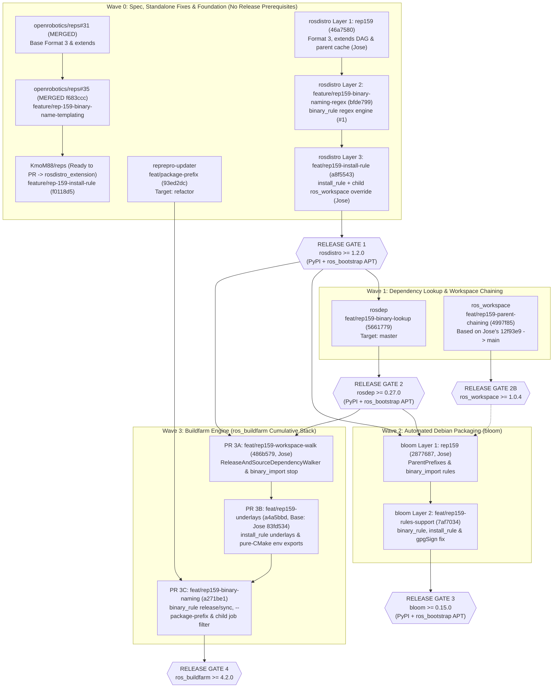

# REP-159 Feature Rollout Plan: Stacked PRs, Branch Matrix, Adoption of Jose's Work & Testfarm Hack Separation

This document defines the rollout strategy for upstreaming **[REP 159](https://github.com/openrobotics/reps/pull/32)** across Open Robotics repositories. It establishes:
1. How **stacked (cumulative) PR branches** are organized per repository.
2. How **Jose Luis Rivero's (`jrivero@honurobotics.com`) foundational `rep159*` commits and APIs** are directly adopted and preserved across all clean PR branches without modifying or stepping on any of his branches (`rep159*`, `kmom88`), test distributions (`upstream`, `srcext`, `binext`), or Jenkins jobs (`U*`, `S*`, `B*`).
3. The strict separation between **clean upstream implementation branches** and **testfarm harness branches** (which include temporary pre-release overrides to run on `build.test.ros2.org` before upstream packages are published to PyPI and `ros_bootstrap` APT).
4. Canonical lowercase placeholder standardization (`{distro}`, `{package}`, `{origin_distro}`) with **zero uppercase duplicate variables**.
5. The **Release-Gated Rollout Sequence** (Waves 0–4).

---

## 1. High-Level Rollout & Stacked PR Graph

---

## 2. Adoption & Alignment with Jose Luis Rivero's (`jrivero`) Implementations

Every clean PR branch and testfarm branch has been aligned to **adopt Jose Luis Rivero's (`jrivero@honurobotics.com`) commits, function signatures, and design patterns directly**, preserving his exact Git authorship (`Author: Jose Luis Rivero <jrivero@honurobotics.com>`) while keeping his branches (`rep159*`, `kmom88`), test distributions (`upstream`, `srcext`, `binext`), and Jenkins jobs (`U*`, `S*`, `B*`) 100% untouched:

| Repository | Jose Luis Rivero's Branch & Original Commits (Untouched) | How Our Stack Adopts & Extends Jose's Work | Coexistence & Non-Interference Guarantee |
|---|---|---|---|
| **`rosdistro`** | • `origin/rep159` (`46a7580`): *"Load parent caches from extends[].index_url and fail if one cannot load"* • `origin/rep159-child-ros-workspace` (`4a89ac4`, `78c7db8`): *"Let a binary_import child release its own ros_workspace"* (`BINARY_IMPORT_OVERRIDABLE = frozenset(['ros_workspace'])`) & *"Require the child's own release of ros_workspace under binary_import"* | • `feature/rep159-binary-naming-regex` (`bfde799`) is stacked directly on `origin/rep159` (`46a7580`). • `feat/rep159-install-rule` (`a8f5543`) cherry-picks both `4a89ac4` (`aefe17c`) and `78c7db8` (`a8f5543`) with Jose's original authorship, combining parent cache loading, `BINARY_IMPORT_OVERRIDABLE`, `binary_rule`, and `install_rule` in one unified stack (96/96 tests passing). | `origin/rep159` (`46a7580`) and `origin/rep159-child-ros-workspace` (`78c7db8`) remain untouched. |
| **`ros_workspace`** | • `origin/rep159-parent-chain` (`12f93e9`, tagged `1.0.4`): *"Chain the binary_import parent distributions (REP 159)"* — searches `${CMAKE_INSTALL_PREFIX};${ROS_WORKSPACE_PARENT_PREFIX_PATH}` for `ament_package` and sets `ENV{AMENT_PREFIX_PATH}` + `SKIP_PARENT_PREFIX_PATH=""` when `ROS_WORKSPACE_PARENT_PREFIX_PATH` is set. | • [`feat/rep159-parent-chaining`](https://github.com/rep159-testing/ros_workspace/tree/feat/rep159-parent-chaining) (`4997f85`) is branched **directly on top of Jose's `12f93e9` commit**, adding only a 5-line `PARENT_PREFIX_PATH` CMake variable alias (`4997f85`) so both `-DROS_WORKSPACE_PARENT_PREFIX_PATH` (Jose's `bloom` contract) and `-DPARENT_PREFIX_PATH` work seamlessly. | `origin/rep159-parent-chain` (`12f93e9`) and tag `1.0.4` remain untouched. |
| **`bloom`** | • `origin/rep159` (`0189046`, `29a329c`, `db66bf6`, `2877687`):   - `0189046`: `get_binary_import_parents()` & `get_ros_workspace_dependencies()`   - `29a329c`: `ParentPrefixes` substitution in `rosdebian.py`   - `db66bf6`: ROS 2 parent walk & unit tests   - `2877687`: `debian/rules.em` sourcing of `ParentPrefixes` and `-DROS_WORKSPACE_PARENT_PREFIX_PATH` | • [`feat/rep159-rules-support`](https://github.com/rep159-testing/bloom/tree/feat/rep159-rules-support) (`7af7034`) is stacked **directly on top of Jose's `origin/rep159` (`2877687`)**, preserving all 4 of Jose's commits intact and extending `ParentPrefixes` and `InstallationPrefix` to query `get_install_prefix()` (`install_rule`) and `get_binary_package_name()` (`binary_rule`). | `origin/rep159` (`2877687`) remains untouched. |
| **`ros_buildfarm`** | • `origin/rep159` (`9736140`):   - `52b51d8`: *"Walk source-only packages when a CI job selects package_names"*   - `9807b32`: *"Source the binary_import parents of a distribution as underlays"* (`BINARY_IMPORT_DISTROS_ENV`, `get_binary_import_distros(dist_file)`, `get_default_parent_result_spaces()`)   - `9736140`: *"REP 159: the CI dependency walk stops at binary_import parents"* | • **PR 3A (`feat/rep159-workspace-walk` @ `486b579`)**: Direct cherry-pick of Jose's `52b51d8` (`1334bf9`) and `9736140` (`486b579`) onto `origin/master` (`7daa2b1`) with Jose's authorship. • **PR 3B (`feat/rep159-underlays` @ `a4a5bbd`)**: Starts directly with a cherry-pick of Jose's `9807b32` (`83fd534`, preserving `Author: Jose Luis Rivero <jrivero@honurobotics.com>`, `BINARY_IMPORT_DISTROS_ENV`, `get_binary_import_distros()`, and all 4 of Jose's unit tests in `test/test_rep159_underlay.py`), then layers `get_distribution_install_prefix()`, recursive `get_binary_import_underlays()`, and pure-CMake `workspace.py` environment exports on top. • **Testfarm branch (`feat/binary-naming-rule` @ `797d771`)**: Includes all 3 of Jose's functional commits (`52b51d8`, `9807b32`, `9736140`) plus `install_rule` and `binary_rule`. | `origin/rep159` (`9736140`) and `origin/kmom88` (`9244aec`) remain untouched. |
| **`rep159-rosdistro` & `ros_buildfarm_config`** | • `origin/main` / `origin/rep159-setup-chain` in `rep159-rosdistro` and `origin/rep159` in `ros_buildfarm_config` define the `upstream`, `srcext`, and `binext` distributions (`U*`, `S*`, `B*` Jenkins jobs). | • All Stage 1–5 topological tests use isolated distributions (`extendable*` -> `E*` Jenkins jobs; `composable*` -> `C*` Jenkins jobs; `cachebase`/`cachechild`) on dedicated `feat/*` branches. | `upstream`, `srcext`, `binext` and Jenkins views `U*`, `S*`, `B*` are never modified or overwritten. |

---

## 3. Clean Upstream PR Branches vs. Testfarm Harness Branches

To validate the entire stack end-to-end on `https://build.test.ros2.org` *before* `rosdistro >= 1.2.0` and `rosdep >= 0.27.0` exist in Ubuntu/OSRF APT repositories, the testfarm uses dedicated harness branches in `rosdep` and `ros_buildfarm` that inject pre-release tarballs into Docker containers. Every feature has a corresponding **100% clean upstream branch** with zero testfarm hacks and strictly canonical lowercase placeholders (`{distro}`, `{package}`, `{origin_distro}`):

| Repository | Clean Upstream PR Branch(es) (0 Hacks) | Testfarm Harness Branch (`build.test.ros2.org`) | What Is Included in Clean Branch | Testfarm Hacks Excluded from Clean Branch |
|---|---|---|---|---|
| **`openrobotics/reps`** | 1. [`openrobotics/reps#31`](https://github.com/openrobotics/reps/pull/31) (**MERGED** into `rosdistro_extension`) 2. [`openrobotics/reps#35`](https://github.com/openrobotics/reps/pull/35) (**MERGED** `f683ccc` into `rosdistro_extension` from `KmoM88:feature/rep-159-binary-name-templating`) 3. [`KmoM88:feature/rep-159-install-rule`](https://github.com/KmoM88/reps/tree/feature/rep-159-install-rule) (`f0118d5` — **Ready to open PR** against `openrobotics:rosdistro_extension`) | N/A (Spec) | Format 3 `extends`, `binary_rule` (`{distro}`, `{package}`, `{origin_distro}`), and `install_rule` specification | **None** |
| **`rosdistro`** | **Stacked Chain off `master` (`960790d`)**: 1. [`rep159`](https://github.com/rep159-testing/rosdistro/tree/rep159) (`46a7580`) 2. [`feature/rep159-binary-naming-regex`](https://github.com/rep159-testing/rosdistro/tree/feature/rep159-binary-naming-regex) (`bfde799`, [`#1`](https://github.com/rep159-testing/rosdistro/pull/1)) 3. [`feat/rep159-install-rule`](https://github.com/rep159-testing/rosdistro/tree/feat/rep159-install-rule) (`a8f5543`) | [`feat/rep159-install-rule`](https://github.com/rep159-testing/rosdistro/tree/feat/rep159-install-rule) / [`feature/rep159-install-rule`](https://github.com/rep159-testing/rosdistro/tree/feature/rep159-install-rule) (both at `a8f5543`) | Format 3 parser, `extends` DAG, parent cache merging (`46a7580`), `BINARY_IMPORT_OVERRIDABLE` (`ros_workspace` child release `aefe17c`, `a8f5543`), `binary_rule` & `install_rule` with canonical lowercase `{distro}`, `{package}`, `{origin_distro}` only | **None** (Clean branch is identical to testfarm branch; all uppercase `{DISTRO}` duplicates removed) |
| **`reprepro-updater`** | [`feat/package-prefix`](https://github.com/rep159-testing/reprepro-updater/tree/feat/package-prefix) (`93ed2dc`) *(Targets upstream `refactor` @ `1e7aa5c`)* | [`feat/package-prefix`](https://github.com/rep159-testing/reprepro-updater/tree/feat/package-prefix) (`93ed2dc`) | `-p / --package-prefix` CLI option for `FilterFormula: Package (% <prefix>*)`, `_clear_ros_distro()`, and `run_cleanup()` | **None** (Clean branch is identical to testfarm branch; zero fork dependencies) |
| **`rosdep`** | [`feat/rep159-binary-lookup`](https://github.com/rep159-testing/rosdep/tree/feat/rep159-binary-lookup) (`5661779`) *(Branched directly off `master` @ `2685b28`)* | [`rep159`](https://github.com/rep159-testing/rosdep/tree/rep159) (`3d52dad`) | `gbpdistro_support.py` delegation to `get_binary_package_name(pkg)` with `binary_import` fallback + Format 3 unit tests (`test_rosdep_gbpdistro_support.py`) | Hardcoded `rosdistro @ git+https://github.com/KmoM88/rosdistro.git@...` in `setup.py` and custom `ROSDEP_LOCAL_DEV` workflow in `.github/workflows/ci.yaml` |
| **`ros_workspace`** | [`feat/rep159-parent-chaining`](https://github.com/rep159-testing/ros_workspace/tree/feat/rep159-parent-chaining) (`4997f85`) *(Based directly on Jose's `12f93e9` off `main` @ `db49f0a`)* | [`feat/rep159-parent-chaining`](https://github.com/rep159-testing/ros_workspace/tree/feat/rep159-parent-chaining) (`4997f85`) | Jose's `12f93e9` (`ROS_WORKSPACE_PARENT_PREFIX_PATH` parent `ament_package` discovery and `parent_prefix_path` chaining) + `PARENT_PREFIX_PATH` CMake variable alias (`4997f85`) | **None** (Pure CMake implementation; zero hacks) |
| **`bloom`** | **Stacked Chain off `master` (`0179b91`)**: 1. [`rep159`](https://github.com/rep159-testing/bloom/tree/rep159) (`2877687`, Jose) 2. [`feat/rep159-rules-support`](https://github.com/rep159-testing/bloom/tree/feat/rep159-rules-support) (`7af7034`) | [`feat/rep159-rules-support`](https://github.com/rep159-testing/bloom/tree/feat/rep159-rules-support) (`7af7034`) | Jose's `ParentPrefixes` recursive `binary_import` resolution in `debian/rules` (`0189046`..`2877687`), `get_binary_package_name()`, `get_install_prefix()` (with regex `dict` delegation fix & lowercase `{distro}` only), `git tag -f -m` GPG sign fix (`d6fdf9e`), and 26 unit tests | **None** (Zero fork URLs or CI hacks in repository) |
| **`ros_buildfarm`** | **Modular PR Branches off `master` (`7daa2b1`)**: • **PR 3A**: [`feat/rep159-workspace-walk`](https://github.com/rep159-testing/ros_buildfarm/tree/feat/rep159-workspace-walk) (`486b579`) • **PR 3B**: [`feat/rep159-underlays`](https://github.com/rep159-testing/ros_buildfarm/tree/feat/rep159-underlays) (`a4a5bbd`) • **PR 3C**: [`feat/rep159-binary-naming`](https://github.com/rep159-testing/ros_buildfarm/tree/feat/rep159-binary-naming) (`a271be1`) • **Wave 0 Fixes**: `ae8826b` (`git.py` TLS retry), `199fd98` (`jenkins.py` 403 view skip) | [`feat/binary-naming-rule`](https://github.com/rep159-testing/ros_buildfarm/tree/feat/binary-naming-rule) (`797d771`) & [`feat/cache-job-rep159`](https://github.com/rep159-testing/ros_buildfarm/tree/feat/cache-job-rep159) (`6f62d7b`) | • **PR 3A**: Jose's `ReleaseAndSourceDependencyWalker` (`1334bf9`) & `_is_binary_import` boundary stop (`486b579`) • **PR 3B**: Jose's `83fd534` (`get_binary_import_distros`, `BINARY_IMPORT_DISTROS_ENV`) + `get_distribution_install_prefix()`, recursive `get_binary_import_underlays()`, `ROS_BUILDFARM_PARENT_RESULT_SPACES`, `build_and_install.py` fallback, pure-CMake `CMAKE_PREFIX_PATH` & multiarch `LD_LIBRARY_PATH` (`workspace.py`) • **PR 3C**: `get_os_package_name()` & `get_os_package_name_prefix()` delegation (lowercase `{distro}` only), `--debian-package-name`, `--package-prefix`, and child `release_job.py` package isolation | 1. `pip3 install --break-system-packages https://github.com/rep159-testing/rosdistro/...` & `rosdep/...` in 6 `*.Dockerfile.em` templates (`create_workspace`, `sourcepkg_task`, `binarypkg_create_task`, `binarypkg_task`, `release_check_sync_criteria_task`, `rosdistro_cache_task`) 2. Fork `https://github.com/rep159-testing/reprepro-updater.git -b feat/package-prefix` in `sync_packages_to_{testing,main}_job.xml.em` 3. `<assignedNode>building_repository</assignedNode>` override in `rosdistro_cache_job.xml.em` |

---

## 4. Detailed Repository Rollout & Commit Breakdown

### 4.0 `openrobotics/reps` (Wave 0 — Specification Status)

All REP-159 specification extensions target `openrobotics/reps:rosdistro_extension`, which feeds the master REP-159 pull request ([`openrobotics/reps#32`](https://github.com/openrobotics/reps/pull/32)):

1. **Base Binary Naming Section** ([`openrobotics/reps#31`](https://github.com/openrobotics/reps/pull/31)):
   - **Status**: **MERGED** into `openrobotics/reps:rosdistro_extension` (`2026-09-17`).
2. **Regex `binary_rule` Decision Rationale & Canonical Lowercase Variables** ([`openrobotics/reps#35`](https://github.com/openrobotics/reps/pull/35) from `KmoM88:feature/rep-159-binary-name-templating`):
   - **Status**: **MERGED** into `openrobotics/reps:rosdistro_extension` (`f683ccc` on `2026-11-09`).
   - Standardizes on lowercase `{distro}`, `{package}`, `{origin_distro}` placeholders and documents the EmPy/Jinja2 vs. declarative regex rationale and `binary_import` lookup semantics.
3. **Custom Installation Prefix Directive (`install_rule`)** (Branch: [`KmoM88:feature/rep-159-install-rule`](https://github.com/KmoM88/reps/tree/feature/rep-159-install-rule) @ `f0118d5`):
   - **Status**: **Ready to open as a follow-up PR** against `openrobotics/reps:rosdistro_extension` now that `#35` has been merged.
   - `f0118d5`: Documents the optional `install_rule` directive (`/opt/vendor/{distro}` or `{search, replace}`) and dynamic underlay propagation (`ROS_BUILDFARM_PARENT_RESULT_SPACES`).

---

### 4.1 `ros-infrastructure/rosdistro` (Wave 0 $\to$ Unblocks Release Gate 1: `rosdistro >= 1.2.0`)

The `rosdistro` implementation is structured as a **3-layer cumulative stack** off `master` (`960790d`):

1. **Layer 1 — Base Format 3 & `extends` Resolution** (Branch: [`rep159`](https://github.com/rep159-testing/rosdistro/tree/rep159) @ `46a7580`):
   - Parses Format 3 `distribution.yaml` and `extends:` list (`distro_name`, `extension_method`, `index_url`).
   - Annotates inherited repositories (`origin_distro`, `extension_method`) on both `RepositorySpecification` and `ReleaseRepositorySpecification`.
   - Enforces ABI immutability (disallows overriding packages inherited via `binary_import`).
   - `46a7580` (*Jose Luis Rivero*): Loads and merges parent distribution caches from `extends[].index_url` and fails fast if a parent cache cannot load.
2. **Layer 2 — Declarative Binary Package Renaming (`binary_rule`)** (Branch: [`feature/rep159-binary-naming-regex`](https://github.com/rep159-testing/rosdistro/tree/feature/rep159-binary-naming-regex) @ `bfde799`, stacked on `rep159`; Org PR [`rosdistro#1`](https://github.com/rep159-testing/rosdistro/pull/1)):
   - `3d301d6`: Adds `binary_rule` (`search` / `replace` regex), `get_binary_package_name()`, and inverted index `get_package_name_from_binary()`.
   - `bfde799`: Standardizes on canonical lowercase `{distro}`, `{package}`, `{origin_distro}` variables matching [`openrobotics/reps#35`](https://github.com/openrobotics/reps/pull/35).
3. **Layer 3 — Custom Installation Prefixes (`install_rule`) & Child `ros_workspace` Release Exemption** (Branch: [`feat/rep159-install-rule`](https://github.com/rep159-testing/rosdistro/tree/feat/rep159-install-rule) & [`feature/rep159-install-rule`](https://github.com/rep159-testing/rosdistro/tree/feature/rep159-install-rule) @ `a8f5543`, stacked on `feature/rep159-binary-naming-regex`):
   - `4916cae`: Adds `install_rule` support (string template or `{search, replace}` regex dict) and `get_distribution_install_prefix()` using canonical lowercase `{distro}` only.
   - `aefe17c` (*Jose Luis Rivero*, cherry-picked from `4a89ac4` on `origin/rep159-child-ros-workspace`): Exempts `ros_workspace` (`BINARY_IMPORT_OVERRIDABLE = frozenset(['ros_workspace'])`) so a `binary_import` child distribution can release its own `ros_workspace` whose setup files chain the parent prefixes.
   - `a8f5543` (*Jose Luis Rivero*, cherry-picked from `78c7db8` on `origin/rep159-child-ros-workspace`): Requires a `binary_import` child declaring `ros_workspace` to bring its own `release` stanza while inheriting missing `source`/`doc` entries.

---

### 4.2 `ros-infrastructure/reprepro-updater` (Wave 0 — Zero Prerequisites)

* **Clean Branch**: [`feat/package-prefix`](https://github.com/rep159-testing/reprepro-updater/tree/feat/package-prefix) (`93ed2dc`) off upstream **`refactor`** (`1e7aa5c`).
* **Target Base**: `ros-infrastructure/reprepro-updater:refactor` *(critical: upstream `sync_ros_packages.py` lives on `refactor`, which `ros_buildfarm` clones directly at runtime during `Erel_sync-packages-to-testing`)*.
* **Commits**:
  - `93ed2dc`: Adds `-p / --package-prefix` to `scripts/sync_ros_packages.py` and `src/reprepro_updater/helpers.py`.

---

### 4.3 `ros-infrastructure/rosdep` (Wave 1 — Requires Release Gate 1)

* **Clean Branch**: [`feat/rep159-binary-lookup`](https://github.com/rep159-testing/rosdep/tree/feat/rep159-binary-lookup) (`5661779`) off `master` (`2685b28`).
* **Target Base**: `ros-infrastructure/rosdep:master`.
* **Commits**:
  - `5661779`: Updates `src/rosdep2/gbpdistro_support.py` to delegate OS package name formatting to `repo.release_repository.get_binary_package_name(pkg)` / `distro_file.get_binary_package_name(pkg)` with fallback for `extension_method == 'binary_import'`, plus unit tests in `test/test_rosdep_gbpdistro_support.py`.
* **Post-Gate 1 Action Before Merge**:
  - Pin `rosdistro >= 1.2.0` in `setup.py` and `python3-rosdistro-modules (>= 1.2.0)` in `stdeb.cfg`.

---

### 4.4 `ros2/ros_workspace` (Wave 1 — Unblocks Release Gate 2B: `ros_workspace >= 1.0.4`)

* **Clean Branch**: [`feat/rep159-parent-chaining`](https://github.com/rep159-testing/ros_workspace/tree/feat/rep159-parent-chaining) (`4997f85`), based directly on Jose's `origin/rep159-parent-chain` (`12f93e9`) off `main` (`db49f0a`).
* **Target Base**: `ros2/ros_workspace:main`.
* **Commits**:
  - `12f93e9` (*Jose Luis Rivero*): Searches `${CMAKE_INSTALL_PREFIX};${ROS_WORKSPACE_PARENT_PREFIX_PATH}` for `ament_package` templates and records `ROS_WORKSPACE_PARENT_PREFIX_PATH` in `parent_prefix_path` while keeping `SKIP_PARENT_PREFIX_PATH` as the hermetic default for root distros.
  - `4997f85` (*Federico Rossi*): Accepts `PARENT_PREFIX_PATH` as a CMake variable alias for `ROS_WORKSPACE_PARENT_PREFIX_PATH`.

---

### 4.5 `ros-infrastructure/bloom` (Wave 2 — Requires Release Gates 1 & 2)

The `bloom` implementation is a **2-layer cumulative stack** off `master` (`0179b91`):

1. **Layer 1 — `binary_import` Parent Chaining in Debian Rules** (Branch: [`rep159`](https://github.com/rep159-testing/bloom/tree/rep159) @ `2877687`, *authored by Jose Luis Rivero*):
   - `0189046`, `29a329c`, `db66bf6`, `2877687`: Adds `get_binary_import_parents()`, substitutes `ParentPrefixes` in `debian/rules.em` (`CMAKE_PREFIX_PATH`, `PKG_CONFIG_PATH`, `setup.sh` sourcing), and passes `-DROS_WORKSPACE_PARENT_PREFIX_PATH` when packaging `ros_workspace`.
2. **Layer 2 — `binary_rule` & `install_rule` Delegation + GPG Tag Fix** (Branch: [`feat/rep159-rules-support`](https://github.com/rep159-testing/bloom/tree/feat/rep159-rules-support) @ `7af7034`, stacked directly on Jose's `rep159`):
   - `1f62809`: Queries `rosdistro.get_binary_package_name()` and `get_install_prefix()` across `rosdebian.py` and `rosdistro_api.py`.
   - `d6fdf9e`: Supplies `-m` message in `git tag -f` so environments with `tag.gpgSign=true` do not abort *(can also be cherry-picked as a standalone Wave 0 PR)*.
   - `45fb575` & `7af7034`: Delegates `get_install_prefix()` to `dist_file.get_distribution_install_prefix()` so regex dictionary `install_rule` definitions work alongside string templates, using canonical lowercase `{distro}` only.

---

### 4.6 `ros-infrastructure/ros_buildfarm` (Wave 3 — Requires Release Gates 1, 2 & `reprepro-updater:refactor`)

In `ros_buildfarm`, the testbed branch [`feat/binary-naming-rule`](https://github.com/rep159-testing/ros_buildfarm/tree/feat/binary-naming-rule) (`797d771`) accumulates all features plus the temporary Dockerfile `pip3 install` injections needed on `build.test.ros2.org`.

For upstreaming, the implementation is separated into **Wave 0 standalone fixes** and **3 clean PR tracks** (zero Dockerfile pip hacks):

1. **Wave 0 Standalone Bugfixes (Can be opened immediately against `master`)**:
   - `ae8826b`: Retries transient TLS/GnuTLS and connection reset errors in `scripts/wrapper/git.py`.
   - `199fd98` / `2823cf1`: Gracefully skips Jenkins view reconfiguration on HTTP `403 Forbidden` in `ros_buildfarm/jenkins.py`.
2. **PR 3A — CI Workspace Dependency Walk Across Extended Distributions** ([`feat/rep159-workspace-walk`](https://github.com/rep159-testing/ros_buildfarm/tree/feat/rep159-workspace-walk) @ `486b579`):
   - **Authorship & Lineage**: Authored by **Jose Luis Rivero (`jrivero@honurobotics.com`)** on `origin/rep159` (`52b51d8` on 2026-09-30 and `9736140` on 2026-10-01) and cherry-picked cleanly onto `origin/master` (`7daa2b1`) without the `[test only]` Dockerfile commits (`fc7b990`, `aa4d978`):
   - `1334bf9` (*Jose Luis Rivero*, cherry-pick of `52b51d8`): Walks source-only packages (`SourceDependencyWalker`) when a CI job selects `package_names` + `package_dependencies`.
   - `486b579` (*Jose Luis Rivero*, cherry-pick of `9736140`): Stops the dependency walk at `binary_import` parents (`_is_binary_import`) so inherited binary packages are not cloned from source into `/tmp/ws/src` and are instead installed from APT via `rosdep`.
3. **PR 3B — Dynamic Install Prefixes & Recursive Ancestor Underlays** ([`feat/rep159-underlays`](https://github.com/rep159-testing/ros_buildfarm/tree/feat/rep159-underlays) @ `a4a5bbd`):
   - `83fd534` (*Jose Luis Rivero*, cherry-pick of `9807b32` from `origin/rep159`): Introduces `BINARY_IMPORT_DISTROS_ENV`, `get_binary_import_distros(dist_file)`, `get_default_parent_result_spaces()`, and base unit tests in `test/test_rep159_underlay.py`.
   - `0ee8e49`, `7d23292`, `08ee386`, `a4a5bbd` (*Federico Rossi*): Extends Jose's underlay implementation with `get_distribution_install_prefix()` (`install_rule` using canonical lowercase `{distro}` only), recursive `get_binary_import_underlays()` across multi-tier and diamond DAGs, and `ROS_BUILDFARM_PARENT_RESULT_SPACES` injection while preserving `get_binary_import_distros()`.
   - `4c70fdc` (*Federico Rossi*): Falls back to `get_default_parent_result_spaces()` in `build_and_install.py` when `--parent-result-space` is not passed.
   - `6b7dc03`, `a63a39d` (*Federico Rossi*): Exports `CMAKE_PREFIX_PATH`, `COLCON_PREFIX_PATH`, `PATH`, and multiarch `LD_LIBRARY_PATH` in `workspace.py` when an underlay prefix exists on disk without `setup.sh` (pure-CMake packages).
4. **PR 3C — Binary Naming Rule Delegation & Prefix-Filtered Sync** ([`feat/rep159-binary-naming`](https://github.com/rep159-testing/ros_buildfarm/tree/feat/rep159-binary-naming) @ `a271be1`):
   - `a1f57c6`, `27628c1`, `f380425`, `0547082`, `a271be1`: Delegates `get_os_package_name()` and `get_os_package_name_prefix()` (using canonical lowercase `{distro}` only) to `dist_file.get_binary_package_name()` across release, sourcedeb, and binarydeb jobs.
   - `b5305a0`: Passes `--package-prefix` to `reprepro-updater` in `sync_packages_to_{testing,main}_job.xml.em` (keeping the canonical `ros-infrastructure/reprepro-updater.git -b refactor` URL).
   - `9b02768`: Skips cached parent packages not present in `dist_file.release_packages` during `release_job.py` generation so child distributions only generate `*src_*` / `*bin_*` jobs for their own packages.

> [!TIP]
> **Cumulative Stacking Option in `ros_buildfarm`**:
> Because both **PR 3B** (`feat/rep159-underlays`) and **PR 3C** (`feat/rep159-binary-naming`) add helpers to `ros_buildfarm/common.py`, they can either be merged sequentially (`PR 3A` $\to$ `PR 3B` $\to$ rebase `PR 3C`) or stacked cumulatively (`master` $\to$ `feat/rep159-workspace-walk` $\to$ `feat/rep159-underlays` $\to$ `feat/rep159-binary-naming`).
