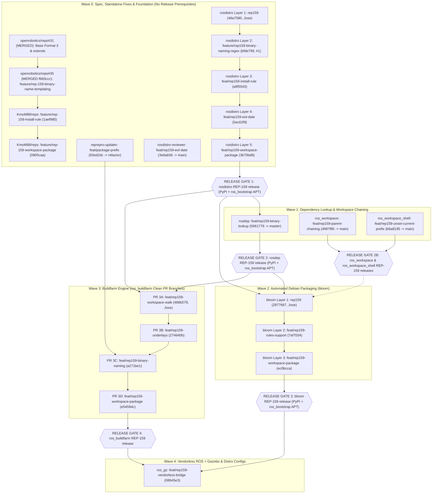
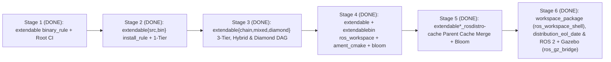

# REP-159 Feature Rollout Plan: Stacked PRs, Branch Matrix, Collaborator Alignment & Testfarm Hack Separation

Rollout strategy for upstreaming **[REP 159](https://github.com/openrobotics/reps/pull/32)** across Open Robotics repositories, structured around:
1. **Cumulative / Stacked PR Branches** per repository (strictly prepared as branches — **no PRs opened without explicit double consent**).
2. **Direct Adoption of Jose Luis Rivero's (`jrivero@honurobotics.com`) `rep159*` Commits** without modifying his branches (`rep159*`, `kmom88`), distributions (`upstream`, `srcext`, `binext`, `gzjetty`, `demo`), or Jenkins jobs (`U*`, `S*`, `B*`, `G*`, `D*`).
3. **Unified `extendable*` (`E*`) Validation Suite on `https://build.test.ros2.org`** from Stages 1–6 (`binary_rule`, `install_rule`, multi-tier/diamond DAGs, `ros_workspace` + `ament_cmake` + `bloom`, `rosdistro_build_cache`, `workspace_package: ros_workspace_shell`, and Multi-Parent ROS 2 + Gazebo `ros_gz_bridge`), with zero overlap with `cargotest` (`C*`) or `jrivero` (`U*`/`S*`/`B*`/`G*`/`D*`).
4. **Semantic Branch Naming & Commit Messages Only**: Feature branches and submodule commit messages never include internal stage numbers (`feat/extendable-*`, `feat/rep159-*`).
5. **Canonical Lowercase Placeholders Only** (`{distro}`, `{package}`, `{origin_distro}`).

---

## 1. Release-Gated Rollout & Stacked PR Graph

---

## 2. Adoption & Alignment with Jose Luis Rivero's (`jrivero`) Implementations

| Repository | Jose Luis Rivero's Branch & Original Commits (Untouched) | How Our Clean PR Stack Adopts & Extends Jose's Work | Coexistence Guarantee |
|---|---|---|---|
| **`rosdistro`** | • `origin/rep159` (`46a7580`): Parent cache loading from `extends[].index_url` • `origin/rep159-child-ros-workspace` (`4a89ac4`, `78c7db8`): `BINARY_IMPORT_OVERRIDABLE = frozenset(['ros_workspace'])` • `origin/rep159-shell` (`bc0600f`): `workspace_package` support | • [`feature/rep159-binary-naming-regex`](https://github.com/rep159-testing/rosdistro/tree/feature/rep159-binary-naming-regex) (`bfde799`) is stacked directly on `origin/rep159` (`46a7580`). • [`feat/rep159-install-rule`](https://github.com/rep159-testing/rosdistro/tree/feat/rep159-install-rule) (`a8f5543`) cherry-picks `4a89ac4` & `78c7db8` (96/96 tests pass). • [`feat/rep159-eol-date`](https://github.com/rep159-testing/rosdistro/tree/feat/rep159-eol-date) (`5ec62f9`) adds Index v4 `distribution_eol_date`. • [`feat/rep159-workspace-package`](https://github.com/rep159-testing/rosdistro/tree/feat/rep159-workspace-package) (`3670bd8`) cherry-picks `bc0600f` (`5d4a392`) + hyphenated package lookup (**106/106 tests pass**). | `origin/rep159` (`46a7580`), `origin/rep159-child-ros-workspace` (`78c7db8`), and `origin/rep159-shell` (`bc0600f`) untouched. |
| **`ros_workspace` & `ros_workspace_shell`** | • `ros_workspace:origin/rep159-parent-chain` (`12f93e9`, tag `1.0.4`) • `ros_workspace_shell:origin/main` (`a89cc7b`, tag `0.1.0`) | • [`ros_workspace:feat/rep159-parent-chaining`](https://github.com/rep159-testing/ros_workspace/tree/feat/rep159-parent-chaining) (`4997f85`) is branched directly on top of Jose's `12f93e9` (+5-line `PARENT_PREFIX_PATH` alias). • [`ros_workspace_shell:feat/rep159-unset-current-prefix`](https://github.com/rep159-testing/ros_workspace_shell/tree/feat/rep159-unset-current-prefix) (`b6a8195`) is branched on top of Jose's `a89cc7b` (+`unset AMENT_CURRENT_PREFIX`). | `origin/rep159-parent-chain` (`12f93e9`) and `ros_workspace_shell:main` (`a89cc7b`) untouched. |
| **`bloom`** | • `origin/rep159` (`0189046`..`2877687`): `get_binary_import_parents()`, `get_ros_workspace_dependencies()`, `ParentPrefixes` • `origin/rep159-shell` (`2cb93dc`): `get_workspace_package()` | • [`feat/rep159-rules-support`](https://github.com/rep159-testing/bloom/tree/feat/rep159-rules-support) (`7af7034`) is stacked on `origin/rep159` (`2877687`, 26/26 tests pass). • [`feat/rep159-workspace-package`](https://github.com/rep159-testing/bloom/tree/feat/rep159-workspace-package) (`ec0bcca`) cherry-picks Jose's `2cb93dc` (`aa5133e`) + `get_distribution_file()` `extends` fix (`ebfa37a`) + `unset AMENT_CURRENT_PREFIX` (`ec0bcca`, **37/37 tests pass**). | `origin/rep159` (`2877687`) and `origin/rep159-shell` (`2cb93dc`) untouched. |
| **`ros_buildfarm`** | • `origin/rep159` (`9736140`): `52b51d8`, `9807b32`, `9736140` • `origin/rep159-shell` (`146d05f`): `dist_file.get_workspace_package()` in `release_job.py` | • **PR 3A (`feat/rep159-workspace-walk` @ `486b579`, 7/7 tests)**: Jose's `52b51d8` & `9736140`. • **PR 3B (`feat/rep159-underlays` @ `274640b`, 11/11 tests)**: Jose's `9807b32` (`83fd534`) + `install_rule`, recursive DAG underlays, pure-CMake exports, `CMAKE_PREFIX_PATH` for `setup.sh` spaces (`a9a60e2`), and `unset AMENT_CURRENT_PREFIX` (`274640b`). • **PR 3C (`feat/rep159-binary-naming` @ `a271be1`, 6/6 tests)**: `binary_rule` release/sync & child release job filter. • **PR 3D (`feat/rep159-workspace-package` @ `e54594c`)**: Jose's `146d05f` stacked on `a271be1`. | `origin/rep159` (`9736140`), `origin/rep159-shell` (`146d05f`), and `origin/kmom88` (`9244aec`) untouched. |
| **`rep159-rosdistro` & `ros_buildfarm_config`** | • `origin/main` / `origin/rep159-setup-chain` and `origin/rep159` (`upstream`, `srcext`, `binext`, `gzjetty`, `demo` $\to$ `U*`, `S*`, `B*`, `G*`, `D*` Jenkins jobs) | • All validation stages run strictly inside the isolated **`extendable*` (`E*` jobs)** distribution family on semantic `feat/*` branches (`feat/extendable-*`, `feat/chained-extensions`, `feat/binary-chained`, `feat/mixed-extensions`, `feat/diamond-extensions`). | `upstream`, `srcext`, `binext`, `gzjetty`, `demo` (`U*`, `S*`, `B*`, `G*`, `D*`) and `cargotest` (`C*`) untouched. |

---

## 3. Clean Upstream PR Branches vs. Testfarm Harness Branches

| Repository | Wave / Gate | Clean Upstream PR Branch(es) (`@ SHA`, 0 Hacks) | Testfarm Harness Branch (`build.test.ros2.org`) | Clean Implementation Commits | Testfarm Hacks Excluded from Clean Branch |
|---|:---:|---|---|---|---|
| **`openrobotics/reps`** | Wave 0 | 1. [`reps#31`](https://github.com/openrobotics/reps/pull/31) (**MERGED**) 2. [`reps#35`](https://github.com/openrobotics/reps/pull/35) (**MERGED** `f683ccc`) 3. [`KmoM88:feature/rep-159-install-rule`](https://github.com/KmoM88/reps/tree/feature/rep-159-install-rule) (`1aef980`) 4. [`KmoM88:feature/rep-159-workspace-package`](https://github.com/KmoM88/reps/tree/feature/rep-159-workspace-package) (`0905caa`, stacked) | N/A | Format 3 `extends`, `binary_rule` (`{distro}`, `{package}`, `{origin_distro}`), `install_rule`, ABI immutability on `binary_import`, `workspace_package` (`ros_workspace_shell` / `ros_workspace`), `distribution_eol_date`, and multi-tier/diamond underlay resolution | **None** |
| **`rosdistro`** | Wave 0 $\to$ **Gate 1** | 1. [`rep159`](https://github.com/rep159-testing/rosdistro/tree/rep159) (`46a7580`) 2. [`feature/rep159-binary-naming-regex`](https://github.com/rep159-testing/rosdistro/tree/feature/rep159-binary-naming-regex) (`bfde799`, [`#1`](https://github.com/rep159-testing/rosdistro/pull/1)) 3. [`feat/rep159-install-rule`](https://github.com/rep159-testing/rosdistro/tree/feat/rep159-install-rule) (`a8f5543`) 4. [`feat/rep159-eol-date`](https://github.com/rep159-testing/rosdistro/tree/feat/rep159-eol-date) (`5ec62f9`, stacked) 5. [`feat/rep159-workspace-package`](https://github.com/rep159-testing/rosdistro/tree/feat/rep159-workspace-package) (`3670bd8`, stacked) | [`feat/rep159-workspace-package`](https://github.com/rep159-testing/rosdistro/tree/feat/rep159-workspace-package) (`3670bd8`) | `46a7580` (parent cache load), `3d301d6` & `bfde799` (`binary_rule`), `4916cae` (`install_rule`), `aefe17c` & `a8f5543` (`BINARY_IMPORT_OVERRIDABLE`), `5ec62f9` (`distribution_eol_date`), `5d4a392` (`jrivero` `workspace_package`), `3670bd8` (hyphenated package name lookup) | **None** (100% identical; 106/106 unit tests pass) |
| **`rosdistro-reviewer`** | Wave 0 | [`feat/rep159-eol-date`](https://github.com/rep159-testing/rosdistro-reviewer/tree/feat/rep159-eol-date) (`3e6ab56` $\to$ `main`) | [`feat/rep159-eol-date`](https://github.com/rep159-testing/rosdistro-reviewer/tree/feat/rep159-eol-date) (`3e6ab56`) | `3e6ab56`: ISO 8601 `YYYY-MM-DD` validation of `distribution_eol_date` in `index-v4.yaml` | **None** (200/200 unit & linter tests pass) |
| **`reprepro-updater`** | Wave 0 | [`feat/package-prefix`](https://github.com/rep159-testing/reprepro-updater/tree/feat/package-prefix) (`93ed2dc` $\to$ `refactor`) | [`feat/package-prefix`](https://github.com/rep159-testing/reprepro-updater/tree/feat/package-prefix) (`93ed2dc`) | `93ed2dc`: `-p / --package-prefix` CLI filter in `sync_ros_packages.py` & `helpers.py` | **None** |
| **`rosdep`** | Wave 1 (Gate 1) $\to$ **Gate 2** | [`feat/rep159-binary-lookup`](https://github.com/rep159-testing/rosdep/tree/feat/rep159-binary-lookup) (`5661779` $\to$ `master`, [`#2`](https://github.com/rep159-testing/rosdep/pull/2)) | [`rep159`](https://github.com/rep159-testing/rosdep/tree/rep159) (`3d52dad`) | `5661779`: `gbpdistro_support.py` delegation to `get_binary_package_name(pkg)` + Format 3 unit tests | Hardcoded `rosdistro @ git+https://github.com/KmoM88/rosdistro.git@...` in `setup.py` & `.github/workflows/ci.yaml` |
| **`ros_workspace`** / **`ros_workspace_shell`** | Wave 1 $\to$ **Gate 2B** | [`feat/rep159-parent-chaining`](https://github.com/rep159-testing/ros_workspace/tree/feat/rep159-parent-chaining) (`4997f85` $\to$ `main`) [`ros_workspace_shell:feat/rep159-unset-current-prefix`](https://github.com/rep159-testing/ros_workspace_shell/tree/feat/rep159-unset-current-prefix) (`b6a8195`) | [`feat/rep159-parent-chaining`](https://github.com/rep159-testing/ros_workspace/tree/feat/rep159-parent-chaining) (`4997f85`) [`ros_workspace_shell:feat/rep159-unset-current-prefix`](https://github.com/rep159-testing/ros_workspace_shell/tree/feat/rep159-unset-current-prefix) (`b6a8195`) | `ros_workspace`: `12f93e9` (`jrivero` `ROS_WORKSPACE_PARENT_PREFIX_PATH`) + `4997f85`. `ros_workspace_shell`: `a89cc7b` (`jrivero` plain-CMake setup files without Ament) + `b6a8195` (`unset AMENT_CURRENT_PREFIX`) | **None** |
| **`bloom`** | Wave 2 (Gates 1 & 2) $\to$ **Gate 3** | 1. [`rep159`](https://github.com/rep159-testing/bloom/tree/rep159) (`2877687`, `jrivero`) 2. [`feat/rep159-rules-support`](https://github.com/rep159-testing/bloom/tree/feat/rep159-rules-support) (`7af7034` $\to$ `master`) 3. [`feat/rep159-workspace-package`](https://github.com/rep159-testing/bloom/tree/feat/rep159-workspace-package) (`ec0bcca`, stacked) | [`feat/rep159-workspace-package`](https://github.com/rep159-testing/bloom/tree/feat/rep159-workspace-package) (`ec0bcca`) | `0189046`..`2877687` (`ParentPrefixes` & `ros_workspace` deps), `1f62809`..`7af7034` (`binary_rule`, `install_rule`, 26/26 tests), `aa5133e` (`jrivero` `workspace_package`), `ebfa37a` (`get_distribution_file` `extends`), `ec0bcca` (`unset AMENT_CURRENT_PREFIX`, 37/37 tests) | **None** |
| **`ros_buildfarm`** | Wave 3 (Gates 1 & 2) $\to$ **Gate 4** | • **PR 3A**: [`feat/rep159-workspace-walk`](https://github.com/rep159-testing/ros_buildfarm/tree/feat/rep159-workspace-walk) (`486b579`) • **PR 3B**: [`feat/rep159-underlays`](https://github.com/rep159-testing/ros_buildfarm/tree/feat/rep159-underlays) (`274640b`) • **PR 3C**: [`feat/rep159-binary-naming`](https://github.com/rep159-testing/ros_buildfarm/tree/feat/rep159-binary-naming) (`a271be1`) • **PR 3D**: [`feat/rep159-workspace-package`](https://github.com/rep159-testing/ros_buildfarm/tree/feat/rep159-workspace-package) (`e54594c`, stacked) | [`feat/binary-naming-rule`](https://github.com/rep159-testing/ros_buildfarm/tree/feat/binary-naming-rule) (`797d771`), [`feat/extendable-workspace`](https://github.com/rep159-testing/ros_buildfarm/tree/feat/extendable-workspace) (`ca13954`), [`feat/extendable-workspace-package`](https://github.com/rep159-testing/ros_buildfarm/tree/feat/extendable-workspace-package) (`b242685`, stacked) | • **PR 3A (`486b579`, 7/7 tests)**: `1334bf9`, `486b579` (`jrivero` `ReleaseAndSourceDependencyWalker`) • **PR 3B (`274640b`, 11/11 tests)**: `83fd534` (`jrivero` `get_binary_import_distros`) + `0ee8e49`..`274640b` (`install_rule`, pure-CMake exports, `CMAKE_PREFIX_PATH` for `setup.sh`, `unset AMENT_CURRENT_PREFIX`) • **PR 3C (`a271be1`, 6/6 tests)**: `a1f57c6`..`a271be1` • **PR 3D (`e54594c`)**: `e54594c` (`jrivero` `146d05f` `get_workspace_package` in `release_job.py`) | 1. `pip3 install --break-system-packages` tarball overrides in `*.Dockerfile.em` templates 2. Fork `rep159-testing/reprepro-updater.git` URL in `sync_packages_to_*_job.xml.em` 3. `ext*` release prefixes inside shared `E*` views |
| **`ros_gz`** | Wave 4 | [`feat/rep159-vendorless-bridge`](https://github.com/rep159-testing/ros_gz/tree/feat/rep159-vendorless-bridge) (`08645e3` $\to$ `ros2` / `3.0.12`) | [`feat/rep159-no-vendor`](https://github.com/rep159-testing/ros_gz/tree/feat/rep159-no-vendor) (`efec554`) | `08645e3`: Only 3 modified files (`ros_gz_interfaces/package.xml`, `ros_gz_bridge/package.xml`, `ros_gz_bridge/CMakeLists.txt`, +17/-22 lines) replacing `gz_*_vendor` with native `gz-*` packages | Deletion of sibling `ros_gz_*` subdirectories (`ros_gz_sim`, `ros_gz_image`, etc.) on `efec554` to shrink CI workspace builds |

---

## 4. `extendable` (`E*`) Progressive Roadmap on `build.test.ros2.org` (Stages 1 $\to$ 6: ROS + Gazebo)

All remote validation on `https://build.test.ros2.org` stays strictly inside the **`extendable*` (`E*`)** namespace (zero overlap with `jrivero`'s `U*`/`S*`/`B*`/`G*`/`D*` or `cargotest`'s `C*`):

| Stage | Detailed Stage Roadmap | Scope on `extendable*` (`E*`) | Status on `build.test.ros2.org` |
|---|---|---|---|
| **Stage 1** | [`roadmap/stage1_binary_naming_and_format3.md`](roadmap/stage1_binary_naming_and_format3.md) | Pure-CMake validation of `binary_rule` (`vendor-extendable-*`), `--package-prefix`, and Root CI | **100% COMPLETE (10/10 `E*` jobs `SUCCESS`)** |
| **Stage 2** | [`roadmap/stage2_install_rule_and_underlays.md`](roadmap/stage2_install_rule_and_underlays.md) | Custom `install_rule` (`/opt/vendor/{distro}`), `ReleaseAndSourceDependencyWalker` boundary pruning, and 1-tier `binary_import` / `source_rebuild` | **100% COMPLETE (9/9 `E*` jobs `SUCCESS`)** |
| **Stage 3** | [`roadmap/stage3_topological_extensions.md`](roadmap/stage3_topological_extensions.md) | Multi-Tier 3-Tier `source_rebuild` & `binary_import`, Hybrid Mixed, and Multi-Parent Diamond DAG with pure-CMake `workspace.py` env exports | **100% COMPLETE (7/7 `E*` jobs `SUCCESS`)** |
| **Stage 4** | [`roadmap/stage4_composable_workspace.md`](roadmap/stage4_composable_workspace.md) | Native ROS 2 `ros_workspace` (`ROS_WORKSPACE_PARENT_PREFIX_PATH`) + `ament_cmake` + `bloom` (`@(ParentPrefixes)`) inside `extendable` & `extendablebin` (`E*`) | **100% COMPLETE (14/14 `E*` jobs `SUCCESS`)** |
| **Stage 5** | [`roadmap/stage5_cache_lifecycle_and_bloom_release.md`](roadmap/stage5_cache_lifecycle_and_bloom_release.md) | Live `rosdistro_build_cache` (`extendable_rosdistro-cache #139`, `extendablebin_rosdistro-cache #138`) parent cache merge + `- REMOVE` isolation | **100% COMPLETE (2/2 cache jobs & `bloom` `SUCCESS`)** |
| **Stage 6** | [`roadmap/stage6_ros_gazebo_and_eol.md`](roadmap/stage6_ros_gazebo_and_eol.md) | Adopting `jrivero`'s `workspace_package` (`ros_workspace_shell`), Index v4 `distribution_eol_date` (`5ec62f9`, `3e6ab56`), 6-package Gazebo Jetty (`extendablejetty`), and Multi-Parent `[lyrical, extendablejetty]` + vendorless `ros_gz_bridge` (`08645e3`) | **100% COMPLETE (Step 6B-1: 17/17 `SUCCESS`; Step 6B-2a: 23/23 `SUCCESS`; Step 6B-2b Multi-Parent `ros_gz_bridge`: 18/18 `SUCCESS`; Phase 6D: 200/200 `PASS`)** |
