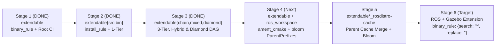

# REP-159 Feature Rollout Plan: Stacked PRs, Branch Matrix, Collaborator Alignment & Testfarm Hack Separation

Rollout strategy for upstreaming **[REP 159](https://github.com/openrobotics/reps/pull/32)** across Open Robotics repositories, structured around:
1. **Cumulative / Stacked PR Branches** per repository.
2. **Direct Adoption of Jose Luis Rivero's (`jrivero@honurobotics.com`) `rep159*` Commits** without modifying his branches (`rep159*`, `kmom88`), distributions (`upstream`, `srcext`, `binext`), or Jenkins jobs (`U*`, `S*`, `B*`).
3. **Strict Separation of Clean Upstream PR Branches vs. Testfarm Harness Branches**.
4. **Canonical Lowercase Placeholders Only** (`{distro}`, `{package}`, `{origin_distro}`).

---

## 1. Release-Gated Rollout & Stacked PR Graph

---

## 2. Adoption & Alignment with Jose Luis Rivero's (`jrivero`) Implementations

| Repository | Jose Luis Rivero's Branch & Original Commits (Untouched) | How Our Clean PR Stack Adopts & Extends Jose's Work | Coexistence Guarantee |
|---|---|---|---|
| **`rosdistro`** | • `origin/rep159` (`46a7580`): Parent cache loading from `extends[].index_url` • `origin/rep159-child-ros-workspace` (`4a89ac4`, `78c7db8`): `BINARY_IMPORT_OVERRIDABLE = frozenset(['ros_workspace'])` & child `release` requirement | • [`feature/rep159-binary-naming-regex`](https://github.com/rep159-testing/rosdistro/tree/feature/rep159-binary-naming-regex) (`bfde799`) is stacked directly on `origin/rep159` (`46a7580`). • [`feat/rep159-install-rule`](https://github.com/rep159-testing/rosdistro/tree/feat/rep159-install-rule) (`a8f5543`) cherry-picks both `4a89ac4` (`aefe17c`) and `78c7db8` (`a8f5543`) with Jose's authorship (96/96 tests pass). | `origin/rep159` (`46a7580`) and `origin/rep159-child-ros-workspace` (`78c7db8`) untouched. |
| **`ros_workspace`** | • `origin/rep159-parent-chain` (`12f93e9`, tagged `1.0.4`): Searches `${CMAKE_INSTALL_PREFIX};${ROS_WORKSPACE_PARENT_PREFIX_PATH}` for `ament_package` and registers `parent_prefix_path` index | • [`feat/rep159-parent-chaining`](https://github.com/rep159-testing/ros_workspace/tree/feat/rep159-parent-chaining) (`4997f85`) is branched **directly on top of Jose's `12f93e9`**, adding a 5-line `PARENT_PREFIX_PATH` CMake variable alias. | `origin/rep159-parent-chain` (`12f93e9`) and tag `1.0.4` untouched. |
| **`bloom`** | • `origin/rep159` (`0189046`, `29a329c`, `db66bf6`, `2877687`): `get_binary_import_parents()`, `get_ros_workspace_dependencies()`, `ParentPrefixes` in `debian/rules.em`, `-DROS_WORKSPACE_PARENT_PREFIX_PATH` | • [`feat/rep159-rules-support`](https://github.com/rep159-testing/bloom/tree/feat/rep159-rules-support) (`7af7034`) is stacked **directly on top of Jose's `origin/rep159` (`2877687`)**, extending `ParentPrefixes` and `InstallationPrefix` to query `get_install_prefix()` and `get_binary_package_name()` (26/26 tests pass). | `origin/rep159` (`2877687`) untouched. |
| **`ros_buildfarm`** | • `origin/rep159` (`9736140`):   - `52b51d8`: `SourceDependencyWalker`   - `9807b32`: `BINARY_IMPORT_DISTROS_ENV`, `get_binary_import_distros()`, `get_default_parent_result_spaces()`   - `9736140`: `_is_binary_import` CI walk boundary | • **PR 3A (`feat/rep159-workspace-walk` @ `486b579`)**: Direct cherry-pick of Jose's `52b51d8` (`1334bf9`) & `9736140` (`486b579`) onto `master` (`7daa2b1`). • **PR 3B (`feat/rep159-underlays` @ `a4a5bbd`)**: Starts with Jose's `9807b32` (`83fd534`) + `install_rule`, recursive DAG underlays, and pure-CMake `workspace.py` env exports. • **PR 3C (`feat/rep159-binary-naming` @ `a271be1`)**: Release/sync `binary_rule` delegation & child release job filter. | `origin/rep159` (`9736140`) and `origin/kmom88` (`9244aec`) untouched. |
| **`rep159-rosdistro` & `ros_buildfarm_config`** | • `origin/main` / `origin/rep159-setup-chain` and `origin/rep159` (`upstream`, `srcext`, `binext` -> `U*`, `S*`, `B*` Jenkins jobs) | • All Stage 1–5 tests use isolated distributions (`extendable*` -> `E*` jobs; `composable*` -> `C*` jobs; `cachebase`/`cachechild`) on `feat/*` branches. | `upstream`, `srcext`, `binext` and Jenkins views `U*`, `S*`, `B*` untouched. |

---

## 3. Clean Upstream PR Branches vs. Testfarm Harness Branches

| Repository | Wave / Gate | Clean Upstream PR Branch(es) (`@ SHA`, 0 Hacks) | Testfarm Harness Branch (`build.test.ros2.org`) | Clean Implementation Commits | Testfarm Hacks Excluded from Clean Branch |
|---|:---:|---|---|---|---|
| **`openrobotics/reps`** | Wave 0 | 1. [`reps#31`](https://github.com/openrobotics/reps/pull/31) (**MERGED**) 2. [`reps#35`](https://github.com/openrobotics/reps/pull/35) (**MERGED** `f683ccc`) 3. [`KmoM88:feature/rep-159-install-rule`](https://github.com/KmoM88/reps/tree/feature/rep-159-install-rule) (`1aef980`) | N/A | Format 3 `extends`, `binary_rule` (`{distro}`, `{package}`, `{origin_distro}`), `install_rule`, ABI immutability on `binary_import`, `BINARY_IMPORT_OVERRIDABLE = {'ros_workspace'}`, and multi-tier/diamond underlay resolution | **None** |
| **`rosdistro`** | Wave 0 $\to$ **Gate 1** | 1. [`rep159`](https://github.com/rep159-testing/rosdistro/tree/rep159) (`46a7580`) 2. [`feature/rep159-binary-naming-regex`](https://github.com/rep159-testing/rosdistro/tree/feature/rep159-binary-naming-regex) (`bfde799`, [`#1`](https://github.com/rep159-testing/rosdistro/pull/1)) 3. [`feat/rep159-install-rule`](https://github.com/rep159-testing/rosdistro/tree/feat/rep159-install-rule) (`a8f5543`) | [`feat/rep159-install-rule`](https://github.com/rep159-testing/rosdistro/tree/feat/rep159-install-rule) (`a8f5543`) | `46a7580` (parent cache load), `3d301d6` & `bfde799` (`binary_rule`), `4916cae` (`install_rule`), `aefe17c` & `a8f5543` (`BINARY_IMPORT_OVERRIDABLE`) | **None** (100% identical; uppercase `{DISTRO}` duplicates removed) |
| **`reprepro-updater`** | Wave 0 | [`feat/package-prefix`](https://github.com/rep159-testing/reprepro-updater/tree/feat/package-prefix) (`93ed2dc` $\to$ `refactor`) | [`feat/package-prefix`](https://github.com/rep159-testing/reprepro-updater/tree/feat/package-prefix) (`93ed2dc`) | `93ed2dc`: `-p / --package-prefix` CLI filter in `sync_ros_packages.py` & `helpers.py` | **None** |
| **`rosdep`** | Wave 1 (Gate 1) $\to$ **Gate 2** | [`feat/rep159-binary-lookup`](https://github.com/rep159-testing/rosdep/tree/feat/rep159-binary-lookup) (`5661779` $\to$ `master`) | [`rep159`](https://github.com/rep159-testing/rosdep/tree/rep159) (`3d52dad`) | `5661779`: `gbpdistro_support.py` delegation to `get_binary_package_name(pkg)` + Format 3 unit tests | Hardcoded `rosdistro @ git+https://github.com/KmoM88/rosdistro.git@...` in `setup.py` & `.github/workflows/ci.yaml` |
| **`ros_workspace`** | Wave 1 $\to$ **Gate 2B** | [`feat/rep159-parent-chaining`](https://github.com/rep159-testing/ros_workspace/tree/feat/rep159-parent-chaining) (`4997f85` $\to$ `main`) | [`feat/rep159-parent-chaining`](https://github.com/rep159-testing/ros_workspace/tree/feat/rep159-parent-chaining) (`4997f85`) | `12f93e9` (`jrivero` `ROS_WORKSPACE_PARENT_PREFIX_PATH` & `parent_prefix_path` index) + `4997f85` (`PARENT_PREFIX_PATH` alias) | **None** |
| **`bloom`** | Wave 2 (Gates 1 & 2) $\to$ **Gate 3** | 1. [`rep159`](https://github.com/rep159-testing/bloom/tree/rep159) (`2877687`, `jrivero`) 2. [`feat/rep159-rules-support`](https://github.com/rep159-testing/bloom/tree/feat/rep159-rules-support) (`7af7034` $\to$ `master`) | [`feat/rep159-rules-support`](https://github.com/rep159-testing/bloom/tree/feat/rep159-rules-support) (`7af7034`) | `0189046`..`2877687` (`ParentPrefixes` & `ros_workspace` deps), `1f62809`..`7af7034` (`binary_rule`, `install_rule`, `git tag -f -m` GPG fix) | **None** |
| **`ros_buildfarm`** | Wave 3 (Gates 1 & 2) $\to$ **Gate 4** | • **PR 3A**: [`feat/rep159-workspace-walk`](https://github.com/rep159-testing/ros_buildfarm/tree/feat/rep159-workspace-walk) (`486b579`) • **PR 3B**: [`feat/rep159-underlays`](https://github.com/rep159-testing/ros_buildfarm/tree/feat/rep159-underlays) (`a4a5bbd`) • **PR 3C**: [`feat/rep159-binary-naming`](https://github.com/rep159-testing/ros_buildfarm/tree/feat/rep159-binary-naming) (`a271be1`) • **Wave 0 Fixes**: `ae8826b` (git TLS), `199fd98` (Jenkins 403) | [`feat/binary-naming-rule`](https://github.com/rep159-testing/ros_buildfarm/tree/feat/binary-naming-rule) (`797d771`) & [`feat/cache-job-rep159`](https://github.com/rep159-testing/ros_buildfarm/tree/feat/cache-job-rep159) (`6f62d7b`) | • **PR 3A**: `1334bf9`, `486b579` (`jrivero` `ReleaseAndSourceDependencyWalker`) • **PR 3B**: `83fd534` (`jrivero` `get_binary_import_distros`) + `0ee8e49`..`a4a5bbd` (`install_rule`, recursive DAG underlays, `workspace.py` CMake/LD exports) • **PR 3C**: `a1f57c6`..`a271be1` (`get_os_package_name*`, `--package-prefix`, child `release_job.py` filter) | 1. `pip3 install --break-system-packages` tarball overrides in 6 `*.Dockerfile.em` templates 2. Fork `rep159-testing/reprepro-updater.git` URL in `sync_packages_to_*_job.xml.em` 3. `building_repository` label override in `rosdistro_cache_job.xml.em` |

---

## 4. `extendable` (`E*`) Progressive Roadmap on `build.test.ros2.org` (Stages 1 $\to$ 6: ROS + Gazebo)

All remote validation on `https://build.test.ros2.org` stays strictly inside the **`extendable*` (`E*`)** namespace (zero overlap with `jrivero`'s `U*`/`S*`/`B*` or `cargotest`'s `C*`):

| Stage | Scope on `extendable*` (`E*`) | Status on `build.test.ros2.org` |
|---|---|---|
| **Stages 1–3** | Pure-CMake validation of `binary_rule`, `install_rule`, `binary_import` pruning, 3-Tier `source_rebuild` & `binary_import`, Hybrid Mixed, and Multi-Parent Diamond DAG | **100% COMPLETE (`SUCCESS` across all 18 `E*` jobs)** |
| **Stage 4** | Unification with `jrivero`'s `ros_workspace` (`ROS_WORKSPACE_PARENT_PREFIX_PATH`) + `ament_cmake` + `bloom` (`@(ParentPrefixes)`) inside `extendable*` (`E*`) | **Ready** (branches prepared, zero overlap with `U*`/`S*`/`B*`/`C*`) |
| **Stage 5** | Live `rosdistro_build_cache` (`extendable*_rosdistro-cache`) parent cache merge + automated `git-bloom-generate rosdebian` | **Ready** (validated in local replica #18, ready for `E*`) |
| **Stage 6** | **ROS + Gazebo** integration (`binary_rule: {search: '^', replace: ''}` + per-repo `libgz-*-dev` overrides + `ament_cmake` / `ros_workspace` overlay) | **Planned Target** |
