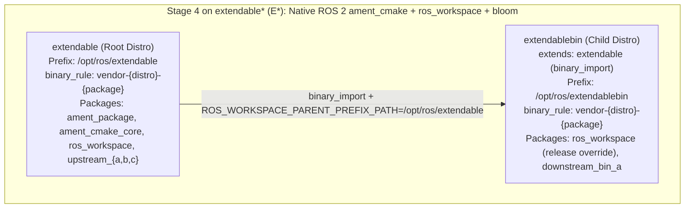

# Stage 4 Plan: `extendable` & `extendablebin` (`E*`) — Native `ros_workspace` Chaining & Automated `bloom` Packaging

Architecture, collaborative branch matrix, and remote validation on `https://build.test.ros2.org` for **Stage 4** of the REP-159 test campaign on **`extendable` & `extendablebin` (Jenkins prefix `E*`)**.

---

## 1. Architecture & Topology (`extendable` $\to$ `extendablebin` with `ros_workspace`)

| Dimension | Stages 1–3 (`extendable*`, Jobs `E*`) | Stage 4 (`extendable` & `extendablebin`, Jobs `E*`) |
|---|---|---|
| **Build Type** | Pure `cmake` (`<build_type>cmake</build_type>`) | Native ROS 2 `ament_cmake` (`ament_package`, `ament_cmake_core`) + `ros_workspace` |
| **Underlay Chaining** | Buildfarm `workspace.py` env exports (`CMAKE_PREFIX_PATH`, `LD_LIBRARY_PATH`) | `/opt/ros/extendablebin/setup.sh` + `.dsv` hooks (`ROS_WORKSPACE_PARENT_PREFIX_PATH="/opt/ros/extendable"`) |
| **Child `ros_workspace` Rule** | N/A (no `ros_workspace` package) | `BINARY_IMPORT_OVERRIDABLE = frozenset(['ros_workspace'])` in `rosdistro` (`aefe17c`, `a8f5543`) allows & requires child `ros_workspace` release |
| **Debian Generation** | Pre-configured release tracks | Automated `git-bloom-generate rosdebian` via `bloom` (`feat/rep159-rules-support` @ `7af7034`) |

---

## 2. Collaborative Tooling & Submodule Matrix (Aligned with `jrivero`)

| Submodule | Semantic Branch (`@ SHA`) | Adopted `jrivero` Commits & Extensions | Role |
|---|---|---|---|
| **`rosdistro`** | [`feat/rep159-install-rule`](https://github.com/rep159-testing/rosdistro/tree/feat/rep159-install-rule) (`a8f5543`) | `46a7580` (parent cache load) + `aefe17c`, `a8f5543` (`BINARY_IMPORT_OVERRIDABLE = frozenset(['ros_workspace'])`) + `binary_rule` & `install_rule` | Allows a `binary_import` child distro (`extendablebin`) to release its own `ros_workspace` while keeping all other inherited parent packages immutable. |
| **`ros_workspace`** | [`feat/rep159-parent-chaining`](https://github.com/rep159-testing/ros_workspace/tree/feat/rep159-parent-chaining) (`4997f85`) | Based directly on `jrivero`'s `12f93e9` (`ROS_WORKSPACE_PARENT_PREFIX_PATH` multi-prefix `ament_package` discovery & `parent_prefix_path` index) + `PARENT_PREFIX_PATH` alias (`4997f85`) | Generates `/opt/ros/extendablebin/setup.sh` that automatically chains `/opt/ros/extendable` while preserving `SKIP_PARENT_PREFIX_PATH` for root `extendable`. |
| **`bloom`** | [`feat/rep159-rules-support`](https://github.com/rep159-testing/bloom/tree/feat/rep159-rules-support) (`7af7034`) | Stacked directly on `jrivero`'s `origin/rep159` (`0189046`..`2877687`: `get_binary_import_parents()`, `ParentPrefixes` in `debian/rules.em`, `-DROS_WORKSPACE_PARENT_PREFIX_PATH`, `get_ros_workspace_dependencies()`) + `binary_rule` & `install_rule` | `git-bloom-generate rosdebian` dynamically formats `Package:`, `Depends:`, `CMAKE_INSTALL_PREFIX`, and parent `setup.sh` sourcing in `debian/rules`. |
| **`ros_buildfarm`** | Clean: [`feat/rep159-binary-naming`](https://github.com/rep159-testing/ros_buildfarm/tree/feat/rep159-binary-naming) (`a271be1`) Testbed: [`feat/extendable-workspace`](https://github.com/rep159-testing/ros_buildfarm/tree/feat/extendable-workspace) (`ca13954`) | PR 3C: `get_os_package_name*` delegation, `--package-prefix`, and child `release_job.py` package isolation (`9b02768`) + `extbin` release prefix inside `E*` views | Generates `Esrc_uR__*`, `Ebin_uR64__*`, `Erel_sync-*`, `Erel_extbin_sync-*`, and `Eci__workspace-*` jobs without overwriting Stage 1–3 `E*` jobs. |
| **`rep159-rosdistro` & `ros_buildfarm_config`** | [`feat/extendable-workspace`](https://github.com/rep159-testing/rep159-rosdistro/tree/feat/extendable-workspace) (`ab0400c` / `3322225`) | `extendable` and `extendablebin` Stage 4 distribution and build files | Adds `ament_package`, `ament_cmake_core`, `ros_workspace` to `extendable` and child `ros_workspace` + `downstream_bin_a` (`extbin`) to `extendablebin`. |
| **Release Tracks (`*-release`)** | `debian/vendor-extendable/resolute/*` `debian/vendor-extendablebin/resolute/*` | `ament_package-release` (`1b551c8`), `ament_cmake_core-release` (`32bc461`), `ros_workspace-release` (`f063a4d`, `bea31df`), `downstream_bin_a-release` (`9f8ba47`) | Debian tracks for `vendor-extendable-*` and `vendor-extendablebin-*`. |

---

## 3. Remote Validation Evidence on `https://build.test.ros2.org` (`E*` Jobs)

| Phase | Job on `build.test.ros2.org` | Build & Console | Status | Target Artifact / Verification |
|---|---|---|:---:|---|
| **Root `ament_package` Release (`extendable`)** | `Esrc_uR__ament_package__ubuntu_resolute__source` `Ebin_uR64__ament_package__ubuntu_resolute_amd64__binary` | [#1](https://build.test.ros2.org/job/Esrc_uR__ament_package__ubuntu_resolute__source/1/) ([Log](https://build.test.ros2.org/job/Esrc_uR__ament_package__ubuntu_resolute__source/1/console)) [#1](https://build.test.ros2.org/job/Ebin_uR64__ament_package__ubuntu_resolute_amd64__binary/1/) ([Log](https://build.test.ros2.org/job/Ebin_uR64__ament_package__ubuntu_resolute_amd64__binary/1/console)) | **SUCCESS** | Publishes [`vendor-extendable-ament-package`](http://repo.test.ros2.org/ubuntu/testing/pool/main/v/vendor-extendable-ament-package/) into `/opt/ros/extendable`. |
| **Root `ament_cmake_core` Release (`extendable`)** | `Esrc_uR__ament_cmake_core__ubuntu_resolute__source` `Ebin_uR64__ament_cmake_core__ubuntu_resolute_amd64__binary` | [#1](https://build.test.ros2.org/job/Esrc_uR__ament_cmake_core__ubuntu_resolute__source/1/) ([Log](https://build.test.ros2.org/job/Esrc_uR__ament_cmake_core__ubuntu_resolute__source/1/console)) [#2](https://build.test.ros2.org/job/Ebin_uR64__ament_cmake_core__ubuntu_resolute_amd64__binary/2/) ([Log](https://build.test.ros2.org/job/Ebin_uR64__ament_cmake_core__ubuntu_resolute_amd64__binary/2/console)) | **SUCCESS** | Publishes [`vendor-extendable-ament-cmake-core`](http://repo.test.ros2.org/ubuntu/testing/pool/main/v/vendor-extendable-ament-cmake-core/) into `/opt/ros/extendable`. |
| **Root `ros_workspace` Release (`extendable`)** | `Esrc_uR__ros_workspace__ubuntu_resolute__source` `Ebin_uR64__ros_workspace__ubuntu_resolute_amd64__binary` | [#1](https://build.test.ros2.org/job/Esrc_uR__ros_workspace__ubuntu_resolute__source/1/) ([Log](https://build.test.ros2.org/job/Esrc_uR__ros_workspace__ubuntu_resolute__source/1/console)) [#1](https://build.test.ros2.org/job/Ebin_uR64__ros_workspace__ubuntu_resolute_amd64__binary/1/) ([Log](https://build.test.ros2.org/job/Ebin_uR64__ros_workspace__ubuntu_resolute_amd64__binary/1/console)) | **SUCCESS** | Publishes [`vendor-extendable-ros-workspace`](http://repo.test.ros2.org/ubuntu/testing/pool/main/v/vendor-extendable-ros-workspace/) into `/opt/ros/extendable`. |
| **Root APT Sync & Workspace CI (`extendable`)** | `Erel_sync-packages-to-testing_resolute_amd64` `Eci__workspace-release_ubuntu_resolute_amd64` | [#12](https://build.test.ros2.org/job/Erel_sync-packages-to-testing_resolute_amd64/12/) ([Log](https://build.test.ros2.org/job/Erel_sync-packages-to-testing_resolute_amd64/12/console)) [#2](https://build.test.ros2.org/job/Eci__workspace-release_ubuntu_resolute_amd64/2/) ([Log](https://build.test.ros2.org/job/Eci__workspace-release_ubuntu_resolute_amd64/2/console)) | **SUCCESS** | Syncs all 6 `vendor-extendable-*` packages to `testing` and runs root `extendable` workspace CI (5/5 packages green). |
| **Child `ros_workspace` Release (`extendablebin` / `extbin`)** | `Esrc_uR__extbin_ros_workspace__ubuntu_resolute__source` `Ebin_uR64__extbin_ros_workspace__ubuntu_resolute_amd64__binary` | [#1](https://build.test.ros2.org/job/Esrc_uR__extbin_ros_workspace__ubuntu_resolute__source/1/) ([Log](https://build.test.ros2.org/job/Esrc_uR__extbin_ros_workspace__ubuntu_resolute__source/1/console)) [#2](https://build.test.ros2.org/job/Ebin_uR64__extbin_ros_workspace__ubuntu_resolute_amd64__binary/2/) ([Log](https://build.test.ros2.org/job/Ebin_uR64__extbin_ros_workspace__ubuntu_resolute_amd64__binary/2/console)) | **SUCCESS** | Builds `vendor-extendablebin-ros-workspace` (`-DROS_WORKSPACE_PARENT_PREFIX_PATH="/opt/ros/extendable"`) into `/opt/ros/extendablebin`. |
| **Child `downstream_bin_a` Release (`extendablebin` / `extbin`)** | `Esrc_uR__extbin_downstream_bin_a__ubuntu_resolute__source` `Ebin_uR64__extbin_downstream_bin_a__ubuntu_resolute_amd64__binary` | [#1](https://build.test.ros2.org/job/Esrc_uR__extbin_downstream_bin_a__ubuntu_resolute__source/1/) ([Log](https://build.test.ros2.org/job/Esrc_uR__extbin_downstream_bin_a__ubuntu_resolute__source/1/console)) [#2](https://build.test.ros2.org/job/Ebin_uR64__extbin_downstream_bin_a__ubuntu_resolute_amd64__binary/2/) ([Log](https://build.test.ros2.org/job/Ebin_uR64__extbin_downstream_bin_a__ubuntu_resolute_amd64__binary/2/console)) | **SUCCESS** | Builds `vendor-extendablebin-downstream-bin-a` (generated via `bloom` with `ParentPrefixes`) into `/opt/ros/extendablebin`. |
| **Child APT Sync & Binary Import CI (`extendablebin`)** | `Erel_extbin_sync-packages-to-testing_resolute_amd64` `Eci__workspace-binary-import_ubuntu_resolute_amd64` | [#3](https://build.test.ros2.org/job/Erel_extbin_sync-packages-to-testing_resolute_amd64/3/) ([Log](https://build.test.ros2.org/job/Erel_extbin_sync-packages-to-testing_resolute_amd64/3/console)) [#1](https://build.test.ros2.org/job/Eci__workspace-binary-import_ubuntu_resolute_amd64/1/) ([Log](https://build.test.ros2.org/job/Eci__workspace-binary-import_ubuntu_resolute_amd64/1/console)) | **SUCCESS** | Syncs `vendor-extendablebin-*` to `testing` and runs child `ros_workspace` CI (`/opt/ros/extendablebin/setup.sh` chains `/opt/ros/extendable`). |
