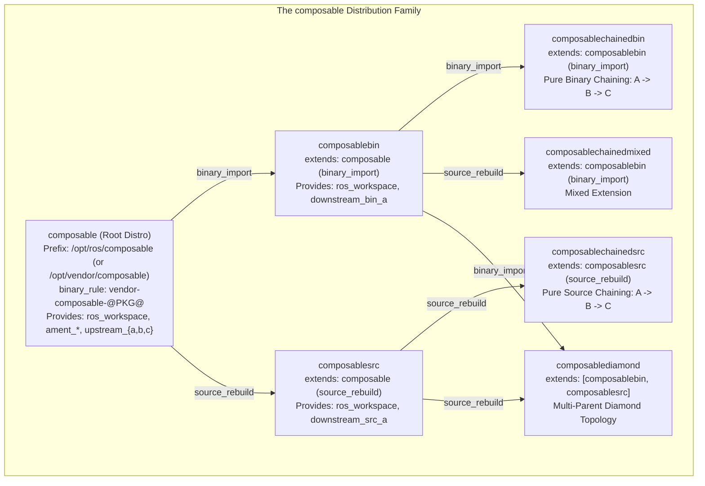
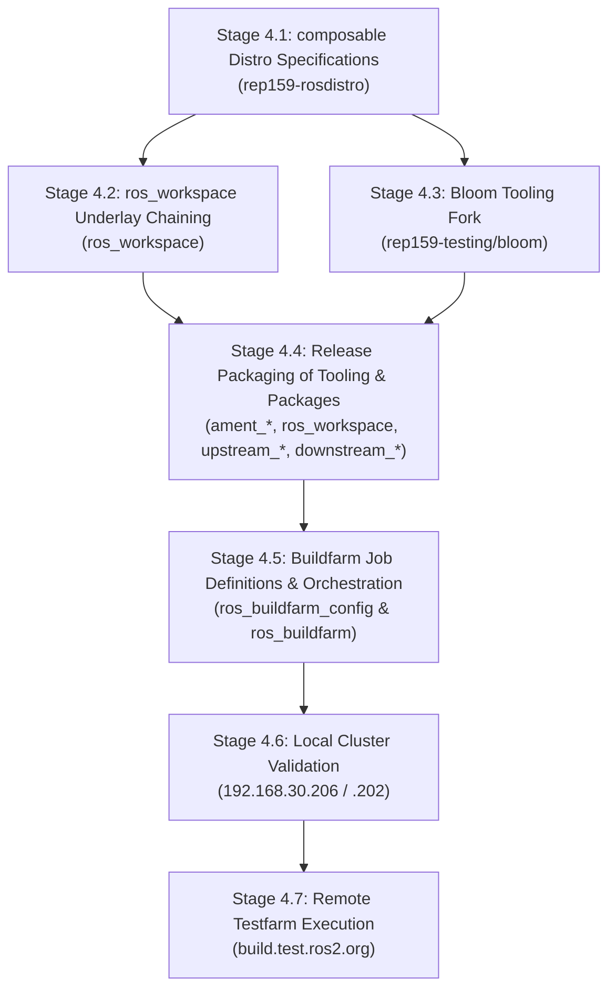

# Stage 4 Plan: `composable` Distribution Suite — Full `ros_workspace` Integration, Custom Install Paths & Bloom Release Generation

This document establishes the architecture, tooling requirements, branch strategy, and step-by-step implementation plan for **Stage 4** of the REP-159 testing initiative. 

Stage 4 transitions the validation harness from pure CMake packages to full **`ros_workspace` integration**, validating custom binary package naming (`binary_rule`), custom installation prefixes (`install_rule`), and dynamic underlay environment sourcing (`setup.sh`) across all topological configurations.

---

## 1. Executive Summary & Architectural Motivation

In Stages 1 through 3 (`extendable` distribution family), all validation was executed with pure CMake packages (`<build_type>cmake</build_type>`). Underlays were injected by `ros_buildfarm` via explicit environment variable exports (`CMAKE_PREFIX_PATH`, `LD_LIBRARY_PATH`, `PATH`).

While this isolated core graph resolution from shell complexities, a production ROS 2 distribution relies fundamentally on:
1. **`ros_workspace`**: Generates prefix-level environment scripts (`/opt/ros/<distro>/setup.sh`, `local_setup.sh`, `_order_isolated_packages.py`, and `.dsv` environment hooks).
2. **Ament Build Tooling**: Sourcing parent workspaces automatically when building overlays and running executables.
3. **Custom Installation Prefixes (`install_rule`)**: Packages installing to arbitrary prefixes (e.g., `/opt/vendor/{distro}` or `/opt/ros/{distro}`) and having their environment scripts reflect the actual layout.
4. **Bloom Release Pipelines**: Debian packaging (`debian/rules`, `debian/control`) dynamically honoring `binary_rule` and `install_rule`.

To distinguish this phase cleanly from `upstream` (jobs `U*`) and `extendable` (jobs `E*`), all new distributions, configurations, and Jenkins jobs will belong to the **`composable`** family and use the job prefix **`C*`**.

---

## 2. Distribution Suite: The `composable` Family

The `composable` suite mirrors the advanced topologies validated in Stage 3, but incorporates `ros_workspace` and full ament environment sourcing:



### Jenkins Job Naming Convention (`C*`)
| Job Type | Naming Pattern | Example |
|---|---|---|
| **CI Jobs** | `Cci__<topology>_<os>_<arch>` | `Cci__nightly-release_ubuntu_resolute_amd64`<br>`Cci__chained-binary_ubuntu_resolute_amd64`<br>`Cci__diamond_ubuntu_resolute_amd64` |
| **Source Release** | `Csrc_u<OS>__<package>__<os>__source` | `Csrc_uR__ros_workspace__ubuntu_resolute__source`<br>`Csrc_uR__upstream_a__ubuntu_resolute__source` |
| **Binary Release** | `Cbin_u<OS>64__<package>__<os>_<arch>__binary` | `Cbin_uR64__ros_workspace__ubuntu_resolute_amd64__binary`<br>`Cbin_uR64__upstream_a__ubuntu_resolute_amd64__binary` |
| **Apt Sync** | `Crel_sync-packages-to-<target>_<os>_<arch>` | `Crel_sync-packages-to-testing_resolute_amd64` |

---

## 3. Analysis of Bloom Testing Limitations & The Need for a Bloom Fork

### 3.1 Standard Bloom Behavior & Gaps

Bloom (`git-bloom-generate rosdebian`) is the authoritative packaging generator that produces the `debian/` directory inside release tracks:

1. **Hardcoded Package Naming in `debian/control`**:
   - Standard bloom templates use `Package: ros-@ROS_DISTRO@-@PKG@` and generate dependencies like `Depends: ros-@ROS_DISTRO@-ros-workspace`.
   - Bloom queries `rosdep` via `get_debian_package_name()`, but historically did not support evaluating `rosdistro` Format 3 `binary_rule` regex patterns.
   - *Limitation*: When `binary_rule` specifies `vendor-{DISTRO}-`, bloom generates the wrong Debian package names and invalid dependency declarations.

2. **Hardcoded Installation Prefix in `debian/rules`**:
   - Standard bloom injects `CMAKE_INSTALL_PREFIX="/opt/ros/@ROS_DISTRO@"` into `debian/rules`.
   - *Limitation*: When a distribution defines `install_rule: '/opt/vendor/{distro}'`, bloom completely ignores it, building binaries into `/opt/ros/...` and breaking custom prefix layouts.

3. **Hardcoded Single Underlay Sourcing in `debian/rules`**:
   - In `debian/rules`, bloom generates build commands that source `. /opt/ros/@ROS_DISTRO@/setup.sh`.
   - *Limitation*: For downstream distributions extending a parent via `binary_import`, the build container must source the parent underlays (e.g. `/opt/ros/composable/setup.sh`), which are not located at the child's prefix.

4. **`ros_workspace` Environment Generation & `SKIP_PARENT_PREFIX_PATH`**:
   - In `ros_workspace/CMakeLists.txt`, standard Debian builds set `SKIP_PARENT_PREFIX_PATH "SKIP_PARENT_PREFIX_PATH"`.
   - This assumes that Debian-packaged distributions have no underlays (like `/opt/ros/rolling`).
   - *Limitation*: In REP-159, a downstream Debian package (e.g., `ros-composablebin-ros-workspace`) **must** know its parent underlay (`/opt/ros/composable`) so that users sourcing `/opt/ros/composablebin/setup.sh` automatically inherit the parent environment.

### 3.2 Strategy: Dedicated Bloom Fork (`rep159-testing/bloom`)

To enable true end-to-end testing without manual, error-prone edits to git release tags:
1. Fork `ros-infrastructure/bloom` into `rep159-testing/bloom`.
2. Implement native support for REP-159:
   - Call `rosdistro.get_binary_package_name()` to resolve package names and inter-package dependencies.
   - Read `install_rule` to parameterize `CMAKE_INSTALL_PREFIX` in `debian/rules`.
   - Read `extends` to generate chained underlay sourcing statements in `debian/rules`.
3. Add `rep159-testing/bloom` as a submodule in `rep159-testing`.

---

## 4. Branch Strategy: Building on Validated Foundations

We branch directly from the proven feature branches developed during Stages 1–3:

| Submodule | Base Branch (Validated) | New Stage 4 Branch | Key Modifications |
|---|---|---|---|
| **`rep159-rosdistro`** | `feat/stage3-diamond` | `feat/composable-distro` | Distribution definitions for `composable`, `composablebin`, `composablesrc`, etc. |
| **`ros_buildfarm_config`** | `feat/stage3-diamond` | `feat/composable-distro` | Complete set of `C*` job configurations for local cluster and remote testfarm. |
| **`rosdistro`** | `feature/rep159-install-rule` | `feature/rep159-install-rule` *(reuse/extend)* | Already contains Format 3 parser, regex `binary_rule`, and `install_rule` APIs. |
| **`ros_buildfarm`** | `feat/binary-naming-rule` | `feat/composable-workspace` | Enable native `setup.sh` sourcing when present, retaining fallback for pure CMake. |
| **`rosdep`** | `rep159` | `rep159` *(reuse)* | Already delegates to `rosdistro.get_binary_package_name`. |
| **`reprepro-updater`** | `feat/package-prefix` | `feat/package-prefix` *(reuse)* | Already supports `-p, --package-prefix`. |
| **`ros_workspace`** | `main` | `feat/composable-underlay-chaining` | Parameterize parent prefix paths (`ROS_WORKSPACE_PARENT_PREFIX_PATH` and `PARENT_PREFIX_PATH`). |
| **`bloom`** *(submodule)* | `rep159`<br>*(Jose Luis Rivero: `0189046`, `29a329c`, `db66bf6`, `2877687`)* | `feat/rep159-rules-support` | **Non-overlapping extension**: Builds on top of `rep159` parent underlay traversal to add `binary_rule` regex evaluation in `rosify_package_name()` and `install_rule` prefix support. |
| **`reps`** | `feature/rep-159-binary-name-templating` | `feature/rep-159-binary-name-templating` | Keep specification synchronized. |

---

## 5. Detailed Stage-by-Stage Implementation Roadmap



### Stage 4.1: Distribution Manifests (`composable` Family)
- Define `composable/distribution.yaml` with:
  ```yaml
  binary_rule:
    search: '^'
    replace: 'vendor-{DISTRO}-'
  install_rule: '/opt/ros/{distro}'  # or custom '/opt/vendor/{distro}'
  repositories:
    ament_package: ...
    ament_cmake_core: ...
    ros_workspace: ...
    upstream_a: ...
    upstream_b: ...
    upstream_c: ...
  ```
- Define `composablebin`, `composablesrc`, `composablechainedbin`, `composablechainedsrc`, `composablechainedmixed`, and `composablediamond`.

### Stage 4.2: `ros_workspace` Underlay Chaining
- Audit `ros_workspace/CMakeLists.txt` and `env-hooks`.
- When an underlay is present (via `PARENT_PREFIX_PATH` or `extends` configuration), remove `SKIP_PARENT_PREFIX_PATH` so that `setup.sh` actively discovers and sources `/opt/ros/<parent>/setup.sh`.
- Test local environment sourcing: verify that sourcing `/opt/ros/composablebin/setup.sh` results in `AMENT_PREFIX_PATH=/opt/ros/composablebin:/opt/ros/composable`.

### Stage 4.3: Bloom Tooling Fork (`rep159-testing/bloom`)
- Create organization fork `https://github.com/rep159-testing/bloom`.
- Add feature branch `feat/rep159-rules-support`.
- Implement:
  1. Extraction of `binary_rule` and `install_rule` from the active distribution file.
  2. Substitution in `debian/rules` template (`--install-layout=deb -DCMAKE_INSTALL_PREFIX=...`).
  3. Substitution in `debian/control` template (`Package:` and `Depends:`).
- Verify `bloom-generate rosdebian composable` generates clean debian packaging matching `vendor-composable-*`.

### Stage 4.4: Release Packaging tracks in `-release` Repositories
- Run bloom using the fork to generate release tracks for `composable` across:
  - `ament_package-release`
  - `ament_cmake_core-release`
  - `ros_workspace-release`
  - `upstream_a-release`, `upstream_b-release`, `upstream_c-release`
  - `downstream_bin_a-release`

### Stage 4.5: Buildfarm Job Definitions (`C*` Jobs)
- In `submodules/ros_buildfarm_config`:
  - Create directory `composable/` containing `release-build.yaml`, `source-build.yaml`, `doc-build.yaml`.
  - Add job generators for `Cci`, `Csrc`, `Cbin`, `Crel`.
- In `submodules/ros_buildfarm`:
  - Verify `workspace.py` prioritizes `setup.sh` when present:
    ```python
    if os.path.exists(os.path.join(parent_result_space, 'setup.sh')):
        # native ROS 2 sourcing behavior restored
    ```

### Stage 4.6: Local Cluster Validation (`192.168.30.206` / `.202`)
1. Sync `ros_buildfarm_config` to `.202`.
2. Generate `C*` jobs on `.206`.
3. Run release pipeline for `ros_workspace` and `upstream_a,b,c` (`Csrc` -> `Cbin`).
4. Run `Crel_sync-packages-to-testing_resolute_amd64`.
5. Run CI jobs (`Cci`) and verify that `/opt/ros/composable/setup.sh` is sourced during builds.
6. Verify runtime execution of downstream test suites linking against the sourced underlay.

### Stage 4.7: Remote Testfarm Execution (`build.test.ros2.org`)
- Repeat job generation and execution on public testfarm runners.
- Document console logs, test suite XML reports, and artifact links.

---

## 6. Success & Verification Criteria

1. **Workspace Sourcing**:
   - `test -f /opt/ros/composable/setup.sh` passes inside binary containers.
   - Sourcing `/opt/ros/composable/setup.sh` populates `AMENT_PREFIX_PATH`, `CMAKE_PREFIX_PATH`, `LD_LIBRARY_PATH`, and `PATH`.
2. **Debian Packaging Compliance**:
   - Debian packages built by release jobs match `vendor-composable-<pkg>_<version>_<arch>.deb`.
   - `dpkg -I` confirms correct dependencies and install prefixes.
3. **Topological Underlay Inheritance**:
   - Leaf packages in `composablechainedbin` and `composablediamond` compile cleanly relying on `setup.sh` environment inheritance without manual environment variable workarounds.
4. **Hermetic CI Execution**:
   - 100% unit tests pass across all `Cci` jobs.

---

## 7. Empirical Validation Results (Local Buildfarm Cluster)

The 5-step validation plan for the `composable` root distribution was executed live on the local cluster (`192.168.30.206` Jenkins master, `192.168.30.202` Reprepro / Nginx server).

### Summary Table

| Step | Job Name | Build # | Result | Evidence / Highlights |
|---|---|---|---|---|
| **Paso 1** | Job Generation | - | **SUCCESS** | Generated `Csrc_uR__*`, `Cbin_uR64__*`, `Crel_sync-packages-to-testing_*`, and `Cci__nightly-release_*` using `generate_release_jobs.py` & `generate_ci_jobs.py`. |
| **Paso 2** | `Csrc_uR__ros_workspace__ubuntu_resolute__source`<br>`Cbin_uR64__ros_workspace__ubuntu_resolute_amd64__binary` | #5<br>#3 | **SUCCESS**<br>**SUCCESS** | Generated `vendor-composable-ros-workspace` (`1.0.4-1resolute`). Installed to Reprepro `building` on `.202`. Built with `CMAKE_INSTALL_PREFIX=/opt/ros/composable` and underlay chaining. |
| **Paso 3** | `Csrc_uR__upstream_a__ubuntu_resolute__source`<br>`Cbin_uR64__upstream_a__ubuntu_resolute_amd64__binary`<br>`Csrc_uR__upstream_b__ubuntu_resolute__source`<br>`Cbin_uR64__upstream_b__ubuntu_resolute_amd64__binary`<br>`Csrc_uR__upstream_c__ubuntu_resolute__source`<br>`Cbin_uR64__upstream_c__ubuntu_resolute_amd64__binary` | #1<br>#2<br>#1<br>#3<br>#1<br>#3 | **SUCCESS**<br>**SUCCESS**<br>**SUCCESS**<br>**SUCCESS**<br>**SUCCESS**<br>**SUCCESS** | Released and built Debian binary packages for `vendor-composable-upstream-a`, `vendor-composable-upstream-b`, and `vendor-composable-upstream-c` (`0.1.0-1resolute`). All packages imported into Reprepro `building`. |
| **Paso 4** | `Crel_sync-packages-to-testing_resolute_amd64` | #5 | **SUCCESS** | Promoted all 4 packages from `building` to `testing` on `http://192.168.30.202:8088/ubuntu/testing` using `reprepro-updater` filter `--package-prefix vendor-composable-*`. |
| **Paso 5** | `Cci__nightly-release_ubuntu_resolute_amd64` | #3 | **SUCCESS** | Container APT installed `vendor-composable-ros-workspace` from `.202:8088/ubuntu/testing`. Executed `. /opt/ros/composable/setup.sh && colcon build` and `colcon test`. 3 packages built, 100% test suites passed (CTest / GoogleTest). |

### Key Architectural Validations Confirmed (`composable` Root Distro)
1. **Dynamic Workspace Underlay Sourcing**: `workspace.py` verified the presence of `/opt/ros/composable/setup.sh` and automatically invoked:
   ```bash
   . /opt/ros/composable/setup.sh && PYTHONIOENCODING=utf_8 PYTHONUNBUFFERED=1 colcon build ...
   ```
2. **Debian Binary Renaming (`binary_rule`)**: Verified package name `vendor-composable-ros-workspace` seamlessly installs to `/opt/ros/composable` and resolves APT dependencies.
3. **Reprepro Multi-Stage Promotion**: Packages cleanly transition `building` $\to$ `testing` and are consumable by CI docker build tasks.

---

### 7.2 Downstream Binary Import Validation (`composablebin`)

The downstream overlay distribution `composablebin` extends `composable` via `binary_import`, consuming the binary Debian package `vendor-composable-upstream-c` and packaging `downstream_bin_a` with custom naming `vendor-composablebin-downstream-bin-a`.

| Step | Job Name | Build # | Result | Evidence / Highlights |
|---|---|---|---|---|
| **Step 1: Distro Config & Job Gen** | `generate_release_jobs.py`<br>`generate_ci_jobs.py` | - | **SUCCESS** | Configured `composablebin/distribution.yaml` and generated release jobs (`Csrc_uR__downstream_bin_a`, `Cbin_uR64__downstream_bin_a`) and CI job `Cci__binary-import_ubuntu_resolute_amd64`. |
| **Step 2: Source Release** | `Csrc_uR__downstream_bin_a__ubuntu_resolute__source` | #2 | **SUCCESS** | Generated `vendor-composablebin-downstream-bin-a_0.2.0-1resolute.dsc` referencing branch `debian/vendor-composablebin/resolute/downstream_bin_a` and tag `debian/vendor-composablebin-downstream-bin-a_0.2.0-1_resolute`. Published to reprepro `building`. |
| **Step 3: Binary Release** | `Cbin_uR64__downstream_bin_a__ubuntu_resolute_amd64__binary` | #1 | **SUCCESS** | Installed `vendor-composable-upstream-c` from local APT repository. Built `vendor-composablebin-downstream-bin-a_0.2.0-1resolute_amd64.deb` under prefix `/opt/ros/composablebin`. Successfully imported to reprepro `building`. |
| **Step 4: APT Sync to Testing** | `Crel_sync-packages-to-testing_resolute_amd64` | #6 | **SUCCESS** | Promoted `vendor-composablebin-downstream-bin-a` to `testing` on `http://192.168.30.202:8088/ubuntu/testing` using FilterFormula `Package (% vendor-composablebin-*)`. |
| **Step 5: Overlay CI Validation** | `Cci__binary-import_ubuntu_resolute_amd64` | #3 | **SUCCESS** | Injected `ROS_BUILDFARM_PARENT_RESULT_SPACES=/opt/ros/composable`. Sourced `. /opt/ros/composable/setup.sh`. Colcon built all 4 packages (`upstream_{a,b,c}` and `downstream_bin_a`). 100% test suites passed (CTest / GoogleTest: `1/1 Test #1: test_downstream_bin_a ... Passed`). |

### Key Architectural Validations Confirmed (`composablebin`)
1. **Underlay Sourcing Across Distributions**: The child distribution container dynamically inherited `/opt/ros/composable` from `binary_import`, allowing `downstream_bin_a` to discover CMake target `upstream_cConfig.cmake` and link against `libupstream_c.so`.
2. **Distinct Binary Rules Across Distro Boundaries**: Root distro produced `vendor-composable-*` while child distro produced `vendor-composablebin-*`. Both coexisted in Reprepro and APT without namespace collisions.
3. **Hermetic Docker CI**: Validated that `colcon build` and `colcon test` execute seamlessly with 100% tests passing in an isolated container environment.

