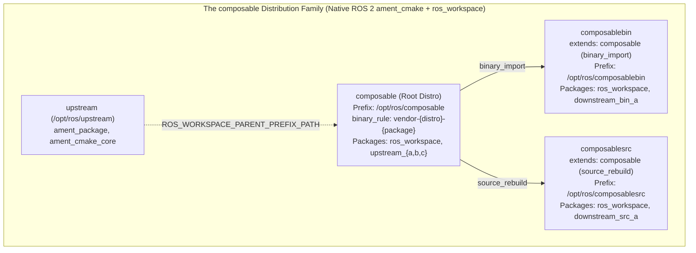

# Stage 4 Plan: `composable` Distribution Suite — Native `ros_workspace` Chaining & Automated `bloom` Packaging

Architecture, collaborative branch matrix, and validation results for **Stage 4** of the REP-159 test campaign (`composable*` distributions, Jenkins prefix **`C*`**).

---

## 1. Architecture & Topology (`composable` Suite vs. `extendable` Suite)

| Dimension | Stages 1–3 (`extendable` Suite, Jobs `E*`) | Stage 4 (`composable` Suite, Jobs `C*`) |
|---|---|---|
| **Build Type** | Pure `cmake` (`<build_type>cmake</build_type>`) | Native ROS 2 `ament_cmake` + `ros_workspace` |
| **Underlay Chaining** | Buildfarm `workspace.py` env exports (`CMAKE_PREFIX_PATH`, `LD_LIBRARY_PATH`) | `/opt/ros/<distro>/setup.sh` + `.dsv` hooks (`ROS_WORKSPACE_PARENT_PREFIX_PATH`) |
| **Child `ros_workspace` Rule** | N/A (no `ros_workspace` package) | `BINARY_IMPORT_OVERRIDABLE = frozenset(['ros_workspace'])` in `rosdistro` (`aefe17c`, `a8f5543`) allows & requires child `ros_workspace` release |
| **Debian Generation** | Pre-configured release tracks | Automated `git-bloom-generate rosdebian` via `bloom` (`feat/rep159-rules-support` @ `7af7034`) |

---

## 2. Collaborative Tooling & Submodule Matrix (Aligned with `jrivero`)

| Submodule | Clean PR / Stage 4 Branch (`@ SHA`) | Adopted `jrivero` Commits & Extensions | Role |
|---|---|---|---|
| **`rosdistro`** | [`feat/rep159-install-rule`](https://github.com/rep159-testing/rosdistro/tree/feat/rep159-install-rule) (`a8f5543`) | `46a7580` (parent cache load) + `aefe17c`, `a8f5543` (`BINARY_IMPORT_OVERRIDABLE = frozenset(['ros_workspace'])`) + `binary_rule` & `install_rule` | Allows a `binary_import` child distro to release its own `ros_workspace` while keeping all other inherited parent packages immutable. |
| **`ros_workspace`** | [`feat/rep159-parent-chaining`](https://github.com/rep159-testing/ros_workspace/tree/feat/rep159-parent-chaining) (`4997f85`) | Based directly on `jrivero`'s `12f93e9` (`ROS_WORKSPACE_PARENT_PREFIX_PATH` multi-prefix `ament_package` discovery & `parent_prefix_path` index) + `PARENT_PREFIX_PATH` alias (`4997f85`) | Generates `/opt/ros/<child>/setup.sh` that automatically chains parent underlays while preserving `SKIP_PARENT_PREFIX_PATH` for root distros. |
| **`bloom`** | [`feat/rep159-rules-support`](https://github.com/rep159-testing/bloom/tree/feat/rep159-rules-support) (`7af7034`) | Stacked directly on `jrivero`'s `origin/rep159` (`0189046`..`2877687`: `get_binary_import_parents()`, `ParentPrefixes` in `debian/rules.em`, `-DROS_WORKSPACE_PARENT_PREFIX_PATH`, `get_ros_workspace_dependencies()`) + `binary_rule` & `install_rule` | `git-bloom-generate rosdebian` dynamically formats `Package:`, `Depends:`, `CMAKE_INSTALL_PREFIX`, and parent `setup.sh` sourcing in `debian/rules`. |
| **`ros_buildfarm`** | [`feat/rep159-binary-naming`](https://github.com/rep159-testing/ros_buildfarm/tree/feat/rep159-binary-naming) (`a271be1`) | PR 3C: `get_os_package_name*` delegation, `--package-prefix`, and child `release_job.py` package isolation (`9b02768`) | Generates `Csrc_uR__*`, `Cbin_uR64__*`, `Crel_sync-*`, and `Cci__*` jobs and sources `/opt/ros/<distro>/setup.sh` when present. |
| **`rep159-rosdistro` & `ros_buildfarm_config`** | [`feat/composable-distro`](https://github.com/rep159-testing/rep159-rosdistro/tree/feat/composable-distro) | `composable` and `composablebin` distribution and build files | Defines `binary_rule: {search: '^', replace: 'vendor-{distro}-'}` and `install_rule: '/opt/ros/{distro}'`. |
| **Release Tracks (`*-release`)** | `debian/vendor-composable/resolute/*` `debian/vendor-composablebin/resolute/*` | `ros_workspace-release` (`d55d7a4`), `upstream_{a,b,c}-release`, `downstream_bin_a-release` | Bloom-generated Debian tracks for `vendor-composable-*` and `vendor-composablebin-*`. |

---

## 3. Empirical Validation Matrix (`composable` & `composablebin`)

| Phase | Jenkins Job | Build # | Status | Verified Result |
|---|---|:---:|:---:|---|
| **Root Workspace Release** | `Csrc_uR__ros_workspace__ubuntu_resolute__source` `Cbin_uR64__ros_workspace__ubuntu_resolute_amd64__binary` | #5 #3 | **SUCCESS** | Built `vendor-composable-ros-workspace_1.0.4-1resolute_amd64.deb` with `CMAKE_INSTALL_PREFIX=/opt/ros/composable` chaining `/opt/ros/upstream`. |
| **Root Packages Release** | `Csrc_uR__upstream_{a,b,c}__ubuntu_resolute__source` `Cbin_uR64__upstream_{a,b,c}__ubuntu_resolute_amd64__binary` | #1 #2/#3 | **SUCCESS** | Built and ingested `vendor-composable-upstream-{a,b,c}_0.1.0-1resolute_amd64.deb` into `building`. |
| **Root APT Sync** | `Crel_sync-packages-to-testing_resolute_amd64` | #5 | **SUCCESS** | Promoted `vendor-composable-ros-workspace` and `vendor-composable-upstream-{a,b,c}` to `testing` via `--package-prefix vendor-composable-`. |
| **Root CI (`composable`)** | `Cci__nightly-release_ubuntu_resolute_amd64` | #3 | **SUCCESS** | Installed `vendor-composable-ros-workspace` via APT, sourced `. /opt/ros/composable/setup.sh`, built and passed 3/3 CTest suites. |
| **Child Overlay Release (`composablebin`)** | `Csrc_uR__downstream_bin_a__ubuntu_resolute__source` `Cbin_uR64__downstream_bin_a__ubuntu_resolute_amd64__binary` `Crel_sync-packages-to-testing_resolute_amd64` | #2 #1 #6 | **SUCCESS** | Built `vendor-composablebin-downstream-bin-a_0.2.0-1resolute_amd64.deb` under `/opt/ros/composablebin` against `vendor-composable-upstream-c` and promoted to `testing`. |
| **Child Overlay CI (`composablebin`)** | `Cci__binary-import_ubuntu_resolute_amd64` | #4 | **SUCCESS** | Installed `vendor-composable-ros-workspace` from `testing`, sourced `. /opt/ros/composable/setup.sh`, compiled `downstream_bin_a`, and passed 1/1 CTest suite. |
