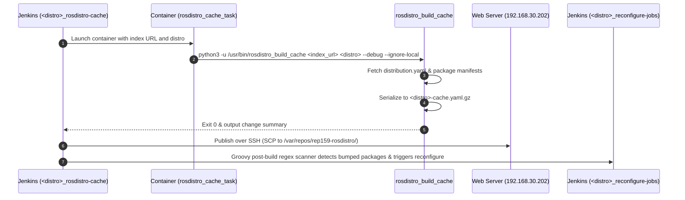
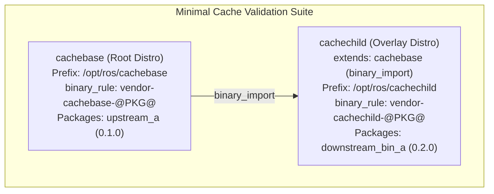

# Stage 5 Plan: Distribution Cache Lifecycle & Bloom Packaging Validation

This document establishes the architecture, tooling requirements, branch strategy, and step-by-step implementation plan for **Stage 5** of the REP-159 testing initiative.

Stage 5 focuses on two fundamental operational capabilities:
1. **Distribution Cache Lifecycle**: Investigating and validating how `rosdistro_build_cache` generates, invalidates, and propagates cache data in `ros_buildfarm`, specifically across hierarchical parent-child distributions (`cachebase` $\to$ `cachechild`).
2. **Automated Bloom Release Generation**: Using the REP-159 enabled `bloom` fork (`submodules/bloom` on `feat/rep159-rules-support`) to generate production-grade Debian packaging (`debian/control`, `debian/rules`) honoring custom binary naming (`binary_rule`) and custom install paths (`install_rule`) without manual patch injection.

---

## 1. Architectural Investigation: How Cache Works in `ros_buildfarm`

### 1.1 Cache Generation (`rosdistro_build_cache`)

In standard ROS 2 buildfarms, the distribution cache is built periodically by a dedicated Jenkins job named `<distro>_rosdistro-cache`.



1. **Job Generation**: Generated via `ros_buildfarm/scripts/misc/generate_rosdistro_cache_job.py`.
2. **Containerized Build Task**:
   - `rosdistro_cache_task.Dockerfile.em` builds a minimal image.
   - Executes `python3 -u /usr/bin/rosdistro_build_cache <index_url> <distro> --debug --ignore-local`.
   - Generates `<distro>-cache.yaml.gz` in the container workspace.
3. **Artifact Deployment (`Publish over SSH`)**:
   - Copies `rosdistro_cache/*.gz` to the web host publishing directory (`/var/repos/rep159-rosdistro/`).
   - Serves the compressed cache over HTTP so tools (`rosdep`, `ros_buildfarm`, `colcon`, `bloom`) can query distribution metadata without cloning git repositories.
4. **Change Detection & Triggering (Groovy Post-Build)**:
   - Configured via `publisher_groovy-postbuild_reconfigure-updated-packages.xml.em`.
   - Scans build logs with regex:
     ```regex
     .*- updated manifest of package '(.+)' to version '(.+)'
     ```
   - When package versions or dependencies change in `distribution.yaml`, the post-build action automatically triggers the corresponding release and reconfigure jobs:
     - Triggers `<distro>_reconfigure-jobs` or directly invokes `Csrc` / `Cbin` jobs for affected packages.

### 1.2 Two Gaps Identified in Upstream `ros_buildfarm` Templates

1. **Gap 1 (Outdated `python3-rosdistro` in Cache Task Container)**:
   - `rosdistro_cache_task.Dockerfile.em` installs `python3-rosdistro` from Ubuntu Focal APT repositories.
   - That upstream package does not recognize REP-159 Format 3 elements (`extends`, `binary_rule`, `install_rule`).
   - **Resolution**: Modify the Dockerfile template to install our fork:
     `https://github.com/rep159-testing/rosdistro/archive/refs/heads/feature/rep159-install-rule.tar.gz`.
2. **Gap 2 (Hardcoded SSH Config Target)**:
   - `rosdistro_cache_job.xml.em` hardcodes `config_name='rosdistro_cache'`.
   - In our cluster setup, the SSH host is registered as `repo`.
   - **Resolution**: Parameterize the SSH config name or fall back to `repo`.

---

## 2. Minimal Distribution Pair (`cachebase` and `cachechild`)

To avoid unnecessary topology overhead while strictly validating cache inheritance and invalidation, we define a 2-tier distribution hierarchy:



### Key Distribution Metadata

| Property | `cachebase` (Root) | `cachechild` (Overlay) |
|---|---|---|
| **Distribution Type** | `ros2` | `ros2` |
| **`extends`** | `None` | `cachebase` (`binary_import`) |
| **`install_rule`** | `/opt/ros/cachebase` | `/opt/ros/cachechild` |
| **`binary_rule`** | `vendor-cachebase-@PKG@` | `vendor-cachechild-@PKG@` |
| **Packages Hosted** | `upstream_a` (ver 0.1.0) | `downstream_bin_a` (ver 0.2.0) |
| **Parent Dependency** | None | Depends on `upstream_a` |

---

## 3. Branch & Submodule Strategy

All changes will be isolated on dedicated feature branches without mutating existing stable branches:

| Submodule / Component | Feature Branch | Base Branch | Purpose |
|---|---|---|---|
| `submodules/ros_buildfarm` | `feat/cache-job-rep159` | `master` (or `feat/binary-naming-rule`) | Update cache Dockerfile and SSH config for REP-159 support |
| `submodules/rep159-rosdistro` | `feat/cache-lifecycle-test` | `master` (or `feat/composable-distro`) | Declare `cachebase` and `cachechild` distributions |
| `submodules/ros_buildfarm_config` | `feat/cache-lifecycle-test` | `master` (or `feat/composable-distro`) | Configure build files and Jenkins job definitions |
| `submodules/bloom` | `feat/rep159-rules-support` | `master` | Use forked bloom to generate Debian packaging |
| `rep159-testing` (Base Repo) | `main` | `main` | Master documentation and test runner scripts |

---

## 4. Implementation Stages

### Stage 5.1: Template Fixes & Submodule Preparation
1. **Branch creation**: Create `feat/cache-job-rep159` in `submodules/ros_buildfarm`.
2. **Update `rosdistro_cache_task.Dockerfile.em`**:
   - Ensure the Docker image installs `python3-rosdistro` from the `feature/rep159-install-rule` branch.
3. **Update `rosdistro_cache_job.xml.em`**:
   - Set the SSH publisher server name to match the Jenkins SSH server configuration (`repo`).
4. **Deploy**: Sync updated `ros_buildfarm` package to the Jenkins agent.

### Stage 5.2: Minimal Distro Definition (`cachebase` and `cachechild`)
1. Create `cachebase/distribution.yaml` with `upstream_a` (0.1.0-1).
2. Create `cachechild/distribution.yaml` with:
   - `extends: {cachebase: {type: binary_import}}`
   - `downstream_bin_a` (0.2.0-1)
3. Add entries to `rep159-rosdistro/index-v4.yaml` and local mirror index.
4. Add build files to `submodules/ros_buildfarm_config`:
   - `cachebase/release-build.yaml`, `cachebase/ci-build.yaml`
   - `cachechild/release-build.yaml`, `cachechild/ci-build.yaml`
5. Sync definitions to Reprepro/Nginx server (`192.168.30.202`).

### Stage 5.3: Cache Generation & Verification in Jenkins
1. Generate cache jobs:
   - `python3 scripts/misc/generate_rosdistro_cache_job.py ... cachebase`
   - `python3 scripts/misc/generate_rosdistro_cache_job.py ... cachechild`
2. **Execute `cachebase_rosdistro-cache`**:
   - Verify container builds cache successfully.
   - Verify `cachebase-cache.yaml.gz` is published to `192.168.30.202:/var/repos/rep159-rosdistro/`.
   - Verify HTTP download: `curl -I http://192.168.30.202:8088/rosdistro_cache/cachebase-cache.yaml.gz`.
3. **Execute `cachechild_rosdistro-cache`**:
   - Verify `cachechild` correctly resolves its parent (`cachebase`).
   - Verify `cachechild-cache.yaml.gz` is published and accessible.

### Stage 5.4: Cache Invalidation & Automated Reconfiguration Test
1. **Simulate Release Update**:
   - Bump version of `upstream_a` in `cachebase/distribution.yaml` (from `0.1.0` to `0.1.1`).
2. **Trigger `cachebase_rosdistro-cache`**:
   - Inspect build log for change notification:
     `- updated manifest of package 'upstream_a' to version '0.1.1'`.
3. **Verify Automated Triggering**:
   - Confirm Groovy post-build scanner detects the update.
   - Confirm `<distro>_reconfigure-jobs` (or release job) is triggered automatically by Jenkins.
4. **Validate Child Cache Refresh**:
   - Trigger `cachechild_rosdistro-cache` and verify it picks up `upstream_a` version `0.1.1` from the parent cache.

### Stage 5.5: Automated Bloom Release Packaging Validation
1. **Target**: Package `downstream_bin_a` targeting distribution `cachechild`.
2. **Bloom Execution**:
   - Run `git-bloom-generate rosdebian --os-name ubuntu --os-version resolute --ros-distro cachechild` inside the release track using our bloom submodule:
     ```bash
     PYTHONPATH="/home/fede/github/kmom88/rep159-testing/submodules/bloom:$PYTHONPATH" \
     python3 -m bloom.commands.generate.rosdebian ...
     ```
3. **Packaging Integrity Checks**:
   - **Check A (`debian/control`)**:
     - Binary package name must be: `Package: vendor-cachechild-downstream-bin-a`.
     - Parent dependency must be resolved to: `Depends: vendor-cachebase-upstream-a`.
   - **Check B (`debian/rules`)**:
     - Install prefix must be: `CMAKE_INSTALL_PREFIX="/opt/ros/cachechild"`.
     - Underlay sourcing must include: `. /opt/ros/cachebase/setup.sh`.
4. **Jenkins Release & Build Execution**:
   - Commit the generated `debian/` directory to `submodules/downstream_bin_a-release` under `debian/vendor-cachechild/resolute/downstream_bin_a`.
   - Trigger `Csrc` and `Cbin` jobs in Jenkins.
   - Verify that the resulting `.deb` package installs cleanly and passes all build and test stages.

### Stage 5.6: Documentation & Evidence Consolidation
1. Update `FEATURE_BRANCH_REGISTRY.md` with FEAT-8 (Cache Lifecycle) and FEAT-9 (Bloom Packaging).
2. Log build URLs, console outputs, and validation artifacts in `TOPOLOGICAL_TESTING_EVIDENCE_GIST.md`.
3. Commit all documentation to `main` in `kmom88/rep159-testing`.

---

## 5. Summary of Deliverables

- **`STAGE5_CACHE_AND_BLOOM_PLAN.md`**: Architectural blueprint and step-by-step test plan.
- **`ros_buildfarm` fixes**: Dockerfile and SSH configuration templates for REP-159 cache jobs.
- **Cache test jobs**: `cachebase_rosdistro-cache` and `cachechild_rosdistro-cache` running in Jenkins.
- **Bloom verification**: Complete automated generation of REP-159 compliant Debian files for `cachechild`.
- **Gist evidence**: Full verification logs proving cache propagation, invalidation triggers, and Bloom packaging correctness.
