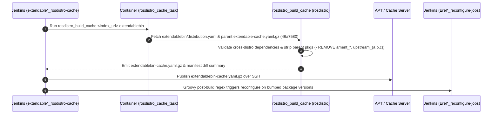

# Stage 5 Plan: `extendable` & `extendablebin` (`E*`) — Distribution Cache Lifecycle & Automated Bloom Packaging

Architecture, sequence flows, branch matrix, and remote validation on `https://build.test.ros2.org` for **Stage 5** of the REP-159 testing campaign (`extendable` $\to$ `extendablebin`).

---

## 1. Cache Generation & Parent Inheritance Flow (`rosdistro_build_cache`)



---

## 2. 2-Tier Cache Hierarchy (`extendable` $\to$ `extendablebin`)

```mermaid
graph LR
    CB["extendable (Root Distro)<br/>Prefix: /opt/ros/extendable<br/>binary_rule: vendor-{distro}-{package}<br/>Packages: ament_package, ament_cmake_core, ros_workspace, upstream_{a,b,c}"] -->|binary_import<br/>extends[].index_url| CC["extendablebin (Overlay Distro)<br/>Prefix: /opt/ros/extendablebin<br/>binary_rule: vendor-{distro}-{package}<br/>Packages: ros_workspace (override), downstream_bin_a"]
```

| Property | `extendable` (Root) | `extendablebin` (Overlay) |
|---|---|---|
| **`extends`** | *(None)* | `[{distro_name: extendable, extension_method: binary_import}]` |
| **`install_rule`** | `/opt/ros/{distro}` | `/opt/ros/{distro}` |
| **`binary_rule`** | `{search: '^', replace: 'vendor-{distro}-'}` | `{search: '^', replace: 'vendor-{distro}-'}` |
| **Own Packages in `<distro>-cache.yaml.gz`** | `ament_package`, `ament_cmake_core`, `ros_workspace`, `upstream_a`, `upstream_b`, `upstream_c` | `ros_workspace`, `downstream_bin_a` *(inherited parent packages stripped via `- REMOVE`)* |
| **In-Memory `get_cached_distribution()`** | 6 packages | 7 packages (`downstream_bin_a` + child `ros_workspace` + merged parent `ament_*`, `upstream_{a,b,c}`) |

---

## 3. Repository & Semantic Branch Matrix

| Submodule | Semantic Branch (`@ SHA`) | Key Commits & Role |
|---|---|---|
| **`rosdistro`** | [`feat/rep159-install-rule`](https://github.com/rep159-testing/rosdistro/tree/feat/rep159-install-rule) (`a8f5543`) | Includes `jrivero`'s `46a7580` (*"Load parent caches from extends[].index_url and fail if one cannot load"*), `aefe17c`/`a8f5543` (`BINARY_IMPORT_OVERRIDABLE = frozenset(['ros_workspace'])`), `binary_rule`, and `install_rule`. |
| **`bloom`** | [`feat/rep159-rules-support`](https://github.com/rep159-testing/bloom/tree/feat/rep159-rules-support) (`7af7034`) | Stacked on `jrivero`'s `origin/rep159` (`0189046`..`2877687`) + `binary_rule`, `install_rule`, and `d6fdf9e` (`git tag -f -m` GPG sign fix). |
| **`downstream_bin_a-release`** | [`debian/vendor-extendablebin/resolute/downstream_bin_a`](https://github.com/rep159-testing/downstream_bin_a-release/tree/debian/vendor-extendablebin/resolute/downstream_bin_a) (`9f8ba47`) | Debian packaging generated via `git-bloom-generate rosdebian` (`Package: vendor-extendablebin-downstream-bin-a`). |
| **`ros_buildfarm`** | [`feat/extendable-workspace`](https://github.com/rep159-testing/ros_buildfarm/tree/feat/extendable-workspace) (`ca13954`) | Installs REP-159 `rosdistro` (`a8f5543`) in `rosdistro_cache_task.Dockerfile.em` (replaced upstream by **Release Gate 1** `python3-rosdistro-modules >= 1.2.0`). |
| **`rep159-rosdistro` & `ros_buildfarm_config`** | [`feat/extendable-workspace`](https://github.com/rep159-testing/rep159-rosdistro/tree/feat/extendable-workspace) (`19aedba` / `c80b6f7`) | `extendable` and `extendablebin` distribution and buildfarm config definitions. |

---

## 4. Remote Validation Evidence on `https://build.test.ros2.org`

| Test Case | Job / Tool on `build.test.ros2.org` | Build & Console | Status | Target Artifact / Verified Output |
|---|---|---|:---:|---|
| **1. Root Cache Generation** | `extendable_rosdistro-cache` | [#139](https://build.test.ros2.org/job/extendable_rosdistro-cache/139/) ([Log](https://build.test.ros2.org/job/extendable_rosdistro-cache/139/console)) | **SUCCESS** | Generates `extendable-cache.yaml.gz` with all 6 root packages (`ament_package`, `ament_cmake_core`, `ros_workspace`, `upstream_{a,b,c}`) and publishes over SSH. |
| **2. Child Cache Parent Merge & Boundary Strip** | `extendablebin_rosdistro-cache` | [#138](https://build.test.ros2.org/job/extendablebin_rosdistro-cache/138/) ([Log](https://build.test.ros2.org/job/extendablebin_rosdistro-cache/138/console)) | **SUCCESS** | Loads parent `extendable-cache.yaml.gz`, validates cross-distro dependencies, strips inherited parent packages (`- REMOVE ament_cmake_core, ament_package, upstream_{a,b,c}`), preserves child `ros_workspace` + `downstream_bin_a`, and publishes `extendablebin-cache.yaml.gz` over SSH. |
| **3. Automated Bloom Debian Generation & Binary Build** | `git-bloom-generate rosdebian`<br>`Esrc_uR__extbin_downstream_bin_a__ubuntu_resolute__source`<br>`Ebin_uR64__extbin_downstream_bin_a__ubuntu_resolute_amd64__binary` | [#1](https://build.test.ros2.org/job/Esrc_uR__extbin_downstream_bin_a__ubuntu_resolute__source/1/) ([Log](https://build.test.ros2.org/job/Esrc_uR__extbin_downstream_bin_a__ubuntu_resolute__source/1/console))<br>[#2](https://build.test.ros2.org/job/Ebin_uR64__extbin_downstream_bin_a__ubuntu_resolute_amd64__binary/2/) ([Log](https://build.test.ros2.org/job/Ebin_uR64__extbin_downstream_bin_a__ubuntu_resolute_amd64__binary/2/console)) | **SUCCESS** | Generates [`debian/vendor-extendablebin/resolute/downstream_bin_a`](https://github.com/rep159-testing/downstream_bin_a-release/tree/debian/vendor-extendablebin/resolute/downstream_bin_a) (`9f8ba47`) and builds `vendor-extendablebin-downstream-bin-a` into `/opt/ros/extendablebin` consuming `/opt/ros/extendable/setup.sh`. |
