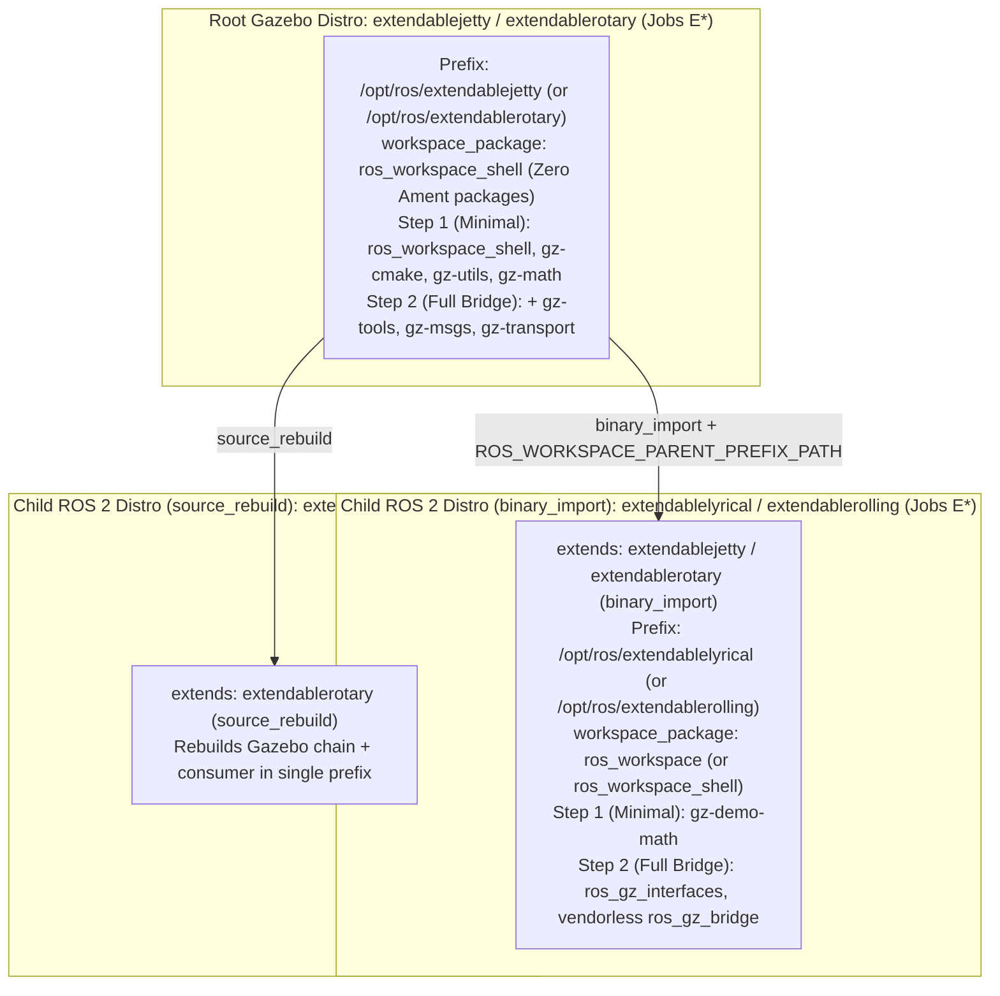

# Stage 6 Plan: Adopting `workspace_package` (`ros_workspace_shell`) & Composable ROS + Gazebo Demonstrations on `build.test.ros2.org`

Architecture, historical progression of workspace chaining across Stages 1–6, stacked branch matrix, and testfarm execution plan for **Stage 6** of the REP-159 validation campaign on `https://build.test.ros2.org`.

---

## 1. Evolution of Workspace Setup & Underlay Chaining (Stages 1 -> 6)

Across our REP-159 testing campaign, we iterated through three distinct mechanisms for managing prefix setup files (`/opt/ros/<distro>/setup.bash`) and parent underlay chaining:

### 1.1 Stages 1–3: Pure CMake Without a Workspace Package (`extendable*`)
* **How We Solved It**:
  - The `extendable`, `extendablesrc`, `extendablebin`, `extendablechain`, `extendablemixed`, and `extendablediamond` distributions contained **only** the pure CMake test packages (`upstream_a/b/c`, `downstream_*`) and **no `ros_workspace` package**.
  - In `bloom`, we conditionally skipped injecting `ros-<distro>-ros-workspace` when `ros_workspace` was absent from the distribution, and passed `-DCMAKE_PREFIX_PATH` directly in `debian/rules.em` while guarding `. "/opt/ros/<parent>/setup.sh"` behind `if [ -f ... ]`.
  - In `ros_buildfarm` (`workspace.py`), when `/opt/ros/<parent>/setup.sh` did not exist on disk, the buildfarm read `ROS_BUILDFARM_PARENT_RESULT_SPACES` and directly exported `CMAKE_PREFIX_PATH`, `COLCON_PREFIX_PATH`, `LD_LIBRARY_PATH`, and `PATH`.
* **What It Validated vs. Its Limitation**:
  - Validated `binary_rule` regex renaming, `install_rule` custom prefixes (`/opt/vendor/extendable`), `ReleaseAndSourceDependencyWalker` boundary pruning, and 3-tier/hybrid/diamond DAG traversal with zero bootstrap packages.
  - **Limitation**: Installed `.deb` packages did not place `/opt/ros/<distro>/setup.bash` on disk, so end users installing the binaries in a container had to export `LD_LIBRARY_PATH` and `CMAKE_PREFIX_PATH` manually.

### 1.2 Stages 4–5: Full `ros_workspace` + `ament_cmake` Stack (`extendable` & `extendablebin`)
* **How We Solved It**:
  - To provide end users with `/opt/ros/<distro>/setup.bash` and automatic parent underlay chaining, we adopted Jose Luis Rivero's (`jrivero`) `BINARY_IMPORT_OVERRIDABLE = frozenset(['ros_workspace'])` in `rosdistro`, `ROS_WORKSPACE_PARENT_PREFIX_PATH` in `ros_workspace`, and `ParentPrefixes` in `bloom`.
  - In the root distribution (`extendable`), we bloomed and built **all 3 Ament bootstrap packages** (`ament_package`, `ament_cmake_core`, and `ros_workspace`), and carried the manual `export PYTHONPATH=...` bootstrap patch in `ament_cmake_core-release` so `ament_cmake_core` could find `ament_package` before `ros_workspace` existed.
  - In the `binary_import` child (`extendablebin`), we released a child `ros_workspace` package that chained `/opt/ros/extendable` via `-DROS_WORKSPACE_PARENT_PREFIX_PATH="/opt/ros/extendable"`.
* **What It Validated vs. Its Limitation**:
  - Validated full ROS 2 `setup.bash` recursive underlay chaining, automated `bloom` Debian generation, and `rosdistro_build_cache` parent cache merging (`extendable_rosdistro-cache`, `extendablebin_rosdistro-cache`).
  - **Limitation**: Any root or `source_rebuild` distribution (even a pure CMake or Gazebo distribution) was forced to bloom and build 3 Ament packages (`ament_package`, `ament_cmake_core`, `ros_workspace`) and maintain a manual `debian/rules` patch in `ament_cmake_core-release`.

### 1.3 Stage 6+: Adopting Jose Luis Rivero's `ros_workspace_shell` Split & `workspace_package` Key
* **Why We Adopt Jose's Solution for Stage 6+**:
  - Jose split the prefix setup scripts out of `ros_workspace` into [`rep159-testing/ros_workspace_shell`](https://github.com/rep159-testing/ros_workspace_shell) (`a89cc7b`, tag `0.1.0`), a **plain CMake** package with **zero Ament dependencies** (depends only on `python3`), and introduced the optional v3 `distribution.yaml` top-level key `workspace_package`.
  - When a non-ROS / Gazebo / CMake distribution sets `workspace_package: ros_workspace_shell`:
    1. Only **1 tiny plain-CMake bootstrap package** (`ros_workspace_shell`) is needed instead of 3 Ament packages.
    2. **Zero manual `debian/rules` patches** are needed (no `ament_cmake_core` bootstrap cycle).
    3. Every distribution still installs `/opt/ros/<distro>/setup.sh`, `setup.bash`, `setup.zsh`, `local_setup.*`, and `.dsv` hooks, and chains parent prefixes via `-DROS_WORKSPACE_PARENT_PREFIX_PATH`.
    4. A ROS 2 child distribution (using default `ros_workspace` or `ros_workspace_shell`) automatically depends on and chains each parent's own configured `workspace_package` (`get_binary_import_parent_workspace_packages`).

### 1.4 Comparison Summary Across Stages 1–6

| Aspect | Stages 1–3 (Pure CMake, No Workspace Pkg) | Stages 4–5 (Full `ros_workspace`) | Stage 6+ (Adopted `workspace_package` / `ros_workspace_shell`) |
| :--- | :--- | :--- | :--- |
| **Bootstrap packages in Root / `source_rebuild` non-ROS distro** | **0** | **3** (`ament_package`, `ament_cmake_core`, `ros_workspace`) | **1** (`ros_workspace_shell` — plain CMake, no Ament) |
| **Bootstrap packages in `binary_import` child distro** | **0** | **1** (`ros_workspace`) | **1** (`ros_workspace` for ROS 2 child, or `ros_workspace_shell` for CMake child) |
| **Manual `PYTHONPATH` patch in `ament_cmake_core-release`?** | No | **Yes** | **No** |
| **Installs `/opt/ros/<distro>/setup.bash` for end users?** | **No** | **Yes** | **Yes** |
| **Recursive runtime underlay chaining (`parent_prefix_path`)?** | No (buildfarm env export only) | **Yes** | **Yes** (works across mixed `ros_workspace` and `ros_workspace_shell` layers) |
| **Supports `binary_rule`, `install_rule`, & `distribution_eol_date`?** | **Yes** | **Yes** | **Yes** (unified on `feat/rep159-workspace-package`) |

---

## 2. Strict Collaborator & Testfarm Isolation Guarantee

All Stage 6 work strictly obeys the following non-overlap rules:
1. **Collaborator Branches Untouched**: Jose's branches (`rep159`, `rep159-workspace-package`, `rep159-shell`, `rep159-setup-chain`, `rep159-child-ros-workspace`, `rep159-parent-chain`, `rep159-split-base`, `kmom88`) are never modified or force-pushed.
2. **Stage 1–5 Branches Untouched**: All of our existing Stage 1–5 `feat/*` branches remain frozen at their verified commits.
3. **Collaborator Distributions & Jenkins Jobs Untouched**: Jose's distributions (`upstream`, `srcext`, `binext`, `ground`, `derived`) and Jenkins jobs (`U*`, `S*`, `B*`, `G*`, `D*`, as well as `C*`) are never modified or triggered. All our testfarm jobs stay strictly in the **`extendable*` (`E*`)** namespace.

---

## 3. Stacked Branch Matrix for Stage 6 (`feat/rep159-workspace-package`)

We have stacked Jose's `workspace_package` commits directly on top of our Stage 5 / `eol-date` stack:

| Submodule / Repository | Base Branch (Untouched) | New Stacked Branch (`@ SHA`) | Adopted `jrivero` Commit & Unified Features | Unit Tests |
| :--- | :--- | :--- | :--- | :---: |
| **[submodules/rosdistro](file:///usr/local/google/home/rossif/github/kmom88/rep159-testing/submodules/rosdistro)** | `feat/rep159-eol-date` (`5ec62f9`) *(on `feat/rep159-install-rule` `a8f5543`)* | [`feat/rep159-workspace-package`](https://github.com/rep159-testing/rosdistro/tree/feat/rep159-workspace-package) (`5d4a392`) | Cherry-picks `bc0600f` (`Jose Luis Rivero`): parses `workspace_package` in v3 `distribution.yaml` and sets `binary_import_overridable = frozenset([self.workspace_package or 'ros_workspace'])` alongside `binary_rule`, `install_rule`, and `distribution_eol_date`. | **104 / 104 PASS** |
| **[submodules/bloom](file:///usr/local/google/home/rossif/github/kmom88/rep159-testing/submodules/bloom)** | `feat/rep159-rules-support` (`7af7034`) | [`feat/rep159-workspace-package`](https://github.com/rep159-testing/bloom/tree/feat/rep159-workspace-package) (`aa5133e`) | Cherry-picks `2cb93dc` (`Jose Luis Rivero`): `get_workspace_package()`, `get_binary_import_parent_workspace_packages()`, and `get_workspace_dependencies()`, integrated with `get_binary_package_name()` (`binary_rule`) and `get_install_prefix()` (`install_rule`). | **40 / 40 PASS** |
| **[submodules/ros_buildfarm](file:///usr/local/google/home/rossif/github/kmom88/rep159-testing/submodules/ros_buildfarm)** *(Clean PR)* | `feat/rep159-binary-naming` (`a271be1`) | [`feat/rep159-workspace-package`](https://github.com/rep159-testing/ros_buildfarm/tree/feat/rep159-workspace-package) (`e54594c`) | Cherry-picks `146d05f` (`Jose Luis Rivero`): `_get_and_parse_distribution_cache` in `release_job.py` uses `get_workspace_package(dist_cache.distribution_file)`. Zero Dockerfile pip hacks. | **27 / 27 PASS** |
| **[submodules/ros_buildfarm](file:///usr/local/google/home/rossif/github/kmom88/rep159-testing/submodules/ros_buildfarm)** *(Testbed)* | `feat/extendable-workspace` (`ca13954`) | [`feat/extendable-workspace-package`](https://github.com/rep159-testing/ros_buildfarm/tree/feat/extendable-workspace-package) (`50884d3`) | Cherry-picks `146d05f` (`3f127b7`), pins `rosdistro` `5d4a392` across the 5 task Dockerfile templates (`2bff39e`), supports `ext*` release build prefixes inside `Esrc_uR` and `Ebin_uR64` (`02dd1a9`), and exports `CMAKE_PREFIX_PATH` in `workspace.py` for `parent_result_spaces` with `setup.sh` (`50884d3`). | **33 / 33 PASS** |
| **[submodules/reps](file:///usr/local/google/home/rossif/github/kmom88/rep159-testing/submodules/reps)** | `feature/rep-159-install-rule` (`1aef980`) | [`feature/rep-159-workspace-package`](https://github.com/KmoM88/reps/tree/feature/rep-159-workspace-package) (`0905caa`) | Documents `workspace_package` (`ros_workspace_shell` vs `ros_workspace`) in Distribution File v3 and `distribution_eol_date` in Index File v4 (`openrobotics/reps#37`). | Spec Verified |
| **[submodules/rosdistro-reviewer](file:///usr/local/google/home/rossif/github/kmom88/rep159-testing/submodules/rosdistro-reviewer)** | `main` (`6e2a173`) | [`feat/rep159-eol-date`](https://github.com/rep159-testing/rosdistro-reviewer/tree/feat/rep159-eol-date) (`3e6ab56`) | Implements `_check_eol_dates` in `RosdistroAnalyzer` validating `distribution_eol_date` ISO 8601 format (`YYYY-MM-DD` / `YYYY-MM`) and detecting parent/child EOL mismatches (`parent_eol < child_eol`) across `extends`. | **200 / 200 PASS** |
| **[submodules/rep159-rosdistro](file:///usr/local/google/home/rossif/github/kmom88/rep159-testing/submodules/rep159-rosdistro)** | `feat/extendable-workspace` (`ab0400c`) | [`feat/extendable-gazebo`](https://github.com/rep159-testing/rep159-rosdistro/tree/feat/extendable-gazebo) (`9b4108b`) | Adds `extendablejetty` (`workspace_package: ros_workspace_shell`, `gz-cmake`, `gz-utils`, `gz-math`), `extendablelyricalsrc` (`source_rebuild`), and `extendablelyrical` (`binary_import`, `gz-demo-math`) with `distribution_eol_date: 2030-11-01`. | Cache Verified |
| **[submodules/ros_buildfarm_config](file:///usr/local/google/home/rossif/github/kmom88/rep159-testing/submodules/ros_buildfarm_config)** | `feat/extendable-workspace` (`3322225`) | [`feat/extendable-gazebo`](https://github.com/rep159-testing/ros_buildfarm_config/tree/feat/extendable-gazebo) (`cda1b06`) | Adds `extendablejetty` (`extjetty`), `extendablelyricalsrc`, and `extendablelyrical` (`extlyrical`) CI and release build configs under `E*`. | Dry-Run & Live Jobs Generated |
| **[submodules/ros_workspace_shell](file:///usr/local/google/home/rossif/github/kmom88/rep159-testing/submodules/ros_workspace_shell)** | `main` (`a89cc7b`, tag `0.1.0`) | Used as-is (`a89cc7b`) | Jose's plain-CMake prefix setup package (`ros_workspace_shell`). | Verified |
| **[submodules/ros_workspace_shell-release](file:///usr/local/google/home/rossif/github/kmom88/rep159-testing/submodules/ros_workspace_shell-release)** | `master` (`2ff6116`) | Untouched (`extendable*` GBP tags hosted in `KmoM88/rep159-testing.git`) | Leaves Jose's `ground`/`derived` release repo 100% untouched. | Verified |

---

## 4. Stage 6 Execution Plan (Aligned with Nov 11 Coordination Notes)

### Phase 6A: Tooling Stack Unification (`feat/rep159-workspace-package`) — COMPLETED
- Stacked `feat/rep159-workspace-package` across `rosdistro` (`5d4a392`), `bloom` (`aa5133e`), `ros_buildfarm` (`e54594c` clean / `2bff39e` testbed), and `reps` (`0905caa`).
- Added `submodules/ros_workspace_shell` and `submodules/ros_workspace_shell-release` to `.gitmodules`.

### Phase 6B: Demonstration 1 — Import Gazebo into ROS (`lyrical`/`jetty` & `rolling`/`rotary`, Up to `ros_gz_bridge` Without Vendor Packages)

1. **Step 6B-1 (Gazebo `ros_workspace_shell` + `gz-demo-math` Smoke Test in `E*`) — COMPLETED (17/17 `SUCCESS`)**:
   - Configured `extendablejetty` (root Gazebo distribution with `workspace_package: ros_workspace_shell`, `gz-cmake` `5.1.1-1`, `gz-utils` `4.0.0-1`, `gz-math` `9.3.0-1` — **zero Ament packages**), `extendablelyricalsrc` (`source_rebuild` child), and `extendablelyrical` (`binary_import` child with `ros_workspace_shell` `0.1.0-1` chaining `/opt/ros/extendablejetty` + `gz-demo-math` `1.0.1-1`).
   - Added permanent stage and Bloom orchestration tools in [`tools/stage_runner.py`](tools/stage_runner.py) and [`tools/bloom_stage6_gazebo.py`](tools/bloom_stage6_gazebo.py).
   - Executed all 17 `E*` release, sync, and CI jobs on `https://build.test.ros2.org` (**17 / 17 `SUCCESS`**):
     - `Esrc_uR__extjetty_ros_workspace_shell__ubuntu_resolute__source` [#1](https://build.test.ros2.org/job/Esrc_uR__extjetty_ros_workspace_shell__ubuntu_resolute__source/1/) — **SUCCESS**
     - `Esrc_uR__extjetty_gz-cmake__ubuntu_resolute__source` [#1](https://build.test.ros2.org/job/Esrc_uR__extjetty_gz-cmake__ubuntu_resolute__source/1/) — **SUCCESS**
     - `Esrc_uR__extjetty_gz-utils__ubuntu_resolute__source` [#1](https://build.test.ros2.org/job/Esrc_uR__extjetty_gz-utils__ubuntu_resolute__source/1/) — **SUCCESS**
     - `Esrc_uR__extjetty_gz-math__ubuntu_resolute__source` [#1](https://build.test.ros2.org/job/Esrc_uR__extjetty_gz-math__ubuntu_resolute__source/1/) — **SUCCESS**
     - `Esrc_uR__extlyrical_ros_workspace_shell__ubuntu_resolute__source` [#1](https://build.test.ros2.org/job/Esrc_uR__extlyrical_ros_workspace_shell__ubuntu_resolute__source/1/) — **SUCCESS**
     - `Esrc_uR__extlyrical_gz-demo-math__ubuntu_resolute__source` [#1](https://build.test.ros2.org/job/Esrc_uR__extlyrical_gz-demo-math__ubuntu_resolute__source/1/) — **SUCCESS**
     - `Ebin_uR64__extjetty_ros_workspace_shell__ubuntu_resolute_amd64__binary` [#1](https://build.test.ros2.org/job/Ebin_uR64__extjetty_ros_workspace_shell__ubuntu_resolute_amd64__binary/1/) — **SUCCESS**
     - `Ebin_uR64__extjetty_gz-cmake__ubuntu_resolute_amd64__binary` [#2](https://build.test.ros2.org/job/Ebin_uR64__extjetty_gz-cmake__ubuntu_resolute_amd64__binary/2/) — **SUCCESS**
     - `Ebin_uR64__extjetty_gz-utils__ubuntu_resolute_amd64__binary` [#2](https://build.test.ros2.org/job/Ebin_uR64__extjetty_gz-utils__ubuntu_resolute_amd64__binary/2/) — **SUCCESS**
     - `Ebin_uR64__extjetty_gz-math__ubuntu_resolute_amd64__binary` [#2](https://build.test.ros2.org/job/Ebin_uR64__extjetty_gz-math__ubuntu_resolute_amd64__binary/2/) — **SUCCESS**
     - `Erel_extjetty_sync-packages-to-testing_resolute_amd64` [#2](https://build.test.ros2.org/job/Erel_extjetty_sync-packages-to-testing_resolute_amd64/2/) — **SUCCESS**
     - `Ebin_uR64__extlyrical_ros_workspace_shell__ubuntu_resolute_amd64__binary` [#2](https://build.test.ros2.org/job/Ebin_uR64__extlyrical_ros_workspace_shell__ubuntu_resolute_amd64__binary/2/) — **SUCCESS**
     - `Ebin_uR64__extlyrical_gz-demo-math__ubuntu_resolute_amd64__binary` [#3](https://build.test.ros2.org/job/Ebin_uR64__extlyrical_gz-demo-math__ubuntu_resolute_amd64__binary/3/) — **SUCCESS**
     - `Erel_extlyrical_sync-packages-to-testing_resolute_amd64` [#2](https://build.test.ros2.org/job/Erel_extlyrical_sync-packages-to-testing_resolute_amd64/2/) — **SUCCESS**
     - `Eci__gazebo-jetty-release_ubuntu_resolute_amd64` [#1](https://build.test.ros2.org/job/Eci__gazebo-jetty-release_ubuntu_resolute_amd64/1/) — **SUCCESS**
     - `Eci__gazebo-lyrical-source-rebuild_ubuntu_resolute_amd64` [#1](https://build.test.ros2.org/job/Eci__gazebo-lyrical-source-rebuild_ubuntu_resolute_amd64/1/) — **SUCCESS**
     - `Eci__gazebo-lyrical-binary-import_ubuntu_resolute_amd64` [#2](https://build.test.ros2.org/job/Eci__gazebo-lyrical-binary-import_ubuntu_resolute_amd64/2/) — **SUCCESS**
2. **Step 6B-2 (Expand up to Vendorless `ros_gz_bridge`)**:
   - Add `gz-tools` (`gz-tools2`), `gz-msgs`, and `gz-transport` to the Gazebo base distribution (`6` Gazebo packages + `ros_workspace_shell`).
   - In the ROS 2 child distribution, include `ros_gz_interfaces` and `ros_gz_bridge` (with `gz_msgs_vendor` and `gz_transport_vendor` removed from `package.xml` and `CMakeLists.txt` so `ros_gz_bridge` calls `find_package(gz-msgs REQUIRED)` and `find_package(gz-transport REQUIRED)` directly against the Gazebo underlay).

### Phase 6C: Demonstration 2 — 3rd-Party Extension of a ROS 2 Distribution
- Define a 3rd-party child distribution (`extendable3rdparty`, Jenkins jobs `E*`) extending a ROS 2 base distribution (`source_rebuild` and same-buildfarm `binary_import` on `build.test.ros2.org`) and building a downstream 3rd-party ROS 2 package without rebuilding the parent ROS 2 packages in `binary_import` mode.

### Phase 6D: `distribution_eol_date` Check in `rosdistro-reviewer` — COMPLETED (200/200 `PASS`)
- Forked `ros-infrastructure/rosdistro-reviewer` to [`rep159-testing/rosdistro-reviewer`](https://github.com/rep159-testing/rosdistro-reviewer), registered `submodules/rosdistro-reviewer`, and implemented `_parse_eol_date` and `_check_eol_dates` on branch [`feat/rep159-eol-date`](https://github.com/rep159-testing/rosdistro-reviewer/tree/feat/rep159-eol-date) (`3e6ab56`):
  1. Validates `distribution_eol_date` (`YYYY-MM-DD` and `YYYY-MM`) in `index-v4.yaml` and emits a recommendation when malformed or missing on active distributions.
  2. Detects **Parent/Child EOL mismatches** (`parent_eol < child_eol`) when a child distribution `extends` a parent distribution whose `distribution_eol_date` expires before the child's `distribution_eol_date`.
  3. All **200 / 200** unit and linter tests (`flake8`, `mypy`, `scspell3k`, `copyright_license`, `yamllint`) pass.
