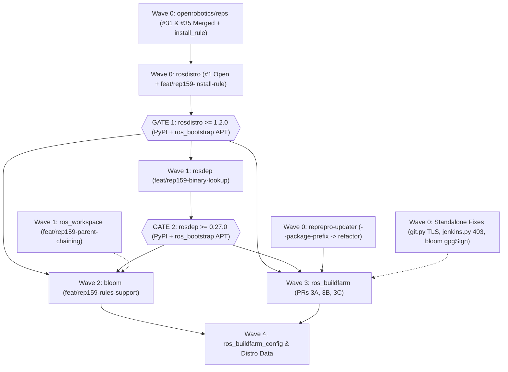

# REP-159 Stage-by-Stage Pull Request & Issue Architecture Map

Cross-repository PR, issue, and release-gate matrix across the **`rep159-testing`** organization and upstream Open Robotics repositories, backed by empirical builds on `https://build.test.ros2.org`.

---

## 1. Upstream Merge & Release-Gate DAG



---

## 2. Phased Milestone & Release-Gate Progression Table

| Milestone | Stage / Area | Repository & Clean PR Branch (`@ SHA`) | Upstream Target | Blocking Gate | Output Deliverable | Status |
|:---:|---|---|---|---|---|:---:|
| **M0** | Specification | [`KmoM88/reps`](https://github.com/KmoM88/reps): `feature/rep-159-binary-name-templating` (`f683ccc`) | `openrobotics/reps:rosdistro_extension` | None | [`openrobotics/reps#35`](https://github.com/openrobotics/reps/pull/35) (`binary_rule` lowercase spec) | **MERGED** |
| **M0** | Specification | [`KmoM88/reps`](https://github.com/KmoM88/reps): `feature/rep-159-install-rule` (`f0118d5`) | `openrobotics/reps:rosdistro_extension` | `reps#35` | `install_rule` directive specification | **READY TO PR** |
| **M0** | APT Sync | [`rep159-testing/reprepro-updater`](https://github.com/rep159-testing/reprepro-updater): `feat/package-prefix` (`93ed2dc`) | `ros-infrastructure/reprepro-updater:refactor` | None | `--package-prefix` filter in `sync_ros_packages.py` | **READY** |
| **M0** | Resilience Fixes | `ros_buildfarm`: `ae8826b` (git TLS), `199fd98` (Jenkins 403)<br>`bloom`: `d6fdf9e` (`git tag -f -m`) | Respective `master` | None | Standalone bugfix PRs | **READY** |
| **M1** | Core Parser & Regex | [`rep159-testing/rosdistro`](https://github.com/rep159-testing/rosdistro): `feature/rep159-binary-naming-regex` (`bfde799`) | `ros-infrastructure/rosdistro:master` | M0 Specs | [`rep159-testing/rosdistro#1`](https://github.com/rep159-testing/rosdistro/pull/1) (Format 3, `extends`, `binary_rule`) | **OPEN** |
| **M1** | Install Prefixes & Child `ros_workspace` | [`rep159-testing/rosdistro`](https://github.com/rep159-testing/rosdistro): `feat/rep159-install-rule` (`a8f5543`) | Stacked on `rosdistro#1` | `rosdistro#1` | `install_rule` + `jrivero`'s `BINARY_IMPORT_OVERRIDABLE = frozenset(['ros_workspace'])` (`aefe17c`, `a8f5543`) | **PR-READY** (96/96 tests) |
| **G1** | **RELEASE GATE 1** | **`ros-infrastructure/rosdistro`** | Tag `1.2.0` | M1 Merge | **PyPI `rosdistro >= 1.2.0` + `ros_bootstrap` APT `python3-rosdistro-modules >= 1.2.0`** | **HOLD ON M1** |
| **M2** | Binary Lookup | [`rep159-testing/rosdep`](https://github.com/rep159-testing/rosdep): `feat/rep159-binary-lookup` (`5661779`) | `ros-infrastructure/rosdep:master` | **GATE 1** | Clean `gbpdistro_support.py` delegation + Format 3 tests (0 CI hacks) | **PR-READY** |
| **M2** | Workspace Chaining | [`rep159-testing/ros_workspace`](https://github.com/rep159-testing/ros_workspace): `feat/rep159-parent-chaining` (`4997f85`) | `ros2/ros_workspace:main` | None (CMake) | Stacked on `jrivero`'s `12f93e9` (`ROS_WORKSPACE_PARENT_PREFIX_PATH`) + `PARENT_PREFIX_PATH` alias | **PR-READY** |
| **G2** | **RELEASE GATE 2** | **`ros-infrastructure/rosdep` & `ros2/ros_workspace`** | Tags `0.27.0` & `1.0.4` | M2 Merge | **PyPI `rosdep >= 0.27.0` + `ros_bootstrap` APT `python3-rosdep-modules >= 0.27.0`** | **HOLD ON M2** |
| **M3** | Debian Generator | [`rep159-testing/bloom`](https://github.com/rep159-testing/bloom): `feat/rep159-rules-support` (`7af7034`) | `ros-infrastructure/bloom:master` | **GATES 1 & 2** | Stacked on `jrivero`'s `rep159` (`0189046`..`2877687`) + `binary_rule` & `install_rule` | **PR-READY** (26/26 tests) |
| **G3** | **RELEASE GATE 3** | **`ros-infrastructure/bloom`** | Tag `0.15.0` | M3 Merge | **PyPI `bloom >= 0.15.0` + `ros_bootstrap` APT `python3-bloom >= 0.15.0`** | **HOLD ON M3** |
| **M4** | Buildfarm Engine | [`rep159-testing/ros_buildfarm`](https://github.com/rep159-testing/ros_buildfarm):<br>• **PR 3A**: `feat/rep159-workspace-walk` (`486b579`)<br>• **PR 3B**: `feat/rep159-underlays` (`a4a5bbd`)<br>• **PR 3C**: `feat/rep159-binary-naming` (`a271be1`) | `ros-infrastructure/ros_buildfarm:master` | **GATES 1 & 2 + `reprepro:refactor`** | 3 clean PRs off `master` (`7daa2b1`, 0 Dockerfile pip hacks): `jrivero` workspace walk (`486b579`), `jrivero` underlays (`83fd534`) + `install_rule`/CMake exports (`a4a5bbd`), and release naming (`a271be1`) | **PR-READY** (100% tests) |
| **G4** | **RELEASE GATE 4** | **`ros-infrastructure/ros_buildfarm`** | Tag `4.2.0` | M4 Merge | **PyPI `ros_buildfarm >= 4.2.0` + APT `python3-ros-buildfarm >= 4.2.0`** | **HOLD ON M4** |

---

## 3. Stage-by-Stage Technical Matrix & Remote Testfarm Evidence

| Stage | Problem Solved | Clean PR Branches (`@ SHA`) | Key Architectural Mechanism | Verified `build.test.ros2.org` Jobs & Status |
|---|---|---|---|---|
| **Stage 1: `binary_rule` & Prefix Sync** | Hardcoded `ros-{distro}-{pkg}` naming causes vendor APT collisions | • `reps`: `f683ccc` (**MERGED** `#35`)<br>• `rosdistro`: `feature/rep159-binary-naming-regex` (`bfde799`, `#1`)<br>• `rosdep`: `feat/rep159-binary-lookup` (`5661779`)<br>• `reprepro-updater`: `feat/package-prefix` (`93ed2dc`)<br>• `ros_buildfarm`: `feat/rep159-binary-naming` (`a271be1`) | `DistributionFile.get_binary_package_name()` evaluates `{search, replace}` with lowercase `{distro}`, `{package}`, `{origin_distro}`; `reprepro-updater` filters sync via `--package-prefix vendor-extendable-` | • `Esrc_uR__upstream_{a,b,c}` ([#2/#1/#1](https://build.test.ros2.org/job/Esrc_uR__upstream_a__ubuntu_resolute__source/2/) & [#4/#3/#3](https://build.test.ros2.org/job/Esrc_uR__upstream_a__ubuntu_resolute__source/4/)) — **SUCCESS**<br>• `Ebin_uR64__upstream_{a,b,c}` ([#1](https://build.test.ros2.org/job/Ebin_uR64__upstream_a__ubuntu_resolute_amd64__binary/1/) & [#3/#4/#3](https://build.test.ros2.org/job/Ebin_uR64__upstream_a__ubuntu_resolute_amd64__binary/3/)) — **SUCCESS**<br>• `Erel_sync` ([#8](https://build.test.ros2.org/job/Erel_sync-packages-to-testing_resolute_amd64/8/) & [#10](https://build.test.ros2.org/job/Erel_sync-packages-to-testing_resolute_amd64/10/)) — **SUCCESS**<br>• `Eci__nightly-release #2`, `Eci__source-branches #2`, `Eci__release-branches #2` — **SUCCESS** |
| **Stage 2: `install_rule` & `binary_import` Walk** | Hardcoded `/opt/ros/{distro}` prefix and unnecessary source checkouts of `binary_import` parents | • `reps`: `feature/rep-159-install-rule` (`f0118d5`)<br>• `rosdistro`: `feat/rep159-install-rule` (`a8f5543`)<br>• `ros_buildfarm`: `feat/rep159-workspace-walk` (`486b579`) + `feat/rep159-underlays` (`a4a5bbd`) | `get_distribution_install_prefix()` resolves `/opt/vendor/extendable`; `ReleaseAndSourceDependencyWalker` halts source walk at `binary_import`; `ROS_BUILDFARM_PARENT_RESULT_SPACES` injected into container | • `Esrc_uR__upstream_{a,b,c}` (`#3`, `#2`, `#2`) — **SUCCESS**<br>• `Ebin_uR64__upstream_{a,b,c}` (`#2`, `#2`, `#2`) — **SUCCESS**<br>• `Erel_sync #9` — **SUCCESS**<br>• [`Eci__binary-import #5`](https://build.test.ros2.org/job/Eci__binary-import_ubuntu_resolute_amd64/5/) (`/opt/vendor/extendable`) — **SUCCESS**<br>• [`Eci__source-rebuild #2`](https://build.test.ros2.org/job/Eci__source-rebuild_ubuntu_resolute_amd64/2/) — **SUCCESS** |
| **Stage 3: Multi-Tier, Hybrid & Diamond DAGs** | Pure CMake underlays lack `setup.sh`; multi-tier and diamond DAGs require recursive underlay deduplication | • `rosdistro`: `feat/rep159-install-rule` (`a8f5543`)<br>• `ros_buildfarm`: `feat/rep159-workspace-walk` (`486b579`) + `feat/rep159-underlays` (`a4a5bbd`)<br>• `rep159-rosdistro`: `feat/stage3-*` (`69afb27`, `e63a90a`, `3e66c48`, `7ab72c6`) | `get_binary_import_underlays()` deduplicates ancestor prefixes (`/opt/ros/extendable:/opt/ros/extendablebin`); `workspace.py` exports `CMAKE_PREFIX_PATH`, `COLCON_PREFIX_PATH`, and multiarch `LD_LIBRARY_PATH` when `setup.sh` is absent | • Option A (`source_rebuild` 3-tier): [`Eci__chained-import #3`](https://build.test.ros2.org/job/Eci__chained-import_ubuntu_resolute_amd64/3/) — **SUCCESS**<br>• Option B (`binary_import` 3-tier): [`Esrc/Ebin downstream_bin_a #1`](https://build.test.ros2.org/job/Ebin_uR64__downstream_bin_a__ubuntu_resolute_amd64__binary/1/), [`Erel_sync #7`](https://build.test.ros2.org/job/Erel_sync-packages-to-testing_resolute_amd64/7/), [`Eci__chained-import #4`](https://build.test.ros2.org/job/Eci__chained-import_ubuntu_resolute_amd64/4/) — **SUCCESS**<br>• Mixed (`binary_import` + CI src): [`Eci__mixed-chain #1`](https://build.test.ros2.org/job/Eci__mixed-chain_ubuntu_resolute_amd64/1/) / [`#2`](https://build.test.ros2.org/job/Eci__mixed-chain_ubuntu_resolute_amd64/2/) — **SUCCESS**<br>• Diamond DAG: [`Eci__diamond-chain #1`](https://build.test.ros2.org/job/Eci__diamond-chain_ubuntu_resolute_amd64/1/) / [`#3`](https://build.test.ros2.org/job/Eci__diamond-chain_ubuntu_resolute_amd64/3/) — **SUCCESS** |
| **Stage 4: `composable` Suite (`ros_workspace` & `bloom`)** | Native ROS 2 distributions require child `ros_workspace` release override, `.dsv` parent prefix chaining, and automated `bloom` Debian generation | • `rosdistro`: `feat/rep159-install-rule` (`a8f5543`)<br>• `ros_workspace`: `feat/rep159-parent-chaining` (`4997f85`)<br>• `bloom`: `feat/rep159-rules-support` (`7af7034`)<br>• `ros_buildfarm`: `feat/rep159-binary-naming` (`a271be1`) | Adopts `jrivero`'s `BINARY_IMPORT_OVERRIDABLE = frozenset(['ros_workspace'])`, `ROS_WORKSPACE_PARENT_PREFIX_PATH` multi-prefix discovery, and `ParentPrefixes` in `bloom` `debian/rules.em` + `binary_rule`/`install_rule` | `Csrc_uR__*`, `Cbin_uR64__*`, `Crel_sync #5/#6`, `Cci__nightly-release #3`, `Cci__binary-import #4` — **SUCCESS** (see [`STAGE4_COMPOSABLE_WORKSPACE_PLAN.md`](STAGE4_COMPOSABLE_WORKSPACE_PLAN.md)) |
| **Stage 5: Cache Lifecycle & Isolation** | `rosdistro_build_cache` must merge parent caches during resolution and strip parent packages (`- REMOVE`) from child cache artifacts | • `rosdistro`: `feat/rep159-install-rule` (`a8f5543`, includes `jrivero` `46a7580`)<br>• `bloom`: `feat/rep159-rules-support` (`7af7034`, includes `d6fdf9e`)<br>• `ros_buildfarm`: `feat/cache-job-rep159` (`6f62d7b`) | Loads parent cache from `extends[].index_url` (`46a7580`), strips inherited parent packages before saving `<child>-cache.yaml.gz`, and triggers Groovy reconfigure on version bump | `cachebase_rosdistro-cache #18`, `cachechild_rosdistro-cache #18` — **SUCCESS** (see [`STAGE5_CACHE_AND_BLOOM_PLAN.md`](STAGE5_CACHE_AND_BLOOM_PLAN.md)) |

---

## 4. Standard Cross-Referencing PR Template

```markdown
### REP-159 Cross-Repository & Release-Gate Tracking
- **Target Repo & Base**: <owner>/<repo> (Base: `<rep159|master|main|refactor>`)
- **Release Gate Prerequisite**: <None (Wave 0) | Gate 1: rosdistro >= 1.2.0 | Gate 2: rosdep >= 0.27.0>
- **Specification**: openrobotics/reps#32 / openrobotics/reps#35 (Merged baseline: openrobotics/reps#31)
- **Core Parser & Rules**: rep159-testing/rosdistro#1 (+ stacked `feat/rep159-install-rule` @ `a8f5543`)
- **Repository Sync (Wave 0)**: rep159-testing/reprepro-updater (`feat/package-prefix` @ `93ed2dc` -> upstream `refactor`)
- **Dependency Resolution (Wave 1)**: rep159-testing/rosdep (`feat/rep159-binary-lookup` @ `5661779` -> upstream `master`)
- **Workspace Chaining (Wave 1)**: rep159-testing/ros_workspace (`feat/rep159-parent-chaining` @ `4997f85` -> upstream `main`)
- **Packaging Generator (Wave 2)**: rep159-testing/bloom (`feat/rep159-rules-support` @ `7af7034` -> upstream `master`)
- **Buildfarm Orchestrator (Wave 3)**: rep159-testing/ros_buildfarm (`feat/rep159-workspace-walk` @ `486b579`, `feat/rep159-underlays` @ `a4a5bbd`, `feat/rep159-binary-naming` @ `a271be1`)
```
