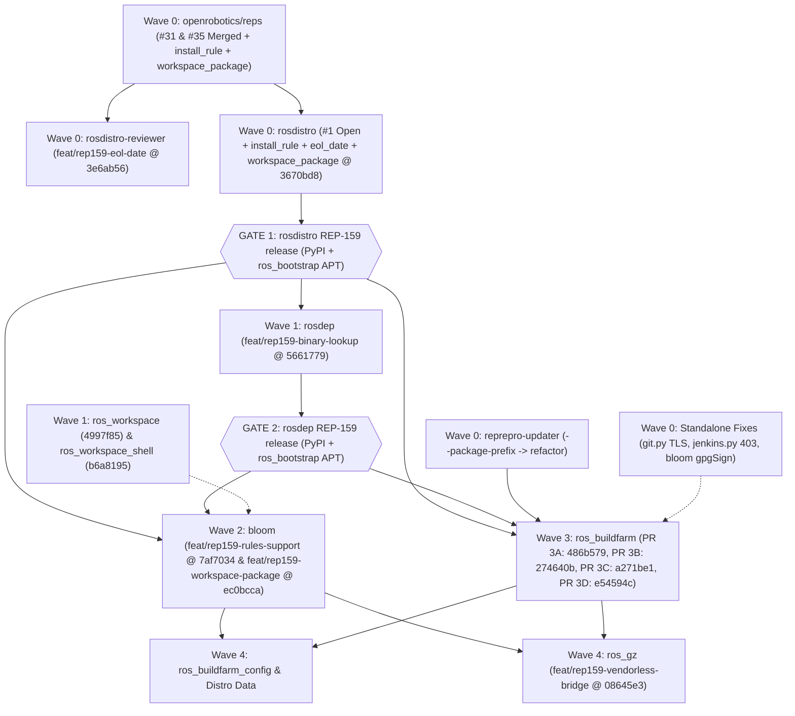

# REP-159 Stage-by-Stage Pull Request & Issue Architecture Map

Cross-repository PR, issue, and release-gate matrix across the **`rep159-testing`** organization and upstream Open Robotics repositories, backed by empirical builds on `https://build.test.ros2.org`.

> [!IMPORTANT]
> **Double-Consent Policy on Pull Requests**: All feature branches listed below are prepared and verified on `https://build.test.ros2.org`. No upstream or fork Pull Requests are created without explicit double consent.

---

## 1. Upstream Merge & Release-Gate DAG



---

## 2. Phased Milestone & Release-Gate Progression Table

| Milestone | Stage / Area | Repository & Clean PR Branch (`@ SHA`) | Upstream Target | Blocking Gate | Output Deliverable | Status |
|:---:|---|---|---|---|---|:---:|
| **M0** | Specification | [`KmoM88/reps`](https://github.com/KmoM88/reps): `feature/rep-159-binary-name-templating` (`f683ccc`) | `openrobotics/reps:rosdistro_extension` | None | [`openrobotics/reps#35`](https://github.com/openrobotics/reps/pull/35) (`binary_rule` lowercase spec) | **MERGED** |
| **M0** | Specification | [`KmoM88/reps`](https://github.com/KmoM88/reps): `feature/rep-159-install-rule` (`1aef980`) & `feature/rep-159-workspace-package` (`0905caa`) | `openrobotics/reps:rosdistro_extension` | `reps#35` | `install_rule`, `workspace_package` (`ros_workspace_shell`), `distribution_eol_date` & multi-tier DAG spec | **BRANCH READY** |
| **M0** | APT Sync | [`rep159-testing/reprepro-updater`](https://github.com/rep159-testing/reprepro-updater): `feat/package-prefix` (`93ed2dc`) | `ros-infrastructure/reprepro-updater:refactor` | None | `--package-prefix` filter in `sync_ros_packages.py` | **BRANCH READY** |
| **M0** | Index Reviewer | [`rep159-testing/rosdistro-reviewer`](https://github.com/rep159-testing/rosdistro-reviewer): `feat/rep159-eol-date` (`3e6ab56`) | `ros-infrastructure/rosdistro-reviewer:main` | None | ISO 8601 `YYYY-MM-DD` validation of `distribution_eol_date` in `index-v4.yaml` | **BRANCH READY** (200/200 tests) |
| **M0** | Resilience Fixes | `ros_buildfarm`: `ae8826b` (git TLS), `199fd98` (Jenkins 403)<br>`bloom`: `d6fdf9e` (`git tag -f -m`) | Respective `master` | None | Standalone bugfix branches | **BRANCH READY** |
| **M1** | Core Parser & Regex | [`rep159-testing/rosdistro`](https://github.com/rep159-testing/rosdistro): `feature/rep159-binary-naming-regex` (`bfde799`) | `ros-infrastructure/rosdistro:master` | M0 Specs | [`rep159-testing/rosdistro#1`](https://github.com/rep159-testing/rosdistro/pull/1) (Format 3, `extends`, `binary_rule`) | **OPEN** |
| **M1** | Install Prefixes, EOL Date & `workspace_package` | [`rep159-testing/rosdistro`](https://github.com/rep159-testing/rosdistro):<br>• `feat/rep159-install-rule` (`a8f5543`)<br>• `feat/rep159-eol-date` (`5ec62f9`)<br>• `feat/rep159-workspace-package` (`3670bd8`) | Stacked on `rosdistro#1` | `rosdistro#1` | `install_rule`, `BINARY_IMPORT_OVERRIDABLE`, Index v4 `distribution_eol_date`, `workspace_package` (`5d4a392`), and hyphenated package lookup (`3670bd8`) | **BRANCH READY** (106/106 tests) |
| **G1** | **RELEASE GATE 1** | **`ros-infrastructure/rosdistro`** | New Release Tag | M1 Merge | **PyPI `rosdistro` + `ros_bootstrap` APT `python3-rosdistro-modules` REP-159 release** | **HOLD ON M1** |
| **M2** | Binary Lookup | [`rep159-testing/rosdep`](https://github.com/rep159-testing/rosdep): `feat/rep159-binary-lookup` (`5661779`) | `ros-infrastructure/rosdep:master` | **GATE 1** | Clean `gbpdistro_support.py` delegation + Format 3 tests (0 CI hacks, [`rosdep#2`](https://github.com/rep159-testing/rosdep/pull/2)) | **BRANCH READY** |
| **M2** | Workspace Chaining | • [`ros_workspace`](https://github.com/rep159-testing/ros_workspace): `feat/rep159-parent-chaining` (`4997f85`)<br>• [`ros_workspace_shell`](https://github.com/rep159-testing/ros_workspace_shell): `feat/rep159-unset-current-prefix` (`b6a8195`) | `ros2/ros_workspace:main` & `ros_workspace_shell:main` | None (CMake) | Stacked on `jrivero`'s `12f93e9` (`ros_workspace`) and `a89cc7b` (`ros_workspace_shell` + `unset AMENT_CURRENT_PREFIX`) | **BRANCH READY** |
| **G2** | **RELEASE GATE 2** | **`ros-infrastructure/rosdep`, `ros2/ros_workspace` & `ros_workspace_shell`** | New Release Tags | M2 Merge | **PyPI `rosdep` + `ros_bootstrap` APT `python3-rosdep-modules` REP-159 release** | **HOLD ON M2** |
| **M3** | Debian Generator | [`rep159-testing/bloom`](https://github.com/rep159-testing/bloom):<br>• `feat/rep159-rules-support` (`7af7034`)<br>• `feat/rep159-workspace-package` (`ec0bcca`) | `ros-infrastructure/bloom:master` | **GATES 1 & 2** | Stacked on `jrivero`'s `rep159` (`2877687`) + `binary_rule`, `install_rule`, `workspace_package`, `get_distribution_file` `extends`, and `unset AMENT_CURRENT_PREFIX` | **BRANCH READY** (37/37 tests) |
| **G3** | **RELEASE GATE 3** | **`ros-infrastructure/bloom`** | New Release Tag | M3 Merge | **PyPI `bloom` + `ros_bootstrap` APT `python3-bloom` REP-159 release** | **HOLD ON M3** |
| **M4** | Buildfarm Engine | [`rep159-testing/ros_buildfarm`](https://github.com/rep159-testing/ros_buildfarm):<br>• **PR 3A**: `feat/rep159-workspace-walk` (`486b579`)<br>• **PR 3B**: `feat/rep159-underlays` (`274640b`)<br>• **PR 3C**: `feat/rep159-binary-naming` (`a271be1`)<br>• **PR 3D**: `feat/rep159-workspace-package` (`e54594c`) | `ros-infrastructure/ros_buildfarm:master` | **GATES 1 & 2 + `reprepro:refactor`** | 4 clean branches off `master` (`7daa2b1`, 0 Dockerfile pip hacks): `jrivero` workspace walk (`486b579`, 7/7), underlays + CMake/`AMENT_CURRENT_PREFIX` fixes (`274640b`, 11/11), release naming (`a271be1`, 6/6), and `get_workspace_package()` (`e54594c`) | **BRANCH READY** (100% tests) |
| **G4** | **RELEASE GATE 4** | **`ros-infrastructure/ros_buildfarm`** | New Release Tag | M4 Merge | **PyPI `ros_buildfarm` + APT `python3-ros-buildfarm` REP-159 release** | **HOLD ON M4** |
| **M5** | Vendorless ROS + Gazebo Bridge | [`rep159-testing/ros_gz`](https://github.com/rep159-testing/ros_gz): `feat/rep159-vendorless-bridge` (`08645e3`) | `gazebosim/ros_gz:ros2` | **GATES 3 & 4** | Clean 3-file diff off `3.0.12` (`04a4544`) replacing `gz_*_vendor` with direct `gz-cmake`, `gz-math`, `gz-msgs`, `gz-transport` dependencies (0 deleted sibling dirs) | **BRANCH READY** |

---

## 3. Stage-by-Stage Technical Matrix & Remote Testfarm Evidence (`extendable*` / `E*`)

| Stage | Problem Solved | Clean PR & Semantic Config Branches (`@ SHA`) | Key Architectural Mechanism | Verified `build.test.ros2.org` Jobs & Status |
|---|---|---|---|---|
| **[Stage 1](roadmap/stage1_binary_naming_and_format3.md): `binary_rule` & Prefix Sync** | Hardcoded `ros-{distro}-{pkg}` naming causes vendor APT collisions | • `reps`: `f683ccc` (**MERGED** `#35`)<br>• `rosdistro`: `feature/rep159-binary-naming-regex` (`bfde799`, `#1`)<br>• `rosdep`: `feat/rep159-binary-lookup` (`5661779`)<br>• `reprepro-updater`: `feat/package-prefix` (`93ed2dc`)<br>• `ros_buildfarm`: `feat/rep159-binary-naming` (`a271be1`) | `DistributionFile.get_binary_package_name()` evaluates `{search, replace}` with lowercase `{distro}`, `{package}`, `{origin_distro}`; `reprepro-updater` filters sync via `--package-prefix vendor-extendable-` | • `Esrc_uR__upstream_{a,b,c}` ([#2/#1/#1](https://build.test.ros2.org/job/Esrc_uR__upstream_a__ubuntu_resolute__source/2/) & [#4/#3/#3](https://build.test.ros2.org/job/Esrc_uR__upstream_a__ubuntu_resolute__source/4/)) — **SUCCESS**<br>• `Ebin_uR64__upstream_{a,b,c}` ([#1](https://build.test.ros2.org/job/Ebin_uR64__upstream_a__ubuntu_resolute_amd64__binary/1/) & [#3/#4/#3](https://build.test.ros2.org/job/Ebin_uR64__upstream_a__ubuntu_resolute_amd64__binary/3/)) — **SUCCESS**<br>• `Erel_sync` ([#8](https://build.test.ros2.org/job/Erel_sync-packages-to-testing_resolute_amd64/8/) & [#10](https://build.test.ros2.org/job/Erel_sync-packages-to-testing_resolute_amd64/10/)) — **SUCCESS**<br>• `Eci__nightly-release #2`, `Eci__source-branches #2`, `Eci__release-branches #2` — **SUCCESS** |
| **[Stage 2](roadmap/stage2_install_rule_and_underlays.md): `install_rule` & `binary_import` Walk** | Hardcoded `/opt/ros/{distro}` prefix and unnecessary source checkouts of `binary_import` parents | • `reps`: `feature/rep-159-install-rule` (`1aef980`)<br>• `rosdistro`: `feat/rep159-install-rule` (`a8f5543`)<br>• `ros_buildfarm`: `feat/rep159-workspace-walk` (`486b579`) + `feat/rep159-underlays` (`274640b`) | `get_distribution_install_prefix()` resolves `/opt/vendor/extendable`; `ReleaseAndSourceDependencyWalker` halts source walk at `binary_import`; `ROS_BUILDFARM_PARENT_RESULT_SPACES` injected into container | • `Esrc_uR__upstream_{a,b,c}` (`#3`, `#2`, `#2`) — **SUCCESS**<br>• `Ebin_uR64__upstream_{a,b,c}` (`#2`, `#2`, `#2`) — **SUCCESS**<br>• `Erel_sync #9` — **SUCCESS**<br>• [`Eci__binary-import #5`](https://build.test.ros2.org/job/Eci__binary-import_ubuntu_resolute_amd64/5/) (`/opt/vendor/extendable`) — **SUCCESS**<br>• [`Eci__source-rebuild #2`](https://build.test.ros2.org/job/Eci__source-rebuild_ubuntu_resolute_amd64/2/) — **SUCCESS** |
| **[Stage 3](roadmap/stage3_topological_extensions.md): Multi-Tier, Hybrid & Diamond DAGs** | Pure CMake underlays lack `setup.sh`; multi-tier and diamond DAGs require recursive underlay deduplication | • `rosdistro`: `feat/rep159-install-rule` (`a8f5543`)<br>• `ros_buildfarm`: `feat/rep159-workspace-walk` (`486b579`) + `feat/rep159-underlays` (`274640b`)<br>• `rep159-rosdistro`: `feat/chained-extensions` (`69afb27`), `feat/binary-chained` (`e63a90a`), `feat/mixed-extensions` (`3e66c48`), `feat/diamond-extensions` (`7ab72c6`) | `get_binary_import_underlays()` deduplicates ancestor prefixes (`/opt/ros/extendable:/opt/ros/extendablebin`); `workspace.py` exports `CMAKE_PREFIX_PATH`, `COLCON_PREFIX_PATH`, and multiarch `LD_LIBRARY_PATH` when `setup.sh` is absent | • Option A (`source_rebuild` 3-tier): [`Eci__chained-import #3`](https://build.test.ros2.org/job/Eci__chained-import_ubuntu_resolute_amd64/3/) — **SUCCESS**<br>• Option B (`binary_import` 3-tier): [`Esrc/Ebin downstream_bin_a #1`](https://build.test.ros2.org/job/Ebin_uR64__downstream_bin_a__ubuntu_resolute_amd64__binary/1/), [`Erel_sync #7`](https://build.test.ros2.org/job/Erel_sync-packages-to-testing_resolute_amd64/7/), [`Eci__chained-import #4`](https://build.test.ros2.org/job/Eci__chained-import_ubuntu_resolute_amd64/4/) — **SUCCESS**<br>• Mixed (`binary_import` + CI src): [`Eci__mixed-chain #1`](https://build.test.ros2.org/job/Eci__mixed-chain_ubuntu_resolute_amd64/1/) / [`#2`](https://build.test.ros2.org/job/Eci__mixed-chain_ubuntu_resolute_amd64/2/) — **SUCCESS**<br>• Diamond DAG: [`Eci__diamond-chain #1`](https://build.test.ros2.org/job/Eci__diamond-chain_ubuntu_resolute_amd64/1/) / [`#3`](https://build.test.ros2.org/job/Eci__diamond-chain_ubuntu_resolute_amd64/3/) — **SUCCESS** |
| **[Stage 4](roadmap/stage4_composable_workspace.md): `extendable` & `extendablebin` (`E*`) `ros_workspace` & `bloom`** | Native ROS 2 distributions require child `ros_workspace` release override, `.dsv` parent prefix chaining, and automated `bloom` Debian generation | • `rosdistro`: `feat/rep159-install-rule` (`a8f5543`)<br>• `ros_workspace`: `feat/rep159-parent-chaining` (`4997f85`)<br>• `bloom`: `feat/rep159-rules-support` (`7af7034`)<br>• `rep159-rosdistro` & `ros_buildfarm_config`: `feat/extendable-workspace` (`19aedba` / `c80b6f7`) | Adopts `jrivero`'s `BINARY_IMPORT_OVERRIDABLE = frozenset(['ros_workspace'])`, `ROS_WORKSPACE_PARENT_PREFIX_PATH` multi-prefix discovery, and `ParentPrefixes` in `bloom` `debian/rules.em` + `binary_rule`/`install_rule` | • Root Release & CI: `Esrc_uR__ament_package #1`, `Ebin_uR64__ament_package #1`, `Esrc_uR__ament_cmake_core #1`, `Ebin_uR64__ament_cmake_core #2`, `Esrc_uR__ros_workspace #1`, `Ebin_uR64__ros_workspace #1`, `Erel_sync #12`, `Eci__workspace-release #2` — **SUCCESS**<br>• Child Release & CI (`extbin`): `Esrc_uR__extbin_ros_workspace #1`, `Ebin_uR64__extbin_ros_workspace #2`, `Esrc_uR__extbin_downstream_bin_a #1`, `Ebin_uR64__extbin_downstream_bin_a #2`, `Erel_extbin_sync #3`, `Eci__workspace-binary-import #1` — **SUCCESS** |
| **[Stage 5](roadmap/stage5_cache_lifecycle_and_bloom_release.md): Cache Lifecycle & Isolation (`E*`)** | `rosdistro_build_cache` must merge parent caches during resolution and strip parent packages (`- REMOVE`) from child cache artifacts | • `rosdistro`: `feat/rep159-install-rule` (`a8f5543`, includes `jrivero` `46a7580`)<br>• `bloom`: `feat/rep159-rules-support` (`7af7034`, includes `d6fdf9e`)<br>• `ros_buildfarm`: `feat/extendable-workspace` (`ca13954`) | Loads parent cache from `extends[].index_url` (`46a7580`), strips inherited parent packages before saving `<child>-cache.yaml.gz`, and triggers Groovy reconfigure on version bump | • [`extendable_rosdistro-cache #139`](https://build.test.ros2.org/job/extendable_rosdistro-cache/139/) — **SUCCESS**<br>• [`extendablebin_rosdistro-cache #138`](https://build.test.ros2.org/job/extendablebin_rosdistro-cache/138/) — **SUCCESS** |
| **[Stage 6](roadmap/stage6_ros_gazebo_and_eol.md): `workspace_package` (`ros_workspace_shell`), `distribution_eol_date` & Multi-Parent ROS 2 + Gazebo** | Non-ROS plain-CMake distros (`extendablejetty`) cannot build `ros_workspace`; multi-parent `[lyrical, extendablejetty]` requires `AMENT_CURRENT_PREFIX` isolation and vendorless `ros_gz_bridge` | • `reps`: `feature/rep-159-workspace-package` (`0905caa`)<br>• `rosdistro`: `feat/rep159-eol-date` (`5ec62f9`), `feat/rep159-workspace-package` (`3670bd8`)<br>• `rosdistro-reviewer`: `feat/rep159-eol-date` (`3e6ab56`)<br>• `ros_workspace_shell`: `feat/rep159-unset-current-prefix` (`b6a8195`)<br>• `bloom`: `feat/rep159-workspace-package` (`ec0bcca`)<br>• `ros_buildfarm`: PR 3B (`274640b`) + PR 3D (`e54594c`)<br>• `ros_gz`: `feat/rep159-vendorless-bridge` (`08645e3`)<br>• `rep159-rosdistro` & `ros_buildfarm_config`: `feat/extendable-gazebo` (`f3891ce` / `5bdad6b`) | Adopts `jrivero`'s `workspace_package: ros_workspace_shell`, exports `CMAKE_PREFIX_PATH` & unsets `AMENT_CURRENT_PREFIX` across multi-parent setups, and compiles `ros_gz_interfaces` + `ros_gz_bridge` without `gz_*_vendor` packages against `repo.ros2.org` (`lyrical`) + `repo.test.ros2.org` (`extendablejetty`) | • **Step 6B-1 (3-Pkg Gazebo)**: 17/17 `E*` jobs — **SUCCESS**<br>• **Step 6B-2a (6-Pkg Gazebo)**: 23/23 `E*` jobs (`Esrc/Ebin extjetty_{ros_workspace_shell,gz-cmake,gz-utils,gz-math,gz-tools2,gz-msgs,gz-transport}`, `Erel_extjetty_sync #7`, `Eci__gazebo-jetty-release #2`, `Eci__gazebo-lyrical-source-rebuild #2`) — **SUCCESS**<br>• **Step 6B-2b (Multi-Parent `ros_gz_bridge`)**: 18/18 `E*` jobs ([`Ebin extlyrical_ros_gz_interfaces #4`](https://build.test.ros2.org/job/Ebin_uR64__extlyrical_ros_gz_interfaces__ubuntu_resolute_amd64__binary/4/), [`Ebin extlyrical_ros_gz_bridge #3`](https://build.test.ros2.org/job/Ebin_uR64__extlyrical_ros_gz_bridge__ubuntu_resolute_amd64__binary/3/), [`Erel_extlyrical_sync #6`](https://build.test.ros2.org/job/Erel_extlyrical_sync-packages-to-testing_resolute_amd64/6/), [`Eci__gazebo-lyrical-binary-import #6`](https://build.test.ros2.org/job/Eci__gazebo-lyrical-binary-import_ubuntu_resolute_amd64/6/)) — **SUCCESS** |

---

## 4. Standard Cross-Referencing PR Template

```markdown
### REP-159 Cross-Repository & Release-Gate Tracking
- **Target Repo & Base**: <owner>/<repo> (Base: `<rep159|master|main|refactor>`)
- **Release Gate Prerequisite**: <None (Wave 0) | Gate 1: rosdistro REP-159 release | Gate 2: rosdep REP-159 release>
- **Specification**: openrobotics/reps#32 / openrobotics/reps#35 (Merged baseline: openrobotics/reps#31) + `feature/rep-159-install-rule` (`1aef980`) + `feature/rep-159-workspace-package` (`0905caa`)
- **Core Parser & Rules**: rep159-testing/rosdistro#1 (+ stacked `feat/rep159-install-rule` @ `a8f5543`, `feat/rep159-eol-date` @ `5ec62f9`, `feat/rep159-workspace-package` @ `3670bd8`)
- **Index Reviewer (Wave 0)**: rep159-testing/rosdistro-reviewer (`feat/rep159-eol-date` @ `3e6ab56` -> upstream `main`)
- **Repository Sync (Wave 0)**: rep159-testing/reprepro-updater (`feat/package-prefix` @ `93ed2dc` -> upstream `refactor`)
- **Dependency Resolution (Wave 1)**: rep159-testing/rosdep (`feat/rep159-binary-lookup` @ `5661779` -> upstream `master`)
- **Workspace Chaining (Wave 1)**: rep159-testing/ros_workspace (`feat/rep159-parent-chaining` @ `4997f85` -> upstream `main`) & rep159-testing/ros_workspace_shell (`feat/rep159-unset-current-prefix` @ `b6a8195` -> upstream `main`)
- **Packaging Generator (Wave 2)**: rep159-testing/bloom (`feat/rep159-rules-support` @ `7af7034` & `feat/rep159-workspace-package` @ `ec0bcca` -> upstream `master`)
- **Buildfarm Orchestrator (Wave 3)**: rep159-testing/ros_buildfarm (`feat/rep159-workspace-walk` @ `486b579`, `feat/rep159-underlays` @ `274640b`, `feat/rep159-binary-naming` @ `a271be1`, `feat/rep159-workspace-package` @ `e54594c`)
- **Vendorless ROS + Gazebo Bridge (Wave 4)**: rep159-testing/ros_gz (`feat/rep159-vendorless-bridge` @ `08645e3` -> upstream `ros2`)
```
