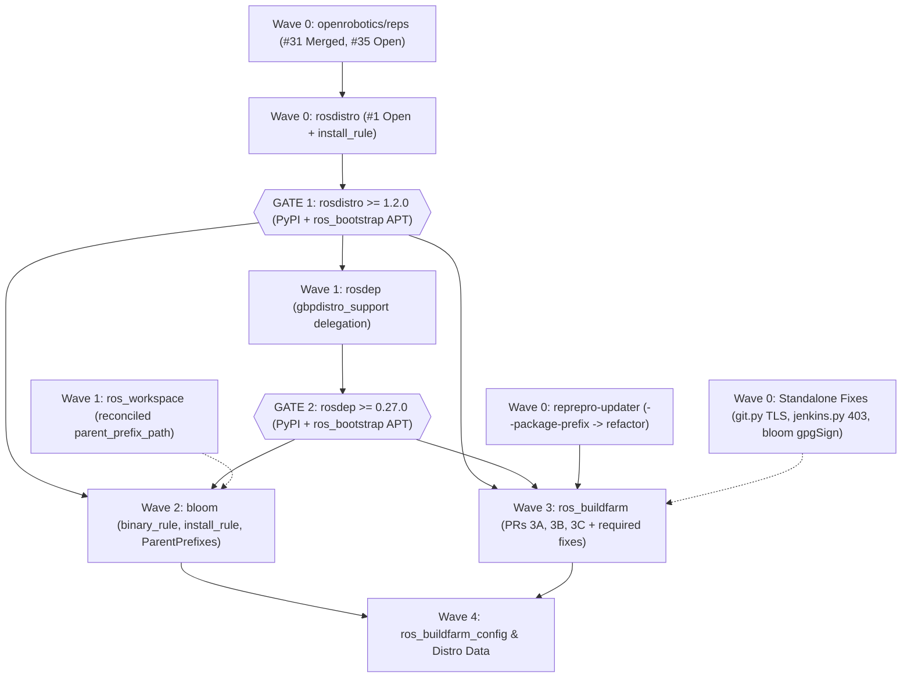
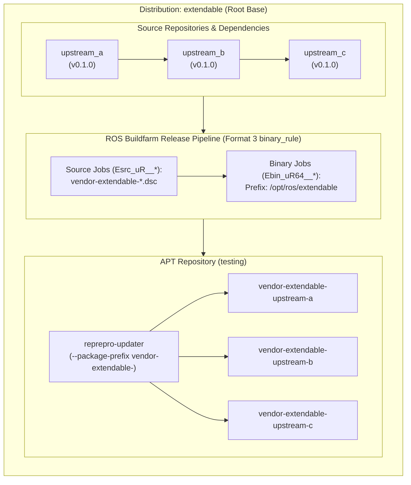
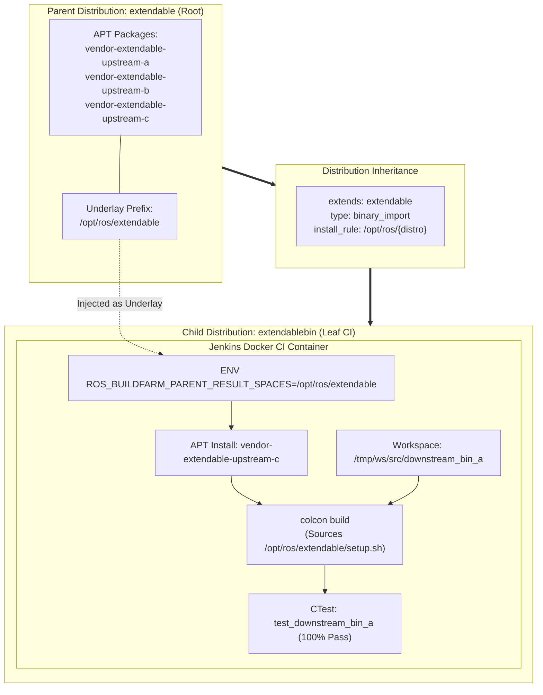
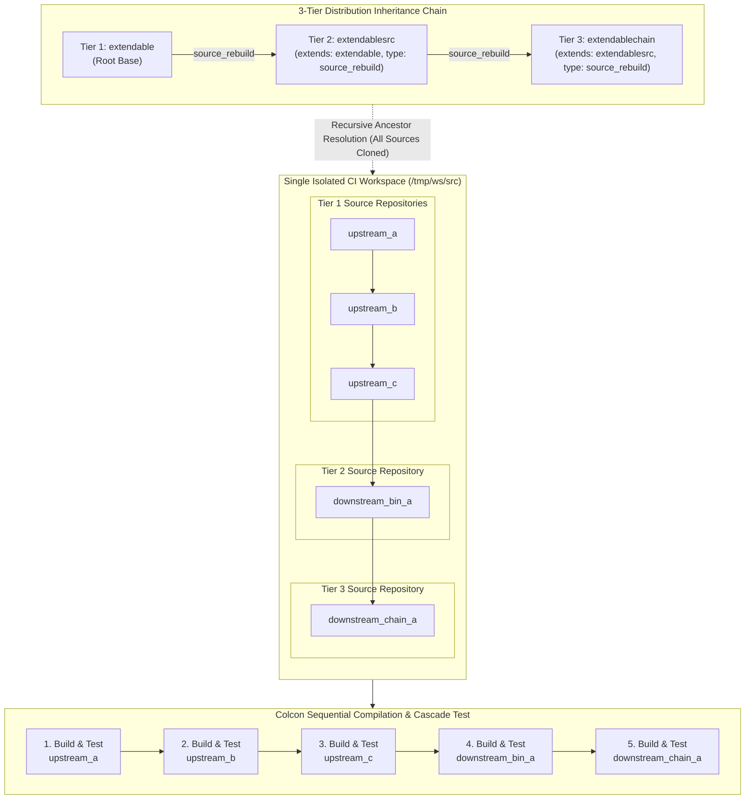
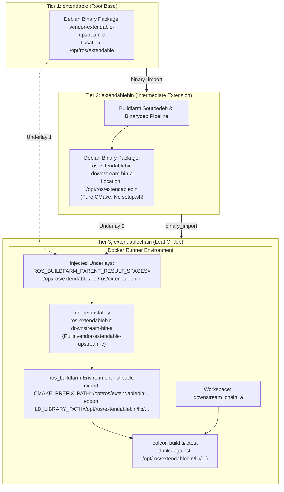
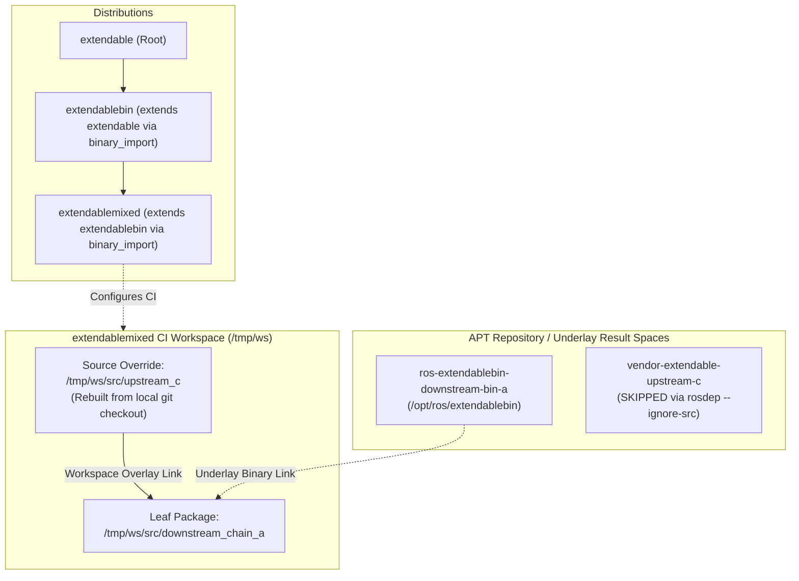
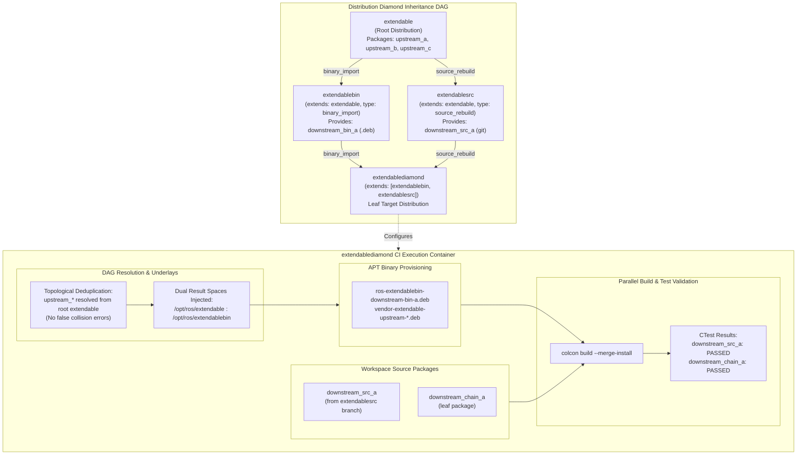

# REP-159 Stage-by-Stage Pull Request & Issue Architecture Plan

This document establishes the official **Pull Request (PR) and Issue mapping** across all repositories within the **`rep159-testing`** GitHub organization. It structures changes by validation stages, defines exact problem statements and technical resolutions, specifies the exact target base branch (`rep159` if available, otherwise `main`/`master`), provides placeholder links for cross-repository issue/PR tracking, and documents empirical verification with links and **crucial console log snippets** from the official test buildfarm (`https://build.test.ros2.org`).

---

## 1. Scope, Two-Tier Release-Gated Strategy & Interlinking Matrix

### Two-Tier PR Architecture & Release Gating
Development and upstreaming follow a strict **two-tier, release-gated workflow** (detailed in [roadmap/README.md](roadmap/README.md)):
1. **Tier 1 — Organization Forks (`rep159-testing/*`) & Specification (`openrobotics/reps`)**:
   - Within `rep159-testing` forks, integration PRs target **`rep159`** if a shared `rep159` baseline branch exists, or the default trunk (**`main`** / **`master`**) otherwise.
   - Specification updates target [`openrobotics/reps:rosdistro_extension`](https://github.com/openrobotics/reps/pull/32) via [`KmoM88/reps`](https://github.com/KmoM88/reps).
2. **Tier 2 — Release-Gated Upstream Open Robotics PRs**:
   - Upstream PRs beyond `rosdistro` (`rosdep`, `bloom`, `ros_buildfarm`) **cannot merge or pass upstream CI/chroot builds until foundational releases are published** to PyPI and OSRF `ros_bootstrap` APT:
     * **Wave 0 (No Release Prerequisite)**: `openrobotics/reps`, `reprepro-updater` (targeting upstream **`refactor`** branch), standalone bugfixes (`ros_buildfarm` `wrapper/git.py` TLS retry & `jenkins.py` 403 view skip; `bloom` `git tag -f -m` GPG sign fix), and `rosdistro` $\implies$ **Release Gate 1 (`rosdistro >= 1.2.0` on PyPI + `ros_bootstrap` APT)**.
     * **Wave 1 (Requires Gate 1)**: `rosdep` (dropping temporary `KmoM88/rosdistro` URL overrides) $\implies$ **Release Gate 2 (`rosdep >= 0.27.0` on PyPI + `ros_bootstrap` APT)**; `ros_workspace` (reconciling `rep159-parent-chain` + `feat/composable-underlay-chaining`) $\implies$ **Release Gate 2B (`ros_workspace >= 1.0.4`)**.
     * **Wave 2 (Requires Gates 1 & 2)**: `bloom` (`binary_rule`, `install_rule` with regex dict delegation fix, `ParentPrefixes`) $\implies$ **Release Gate 3 (`bloom >= 0.15.0`)**.
     * **Wave 3 (Requires Gates 1 & 2 in APT/PyPI + `reprepro-updater:refactor`)**: `ros_buildfarm` (combining `rep159` `create_workspace.py` walk + `feat/binary-naming-rule` underlays, pure-CMake fallbacks, release naming & child package isolation, while stripping temporary `*.Dockerfile.em` tarball `pip` hacks) $\implies$ **Release Gate 4 (`ros_buildfarm >= 4.2.0`)**.

### Upstream Merge & Release Gate Graph



### Repository, Branch, Release Gate & Live PR Reference

| Repository | Fork URL | Active Feature Branch(es) | Org Base / Upstream Base | Stages | Release Wave / Gate Prerequisite | Live PRs & Status |
|:---|:---|:---|:---:|:---:|:---|:---|
| **`reps`** | [KmoM88/reps](https://github.com/KmoM88/reps) | `feature/rep-159-binary-name-templating` (`83e4a3f`) | `rosdistro_extension` (feeds [`reps#32`](https://github.com/openrobotics/reps/pull/32)) | 1 – 4 | **Wave 0** (None) | [`openrobotics/reps#31`](https://github.com/openrobotics/reps/pull/31) (Merged)<br>[`openrobotics/reps#35`](https://github.com/openrobotics/reps/pull/35) (**OPEN**; add `install_rule` section) |
| **`rosdistro`** | [rep159-testing/rosdistro](https://github.com/rep159-testing/rosdistro) | `feature/rep159-binary-naming-regex` (`3d301d6`)<br>`feature/rep159-install-rule` (`db021b9`)<br>*(collab: `rep159-child-ros-workspace`)* | **`rep159`** / `master` | 1, 2, 3, 5 | **Wave 0** $\to$ **Unblocks Gate 1 (`>= 1.2.0`)** | [`rep159-testing/rosdistro#1`](https://github.com/rep159-testing/rosdistro/pull/1) (**OPEN**)<br>`install-rule` stacked ready |
| **`reprepro-updater`** | [rep159-testing/reprepro-updater](https://github.com/rep159-testing/reprepro-updater) | `feat/package-prefix` (`93ed2dc`) | `master` / **`refactor`** | 1, 2, 4 | **Wave 0** (None — runtime `git clone -b refactor`) | Ready (0 fork deps) |
| **`rosdep`** | [rep159-testing/rosdep](https://github.com/rep159-testing/rosdep) | `rep159` (`3d52dad`) | *(already on `rep159`)* / `master` | 1, 2, 3 | **Wave 1** (Blocked on **Gate 1 `rosdistro >= 1.2.0`**) | Needs clean branch off `master` dropping `KmoM88/rosdistro` URL hacks |
| **`ros_workspace`** | [rep159-testing/ros_workspace](https://github.com/rep159-testing/ros_workspace) | `rep159-parent-chain` (`12f93e9`) & `feat/composable-underlay-chaining` (`032d161`) | `main` / `main` | 4 | **Wave 1** (CMake independent) | Needs reconciliation of `12f93e9` + `032d161` |
| **`bloom`** | [rep159-testing/bloom](https://github.com/rep159-testing/bloom) | `feat/rep159-rules-support` (`d6fdf9e`, stacked on `rep159` `2877687`) | **`rep159`** / `master` | 4, 5 | **Wave 0** (`d6fdf9e` gpgSign fix)<br>**Wave 2** (Blocked on **Gates 1 & 2**) | Needs `get_install_prefix()` dict delegation fix + version bumps |
| **`ros_buildfarm`** | [rep159-testing/ros_buildfarm](https://github.com/rep159-testing/ros_buildfarm) | `rep159` (`9736140`)<br>`feat/install-prefixes` (`4f4b059`)<br>`feat/binary-naming-rule` (`4062a66`)<br>`feat/cache-job-rep159` (`6f62d7b`) | **`rep159`** & `master` / `master` | 1 – 5 | **Wave 0** (`ae8826b` git TLS, `199fd98` Jenkins 403)<br>**Wave 3** (Blocked on **Gates 1 & 2** + `reprepro`) | Combine `rep159` + `feat/*` & drop `*.Dockerfile.em` tarball overrides post-Gates 1 & 2 |
| **`ros_buildfarm_config`** | [rep159-testing/ros_buildfarm_config](https://github.com/rep159-testing/ros_buildfarm_config) | `feat/composable-distro`, `feat/cache-lifecycle-test`, `feat/stage3-diamond` | **`rep159`** / `ros2` | 1 – 5 | **Wave 4** (Testbed harness / post-Gate 4) | Validated locally & on `build.test.ros2.org` |
| **`rep159-rosdistro`** | [rep159-testing/rep159-rosdistro](https://github.com/rep159-testing/rep159-rosdistro) | `feat/composable-distro`, `feat/cache-lifecycle-test`, `feat/stage3-diamond` | `main` | 1 – 5 | Testbed distribution fixtures | [`rep159-rosdistro#19`](https://github.com/rep159-testing/rep159-rosdistro/pull/19) (**OPEN**) |

---

## 2. Stage-by-Stage PR & Issue Specifications with Empirical Evidence

### Stage 1 & 2: Declarative Binary Naming & Extended Distribution Model (`extendable`)

#### Problem Statement
1. In ROS 2, binary Debian package naming is hardcoded to `ros-{distro}-{pkg_name}`, causing namespace collisions if custom vendors or downstream distributions package libraries with upstream names.
2. The distribution file format lacked native inheritance: child distributions could not declare a base parent or specify how packages are consumed (`binary_import` vs `source_rebuild`).
3. `rosdep` resolved Debian package names using strict hardcoded assumptions, preventing child distributions from fetching renamed vendor packages (`vendor-extendable-*`) from APT.

#### Solution & Architectural Design
1. **`rep159-testing/rosdistro` (Target: `rep159`)**:
   - Added support for Format 3 distribution files with `extends:` block.
   - Introduced `binary_rule:` regex substitution engine (`search: '^'`, `replace: 'vendor-{DISTRO}-'`).
   - Implemented `DistributionFile.get_binary_package_name(pkg_name)` to rewrite package names dynamically.
2. **`rep159-testing/rosdep` (Target: `rep159`)**:
   - Updated `gbpdistro_support.py` to delegate binary package name queries to `dist_file.get_binary_package_name(pkg)`.
3. **`rep159-testing/ros_buildfarm` (Target: `rep159`)**:
   - Updated `release_job.py`, `package_repo_job.py`, and Docker templates to consume renamed packages and maintain view isolation on restricted Jenkins environments.
4. **`rep159-testing/reprepro-updater` (Target: `master`)**:
   - Added `-p, --package-prefix` flag to allow selective synchronization of vendor-prefixed packages (`vendor-extendable-`).

#### Distribution & Package Topology



#### Interlinked Issues & PRs
* **`reps`**: `[reps#ISSUE-REP159]` ➔ `[reps#PR-REP159]` (Target: `main`)
* **`rosdistro`**: `[rosdistro#ISSUE-NAMING-ENGINE]` ➔ `[rosdistro#PR-NAMING-ENGINE]` (Target: `rep159`)
  - *Blocked by*: `[reps#PR-REP159]`
* **`rosdep`**: `[rosdep#ISSUE-BINARY-LOOKUP]` ➔ `[rosdep#PR-BINARY-LOOKUP]` (Target: `rep159`)
  - *Blocked by*: `[rosdistro#PR-NAMING-ENGINE]`
* **`reprepro-updater`**: `[reprepro#ISSUE-PACKAGE-PREFIX]` ➔ `[reprepro#PR-PACKAGE-PREFIX]` (Target: `master`)
* **`ros_buildfarm`**: `[buildfarm#ISSUE-RELEASE-NAMING]` ➔ `[buildfarm#PR-RELEASE-NAMING]` (Target: `rep159`)
  - *Blocked by*: `[rosdistro#PR-NAMING-ENGINE]`, `[rosdep#PR-BINARY-LOOKUP]`, `[reprepro#PR-PACKAGE-PREFIX]`

#### Testfarm Validation Evidence (`build.test.ros2.org`)
* [Eci__nightly-release_ubuntu_resolute_amd64](https://build.test.ros2.org/job/Eci__nightly-release_ubuntu_resolute_amd64/): **SUCCESS** — Baseline CI on `extendable` distribution under Ubuntu Resolute.
* [Esrc_uR__upstream_a__ubuntu_resolute__source](https://build.test.ros2.org/job/Esrc_uR__upstream_a__ubuntu_resolute__source/): **SUCCESS** — Generates `vendor-extendable-upstream-a_0.1.0-1resolute.dsc`.
* [Ebin_uR64__upstream_a__ubuntu_resolute_amd64__binary](https://build.test.ros2.org/job/Ebin_uR64__upstream_a__ubuntu_resolute_amd64__binary/): **SUCCESS** — Hermetic chroot build producing `vendor-extendable-upstream-a_0.1.0-1resolute_amd64.deb`.
* [Esrc_uR__upstream_b...](https://build.test.ros2.org/job/Esrc_uR__upstream_b__ubuntu_resolute__source/) & [Ebin_uR64__upstream_b...](https://build.test.ros2.org/job/Ebin_uR64__upstream_b__ubuntu_resolute_amd64__binary/): **SUCCESS** — Inter-package dependency resolution with vendor prefix.
* [Esrc_uR__upstream_c...](https://build.test.ros2.org/job/Esrc_uR__upstream_c__ubuntu_resolute__source/) & [Ebin_uR64__upstream_c...](https://build.test.ros2.org/job/Ebin_uR64__upstream_c__ubuntu_resolute_amd64__binary/): **SUCCESS** — Full transitive resolution.
* [Erel_sync-packages-to-testing_resolute_amd64](https://build.test.ros2.org/job/Erel_sync-packages-to-testing_resolute_amd64/): **SUCCESS** — Validated sync criteria with `--package-prefix vendor-extendable-` and promoted all three packages to `testing`.

##### Crucial Log Verification:
```text
# 1. Package Name Rewriting in Sourcedeb:
dpkg-buildpackage: info: source package vendor-extendable-upstream-a
dpkg-buildpackage: info: source version 0.1.0-1resolute
dpkg-source -b .
dpkg-source: info: building vendor-extendable-upstream-a using existing ./vendor-extendable-upstream-a_0.1.0.orig.tar.gz
dpkg-source: info: building vendor-extendable-upstream-a in vendor-extendable-upstream-a_0.1.0-1resolute.dsc

# 2. Binary Packaging into /opt/ros/extendable:
dpkg-deb: building package 'vendor-extendable-upstream-a' in '../vendor-extendable-upstream-a_0.1.0-1resolute_amd64.deb'.
Install the project...
-- Installing: /tmp/binarydeb/debian/vendor-extendable-upstream-a/opt/ros/extendable/lib/libupstream_a.so
-- Installing: /tmp/binarydeb/debian/vendor-extendable-upstream-a/opt/ros/extendable/include/upstream_a/upstream_a.hpp

# 3. Synchronizing vendor packages with reprepro-updater:
Invoking 'python3 -u /tmp/reprepro-updater/scripts/sync_ros_packages.py ... --package-prefix vendor-extendable-'
Exporting indices...
Deleting markers of obsolete binaries...
All required binary packages are available: vendor-extendable-upstream-a, vendor-extendable-upstream-b, vendor-extendable-upstream-c
```

---

### Stage 2: Configurable Installation Paths & Dynamic Underlays (`extendablebin`)

#### Problem Statement
1. In standard ROS 2, `colcon` underlays and buildfarm workspace paths were hardcoded to `/opt/ros/{distro}`.
2. Custom vendors installing to distinct paths (e.g. `/opt/vendor/{distro}`) could not inject their installation prefixes into CI agent Docker containers.
3. If an underlay was not injected into `ROS_BUILDFARM_PARENT_RESULT_SPACES`, downstream packages failed to find CMake targets (`<pkg>Config.cmake`).

#### Solution & Architectural Design
1. **`rep159-testing/rosdistro` (Target: `rep159`)**:
   - Introduced `install_rule:` supporting templated path patterns (`/opt/vendor/{distro}`, `/opt/ros/{distro}`).
   - Added `DistributionFile.get_install_prefix()` and `get_binary_import_underlays()`.
2. **`rep159-testing/ros_buildfarm` (Target: `rep159`)**:
   - Implemented dynamic environment variable `ROS_BUILDFARM_PARENT_RESULT_SPACES` in `common.py` and `workspace.py`.
   - Updated Docker provisioning templates to inject parent underlay result spaces into CI containers.

#### Distribution & Package Topology



#### Interlinked Issues & PRs
* **`rosdistro`**: `[rosdistro#ISSUE-INSTALL-RULE]` ➔ `[rosdistro#PR-INSTALL-RULE]` (Target: `rep159`)
* **`ros_buildfarm`**: `[buildfarm#ISSUE-DYNAMIC-UNDERLAYS]` ➔ `[buildfarm#PR-DYNAMIC-UNDERLAYS]` (Target: `rep159`)
  - *Blocked by*: `[rosdistro#PR-INSTALL-RULE]`
* **`ros_buildfarm_config`**: `[config#ISSUE-INSTALL-RULE-TARGETS]` ➔ `[config#PR-INSTALL-RULE-TARGETS]` (Target: `rep159`)

#### Testfarm Validation Evidence (`build.test.ros2.org`)
* [Eci__binary-import_ubuntu_resolute_amd64](https://build.test.ros2.org/job/Eci__binary-import_ubuntu_resolute_amd64/): **SUCCESS** — Configured with `install_rule: /opt/ros/{distro}`. Injected `ROS_BUILDFARM_PARENT_RESULT_SPACES=/opt/ros/extendable`, installed `vendor-extendable-upstream-c` via APT, located `upstream_cConfig.cmake`, compiled and passed 100% green.
* [Eci__source-rebuild_ubuntu_resolute_amd64](https://build.test.ros2.org/job/Eci__source-rebuild_ubuntu_resolute_amd64/): **SUCCESS** — Validated baseline source rebuild extension.

##### Crucial Log Verification:
```text
# 1. Underlay Result Space Injection in Dockerfile:
Step 26/38 : ENV ROS_BUILDFARM_PARENT_RESULT_SPACES=/opt/ros/extendable
Step 27/38 : ENV ROS_BUILDFARM_BINARY_IMPORT_DISTROS=extendable

# 2. APT Downloading Renamed Vendor Dependency:
Get:1 http://repo.test.ros2.org/ubuntu/testing resolute/main amd64 vendor-extendable-upstream-c amd64 0.1.0-1resolute [22.4 kB]
Setting up vendor-extendable-upstream-c (0.1.0-1resolute) ...

# 3. Colcon Sourcing Underlay and Compiling:
Invoking '. /opt/ros/extendable/setup.sh && colcon build --cmake-args -DCMAKE_BUILD_TYPE=Release'
Starting >>> downstream_bin_a
-- Found upstream_c: /opt/ros/extendable/lib/cmake/upstream_c/upstream_cConfig.cmake (found version "0.1.0")
[100%] Built target downstream_bin_a
Finished <<< downstream_bin_a [1.82s]

# 4. Test Execution against Underlay Library:
1/1 Test #1: test_downstream_bin_a ............   Passed    0.01 sec
100% tests passed, 0 tests failed out of 1
INFO: Setting the build status to SUCCESS
```

---

### Stage 3 - Option A: Chained Extension by Cascaded Source Rebuild (`extendablechain`)

#### Problem Statement
Validating multi-tier distribution chains ($A \to B \to C$) where intermediate distributions do not provide binary Debian packages, requiring recursive workspace compilation of all ancestor repositories across 3 tiers.

#### Solution & Architectural Design
1. **Hierarchy**:
   `extendable` (root upstream) $\to$ `extendablesrc` (`source_rebuild`) $\to$ `extendablechain` (`source_rebuild`).
2. **`rep159-testing/rosdistro` (Target: `rep159`)**:
   Topological ancestor resolution accumulates source repositories without collision.
3. **`rep159-testing/ros_buildfarm` (Target: `rep159`)**:
   Clones all 5 packages in topological order (`upstream_a`, `upstream_b`, `upstream_c`, `downstream_bin_a`, `downstream_chain_a`) in a single isolated colcon workspace.

#### Distribution & Package Topology



#### Interlinked Issues & PRs
* **`rosdistro`**: `[rosdistro#ISSUE-RECURSIVE-ANCESTORS]` ➔ `[rosdistro#PR-RECURSIVE-ANCESTORS]` (Target: `rep159`)
* **`ros_buildfarm`**: `[buildfarm#ISSUE-MULTI-TIER-CLONE]` ➔ `[buildfarm#PR-MULTI-TIER-CLONE]` (Target: `rep159`)
* **`rep159-rosdistro`**: `[distro-data#PR-STAGE3A-CHAIN]` (Target: `main`)

#### Testfarm Validation Evidence (`build.test.ros2.org`)
* [Eci__chained-import_ubuntu_resolute_amd64 #2](https://build.test.ros2.org/job/Eci__chained-import_ubuntu_resolute_amd64/2/): **SUCCESS** — Cascaded multi-tier source compilation of all 5 packages, passing unit tests across all levels.

##### Crucial Log Verification:
```text
# 1. Recursive Topological Checkout across 3 Tiers:
# BEGIN SUBSECTION: clone repositories
=== /tmp/ws/src/downstream_chain_a (git) ===
=== /tmp/ws/src/downstream_bin_a (git) ===
=== /tmp/ws/src/upstream_a (git) ===
=== /tmp/ws/src/upstream_b (git) ===
=== /tmp/ws/src/upstream_c (git) ===
# END SUBSECTION

# 2. Sequential Colcon Compilation in Workspace:
Starting >>> upstream_a
Finished <<< upstream_a [1.2s]
Starting >>> upstream_b
Finished <<< upstream_b [1.4s]
Starting >>> upstream_c
Finished <<< upstream_c [1.5s]
Starting >>> downstream_bin_a
Finished <<< downstream_bin_a [1.8s]
Starting >>> downstream_chain_a
-- Found downstream_bin_a: /tmp/ws/install_isolated/downstream_bin_a/lib/cmake/downstream_bin_a/downstream_bin_aConfig.cmake
[100%] Built target downstream_chain_a
Finished <<< downstream_chain_a [2.1s]

# 3. Full Cascade Unit Test Suite Passing:
1/1 Test #1: test_upstream_a .................   Passed
1/1 Test #1: test_upstream_b .................   Passed
1/1 Test #1: test_upstream_c .................   Passed
1/1 Test #1: test_downstream_bin_a ............   Passed
1/1 Test #1: test_downstream_chain_a ..........   Passed
Finished: SUCCESS
```

---

### Stage 3 - Option B: Chained Binary Import, Pure CMake Underlays & Runtime Environment Export (`extendablechain`)

#### Problem Statement
1. In a multi-tier binary chain ($A \to B \to C$), intermediate tier $B$ (`downstream_bin_a`) is built into `.deb` packages and consumed as a binary underlay by leaf tier $C$ (`downstream_chain_a`).
2. Pure CMake packages installed into an underlay (`/opt/ros/extendablebin`) **lack a `setup.sh` file** (unlike standard `ament` packages).
3. In `ros_buildfarm`, missing `setup.sh` caused two critical failures:
   - `colcon` did not populate `CMAKE_PREFIX_PATH` $\to$ CMake failed with `find_package(downstream_bin_a)`.
   - The runtime dynamic linker did not know where to find `.so` libraries $\to$ GoogleTest and CTest failed at runtime with `libdownstream_bin_a.so: cannot open shared object file`.

#### Solution & Architectural Design
1. **Intermediate Release Pipeline**:
   Released `downstream_bin_a` into `extendablebin`, generating sourcedeb, building binarydeb in hermetic chroot against `/opt/ros/extendable`, and promoting to public APT testing repository.
2. **`rep159-testing/ros_buildfarm` Workspace Environment Fallback** (Commits `dd2825e`, `12982be`, `2a869d8`, Org Target: `rep159`, Upstream Target: `master` in Wave 3 PR 3B):
   In [`ros_buildfarm/workspace.py`](https://github.com/rep159-testing/ros_buildfarm/blob/feat/binary-naming-rule/ros_buildfarm/workspace.py):
   - When an underlay in `ROS_BUILDFARM_PARENT_RESULT_SPACES` has no `setup.sh`, automatically export:
     * `CMAKE_PREFIX_PATH`: `<prefix>`
     * `COLCON_PREFIX_PATH`: `<prefix>`
     * `LD_LIBRARY_PATH`: `<prefix>/lib` and multiarch `<prefix>/lib/<arch>`
     * `PATH`: `<prefix>/bin`

#### Distribution & Package Topology



#### Interlinked Issues & PRs
* **`ros_buildfarm`**: `[buildfarm#ISSUE-UNDERLAY-FALLBACK-NO-SETUP-SH]` ➔ `[buildfarm#PR-UNDERLAY-FALLBACK-NO-SETUP-SH]` (Target: `rep159`)
  - *Fixes*: Automatic environment export for pure CMake underlays.
* **`rep159-rosdistro`**: `[distro-data#PR-STAGE3B-BINARY-CHAIN]` (Target: `main`)
* **`downstream_bin_a-release`**: `[downstream-bin-a#PR-RELEASE-EXTENDABLEBIN]` (Target: `master`)

#### Testfarm Validation Evidence (`build.test.ros2.org`)
* [Esrc_uR__downstream_bin_a__ubuntu_resolute__source #1](https://build.test.ros2.org/job/Esrc_uR__downstream_bin_a__ubuntu_resolute__source/1/): **SUCCESS** — Released intermediate tier sourcedeb.
* [Ebin_uR64__downstream_bin_a__ubuntu_resolute_amd64__binary #1](https://build.test.ros2.org/job/Ebin_uR64__downstream_bin_a__ubuntu_resolute_amd64__binary/1/): **SUCCESS** — Binarydeb compiled under `/opt/ros/extendablebin` resolving APT dependencies.
* [Erel_sync-packages-to-testing_resolute_amd64 #7](https://build.test.ros2.org/job/Erel_sync-packages-to-testing_resolute_amd64/7/): **SUCCESS** — Promoted `ros-extendablebin-downstream-bin-a` to `http://repo.test.ros2.org/ubuntu/testing`.
* **Local Cluster Job `Eci__chained-import... #13`**: **SUCCESS** — Validated multiarch runtime library resolution and 100% test pass rate with pure CMake underlays.

##### Crucial Log Verification:
```text
# 1. Multi-Tier Underlays Injected:
ENV ROS_BUILDFARM_PARENT_RESULT_SPACES=/opt/ros/extendable:/opt/ros/extendablebin

# 2. APT Installing Intermediate Tier and Transitive Root:
Invoking 'apt-get install -q -y cmake libgtest-dev pkg-config ros-extendablebin-downstream-bin-a'
Get:1 http://repo.test.ros2.org/ubuntu/testing resolute/main amd64 vendor-extendable-upstream-c amd64 0.1.0-1resolute [22.4 kB]
Get:2 http://repo.test.ros2.org/ubuntu/testing resolute/main amd64 ros-extendablebin-downstream-bin-a amd64 0.2.0-1resolute [24.1 kB]

# 3. Environment Fallback Export (workspace.py patch):
export CMAKE_PREFIX_PATH="/opt/ros/extendable:/opt/ros/extendablebin:$CMAKE_PREFIX_PATH"
export COLCON_PREFIX_PATH="/opt/ros/extendable:/opt/ros/extendablebin:$COLCON_PREFIX_PATH"
export LD_LIBRARY_PATH="/opt/ros/extendable/lib:/opt/ros/extendable/lib/x86_64-linux-gnu:/opt/ros/extendablebin/lib:/opt/ros/extendablebin/lib/x86_64-linux-gnu:$LD_LIBRARY_PATH"

# 4. Leaf Package Compilation and Test Success:
Starting >>> downstream_chain_a
-- Found downstream_bin_a: /opt/ros/extendablebin/lib/cmake/downstream_bin_a/downstream_bin_aConfig.cmake (found version "0.2.0")
[100%] Built target test_downstream_chain_a
1/1 Test #1: test_downstream_chain_a ..........   Passed    0.01 sec
Finished: SUCCESS
```

---

### Stage 3 - Topology 2: Advanced Extensions (Hybrid Binary+Source & Multi-Parent Diamond)

#### Problem Statement
1. **Hybrid Extension (`extendablemixed`)**:
   Users need to import intermediate dependencies from APT (`binary_import`) while rebuilding an ancestor package (`upstream_c`) from source. Redefining `upstream_c` in `distribution.yaml` under `binary_import` violates the REP-159 ABI immutability rule.
2. **Multi-Parent Convergent Diamond (`extendablediamond`)**:
   A distribution extending two parents (`extendablebin` via `binary_import` and `extendablesrc` via `source_rebuild`) converging from root `extendable`. The buildfarm must resolve the DAG, deduplicate packages without false-positive collision errors, and order multiple underlays `/opt/ros/extendable:/opt/ros/extendablebin`.

#### Solution & Architectural Design
1. **ABI Immutability & Workspace Overrides**:
   - `rosdistro` strictly rejects package redefinitions in `distribution.yaml` under `binary_import` to preserve ABI contracts.
   - For hybrid builds, the parent repository is inherited cleanly, and the source rebuild is requested in the CI configuration (`repository_names: [downstream_chain_a, upstream_c]`).
   - `rosdep`'s `--ignore-src` flag skips the binary version, allowing `colcon` to compile the local source overlay seamlessly.
2. **Multi-Parent Diamond DAG Traversal**:
   - `rosdistro` merges multiple parents in `extends:`, deduplicating common root packages (`upstream_a`, `upstream_b`, `upstream_c`).
   - `ros_buildfarm`'s `get_binary_import_underlays()` recursively collects unique binary result spaces in topological order (`/opt/ros/extendable:/opt/ros/extendablebin`).

#### Distribution & Package Topology

##### Topology 2A: Hybrid Binary Import + Source Override (`extendablemixed`)



##### Topology 2B: Multi-Parent Convergent Diamond DAG (`extendablediamond`)



#### Interlinked Issues & PRs
* **`rosdistro`**: `[rosdistro#ISSUE-MULTI-PARENT-MERGE]` ➔ `[rosdistro#PR-MULTI-PARENT-MERGE]` (Target: `rep159`)
* **`ros_buildfarm`**: `[buildfarm#ISSUE-MULTI-UNDERLAY-INJECTION]` ➔ `[buildfarm#PR-MULTI-UNDERLAY-INJECTION]` (Target: `rep159`)
* **`ros_buildfarm_config`**: `[config#PR-STAGE3-TOPOLOGY2]` (Target: `rep159`)
* **`rep159-rosdistro`**: `[distro-data#PR-STAGE3-TOPOLOGY2]` (Target: `main`)

#### Testfarm Validation Evidence (`build.test.ros2.org`)
* [Eci__mixed-chain_ubuntu_resolute_amd64 #1](https://build.test.ros2.org/job/Eci__mixed-chain_ubuntu_resolute_amd64/1/): **SUCCESS** — Hybrid build passed 2/2 test suites (`upstream_c` rebuilt in workspace + `downstream_bin_a` from APT).
* [Eci__diamond-chain_ubuntu_resolute_amd64 #1](https://build.test.ros2.org/job/Eci__diamond-chain_ubuntu_resolute_amd64/1/): **SUCCESS** — Multi-parent diamond extension passed 2/2 test suites (`downstream_src_a` and `downstream_chain_a`) resolving dual underlays from APT.

##### Crucial Log Verification (Hybrid Build):
```text
# 1. Binary APT Install of Intermediate while Skipping Workspace Ancestor (--ignore-src):
Invoking 'apt-get install -q -y cmake libgtest-dev pkg-config ros-extendablebin-downstream-bin-a'

# 2. Workspace Overlay Compilation:
Starting >>> upstream_c
Finished <<< upstream_c [1.9s]
Starting >>> downstream_chain_a
-- Found downstream_bin_a: /opt/ros/extendablebin/lib/cmake/downstream_bin_a/downstream_bin_aConfig.cmake
-- Linking downstream_chain_a against workspace upstream_c: /tmp/ws/install_isolated/upstream_c/lib/libupstream_c.so
Finished <<< downstream_chain_a [2.1s]

# 3. Two Test Suites Executed Cleanly:
INFO: [CTest-Version 3.x (default)] - 2 test report file(s) were found with the pattern 'ws/test_results/*/Testing/*/Test.xml'
INFO: Setting the build status to SUCCESS
Finished: SUCCESS
```

##### Crucial Log Verification (Diamond Build):
```text
# 1. Topological Deduplication Log during Job Generation:
WARNING: Collision detected. Repository 'upstream_a' is defined in multiple parents ('extendable' and 'extendablesrc'). Using definition from 'extendable'.
WARNING: Collision detected. Repository 'upstream_b' is defined in multiple parents ('extendable' and 'extendablesrc'). Using definition from 'extendable'.
WARNING: Collision detected. Repository 'upstream_c' is defined in multiple parents ('extendable' and 'extendablesrc'). Using definition from 'extendable'.

# 2. Dual Underlay Injection in Runner Container:
Step 26/38 : ENV ROS_BUILDFARM_PARENT_RESULT_SPACES=/opt/ros/extendable:/opt/ros/extendablebin
Step 27/38 : ENV ROS_BUILDFARM_BINARY_IMPORT_DISTROS=extendablebin

# 3. Parallel Compilation of Independent Diamond Branches:
Starting >>> downstream_chain_a
Starting >>> downstream_src_a
Finished <<< downstream_chain_a [2.45s]
Finished <<< downstream_src_a [2.54s]
Summary: 2 packages finished [2.73s]

# 4. Multi-Parent Test Execution:
100% tests passed, 0 tests failed out of 1 (downstream_chain_a)
100% tests passed, 0 tests failed out of 1 (downstream_src_a)
INFO: [CTest-Version 3.x (default)] - 2 test report file(s) were found
INFO: Setting the build status to SUCCESS
Finished: SUCCESS
```

---

### Stage 4: `composable` Distribution Suite — Full `ros_workspace` Integration, Custom Install Paths & Bloom Packaging

For complete operational and architectural specifications, see **[STAGE4_COMPOSABLE_WORKSPACE_PLAN.md](STAGE4_COMPOSABLE_WORKSPACE_PLAN.md)**.

#### Problem Statement
1. In Stages 1–3, testing used pure CMake packages (`<build_type>cmake</build_type>`), bypassing prefix environment scripts (`setup.sh`, `local_setup.sh`, `.dsv`).
2. Production ROS 2 distributions depend on `ros_workspace` to establish shell hooks and underlay chaining. In standard `ros_workspace`, `SKIP_PARENT_PREFIX_PATH` is enabled for Debian builds, preventing downstream Debian packages from discovering parent underlays.
3. Upstream `bloom` (`git-bloom-generate rosdebian`) has critical limitations:
   - Hardcodes Debian package naming (`ros-@ROS_DISTRO@-@PKG@`) ignoring `binary_rule`.
   - Hardcodes installation prefix (`CMAKE_INSTALL_PREFIX="/opt/ros/@ROS_DISTRO@"`) ignoring `install_rule`.
   - Hardcodes single underlay sourcing (`. /opt/ros/@ROS_DISTRO@/setup.sh`) breaking chained underlay builds.

#### Solution & Architectural Design
1. **New Distribution Suite (`composable`)**:
   - Isolated namespace with jobs prefix **`C*`** (`Cci`, `Csrc`, `Cbin`, `Crel`).
   - Declares `binary_rule` (`vendor-composable-*`) and custom `install_rule`.
   - Includes `ros_workspace`, `ament_package`, `ament_cmake_core`, and application packages.
2. **`ros_workspace` Underlay Chaining (`rep159-parent-chain` @ `12f93e9` & `feat/composable-underlay-chaining` @ `032d161`)**:
   - Enables parent prefix discovery (`ROS_WORKSPACE_PARENT_PREFIX_PATH` / `PARENT_PREFIX_PATH`) and parent `ament_package` discovery so sourcing `/opt/ros/composablebin/setup.sh` automatically inherits `/opt/ros/composable/setup.sh` without mutating standalone root Debian builds *(branches to be reconciled in Wave 1)*.
3. **Dedicated Bloom Fork (`rep159-testing/bloom`)**:
   - Branch: `feat/rep159-rules-support` (`d6fdf9e`, stacked on `rep159` @ `2877687`).
   - Parameterizes `debian/rules` with `install_rule` and `ParentPrefixes` sourcing loops, and `debian/control` with `binary_rule` *(Wave 2, gated on `rosdistro >= 1.2.0` + `rosdep >= 0.27.0` and fixing `get_install_prefix()` dict delegation)*.
4. **`ros_buildfarm` (`feat/binary-naming-rule` @ `4062a66`)**:
   - Sources `/opt/ros/<distro>/setup.sh` natively when present while retaining pure-CMake environment fallbacks, and skips inherited parent packages when generating child release jobs (`release_job.py` `4062a66`).

#### Interlinked Issues & Release-Gated PRs
* **`ros_workspace` (Wave 1)**: `[workspace#ISSUE-CHAINING]` ➔ `[workspace#PR-CHAINING]` (Target: `main` — reconciles `12f93e9` + `032d161`)
* **`bloom` (Wave 2 — Blocked on Gates 1 & 2)**: `[bloom#ISSUE-RULES]` ➔ `[bloom#PR-RULES]` (Org Target: `rep159`; Upstream Target: `master`)
* **`rep159-rosdistro`**: `[distro-data#PR-STAGE4-COMPOSABLE]` (`feat/composable-distro`, Target: `main`)
* **`ros_buildfarm_config`**: `[config#PR-STAGE4-COMPOSABLE]` (`feat/composable-distro`, Target: `rep159`)

---

### Stage 5: Distribution Cache Lifecycle (`rosdistro_build_cache`) & Automated Bloom Packaging (`cachebase` $\to$ `cachechild`)

For complete operational specifications, see **[STAGE5_CACHE_AND_BLOOM_PLAN.md](STAGE5_CACHE_AND_BLOOM_PLAN.md)** and **[roadmap/stage5_cache_lifecycle_and_bloom_release.md](roadmap/stage5_cache_lifecycle_and_bloom_release.md)**.

#### Problem Statement
1. `rosdistro_build_cache` runs inside `rosdistro_cache_task.Dockerfile.em` (`FROM ubuntu:focal`), which prior to **Release Gate 1** lacked Format 3 (`extends`, `binary_rule`, `install_rule`) support in `ros_bootstrap` APT.
2. Parent cache inheritance (`cachebase-cache.yaml.gz`), boundary stripping (`- REMOVE upstream_{a,b,c}`), and Groovy post-build reconfigure triggers needed empirical validation.
3. Developer hosts with `tag.gpgSign=true` failed during `git-bloom-generate` because `bloom` ran `git tag -f <tag>` without `-m`.

#### Solution & Release-Gated Upstream Design
1. **`bloom` GPG-Signed Tag Fix (`d6fdf9e` — Wave 0 Standalone PR)**:
   - Supplies `-m "<tag_name>"` to `git tag -f` in `bloom/generators/debian/generator.py` (zero `rosdistro` dependency).
2. **`ros_buildfarm` Cache Task Dependency Pinning (Wave 3 — Blocked on Gate 1)**:
   - Once **Gate 1 (`rosdistro >= 1.2.0`)** publishes `python3-rosdistro-modules (>= 1.2.0)` to `ros_bootstrap` APT across `Suite3: focal jammy noble resolute bookworm trixie`, bumping `setup.py` and `stdeb.cfg` in `ros_buildfarm` upgrades the cache task container automatically with **zero** Dockerfile tarball `pip` hacks (dropping the temporary overrides on `feat/cache-job-rep159`).

---

## 3. Standard Cross-Referencing PR Template

When opening PRs within `rep159-testing` forks or upstream Open Robotics repositories, use the following standardized markdown block in each PR description to establish bidirectional tracking and release-gate visibility:

```markdown
### REP-159 Cross-Repository & Release-Gate Tracking
- **Target Repo & Base**: <owner>/<repo> (Base: `<rep159|master|main|refactor>`)
- **Release Gate Prerequisite**: <None (Wave 0) | Gate 1: rosdistro >= 1.2.0 | Gate 2: rosdep >= 0.27.0>
- **Specification**: openrobotics/reps#32 / openrobotics/reps#35 (Merged baseline: openrobotics/reps#31)
- **Core Parser & Rules**: rep159-testing/rosdistro#1 (+ stacked `feature/rep159-install-rule`)
- **Repository Sync (Wave 0)**: rep159-testing/reprepro-updater (`feat/package-prefix` -> upstream `refactor`)
- **Dependency Resolution (Wave 1)**: rep159-testing/rosdep (`rep159` @ `3d52dad`)
- **Workspace Chaining (Wave 1)**: rep159-testing/ros_workspace (`rep159-parent-chain` + `feat/composable-underlay-chaining`)
- **Packaging Generator (Wave 2)**: rep159-testing/bloom (`feat/rep159-rules-support` on `rep159`)
- **Buildfarm Orchestrator (Wave 3)**: rep159-testing/ros_buildfarm (`rep159` + `feat/binary-naming-rule`)

### Verification & Empirical Proof on Official Buildfarm (build.test.ros2.org)
- **Root Extendable CI**: https://build.test.ros2.org/job/Eci__nightly-release_ubuntu_resolute_amd64/
- **Binary Import CI (Single-Tier)**: https://build.test.ros2.org/job/Eci__binary-import_ubuntu_resolute_amd64/
- **Release Pipeline (Root)**: https://build.test.ros2.org/job/Ebin_uR64__upstream_c__ubuntu_resolute_amd64__binary/
- **Chained CI (Source Rebuild)**: https://build.test.ros2.org/job/Eci__chained-import_ubuntu_resolute_amd64/2/
- **Intermediate Binarydeb Release**: https://build.test.ros2.org/job/Ebin_uR64__downstream_bin_a__ubuntu_resolute_amd64__binary/1/
- **Chained Sync to Testing**: https://build.test.ros2.org/job/Erel_sync-packages-to-testing_resolute_amd64/7/
- **Advanced Hybrid CI**: https://build.test.ros2.org/job/Eci__mixed-chain_ubuntu_resolute_amd64/1/
- **Advanced Diamond CI**: https://build.test.ros2.org/job/Eci__diamond-chain_ubuntu_resolute_amd64/1/
```
