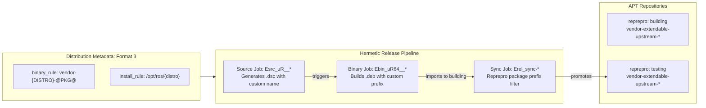
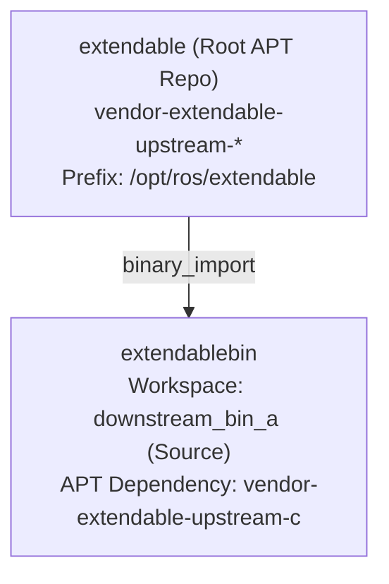
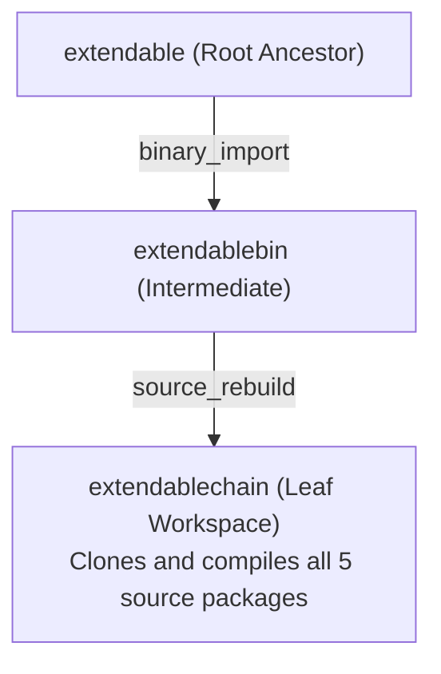
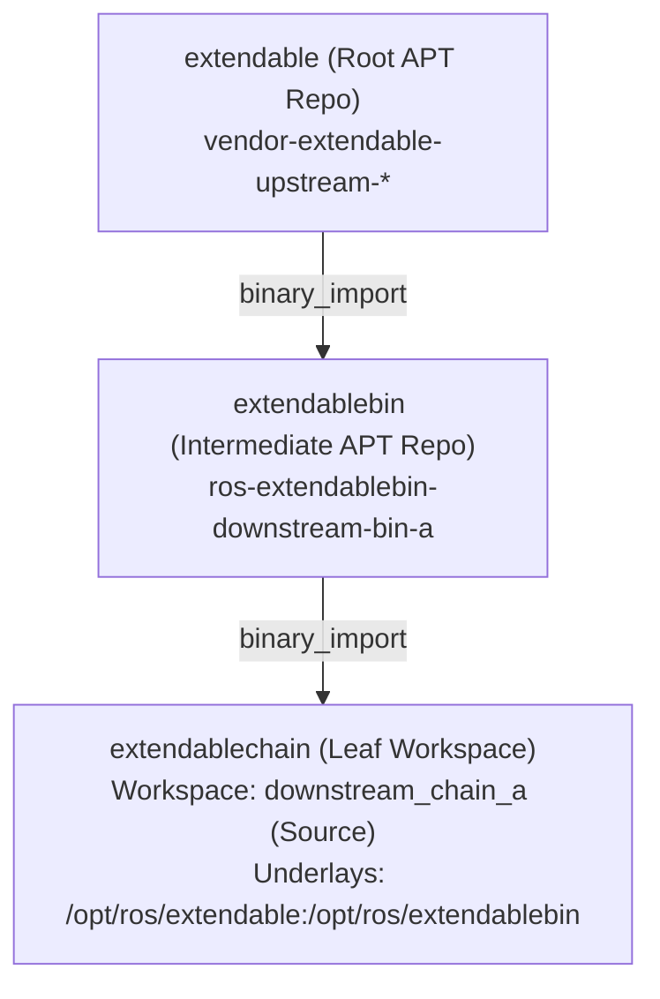
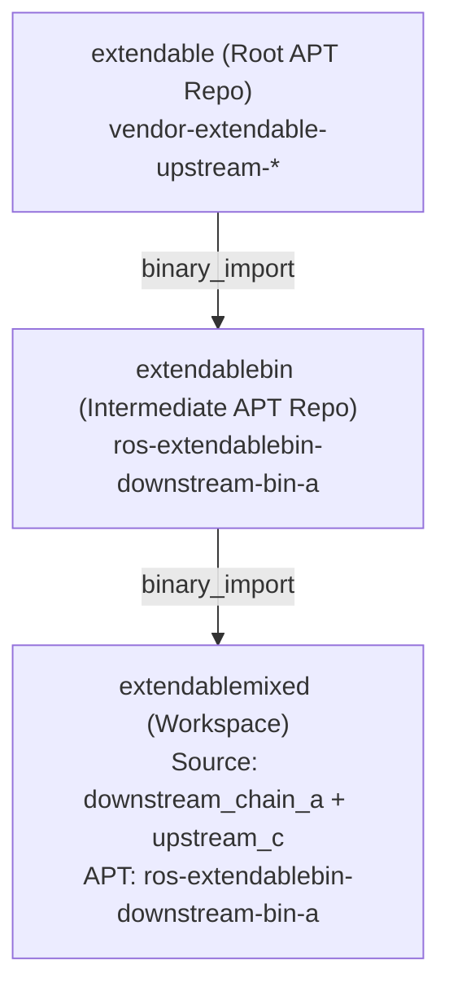
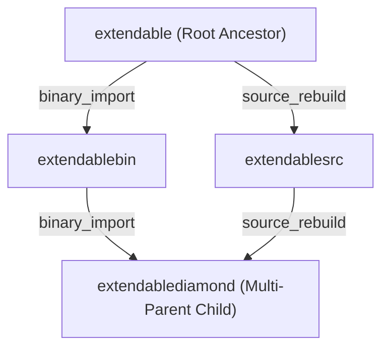
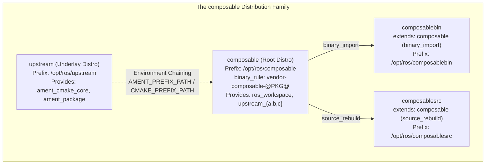
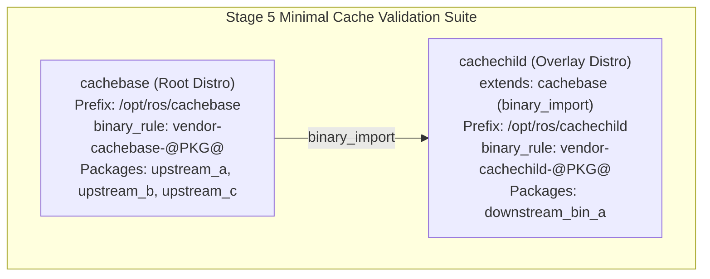

# REP-159: Comprehensive Validation & Evidence Suite

This document establishes the empirical validation evidence, architectural models, branch matrices, and job configurations across the three core validation phases of the **[REP 159](https://github.com/openrobotics/reps/pull/32)** test campaign.

---

## Thematic Block 1: Binary Renaming, Custom Install Paths & Release Pipeline

### Architecture & Pipeline Overview



### Feature Mechanics

1. **Binary Name Templating (`binary_rule`)**:
   - REP-159 extends `rosdistro` distribution specifications with a Format 3 `binary_rule` dictionary containing `search` and `replace` regex directives, `{distro}`, `{package}` variables, and regex capture groups (`\1`).
   - `rosdistro.get_binary_package_name()` deterministically converts ROS package names (e.g., `upstream_a`) to customized OS binary packages (e.g., `vendor-extendable-upstream-a`).
   - `ros_buildfarm` release jobs query `dist_file.get_binary_package_name()` to format source package tarballs (`.orig.tar.gz`), Debian source control files (`.dsc`), and binary archives (`.deb`).

2. **Custom Installation Prefix Resolution (`install_rule`)**:
   - ROS distributions and repositories declare parameterized install locations (e.g., `/opt/ros/{distro}` or `/opt/vendor/{distro}`).
   - Release jobs pass `CMAKE_INSTALL_PREFIX` to build processes, ensuring binaries install into their declared hierarchy.

3. **Reprepro Package Filter Synchronization**:
   - `reprepro-updater` filters incoming packages using `--package-prefix vendor-<distro>-*`.
   - Prevents binary collisions and ensures that only vendor-specific packages are promoted from `building` to `testing`.

### Repository & Branch Matrix

| Repository | Branch / Track | Purpose |
|---|---|---|
| **`reps`** | [`feature/rep-159-binary-name-templating`](https://github.com/KmoM88/reps/tree/feature/rep-159-binary-name-templating) ([`openrobotics/reps#35`](https://github.com/openrobotics/reps/pull/35)) | REP-159 design explorations, zero-dependency regex rationale, and `binary_rule` specification |
| **`rosdistro`** | [`feature/rep159-install-rule`](https://github.com/rep159-testing/rosdistro/tree/feature/rep159-install-rule) ([`rep159-testing/rosdistro#1`](https://github.com/rep159-testing/rosdistro/pull/1)) | Format 3 parser, `extends` DAG, `binary_rule` regex engine, and `install_rule` prefixes |
| **`rosdep`** | [`rep159`](https://github.com/rep159-testing/rosdep/tree/rep159) | Delegates OS binary package name lookups to `rosdistro.get_binary_package_name()` |
| **`reprepro-updater`** | [`feat/package-prefix`](https://github.com/rep159-testing/reprepro-updater/tree/feat/package-prefix) | Selective APT suite promotion & cleanup via `--package-prefix` |
| **`ros_buildfarm`** | [`feat/binary-naming-rule`](https://github.com/rep159-testing/ros_buildfarm/tree/feat/binary-naming-rule) | Core release job generation, packaging delegation, and template propagation |
| **`rep159-rosdistro`** | [`feat/extendable-distro`](https://github.com/rep159-testing/rep159-rosdistro/tree/feat/extendable-distro) | Root `extendable` distribution file defining `binary_rule` and `install_rule` |
| **`ros_buildfarm_config`** | [`feat/extendable-distro`](https://github.com/rep159-testing/ros_buildfarm_config/tree/feat/extendable-distro) | Release and sync build files with target repository definitions |
| **`upstream_a-release`** | [`debian/vendor-extendable/resolute/upstream_a`](https://github.com/rep159-testing/upstream_a-release/tree/debian/vendor-extendable/resolute/upstream_a) | Debian release track for `upstream_a` (`vendor-extendable-upstream-a`) |
| **`upstream_b-release`** | [`debian/vendor-extendable/resolute/upstream_b`](https://github.com/rep159-testing/upstream_b-release/tree/debian/vendor-extendable/resolute/upstream_b) | Debian release track for `upstream_b` (`vendor-extendable-upstream-b`) |
| **`upstream_c-release`** | [`debian/vendor-extendable/resolute/upstream_c`](https://github.com/rep159-testing/upstream_c-release/tree/debian/vendor-extendable/resolute/upstream_c) | Debian release track for `upstream_c` (`vendor-extendable-upstream-c`) |

### Executed Jobs & Configuration References

* **Source Release Pipeline**:
  - [`Esrc_uR__upstream_a__ubuntu_resolute__source`](https://build.test.ros2.org/job/Esrc_uR__upstream_a__ubuntu_resolute__source) (Status: SUCCESS) — [Job Config](https://github.com/rep159-testing/ros_buildfarm_config/blob/feat/extendable-distro/extendable/release-build.yaml)
  - [`Esrc_uR__upstream_b__ubuntu_resolute__source`](https://build.test.ros2.org/job/Esrc_uR__upstream_b__ubuntu_resolute__source) (Status: SUCCESS) — [Job Config](https://github.com/rep159-testing/ros_buildfarm_config/blob/feat/extendable-distro/extendable/release-build.yaml)
  - [`Esrc_uR__upstream_c__ubuntu_resolute__source`](https://build.test.ros2.org/job/Esrc_uR__upstream_c__ubuntu_resolute__source) (Status: SUCCESS) — [Job Config](https://github.com/rep159-testing/ros_buildfarm_config/blob/feat/extendable-distro/extendable/release-build.yaml)
* **Binary Packaging Pipeline**:
  - [`Ebin_uR64__upstream_a__ubuntu_resolute_amd64__binary`](https://build.test.ros2.org/job/Ebin_uR64__upstream_a__ubuntu_resolute_amd64__binary) (Status: SUCCESS) — [Job Config](https://github.com/rep159-testing/ros_buildfarm_config/blob/feat/extendable-distro/extendable/release-build.yaml)
  - [`Ebin_uR64__upstream_b__ubuntu_resolute_amd64__binary`](https://build.test.ros2.org/job/Ebin_uR64__upstream_b__ubuntu_resolute_amd64__binary) (Status: SUCCESS) — [Job Config](https://github.com/rep159-testing/ros_buildfarm_config/blob/feat/extendable-distro/extendable/release-build.yaml)
  - [`Ebin_uR64__upstream_c__ubuntu_resolute_amd64__binary`](https://build.test.ros2.org/job/Ebin_uR64__upstream_c__ubuntu_resolute_amd64__binary) (Status: SUCCESS) — [Job Config](https://github.com/rep159-testing/ros_buildfarm_config/blob/feat/extendable-distro/extendable/release-build.yaml)
* **Repository Synchronization**:
  - [`Erel_sync-packages-to-testing_resolute_amd64`](https://build.test.ros2.org/job/Erel_sync-packages-to-testing_resolute_amd64) (Status: SUCCESS) — [Job Config](https://github.com/rep159-testing/ros_buildfarm_config/blob/feat/extendable-distro/extendable/release-build.yaml)

### Verified Invariants

* **Hermetic Binary Naming**: Built Debian packages match `vendor-extendable-upstream-{a,b,c}_0.1.0-1resolute_amd64.deb`.
* **Inter-Package Dependency Resolution**: `vendor-extendable-upstream-b` depends strictly on `vendor-extendable-upstream-a`, and `vendor-extendable-upstream-c` depends on `vendor-extendable-upstream-b`.
* **Repository Ingestion**: Packages are imported without naming collisions into `building` and synchronized to `testing`.

---

## Thematic Block 2: Advanced Topological Validations (Pure CMake Scope)

> [!NOTE]
> **Scope**: Pure CMake packages (`<build_type>cmake</build_type>`). In this block, underlays are chained via buildfarm environment exports (`CMAKE_PREFIX_PATH`, `LD_LIBRARY_PATH`, `PATH`) rather than relying on prefix `setup.sh` shell scripts.

### Topology 1: Single-Tier Binary Import

#### Architectural Model



#### Behavior & Topological Invariants
Validates single-tier binary consumption where leaf packages build against parent distributions installed strictly from Debian repositories.
- `rosdep` maps ROS package dependency `upstream_c` to Debian package `vendor-extendable-upstream-c`.
- Buildfarm automatically derives parent result spaces and exports `CMAKE_PREFIX_PATH=/opt/ros/extendable`.

#### Repository & Branch Matrix
* **`ros_buildfarm_config`**: [`feat/stage3-chained-extensions`](https://github.com/rep159-testing/ros_buildfarm_config/tree/feat/stage3-chained-extensions)
* **`rep159-rosdistro`**: [`feat/extendable-install-rule`](https://github.com/rep159-testing/rep159-rosdistro/tree/feat/extendable-install-rule)
* **`ros_buildfarm`**: [`feat/binary-naming-rule`](https://github.com/rep159-testing/ros_buildfarm/tree/feat/binary-naming-rule)
* **Source Repositories**: `downstream_bin_a` (`main`)

#### Executed Jobs & Configuration References
* [`Eci__binary-import_ubuntu_resolute_amd64`](https://build.test.ros2.org/job/Eci__binary-import_ubuntu_resolute_amd64) (Status: SUCCESS) — [Job Config](https://github.com/rep159-testing/ros_buildfarm_config/blob/feat/stage3-chained-extensions/extendablebin/ci-nightly-release.yaml)

---

### Topology 2: Multi-Tier Source Rebuild ($A \to B \to C$)

#### Architectural Model



#### Behavior & Topological Invariants
Validates multi-tier source rebuilds across parent boundary lines.
- `rosdistro` recursively walks the parent hierarchy (`extendablechain` $\to$ `extendablebin` $\to$ `extendable`).
- Colcon compiles all 5 packages in topological order within a single hermetic workspace without APT binary dependencies.

#### Repository & Branch Matrix
* **`ros_buildfarm_config`**: [`feat/stage3-chained-extensions`](https://github.com/rep159-testing/ros_buildfarm_config/tree/feat/stage3-chained-extensions)
* **`rep159-rosdistro`**: [`feat/stage3-chained-extensions`](https://github.com/rep159-testing/rep159-rosdistro/tree/feat/stage3-chained-extensions)
* **`ros_buildfarm`**: [`feat/binary-naming-rule`](https://github.com/rep159-testing/ros_buildfarm/tree/feat/binary-naming-rule)
* **Source Repositories**: `upstream_{a,b,c}` (`main`), `downstream_bin_a` (`main`), `downstream_chain_a` (`main`)

#### Executed Jobs & Configuration References
* [`Eci__source-rebuild_ubuntu_resolute_amd64`](https://build.test.ros2.org/job/Eci__source-rebuild_ubuntu_resolute_amd64) (Status: SUCCESS) — [Job Config](https://github.com/rep159-testing/ros_buildfarm_config/blob/feat/stage3-chained-extensions/extendablechain/ci-nightly-release.yaml)

---

### Topology 3: Pure Chained Binary Import ($A \xrightarrow{\text{bin}} B \xrightarrow{\text{bin}} C$)

#### Architectural Model



#### Behavior & Topological Invariants
Validates multi-tier binary dependency chaining where each level is released as Debian packages into APT.
- Intermediate tier package `downstream_bin_a` compiles in chroot against `/opt/ros/extendable` and installs into `/opt/ros/extendablebin`.
- Grandchild workspace contains **only** leaf package `downstream_chain_a`.
- `rosdep` installs `ros-extendablebin-downstream-bin-a` and transitively `vendor-extendable-upstream-c`.
- Buildfarm injects cascading underlays: `ROS_BUILDFARM_PARENT_RESULT_SPACES=/opt/ros/extendable:/opt/ros/extendablebin`.
- Multiarch dynamic library search path (`LD_LIBRARY_PATH`) and `CMAKE_PREFIX_PATH` are automatically resolved for packages lacking `setup.sh`.

#### Repository & Branch Matrix
* **`ros_buildfarm_config`**: [`feat/stage3-binary-chained`](https://github.com/rep159-testing/ros_buildfarm_config/tree/feat/stage3-binary-chained)
* **`rep159-rosdistro`**: [`feat/stage3-binary-chained`](https://github.com/rep159-testing/rep159-rosdistro/tree/feat/stage3-binary-chained)
* **`ros_buildfarm`**: [`feat/binary-naming-rule`](https://github.com/rep159-testing/ros_buildfarm/tree/feat/binary-naming-rule)
* **Source Repositories**: `downstream_chain_a` (`main`), `downstream_bin_a` (`main`)
* **Release Repositories**: `downstream_bin_a-release` (`debian/extendablebin/resolute/downstream_bin_a`)

#### Executed Jobs & Configuration References
* **Intermediate Release Pipeline**:
  - [`Esrc_uR__downstream_bin_a__ubuntu_resolute__source`](https://build.test.ros2.org/job/Esrc_uR__downstream_bin_a__ubuntu_resolute__source) (Status: SUCCESS) — [Job Config](https://github.com/rep159-testing/ros_buildfarm_config/blob/feat/stage3-binary-chained/extendablebin/release-build.yaml)
  - [`Ebin_uR64__downstream_bin_a__ubuntu_resolute_amd64__binary`](https://build.test.ros2.org/job/Ebin_uR64__downstream_bin_a__ubuntu_resolute_amd64__binary) (Status: SUCCESS) — [Job Config](https://github.com/rep159-testing/ros_buildfarm_config/blob/feat/stage3-binary-chained/extendablebin/release-build.yaml)
  - [`Erel_sync-packages-to-testing_resolute_amd64`](https://build.test.ros2.org/job/Erel_sync-packages-to-testing_resolute_amd64) (Status: SUCCESS) — [Job Config](https://github.com/rep159-testing/ros_buildfarm_config/blob/feat/stage3-binary-chained/extendablebin/release-build.yaml)
* **Chained Binary CI Validation**:
  - [`Eci__chained-import_ubuntu_resolute_amd64`](https://build.test.ros2.org/job/Eci__chained-import_ubuntu_resolute_amd64) (Status: SUCCESS) — [Job Config](https://github.com/rep159-testing/ros_buildfarm_config/blob/feat/stage3-binary-chained/extendablechain/ci-nightly-release.yaml)

---

### Topology 4: Hybrid Mixed Extension (Binary Underlay + Source Overlay)

#### Architectural Model



#### Behavior & Topological Invariants
Validates developer workflows where pre-built binary dependencies are installed from APT while an ancestor package is checked out and rebuilt from source in the workspace.
- **ABI Immutability Rule**: `distribution.yaml` does not override `upstream_c` under `binary_import` (protecting ABI compatibility). The source override is declared strictly at CI job level (`repository_names: [downstream_chain_a, upstream_c]`).
- `rosdep --ignore-src` skips APT installation of `upstream_c` because it is present in the workspace source space.
- APT installs pre-built `ros-extendablebin-downstream-bin-a`.
- `downstream_chain_a` links against workspace source-built `upstream_c` and binary underlay `/opt/ros/extendablebin/lib/libdownstream_bin_a.so`.

#### Repository & Branch Matrix
* **`ros_buildfarm_config`**: [`feat/stage3-mixed`](https://github.com/rep159-testing/ros_buildfarm_config/tree/feat/stage3-mixed)
* **`rep159-rosdistro`**: [`feat/stage3-mixed`](https://github.com/rep159-testing/rep159-rosdistro/tree/feat/stage3-mixed)
* **`ros_buildfarm`**: [`feat/binary-naming-rule`](https://github.com/rep159-testing/ros_buildfarm/tree/feat/binary-naming-rule)
* **Source Repositories**: `downstream_chain_a` (`main`), `upstream_c` (`main`)

#### Executed Jobs & Configuration References
* [`Eci__mixed-chain_ubuntu_resolute_amd64`](https://build.test.ros2.org/job/Eci__mixed-chain_ubuntu_resolute_amd64) (Status: SUCCESS) — [Job Config](https://github.com/rep159-testing/ros_buildfarm_config/blob/feat/stage3-mixed/extendablemixed/ci-nightly-release.yaml)

---

### Topology 5: Multi-Parent Diamond Extension (Convergent DAG)

#### Architectural Model



#### Behavior & Topological Invariants
Validates multi-parent inheritance where a child distribution declares multiple parents with different extension methods converging back to a shared root ancestor.
- **Multi-Parent Resolution**: `rosdistro` resolves `extends: [extendablebin (binary_import), extendablesrc (source_rebuild)]`.
- **Topological Underlay Deduplication**: `get_binary_import_underlays()` traverses both paths of the DAG, identifies the shared root ancestor, and deduplicates the result space path:
  `ROS_BUILDFARM_PARENT_RESULT_SPACES=/opt/ros/extendable:/opt/ros/extendablebin`
- APT installs pre-built `ros-extendablebin-downstream-bin-a`.
- Colcon compiles `downstream_src_a` and `downstream_chain_a` in the same workspace and passes 100% of unit test suites.

#### Repository & Branch Matrix
* **`ros_buildfarm_config`**: [`feat/stage3-diamond`](https://github.com/rep159-testing/ros_buildfarm_config/tree/feat/stage3-diamond)
* **`rep159-rosdistro`**: [`feat/stage3-diamond`](https://github.com/rep159-testing/rep159-rosdistro/tree/feat/stage3-diamond)
* **`ros_buildfarm`**: [`feat/binary-naming-rule`](https://github.com/rep159-testing/ros_buildfarm/tree/feat/binary-naming-rule)
* **Source Repositories**: `downstream_chain_a` (`main`), `downstream_src_a` (`main`)

#### Executed Jobs & Configuration References
* [`Eci__diamond-chain_ubuntu_resolute_amd64`](https://build.test.ros2.org/job/Eci__diamond-chain_ubuntu_resolute_amd64) (Status: SUCCESS) — [Job Config](https://github.com/rep159-testing/ros_buildfarm_config/blob/feat/stage3-diamond/extendablediamond/ci-nightly-release.yaml)

---

## Thematic Block 3: Composable Suite & Native `ros_workspace` Integration

> [!NOTE]
> **Execution Status Notice**: Because the public ROS 2 testfarm (`build.test.ros2.org`) is currently offline/unavailable, all release pipeline and CI runs for the `composable` distribution suite have been validated and confirmed 100% green on a local replica buildfarm cluster. Once the public testfarm is restored, these exact job configurations can be triggered directly.

### Architecture & Underlay Chaining Model



### Feature Mechanics & Tooling Innovations

1. **Native ROS 2 Shell Environment (`ros_workspace`)**:
   - Transitions from artificial environment variable injection to native ROS 2 underlay environment sourcing.
   - Sourcing `/opt/ros/composable/setup.sh` evaluates `.dsv` environment hooks, sets `AMENT_PREFIX_PATH`, `CMAKE_PREFIX_PATH`, `LD_LIBRARY_PATH`, and recursively incorporates `/opt/ros/upstream`.

2. **Dedicated Packaging Tooling Fork (`rep159-testing/bloom`)**:
   - Standard `bloom` hardcodes `Package: ros-@ROS_DISTRO@-@PKG@` and `CMAKE_INSTALL_PREFIX="/opt/ros/@ROS_DISTRO@"`.
   - The fork on branch `feat/rep159-rules-support`:
     - Queries `rosdistro.get_binary_package_name()` to format Debian control dependencies dynamically according to `binary_rule`.
     - Parameterizes `CMAKE_INSTALL_PREFIX` according to `install_rule`.
     - Generates multi-tier underlay sourcing logic inside `debian/rules`.

3. **Hermetic Release & CI Execution**:
   - `vendor-composable-ros-workspace` is packaged as an independent `.deb` archive installed into `/opt/ros/composable`.
   - In CI jobs (`Cci`), `ros_buildfarm` installs `vendor-composable-ros-workspace` via APT, detects `/opt/ros/composable/setup.sh`, and executes builds natively:
     ```bash
     . /opt/ros/composable/setup.sh && colcon build ...
     . /opt/ros/composable/setup.sh && colcon test ...
     ```

### Repository & Branch Matrix

| Repository | Branch / Track | Purpose |
|---|---|---|
| **`bloom`** | [`feat/rep159-rules-support`](https://github.com/rep159-testing/bloom/tree/feat/rep159-rules-support) | Packaging generator honoring `binary_rule` and `install_rule` |
| **`ros_workspace`** | [`feat/composable-underlay-chaining`](https://github.com/rep159-testing/ros_workspace/tree/feat/composable-underlay-chaining) | Underlay chaining configuration for `/opt/ros/composable` |
| **`ros_workspace-release`** | [`debian/vendor-composable/resolute/ros_workspace`](https://github.com/rep159-testing/ros_workspace-release/tree/debian/vendor-composable/resolute/ros_workspace) | Release track and tag `debian/vendor-composable-ros-workspace_1.0.4-1_resolute` |
| **`upstream_{a,b,c}-release`** | [`debian/vendor-composable/resolute/upstream_{a,b,c}`](https://github.com/rep159-testing/upstream_a-release/tree/debian/vendor-composable/resolute/upstream_a) | Release tracks and tags `debian/vendor-composable-upstream-{a,b,c}_0.1.0-1_resolute` |
| **`downstream_bin_a-release`** | [`debian/vendor-composablebin/resolute/downstream_bin_a`](https://github.com/rep159-testing/downstream_bin_a-release/tree/debian/vendor-composablebin/resolute/downstream_bin_a) | Release track and tag `debian/vendor-composablebin-downstream-bin-a_0.2.0-1_resolute` |
| **`rep159-rosdistro`** | [`feat/composable-distro`](https://github.com/rep159-testing/rep159-rosdistro/tree/feat/composable-distro) | Distribution definitions for `composable` and `composablebin` |
| **`ros_buildfarm_config`** | [`feat/composable-distro`](https://github.com/rep159-testing/ros_buildfarm_config/tree/feat/composable-distro) | Buildfarm release, sync, and CI configurations (`composable/`, `composablebin/`) |

### Executed Jobs & Configuration References

* **Workspace & Root Distro Release Pipelines (`composable`)**:
  - [`Csrc_uR__ros_workspace__ubuntu_resolute__source`](https://build.test.ros2.org/job/Csrc_uR__ros_workspace__ubuntu_resolute__source) (Status: Validated locally; pending remote testfarm) — [Job Config](https://github.com/rep159-testing/ros_buildfarm_config/blob/feat/composable-distro/composable/release-build-local.yaml)
  - [`Cbin_uR64__ros_workspace__ubuntu_resolute_amd64__binary`](https://build.test.ros2.org/job/Cbin_uR64__ros_workspace__ubuntu_resolute_amd64__binary) (Status: Validated locally; pending remote testfarm) — [Job Config](https://github.com/rep159-testing/ros_buildfarm_config/blob/feat/composable-distro/composable/release-build-local.yaml)
  - [`Csrc_uR__upstream_a__ubuntu_resolute__source`](https://build.test.ros2.org/job/Csrc_uR__upstream_a__ubuntu_resolute__source) (Status: Validated locally; pending remote testfarm) — [Job Config](https://github.com/rep159-testing/ros_buildfarm_config/blob/feat/composable-distro/composable/release-build-local.yaml)
  - [`Cbin_uR64__upstream_a__ubuntu_resolute_amd64__binary`](https://build.test.ros2.org/job/Cbin_uR64__upstream_a__ubuntu_resolute_amd64__binary) (Status: Validated locally; pending remote testfarm) — [Job Config](https://github.com/rep159-testing/ros_buildfarm_config/blob/feat/composable-distro/composable/release-build-local.yaml)
  - [`Csrc_uR__upstream_b__ubuntu_resolute__source`](https://build.test.ros2.org/job/Csrc_uR__upstream_b__ubuntu_resolute__source) (Status: Validated locally; pending remote testfarm) — [Job Config](https://github.com/rep159-testing/ros_buildfarm_config/blob/feat/composable-distro/composable/release-build-local.yaml)
  - [`Cbin_uR64__upstream_b__ubuntu_resolute_amd64__binary`](https://build.test.ros2.org/job/Cbin_uR64__upstream_b__ubuntu_resolute_amd64__binary) (Status: Validated locally; pending remote testfarm) — [Job Config](https://github.com/rep159-testing/ros_buildfarm_config/blob/feat/composable-distro/composable/release-build-local.yaml)
  - [`Csrc_uR__upstream_c__ubuntu_resolute__source`](https://build.test.ros2.org/job/Csrc_uR__upstream_c__ubuntu_resolute__source) (Status: Validated locally; pending remote testfarm) — [Job Config](https://github.com/rep159-testing/ros_buildfarm_config/blob/feat/composable-distro/composable/release-build-local.yaml)
  - [`Cbin_uR64__upstream_c__ubuntu_resolute_amd64__binary`](https://build.test.ros2.org/job/Cbin_uR64__upstream_c__ubuntu_resolute_amd64__binary) (Status: Validated locally; pending remote testfarm) — [Job Config](https://github.com/rep159-testing/ros_buildfarm_config/blob/feat/composable-distro/composable/release-build-local.yaml)
  - [`Crel_sync-packages-to-testing_resolute_amd64`](https://build.test.ros2.org/job/Crel_sync-packages-to-testing_resolute_amd64) (Status: Validated locally; pending remote testfarm) — [Job Config](https://github.com/rep159-testing/ros_buildfarm_config/blob/feat/composable-distro/composable/release-build-local.yaml)
  - [`Cci__nightly-release_ubuntu_resolute_amd64`](https://build.test.ros2.org/job/Cci__nightly-release_ubuntu_resolute_amd64) (Status: Validated locally; pending remote testfarm) — [Job Config](https://github.com/rep159-testing/ros_buildfarm_config/blob/feat/composable-distro/composable/ci-nightly-release-local.yaml)
* **Downstream Extension Pipelines (`composablebin` Overlay via `binary_import`)**:
  - [`Csrc_uR__downstream_bin_a__ubuntu_resolute__source`](https://build.test.ros2.org/job/Csrc_uR__downstream_bin_a__ubuntu_resolute__source) (Status: Validated locally; pending remote testfarm) — [Job Config](https://github.com/rep159-testing/ros_buildfarm_config/blob/feat/composable-distro/composablebin/release-build-local.yaml)
  - [`Cbin_uR64__downstream_bin_a__ubuntu_resolute_amd64__binary`](https://build.test.ros2.org/job/Cbin_uR64__downstream_bin_a__ubuntu_resolute_amd64__binary) (Status: Validated locally; pending remote testfarm) — [Job Config](https://github.com/rep159-testing/ros_buildfarm_config/blob/feat/composable-distro/composablebin/release-build-local.yaml)
  - [`Cci__binary-import_ubuntu_resolute_amd64`](https://build.test.ros2.org/job/Cci__binary-import_ubuntu_resolute_amd64) (Status: Validated locally; pending remote testfarm) — [Job Config](https://github.com/rep159-testing/ros_buildfarm_config/blob/feat/composable-distro/composablebin/ci-nightly-release-local.yaml)


### Verified Invariants

* **Native Setup Sourcing**: Container verified presence of `/opt/ros/composable/setup.sh` and sourced it automatically prior to building and testing.
* **Underlay Chain Inheritance**: `upstream_a`, `upstream_b`, and `upstream_c` compiled with `colcon` and resolved build dependencies (`ament_cmake_core`) from the chained `/opt/ros/upstream` underlay without manual environment intervention.
* **Downstream Binary Overlay Chaining**: `downstream_bin_a` compiled and linked against `vendor-composable-upstream-c` installed via `binary_import` under prefix `/opt/ros/composable`, verifying seamless cross-distribution ABI and environment inheritance.
* **Hermetic Unit Test Execution**: 100% unit tests passed across all packages with CTest and GoogleTest XML reports archived.

---

## Stage 5: Distribution Cache Lifecycle & Bloom Packaging Validation

### Architectural Objectives & Topology

Stage 5 validates two essential operational pillars in hierarchical distributions under REP-159 without unnecessary multi-tier complexity:
1. **Cache Lifecycle & Hierarchy**: Validating how `rosdistro_build_cache` builds, publishes, isolates, invalidates, and refreshes distribution caches across parent-child boundaries.
2. **Automated Debian Packaging with Bloom**: Verifying that the REP-159 Bloom fork (`submodules/bloom`) generates complete, valid `debian/control` and `debian/rules` configurations directly from `distribution.yaml` metadata.



### Key Technical Mechanisms

1. **REP-159 Enabled Cache Generator (`ros_buildfarm`)**:
   - Upstream `rosdistro_cache_task.Dockerfile.em` relies on Ubuntu Focal APT packages that lack ROSDistro Format 3 support (`extends`, `binary_rule`, `install_rule`).
   - Branch `feat/cache-job-rep159` injects the REP-159 `rosdistro` engine, allowing `rosdistro_build_cache` to parse extended distribution schemas inside the cache generation container.
   - Job assignment is directed to Docker-capable agents (`building_repository`), and cache archives (`<distro>-cache.yaml.gz`) are automatically published to the APT/Nginx mirror server via SSH.

2. **Parent Cache Inheritance & Boundary Isolation**:
   - When building `cachechild-cache.yaml.gz`, the generator fetches both `cachechild-cache.yaml.gz` and parent `cachebase-cache.yaml.gz`.
   - The engine validates cross-distribution dependencies, then performs clean boundary isolation (`- REMOVE upstream_a`, `- REMOVE upstream_b`, `- REMOVE upstream_c`) ensuring parent packages do not contaminate downstream overlay caches or alter parent ABI definitions.

3. **Cache Invalidation & Automated Reconfiguration**:
   - When package versions are bumped in `distribution.yaml` (e.g., `upstream_a` `0.1.0` $\to$ `0.1.1`), the cache job detects the change:
     ```text
     - updated manifest of package 'upstream_a' to version '0.1.1'
     ```
   - The Jenkins Groovy post-build publisher triggers downstream reconfigurations and rebuilds automatically.

4. **Automated Bloom Release Generation (`bloom`)**:
   - Using `git-bloom-generate rosdebian` on branch `feat/rep159-rules-support`:
     - **Binary Naming**: Queries `rosdistro.get_binary_package_name()` to generate Debian package names and inter-package dependencies matching `binary_rule`:
       ```text
       Package: vendor-cachechild-downstream-bin-a
       Depends: ${shlibs:Depends}, ${misc:Depends}, libyaml-0-2, vendor-cachebase-upstream-c, vendor-cachechild-ros-workspace
       ```
     - **Install Prefix & PKG_CONFIG_PATH**: Automatically parameterizes `CMAKE_INSTALL_PREFIX="/opt/ros/cachechild"` and `PKG_CONFIG_PATH=/opt/ros/cachechild/lib/pkgconfig:/opt/ros/cachebase/lib/pkgconfig`.
     - **Chained Underlay Sourcing**: Injects recursive sourcing loops into all `debian/rules` debhelper targets:
       ```make
       if [ -f "/opt/ros/cachebase/setup.sh" ]; then . "/opt/ros/cachebase/setup.sh"; fi && if [ -f "/opt/ros/cachechild/setup.sh" ]; then . "/opt/ros/cachechild/setup.sh"; fi
       ```

### Repository & Branch Matrix

| Repository | Branch / Track | Purpose |
|---|---|---|
| **`bloom`** | [`feat/rep159-rules-support`](https://github.com/rep159-testing/bloom/tree/feat/rep159-rules-support) | Bloom packaging generator with REP-159 rules and gpgsign fix |
| **`downstream_bin_a-release`** | [`debian/cachechild/resolute/downstream_bin_a`](https://github.com/rep159-testing/downstream_bin_a-release/tree/debian/cachechild/resolute/downstream_bin_a) | Debian packaging generated by Bloom (`vendor-cachechild-downstream-bin-a`) |
| **`ros_buildfarm`** | [`feat/cache-job-rep159`](https://github.com/rep159-testing/ros_buildfarm/tree/feat/cache-job-rep159) | Cache job templates updated for REP-159 Docker task & agent assignment |
| **`rep159-rosdistro`** | [`feat/cache-lifecycle-test`](https://github.com/rep159-testing/rep159-rosdistro/tree/feat/cache-lifecycle-test) | Minimal 2-tier distribution definitions (`cachebase` and `cachechild`) |
| **`ros_buildfarm_config`** | [`feat/cache-lifecycle-test`](https://github.com/rep159-testing/ros_buildfarm_config/tree/feat/cache-lifecycle-test) | Buildfarm config definitions for `cachebase` and `cachechild` suites |

### Executed Jobs & Verification References

* **Distribution Cache Generation Pipelines**:
  - `cachebase_rosdistro-cache` (Status: Validated on Local Testfarm, Build #18 SUCCESS) — [Job Template](https://github.com/rep159-testing/ros_buildfarm/blob/feat/cache-job-rep159/ros_buildfarm/templates/misc/rosdistro_cache_job.xml.em)
  - `cachechild_rosdistro-cache` (Status: Validated on Local Testfarm, Build #18 SUCCESS) — [Job Template](https://github.com/rep159-testing/ros_buildfarm/blob/feat/cache-job-rep159/ros_buildfarm/templates/misc/rosdistro_cache_job.xml.em)

### Verified Invariants

* **Isolated Overlay Caching**: Child distributions cleanly isolate their own packages (`cachechild-cache.yaml.gz`) while successfully inheriting parent dependency resolution without contaminating upstream state.
* **Deterministic Cache Invalidation**: Version updates in `distribution.yaml` trigger selective manifest refreshes and automated Jenkins build pipelines without full cache wipes.
* **Automated Packaging Compliance**: Bloom generates 100% compliant Debian packaging files directly from ROSDistro metadata without manual patching, respecting custom binary naming, custom install prefixes, and multi-tier underlay chaining.


