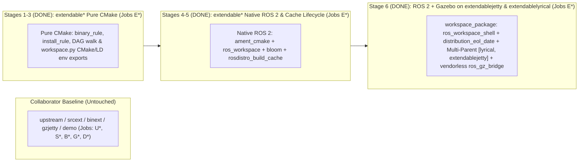
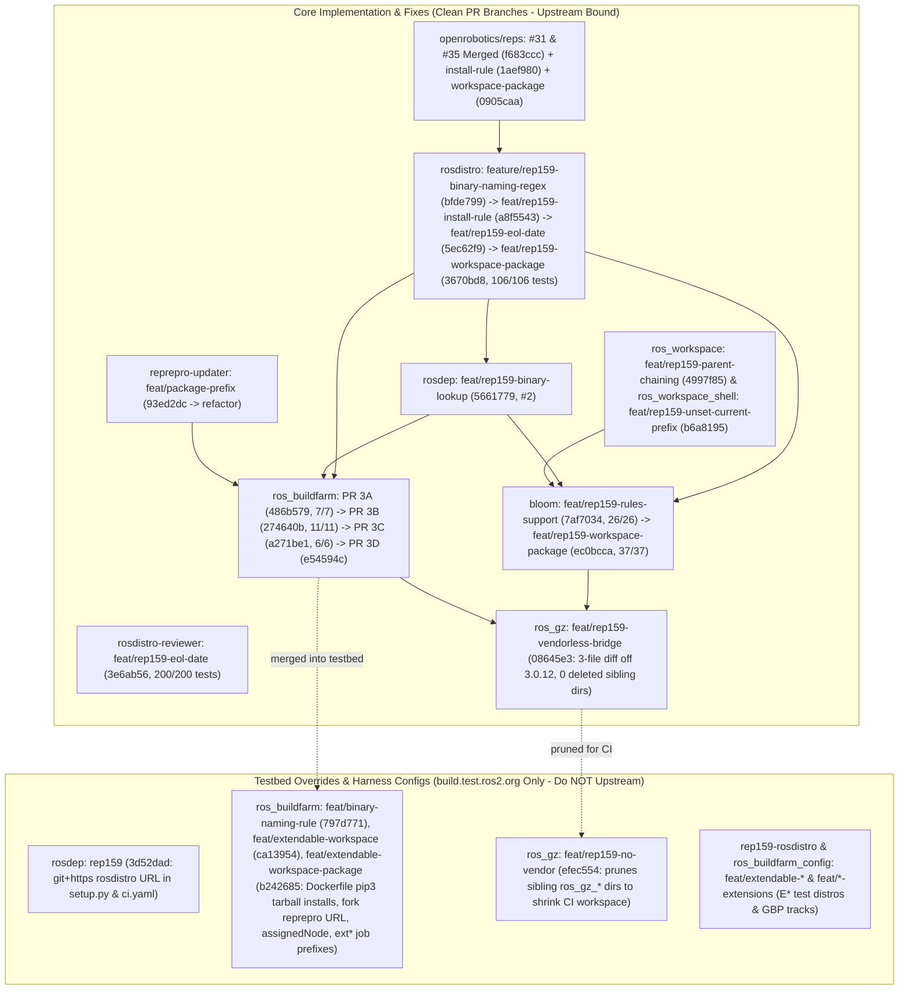
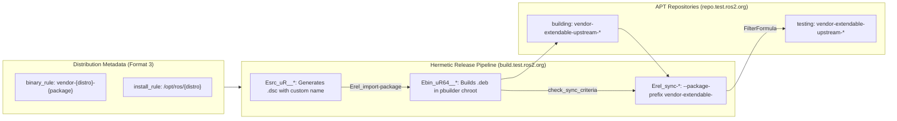
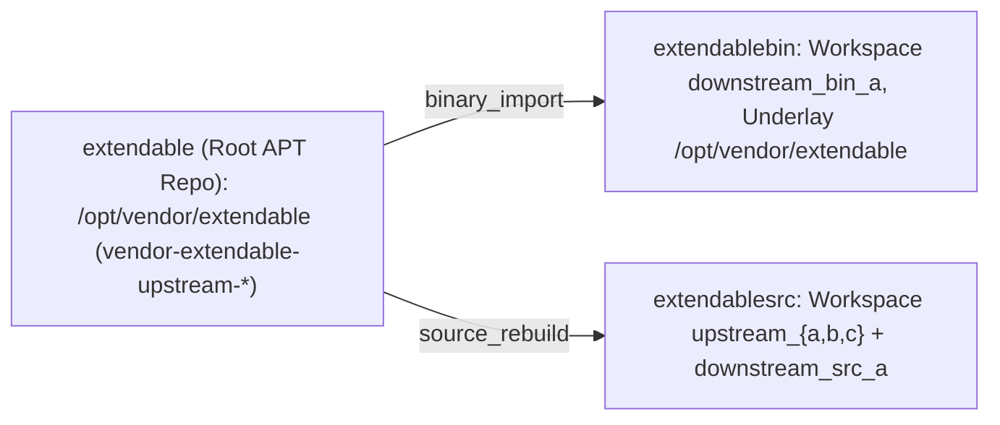
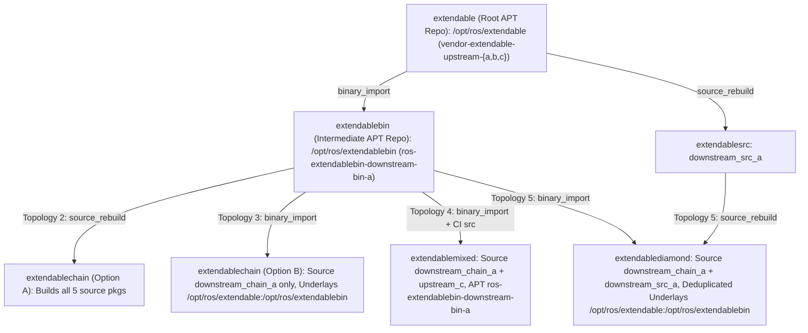
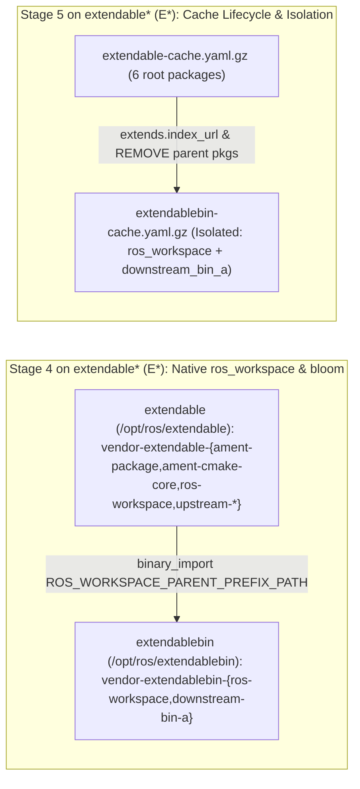
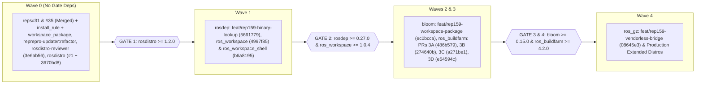

# REP-159: Comprehensive Validation & Evidence Suite (Stages 1–6)

Empirical validation evidence, topological diagrams, clean PR vs. testbed branch matrices, and remote testfarm (`https://build.test.ros2.org` & `http://repo.test.ros2.org`) verification across all 6 stages of the **[REP 159](https://github.com/openrobotics/reps/pull/32)** test campaign.

---

## 0. Unified `extendable*` (`E*`) Validation Architecture on `build.test.ros2.org`



| Dimension | Collaborator Baseline (`upstream` / `srcext` / `binext` / `gzjetty` / `demo`) | `extendable*` [Stages 1–3](https://github.com/KmoM88/rep159-testing/blob/main/roadmap/stage3_topological_extensions.md) (Pure CMake) | `extendable*` [Stages 4–5](https://github.com/KmoM88/rep159-testing/blob/main/roadmap/stage4_composable_workspace.md) (`ros_workspace` + `bloom` + Caches) | `extendable*` [Stage 6](https://github.com/KmoM88/rep159-testing/blob/main/roadmap/stage6_ros_gazebo_and_eol.md) (`ros_workspace_shell` + ROS 2 & Gazebo) |
|---|---|---|---|---|
| **Jenkins Prefix** | `U*`, `S*`, `B*`, `G*`, `D*` *(untouched)* | **`E*`** (`Esrc`, `Ebin`, `Erel`, `Eci`) | **`E*`** (`Esrc`, `Ebin`, `Erel`, `Eci`, `extendable*_rosdistro-cache`) | **`E*`** (`Esrc_uR__extjetty_*`, `Ebin_uR64__extjetty_*`, `Esrc_uR__extlyrical_*`, `Ebin_uR64__extlyrical_*`, `Eci__gazebo-*`) |
| **Package Build Type** | `ament_cmake` + `ros_workspace` / `ros_workspace_shell` | Pure `cmake` (`upstream_{a,b,c}`, `downstream_*`) | `ament_cmake` + `ros_workspace` + `bloom` | Root: Plain `cmake` Gazebo (`ros_workspace_shell`, 6 `gz-*` pkgs)<br>Child: Multi-Parent `[lyrical, extendablejetty]` (`ros_workspace`, `gz-demo-math`, `ros_gz_interfaces`, `ros_gz_bridge`) |
| **Environment Chaining** | `/opt/ros/<distro>/setup.sh` | Buildfarm `workspace.py` (`CMAKE_PREFIX_PATH`, `LD_LIBRARY_PATH`) | Native `/opt/ros/<distro>/setup.sh` + `.dsv` hooks (`ROS_WORKSPACE_PARENT_PREFIX_PATH`) | `/opt/ros/extendablelyrical/setup.sh` chains `/opt/ros/lyrical` (`setup.sh`) + `/opt/ros/extendablejetty` (`ros_workspace_shell`) with `unset AMENT_CURRENT_PREFIX` |
| **Primary Validation Goal** | Foundational 1-tier extensions & Gazebo prototype | Regex `binary_rule`, custom `install_rule`, 3-tier chains, hybrid & diamond DAGs | Child `ros_workspace` release override, automated `bloom` packaging & cache lifecycle | Index v4 `distribution_eol_date`, `rosdistro-reviewer`, `workspace_package: ros_workspace_shell`, and vendorless `ros_gz_bridge` across `repo.ros2.org` + `repo.test.ros2.org` |

---

## 0.1 Core Implementation (Upstream-Bound Clean PRs) vs. Testbed Overrides (`build.test.ros2.org`)

Every stage strictly separates **Clean Upstream PR Branches (0 Hacks)** from **Testbed Bootstrap Overrides**:



### Complete Clean PR vs. Testbed Branch Matrix

| Repository | Clean Upstream PR Branch(es) (`@ SHA`, 0 Hacks) | Testfarm Branch (`@ SHA`) | Role & Unit Test Status |
|---|---|---|---|
| **`reps`** | • [`openrobotics/reps#31`](https://github.com/openrobotics/reps/pull/31) (**MERGED**)<br>• [`openrobotics/reps#35`](https://github.com/openrobotics/reps/pull/35) (**MERGED** `f683ccc`)<br>• [`feature/rep-159-install-rule`](https://github.com/KmoM88/reps/tree/feature/rep-159-install-rule) (`1aef980`)<br>• [`feature/rep-159-workspace-package`](https://github.com/KmoM88/reps/tree/feature/rep-159-workspace-package) (`0905caa`) | N/A | REP-159 Format 3 `extends`, `binary_rule` (`{distro}`, `{package}`, `{origin_distro}`), `install_rule`, `workspace_package` (`ros_workspace_shell`), `distribution_eol_date`, and multi-tier DAG spec |
| **`rosdistro`** | • [`feature/rep159-binary-naming-regex`](https://github.com/rep159-testing/rosdistro/tree/feature/rep159-binary-naming-regex) (`bfde799`, [`#1`](https://github.com/rep159-testing/rosdistro/pull/1))<br>• [`feat/rep159-install-rule`](https://github.com/rep159-testing/rosdistro/tree/feat/rep159-install-rule) (`a8f5543`)<br>• [`feat/rep159-eol-date`](https://github.com/rep159-testing/rosdistro/tree/feat/rep159-eol-date) (`5ec62f9`)<br>• [`feat/rep159-workspace-package`](https://github.com/rep159-testing/rosdistro/tree/feat/rep159-workspace-package) (`3670bd8`) | [`feat/rep159-workspace-package`](https://github.com/rep159-testing/rosdistro/tree/feat/rep159-workspace-package) (`3670bd8`) | Format 3 parser, `extends` DAG, parent cache load (`46a7580`), `binary_rule`, `install_rule`, `BINARY_IMPORT_OVERRIDABLE`, `distribution_eol_date`, `workspace_package`, and hyphenated package lookup (**106/106 tests pass**) |
| **`rosdistro-reviewer`** | [`feat/rep159-eol-date`](https://github.com/rep159-testing/rosdistro-reviewer/tree/feat/rep159-eol-date) (`3e6ab56`) | [`feat/rep159-eol-date`](https://github.com/rep159-testing/rosdistro-reviewer/tree/feat/rep159-eol-date) (`3e6ab56`) | ISO 8601 `YYYY-MM-DD` validation of `distribution_eol_date` in `index-v4.yaml` (**200/200 unit & linter tests pass**) |
| **`reprepro-updater`** | [`feat/package-prefix`](https://github.com/rep159-testing/reprepro-updater/tree/feat/package-prefix) (`93ed2dc`) | [`feat/package-prefix`](https://github.com/rep159-testing/reprepro-updater/tree/feat/package-prefix) (`93ed2dc`) | Selective APT promotion via `--package-prefix` (targets upstream `refactor`) |
| **`rosdep`** | [`feat/rep159-binary-lookup`](https://github.com/rep159-testing/rosdep/tree/feat/rep159-binary-lookup) (`5661779`, [`#2`](https://github.com/rep159-testing/rosdep/pull/2)) | [`rep159`](https://github.com/rep159-testing/rosdep/tree/rep159) (`3d52dad`) | Delegates binary package lookup to `rosdistro.get_binary_package_name()` |
| **`ros_workspace` & `ros_workspace_shell`** | • [`ros_workspace:feat/rep159-parent-chaining`](https://github.com/rep159-testing/ros_workspace/tree/feat/rep159-parent-chaining) (`4997f85`)<br>• [`ros_workspace_shell:feat/rep159-unset-current-prefix`](https://github.com/rep159-testing/ros_workspace_shell/tree/feat/rep159-unset-current-prefix) (`b6a8195`) | Same as clean PR branches (`4997f85`, `b6a8195`) | `ros_workspace` (`12f93e9` + `4997f85`) for Ament distros; `ros_workspace_shell` (`a89cc7b` + `b6a8195` `unset AMENT_CURRENT_PREFIX`) for plain-CMake distros |
| **`bloom`** | • [`feat/rep159-rules-support`](https://github.com/rep159-testing/bloom/tree/feat/rep159-rules-support) (`7af7034`)<br>• [`feat/rep159-workspace-package`](https://github.com/rep159-testing/bloom/tree/feat/rep159-workspace-package) (`ec0bcca`) | [`feat/rep159-workspace-package`](https://github.com/rep159-testing/bloom/tree/feat/rep159-workspace-package) (`ec0bcca`) | `ParentPrefixes`, `binary_rule`, `install_rule`, `workspace_package`, `get_distribution_file()` `extends` resolution, and `unset AMENT_CURRENT_PREFIX` (**37/37 tests pass**) |
| **`ros_buildfarm`** | • **PR 3A**: [`feat/rep159-workspace-walk`](https://github.com/rep159-testing/ros_buildfarm/tree/feat/rep159-workspace-walk) (`486b579`, 7/7)<br>• **PR 3B**: [`feat/rep159-underlays`](https://github.com/rep159-testing/ros_buildfarm/tree/feat/rep159-underlays) (`274640b`, 11/11)<br>• **PR 3C**: [`feat/rep159-binary-naming`](https://github.com/rep159-testing/ros_buildfarm/tree/feat/rep159-binary-naming) (`a271be1`, 6/6)<br>• **PR 3D**: [`feat/rep159-workspace-package`](https://github.com/rep159-testing/ros_buildfarm/tree/feat/rep159-workspace-package) (`e54594c`) | [`feat/binary-naming-rule`](https://github.com/rep159-testing/ros_buildfarm/tree/feat/binary-naming-rule) (`797d771`)<br>[`feat/extendable-workspace`](https://github.com/rep159-testing/ros_buildfarm/tree/feat/extendable-workspace) (`ca13954`)<br>[`feat/extendable-workspace-package`](https://github.com/rep159-testing/ros_buildfarm/tree/feat/extendable-workspace-package) (`b242685`, **34/34 tests pass**) | Release naming delegation, `--package-prefix`, `ReleaseAndSourceDependencyWalker`, dynamic underlays, `CMAKE_PREFIX_PATH` / `AMENT_CURRENT_PREFIX` multi-parent isolation, and `get_workspace_package()` |
| **`ros_gz`** | [`feat/rep159-vendorless-bridge`](https://github.com/rep159-testing/ros_gz/tree/feat/rep159-vendorless-bridge) (`08645e3`) | [`feat/rep159-no-vendor`](https://github.com/rep159-testing/ros_gz/tree/feat/rep159-no-vendor) (`efec554`) | Clean 3-file diff (`08645e3`) off tag `3.0.12` (`04a4544`) building `ros_gz_interfaces` & `ros_gz_bridge` directly against `gz-*` without `gz_*_vendor` wrappers |
| **`rep159-rosdistro` & `ros_buildfarm_config`** | N/A (Testbed distribution data & job configs) | `feat/extendable-binary-naming` (`b2882ed` / `30a7f90`), `feat/extendable-install-rule` (`c980f45` / `f8751e6`), `feat/chained-extensions` (`69afb27` / `7ce43b3`), `feat/binary-chained` (`e63a90a` / `0f308af`), `feat/mixed-extensions` (`3e66c48` / `6fc8b81`), `feat/diamond-extensions` (`7ab72c6` / `84064ae`), `feat/extendable-workspace` (`19aedba` / `c80b6f7`), `feat/extendable-gazebo` (`f3891ce` / `5bdad6b`) | Distribution manifests and Jenkins job configs for `build.test.ros2.org` (`index-rep159.yaml`) |

---

## Thematic Block 1: Binary Renaming (`binary_rule`), Custom Install Paths & Release Pipeline ([Stage 1](https://github.com/KmoM88/rep159-testing/blob/main/roadmap/stage1_binary_naming_and_format3.md))

### Architecture & Pipeline Flow



### Executed Jobs & Published Artifacts (`build.test.ros2.org` & `repo.test.ros2.org`)

| Stage / Pipeline Phase | Jenkins Job (`build.test.ros2.org`) | Build & Console | Status | Config / Published APT Artifact (`repo.test.ros2.org`) |
|---|---|---|:---:|---|
| **Source Packaging** | `Esrc_uR__upstream_a__ubuntu_resolute__source` | [#2](https://build.test.ros2.org/job/Esrc_uR__upstream_a__ubuntu_resolute__source/2/) / [#4](https://build.test.ros2.org/job/Esrc_uR__upstream_a__ubuntu_resolute__source/4/) ([Log](https://build.test.ros2.org/job/Esrc_uR__upstream_a__ubuntu_resolute__source/4/console)) | **SUCCESS** | [`release-build.yaml`](https://github.com/rep159-testing/ros_buildfarm_config/blob/feat/extendable-binary-naming/extendable/release-build.yaml) |
| **Source Packaging** | `Esrc_uR__upstream_b__ubuntu_resolute__source` | [#1](https://build.test.ros2.org/job/Esrc_uR__upstream_b__ubuntu_resolute__source/1/) / [#3](https://build.test.ros2.org/job/Esrc_uR__upstream_b__ubuntu_resolute__source/3/) ([Log](https://build.test.ros2.org/job/Esrc_uR__upstream_b__ubuntu_resolute__source/3/console)) | **SUCCESS** | [`release-build.yaml`](https://github.com/rep159-testing/ros_buildfarm_config/blob/feat/extendable-binary-naming/extendable/release-build.yaml) |
| **Source Packaging** | `Esrc_uR__upstream_c__ubuntu_resolute__source` | [#1](https://build.test.ros2.org/job/Esrc_uR__upstream_c__ubuntu_resolute__source/1/) / [#3](https://build.test.ros2.org/job/Esrc_uR__upstream_c__ubuntu_resolute__source/3/) ([Log](https://build.test.ros2.org/job/Esrc_uR__upstream_c__ubuntu_resolute__source/3/console)) | **SUCCESS** | [`release-build.yaml`](https://github.com/rep159-testing/ros_buildfarm_config/blob/feat/extendable-binary-naming/extendable/release-build.yaml) |
| **Binary Packaging** | `Ebin_uR64__upstream_a__ubuntu_resolute_amd64__binary` | [#1](https://build.test.ros2.org/job/Ebin_uR64__upstream_a__ubuntu_resolute_amd64__binary/1/) / [#3](https://build.test.ros2.org/job/Ebin_uR64__upstream_a__ubuntu_resolute_amd64__binary/3/) ([Log](https://build.test.ros2.org/job/Ebin_uR64__upstream_a__ubuntu_resolute_amd64__binary/3/console)) | **SUCCESS** | [`pool/main/v/vendor-extendable-upstream-a/`](http://repo.test.ros2.org/ubuntu/testing/pool/main/v/vendor-extendable-upstream-a/) |
| **Binary Packaging** | `Ebin_uR64__upstream_b__ubuntu_resolute_amd64__binary` | [#1](https://build.test.ros2.org/job/Ebin_uR64__upstream_b__ubuntu_resolute_amd64__binary/1/) / [#4](https://build.test.ros2.org/job/Ebin_uR64__upstream_b__ubuntu_resolute_amd64__binary/4/) ([Log](https://build.test.ros2.org/job/Ebin_uR64__upstream_b__ubuntu_resolute_amd64__binary/4/console)) | **SUCCESS** | [`pool/main/v/vendor-extendable-upstream-b/`](http://repo.test.ros2.org/ubuntu/testing/pool/main/v/vendor-extendable-upstream-b/) |
| **Binary Packaging** | `Ebin_uR64__upstream_c__ubuntu_resolute_amd64__binary` | [#1](https://build.test.ros2.org/job/Ebin_uR64__upstream_c__ubuntu_resolute_amd64__binary/1/) / [#3](https://build.test.ros2.org/job/Ebin_uR64__upstream_c__ubuntu_resolute_amd64__binary/3/) ([Log](https://build.test.ros2.org/job/Ebin_uR64__upstream_c__ubuntu_resolute_amd64__binary/3/console)) | **SUCCESS** | [`pool/main/v/vendor-extendable-upstream-c/`](http://repo.test.ros2.org/ubuntu/testing/pool/main/v/vendor-extendable-upstream-c/) |
| **APT Repo Sync** | `Erel_sync-packages-to-testing_resolute_amd64` | [#8](https://build.test.ros2.org/job/Erel_sync-packages-to-testing_resolute_amd64/8/) / [#10](https://build.test.ros2.org/job/Erel_sync-packages-to-testing_resolute_amd64/10/) ([Log](https://build.test.ros2.org/job/Erel_sync-packages-to-testing_resolute_amd64/10/console)) | **SUCCESS** | [`testing/dists/resolute/main/binary-amd64/Packages.gz`](http://repo.test.ros2.org/ubuntu/testing/dists/resolute/main/binary-amd64/Packages.gz) |
| **Root CI (`extendable`)** | `Eci__nightly-release_ubuntu_resolute_amd64` | [#2](https://build.test.ros2.org/job/Eci__nightly-release_ubuntu_resolute_amd64/2/) ([Log](https://build.test.ros2.org/job/Eci__nightly-release_ubuntu_resolute_amd64/2/console)) | **SUCCESS** | [`ci-nightly-release.yaml`](https://github.com/rep159-testing/ros_buildfarm_config/blob/feat/extendable-binary-naming/extendable/ci-nightly-release.yaml) |
| **Root CI (`extendable`)** | `Eci__source-branches_ubuntu_resolute_amd64` | [#2](https://build.test.ros2.org/job/Eci__source-branches_ubuntu_resolute_amd64/2/) ([Log](https://build.test.ros2.org/job/Eci__source-branches_ubuntu_resolute_amd64/2/console)) | **SUCCESS** | [`ci-source-branches.yaml`](https://github.com/rep159-testing/ros_buildfarm_config/blob/feat/extendable-binary-naming/extendable/ci-source-branches.yaml) |
| **Root CI (`extendable`)** | `Eci__release-branches_ubuntu_resolute_amd64` | [#2](https://build.test.ros2.org/job/Eci__release-branches_ubuntu_resolute_amd64/2/) ([Log](https://build.test.ros2.org/job/Eci__release-branches_ubuntu_resolute_amd64/2/console)) | **SUCCESS** | [`ci-release-branches.yaml`](https://github.com/rep159-testing/ros_buildfarm_config/blob/feat/extendable-binary-naming/extendable/ci-release-branches.yaml) |

---

## Thematic Block 2: Advanced Topological Validations ([Stage 2](https://github.com/KmoM88/rep159-testing/blob/main/roadmap/stage2_install_rule_and_underlays.md) & [Stage 3](https://github.com/KmoM88/rep159-testing/blob/main/roadmap/stage3_topological_extensions.md))

### Master Overview of Topologies 1–5

| Topology | Distribution Hierarchy | Extension Method(s) | Underlay Prefix (`ROS_BUILDFARM_PARENT_RESULT_SPACES`) | Workspace Source Packages | APT Installed Packages (`rosdep`) |
|---|---|---|---|---|---|
| **1. Single-Tier Custom Prefix** | `extendable` $\to$ `extendablebin`<br>`extendable` $\to$ `extendablesrc` | `binary_import`<br>`source_rebuild` | `/opt/vendor/extendable` | `downstream_bin_a`<br>*(or all 4 in `extendablesrc`)* | `vendor-extendable-upstream-{a,b,c}` |
| **2. Chained Source Rebuild (Option A)** | `extendable` $\to$ `extendablebin` $\to$ `extendablechain` | `source_rebuild` (3-tier) | *(None — full source build)* | `upstream_{a,b,c}`, `downstream_bin_a`, `downstream_chain_a` (5 pkgs) | *(System build deps only)* |
| **3. Chained Binary Import (Option B)** | `extendable` $\to$ `extendablebin` $\to$ `extendablechain` | `binary_import` (3-tier) | `/opt/ros/extendable:/opt/ros/extendablebin` | `downstream_chain_a` (1 pkg) | `ros-extendablebin-downstream-bin-a` + `vendor-extendable-upstream-{a,b,c}` |
| **4. Hybrid Mixed Extension** | `extendable` $\to$ `extendablebin` $\to$ `extendablemixed` | `binary_import` + CI source override | `/opt/ros/extendable:/opt/ros/extendablebin` | `downstream_chain_a`, `upstream_c` (2 pkgs) | `ros-extendablebin-downstream-bin-a` (`--ignore-src` skips `upstream_c`) |
| **5. Multi-Parent Diamond DAG** | `extendable` $\to$ `[extendablebin, extendablesrc]` $\to$ `extendablediamond` | `binary_import` + `source_rebuild` | `/opt/ros/extendable:/opt/ros/extendablebin` *(deduplicated)* | `downstream_chain_a`, `downstream_src_a` (2 pkgs) | `ros-extendablebin-downstream-bin-a` + `vendor-extendable-upstream-{a,b,c}` |

---

### Topology 1: Single-Tier Binary Import & Custom Installation Prefix (`/opt/vendor/{distro}`)



| Job / Artifact | Build & Console (`build.test.ros2.org`) | Status | Config / Branch (`@ SHA`) |
|---|---|:---:|---|
| `Esrc_uR__upstream_{a,b,c}__ubuntu_resolute__source` | [`a #3`](https://build.test.ros2.org/job/Esrc_uR__upstream_a__ubuntu_resolute__source/3/), [`b #2`](https://build.test.ros2.org/job/Esrc_uR__upstream_b__ubuntu_resolute__source/2/), [`c #2`](https://build.test.ros2.org/job/Esrc_uR__upstream_c__ubuntu_resolute__source/2/) | **SUCCESS** | `upstream_{a,b,c}-release:debian/vendor-extendable-install-rule/resolute/upstream_*` (`ad87f5b`, `8c33a3d`, `eef2f2b`) |
| `Ebin_uR64__upstream_{a,b,c}__ubuntu_resolute_amd64__binary` | [`a #2`](https://build.test.ros2.org/job/Ebin_uR64__upstream_a__ubuntu_resolute_amd64__binary/2/), [`b #2`](https://build.test.ros2.org/job/Ebin_uR64__upstream_b__ubuntu_resolute_amd64__binary/2/), [`c #2`](https://build.test.ros2.org/job/Ebin_uR64__upstream_c__ubuntu_resolute_amd64__binary/2/) | **SUCCESS** | Installed into `/opt/vendor/extendable` |
| `Erel_sync-packages-to-testing_resolute_amd64` | [#9](https://build.test.ros2.org/job/Erel_sync-packages-to-testing_resolute_amd64/9/) ([Log](https://build.test.ros2.org/job/Erel_sync-packages-to-testing_resolute_amd64/9/console)) | **SUCCESS** | [`rep159-rosdistro:feat/extendable-install-rule`](https://github.com/rep159-testing/rep159-rosdistro/tree/feat/extendable-install-rule) (`c980f45`) |
| `Eci__binary-import_ubuntu_resolute_amd64` | [#5](https://build.test.ros2.org/job/Eci__binary-import_ubuntu_resolute_amd64/5/) ([Log](https://build.test.ros2.org/job/Eci__binary-import_ubuntu_resolute_amd64/5/console)) | **SUCCESS** | [`extendablebin/ci-nightly-release.yaml`](https://github.com/rep159-testing/ros_buildfarm_config/blob/feat/extendable-install-rule/extendablebin/ci-nightly-release.yaml) |
| `Eci__source-rebuild_ubuntu_resolute_amd64` | [#2](https://build.test.ros2.org/job/Eci__source-rebuild_ubuntu_resolute_amd64/2/) ([Log](https://build.test.ros2.org/job/Eci__source-rebuild_ubuntu_resolute_amd64/2/console)) | **SUCCESS** | [`extendablesrc/ci-nightly-release.yaml`](https://github.com/rep159-testing/ros_buildfarm_config/blob/feat/extendable-install-rule/extendablesrc/ci-nightly-release.yaml) |

---

### Topologies 2, 3, 4 & 5: Multi-Tier, Hybrid & Diamond Extensions



| Topology | Jenkins Job (`build.test.ros2.org`) | Build & Console | Status | Config & Distro Branch (`@ SHA`) |
|---|---|---|:---:|---|
| **Topology 2 (Option A: 3-Tier Source)** | `Eci__chained-import_ubuntu_resolute_amd64` | [#3](https://build.test.ros2.org/job/Eci__chained-import_ubuntu_resolute_amd64/3/) ([Log](https://build.test.ros2.org/job/Eci__chained-import_ubuntu_resolute_amd64/3/console)) | **SUCCESS** | [`feat/chained-extensions`](https://github.com/rep159-testing/rep159-rosdistro/tree/feat/chained-extensions) (`69afb27` / `7ce43b3`) |
| **Topology 3 (Intermediate Release)** | `Esrc_uR__downstream_bin_a__ubuntu_resolute__source`<br>`Ebin_uR64__downstream_bin_a__ubuntu_resolute_amd64__binary`<br>`Erel_sync-packages-to-testing_resolute_amd64` | [#1](https://build.test.ros2.org/job/Esrc_uR__downstream_bin_a__ubuntu_resolute__source/1/) ([Log](https://build.test.ros2.org/job/Esrc_uR__downstream_bin_a__ubuntu_resolute__source/1/console))<br>[#1](https://build.test.ros2.org/job/Ebin_uR64__downstream_bin_a__ubuntu_resolute_amd64__binary/1/) ([Log](https://build.test.ros2.org/job/Ebin_uR64__downstream_bin_a__ubuntu_resolute_amd64__binary/1/console))<br>[#7](https://build.test.ros2.org/job/Erel_sync-packages-to-testing_resolute_amd64/7/) ([Log](https://build.test.ros2.org/job/Erel_sync-packages-to-testing_resolute_amd64/7/console)) | **SUCCESS** | [`extendablebin/release-build.yaml`](https://github.com/rep159-testing/ros_buildfarm_config/blob/feat/binary-chained/extendablebin/release-build.yaml)<br>[`pool/main/r/ros-extendablebin-downstream-bin-a/`](http://repo.test.ros2.org/ubuntu/testing/pool/main/r/ros-extendablebin-downstream-bin-a/) |
| **Topology 3 (Option B: 3-Tier Binary)** | `Eci__chained-import_ubuntu_resolute_amd64` | [#4](https://build.test.ros2.org/job/Eci__chained-import_ubuntu_resolute_amd64/4/) ([Log](https://build.test.ros2.org/job/Eci__chained-import_ubuntu_resolute_amd64/4/console)) | **SUCCESS** | [`feat/binary-chained`](https://github.com/rep159-testing/rep159-rosdistro/tree/feat/binary-chained) (`e63a90a` / `0f308af`) |
| **Topology 4 (Hybrid Binary + Source)** | `Eci__mixed-chain_ubuntu_resolute_amd64` | [#1](https://build.test.ros2.org/job/Eci__mixed-chain_ubuntu_resolute_amd64/1/) / [#2](https://build.test.ros2.org/job/Eci__mixed-chain_ubuntu_resolute_amd64/2/) ([Log](https://build.test.ros2.org/job/Eci__mixed-chain_ubuntu_resolute_amd64/2/console)) | **SUCCESS** | [`feat/mixed-extensions`](https://github.com/rep159-testing/rep159-rosdistro/tree/feat/mixed-extensions) (`3e66c48` / `6fc8b81`) |
| **Topology 5 (Multi-Parent Diamond)** | `Eci__diamond-chain_ubuntu_resolute_amd64` | [#1](https://build.test.ros2.org/job/Eci__diamond-chain_ubuntu_resolute_amd64/1/) / [#3](https://build.test.ros2.org/job/Eci__diamond-chain_ubuntu_resolute_amd64/3/) ([Log](https://build.test.ros2.org/job/Eci__diamond-chain_ubuntu_resolute_amd64/3/console)) | **SUCCESS** | [`feat/diamond-extensions`](https://github.com/rep159-testing/rep159-rosdistro/tree/feat/diamond-extensions) (`7ab72c6` / `84064ae`) |

---

## Thematic Block 3: Native `ros_workspace` + `bloom` & Cache Lifecycle on `extendable*` ([Stage 4](https://github.com/KmoM88/rep159-testing/blob/main/roadmap/stage4_composable_workspace.md) & [Stage 5](https://github.com/KmoM88/rep159-testing/blob/main/roadmap/stage5_cache_lifecycle_and_bloom_release.md))

### Architecture & Underlay Chaining Flow



### Executed Stage 4 & Stage 5 Jobs on `https://build.test.ros2.org` (`E*` Namespace)

| Stage / Pipeline Phase | Jenkins Job (`build.test.ros2.org`) | Build & Console | Status | Config / Published APT Artifact (`repo.test.ros2.org`) |
|---|---|---|:---:|---|
| **Stage 5 Root Cache** | `extendable_rosdistro-cache` | [#139](https://build.test.ros2.org/job/extendable_rosdistro-cache/139/) ([Log](https://build.test.ros2.org/job/extendable_rosdistro-cache/139/console)) | **SUCCESS** | Generates & publishes `extendable-cache.yaml.gz` (6 packages) over SSH |
| **Stage 5 Child Cache** | `extendablebin_rosdistro-cache` | [#138](https://build.test.ros2.org/job/extendablebin_rosdistro-cache/138/) ([Log](https://build.test.ros2.org/job/extendablebin_rosdistro-cache/138/console)) | **SUCCESS** | Loads parent `extendable-cache.yaml.gz`, strips 5 parent packages (`- REMOVE`), and publishes `extendablebin-cache.yaml.gz` |
| **Stage 4 Root `ament_package`** | `Esrc_uR__ament_package__ubuntu_resolute__source`<br>`Ebin_uR64__ament_package__ubuntu_resolute_amd64__binary` | [#1](https://build.test.ros2.org/job/Esrc_uR__ament_package__ubuntu_resolute__source/1/) ([Log](https://build.test.ros2.org/job/Esrc_uR__ament_package__ubuntu_resolute__source/1/console))<br>[#1](https://build.test.ros2.org/job/Ebin_uR64__ament_package__ubuntu_resolute_amd64__binary/1/) ([Log](https://build.test.ros2.org/job/Ebin_uR64__ament_package__ubuntu_resolute_amd64__binary/1/console)) | **SUCCESS** | [`pool/main/v/vendor-extendable-ament-package/`](http://repo.test.ros2.org/ubuntu/testing/pool/main/v/vendor-extendable-ament-package/) |
| **Stage 4 Root `ament_cmake_core`** | `Esrc_uR__ament_cmake_core__ubuntu_resolute__source`<br>`Ebin_uR64__ament_cmake_core__ubuntu_resolute_amd64__binary` | [#1](https://build.test.ros2.org/job/Esrc_uR__ament_cmake_core__ubuntu_resolute__source/1/) ([Log](https://build.test.ros2.org/job/Esrc_uR__ament_cmake_core__ubuntu_resolute__source/1/console))<br>[#2](https://build.test.ros2.org/job/Ebin_uR64__ament_cmake_core__ubuntu_resolute_amd64__binary/2/) ([Log](https://build.test.ros2.org/job/Ebin_uR64__ament_cmake_core__ubuntu_resolute_amd64__binary/2/console)) | **SUCCESS** | [`pool/main/v/vendor-extendable-ament-cmake-core/`](http://repo.test.ros2.org/ubuntu/testing/pool/main/v/vendor-extendable-ament-cmake-core/) |
| **Stage 4 Root `ros_workspace`** | `Esrc_uR__ros_workspace__ubuntu_resolute__source`<br>`Ebin_uR64__ros_workspace__ubuntu_resolute_amd64__binary` | [#1](https://build.test.ros2.org/job/Esrc_uR__ros_workspace__ubuntu_resolute__source/1/) ([Log](https://build.test.ros2.org/job/Esrc_uR__ros_workspace__ubuntu_resolute__source/1/console))<br>[#1](https://build.test.ros2.org/job/Ebin_uR64__ros_workspace__ubuntu_resolute_amd64__binary/1/) ([Log](https://build.test.ros2.org/job/Ebin_uR64__ros_workspace__ubuntu_resolute_amd64__binary/1/console)) | **SUCCESS** | [`pool/main/v/vendor-extendable-ros-workspace/`](http://repo.test.ros2.org/ubuntu/testing/pool/main/v/vendor-extendable-ros-workspace/) |
| **Stage 4 Root APT Sync & CI** | `Erel_sync-packages-to-testing_resolute_amd64`<br>`Eci__workspace-release_ubuntu_resolute_amd64` | [#12](https://build.test.ros2.org/job/Erel_sync-packages-to-testing_resolute_amd64/12/) ([Log](https://build.test.ros2.org/job/Erel_sync-packages-to-testing_resolute_amd64/12/console))<br>[#2](https://build.test.ros2.org/job/Eci__workspace-release_ubuntu_resolute_amd64/2/) ([Log](https://build.test.ros2.org/job/Eci__workspace-release_ubuntu_resolute_amd64/2/console)) | **SUCCESS** | Syncs `vendor-extendable-{ament-package,ament-cmake-core,ros-workspace}` to `testing` and passes root workspace CI (5/5 packages green) |
| **Stage 4 Child `ros_workspace` (`extbin`)** | `Esrc_uR__extbin_ros_workspace__ubuntu_resolute__source`<br>`Ebin_uR64__extbin_ros_workspace__ubuntu_resolute_amd64__binary` | [#1](https://build.test.ros2.org/job/Esrc_uR__extbin_ros_workspace__ubuntu_resolute__source/1/) ([Log](https://build.test.ros2.org/job/Esrc_uR__extbin_ros_workspace__ubuntu_resolute__source/1/console))<br>[#2](https://build.test.ros2.org/job/Ebin_uR64__extbin_ros_workspace__ubuntu_resolute_amd64__binary/2/) ([Log](https://build.test.ros2.org/job/Ebin_uR64__extbin_ros_workspace__ubuntu_resolute_amd64__binary/2/console)) | **SUCCESS** | [`pool/main/v/vendor-extendablebin-ros-workspace/`](http://repo.test.ros2.org/ubuntu/testing/pool/main/v/vendor-extendablebin-ros-workspace/) (`ROS_WORKSPACE_PARENT_PREFIX_PATH=/opt/ros/extendable`) |
| **Stage 4 Child `downstream_bin_a` (`extbin`)** | `Esrc_uR__extbin_downstream_bin_a__ubuntu_resolute__source`<br>`Ebin_uR64__extbin_downstream_bin_a__ubuntu_resolute_amd64__binary` | [#1](https://build.test.ros2.org/job/Esrc_uR__extbin_downstream_bin_a__ubuntu_resolute__source/1/) ([Log](https://build.test.ros2.org/job/Esrc_uR__extbin_downstream_bin_a__ubuntu_resolute__source/1/console))<br>[#2](https://build.test.ros2.org/job/Ebin_uR64__extbin_downstream_bin_a__ubuntu_resolute_amd64__binary/2/) ([Log](https://build.test.ros2.org/job/Ebin_uR64__extbin_downstream_bin_a__ubuntu_resolute_amd64__binary/2/console)) | **SUCCESS** | [`pool/main/v/vendor-extendablebin-downstream-bin-a/`](http://repo.test.ros2.org/ubuntu/testing/pool/main/v/vendor-extendablebin-downstream-bin-a/) (generated via `bloom` with `ParentPrefixes`) |
| **Stage 4 Child APT Sync & CI (`extbin`)** | `Erel_extbin_sync-packages-to-testing_resolute_amd64`<br>`Eci__workspace-binary-import_ubuntu_resolute_amd64` | [#3](https://build.test.ros2.org/job/Erel_extbin_sync-packages-to-testing_resolute_amd64/3/) ([Log](https://build.test.ros2.org/job/Erel_extbin_sync-packages-to-testing_resolute_amd64/3/console))<br>[#1](https://build.test.ros2.org/job/Eci__workspace-binary-import_ubuntu_resolute_amd64/1/) ([Log](https://build.test.ros2.org/job/Eci__workspace-binary-import_ubuntu_resolute_amd64/1/console)) | **SUCCESS** | Syncs `vendor-extendablebin-{ros-workspace,downstream-bin-a}` to `testing` and passes child `ros_workspace` CI (`/opt/ros/extendablebin/setup.sh` chains `/opt/ros/extendable`) |

---

## Thematic Block 4: `workspace_package: ros_workspace_shell`, Index v4 `distribution_eol_date` & Multi-Parent ROS 2 + Gazebo ([Stage 6](https://github.com/KmoM88/rep159-testing/blob/main/roadmap/stage6_ros_gazebo_and_eol.md))

### Architecture & Multi-Parent Underlay Flow (`lyrical` + `extendablejetty` $\to$ `extendablelyrical`)

```mermaid
flowchart LR
    subgraph OfficialROS2 ["Official ROS 2 APT (repo.ros2.org/ubuntu/testing)"]
        LYR["lyrical (/opt/ros/lyrical): ros-lyrical-{rclcpp,std-msgs,geometry-msgs,rosidl-*,ament-*}"]
    end

    subgraph GazeboJetty ["Gazebo Jetty Root Distro (repo.test.ros2.org/ubuntu/testing)"]
        EJ["extendablejetty (/opt/ros/extendablejetty, workspace_package: ros_workspace_shell): ros-extendablejetty-{ros-workspace-shell,gz-cmake,gz-utils,gz-math,gz-tools2,gz-msgs,gz-transport}"]
    end

    subgraph ChildSource ["Single-Parent Source Rebuild Child"]
        ELS["extendablelyricalsrc: extends extendablejetty (source_rebuild) -> Builds all 6 gz-* pkgs + ros_workspace_shell + gz-demo-math"]
    end

    subgraph ChildMultiParent ["Multi-Parent Binary Import Child (repo.test.ros2.org/ubuntu/testing)"]
        EL["extendablelyrical (/opt/ros/extendablelyrical): extends [lyrical, extendablejetty] (binary_import) -> Releases ros-extendablelyrical-{ros-workspace,gz-demo-math,ros-gz-interfaces,ros-gz-bridge} without gz_*_vendor"]
    end

    EJ -->|source_rebuild| ELS
    LYR -->|binary_import (/opt/ros/lyrical)| EL
    EJ -->|binary_import (/opt/ros/extendablejetty)| EL
```

### Executed Stage 6 Jobs on `https://build.test.ros2.org` (`E*` Namespace)

#### 1. Step 6B-2a: 6-Package Gazebo Jetty Root Release, Sync & CI (`extendablejetty` & `extendablelyricalsrc`)

| Pipeline Phase | Jenkins Job (`build.test.ros2.org`) | Build & Console | Status | Verified Artifact / Invariant |
|---|---|---|:---:|---|
| **Root `ros_workspace_shell`** | `Esrc_uR__extjetty_ros_workspace_shell__ubuntu_resolute__source`<br>`Ebin_uR64__extjetty_ros_workspace_shell__ubuntu_resolute_amd64__binary` | [#1](https://build.test.ros2.org/job/Esrc_uR__extjetty_ros_workspace_shell__ubuntu_resolute__source/1/) / [#2](https://build.test.ros2.org/job/Esrc_uR__extjetty_ros_workspace_shell__ubuntu_resolute__source/2/) ([Log](https://build.test.ros2.org/job/Esrc_uR__extjetty_ros_workspace_shell__ubuntu_resolute__source/2/console))<br>[#1](https://build.test.ros2.org/job/Ebin_uR64__extjetty_ros_workspace_shell__ubuntu_resolute_amd64__binary/1/) / [#2](https://build.test.ros2.org/job/Ebin_uR64__extjetty_ros_workspace_shell__ubuntu_resolute_amd64__binary/2/) ([Log](https://build.test.ros2.org/job/Ebin_uR64__extjetty_ros_workspace_shell__ubuntu_resolute_amd64__binary/2/console)) | **SUCCESS** | `ros-extendablejetty-ros-workspace-shell` (`0.1.0-2`: plain-CMake `/opt/ros/extendablejetty/setup.sh` with `unset AMENT_CURRENT_PREFIX`) |
| **Root `gz-cmake` (`5.1.1`)** | `Esrc_uR__extjetty_gz-cmake__ubuntu_resolute__source`<br>`Ebin_uR64__extjetty_gz-cmake__ubuntu_resolute_amd64__binary` | [#1](https://build.test.ros2.org/job/Esrc_uR__extjetty_gz-cmake__ubuntu_resolute__source/1/) ([Log](https://build.test.ros2.org/job/Esrc_uR__extjetty_gz-cmake__ubuntu_resolute__source/1/console))<br>[#2](https://build.test.ros2.org/job/Ebin_uR64__extjetty_gz-cmake__ubuntu_resolute_amd64__binary/2/) / [#3](https://build.test.ros2.org/job/Ebin_uR64__extjetty_gz-cmake__ubuntu_resolute_amd64__binary/3/) ([Log](https://build.test.ros2.org/job/Ebin_uR64__extjetty_gz-cmake__ubuntu_resolute_amd64__binary/3/console)) | **SUCCESS** | [`pool/main/r/ros-extendablejetty-gz-cmake/`](http://repo.test.ros2.org/ubuntu/testing/pool/main/r/ros-extendablejetty-gz-cmake/) |
| **Root `gz-utils` (`4.0.0`)** | `Esrc_uR__extjetty_gz-utils__ubuntu_resolute__source`<br>`Ebin_uR64__extjetty_gz-utils__ubuntu_resolute_amd64__binary` | [#1](https://build.test.ros2.org/job/Esrc_uR__extjetty_gz-utils__ubuntu_resolute__source/1/) ([Log](https://build.test.ros2.org/job/Esrc_uR__extjetty_gz-utils__ubuntu_resolute__source/1/console))<br>[#2](https://build.test.ros2.org/job/Ebin_uR64__extjetty_gz-utils__ubuntu_resolute_amd64__binary/2/) / [#3](https://build.test.ros2.org/job/Ebin_uR64__extjetty_gz-utils__ubuntu_resolute_amd64__binary/3/) ([Log](https://build.test.ros2.org/job/Ebin_uR64__extjetty_gz-utils__ubuntu_resolute_amd64__binary/3/console)) | **SUCCESS** | [`pool/main/r/ros-extendablejetty-gz-utils/`](http://repo.test.ros2.org/ubuntu/testing/pool/main/r/ros-extendablejetty-gz-utils/) |
| **Root `gz-math` (`9.3.0`)** | `Esrc_uR__extjetty_gz-math__ubuntu_resolute__source`<br>`Ebin_uR64__extjetty_gz-math__ubuntu_resolute_amd64__binary` | [#1](https://build.test.ros2.org/job/Esrc_uR__extjetty_gz-math__ubuntu_resolute__source/1/) ([Log](https://build.test.ros2.org/job/Esrc_uR__extjetty_gz-math__ubuntu_resolute__source/1/console))<br>[#2](https://build.test.ros2.org/job/Ebin_uR64__extjetty_gz-math__ubuntu_resolute_amd64__binary/2/) / [#3](https://build.test.ros2.org/job/Ebin_uR64__extjetty_gz-math__ubuntu_resolute_amd64__binary/3/) ([Log](https://build.test.ros2.org/job/Ebin_uR64__extjetty_gz-math__ubuntu_resolute_amd64__binary/3/console)) | **SUCCESS** | [`pool/main/r/ros-extendablejetty-gz-math/`](http://repo.test.ros2.org/ubuntu/testing/pool/main/r/ros-extendablejetty-gz-math/) |
| **Root `gz-tools2` (`2.0.3`)** | `Esrc_uR__extjetty_gz-tools2__ubuntu_resolute__source`<br>`Ebin_uR64__extjetty_gz-tools2__ubuntu_resolute_amd64__binary` | [#1](https://build.test.ros2.org/job/Esrc_uR__extjetty_gz-tools2__ubuntu_resolute__source/1/) ([Log](https://build.test.ros2.org/job/Esrc_uR__extjetty_gz-tools2__ubuntu_resolute__source/1/console))<br>[#1](https://build.test.ros2.org/job/Ebin_uR64__extjetty_gz-tools2__ubuntu_resolute_amd64__binary/1/) / [#2](https://build.test.ros2.org/job/Ebin_uR64__extjetty_gz-tools2__ubuntu_resolute_amd64__binary/2/) ([Log](https://build.test.ros2.org/job/Ebin_uR64__extjetty_gz-tools2__ubuntu_resolute_amd64__binary/2/console)) | **SUCCESS** | [`pool/main/r/ros-extendablejetty-gz-tools2/`](http://repo.test.ros2.org/ubuntu/testing/pool/main/r/ros-extendablejetty-gz-tools2/) |
| **Root `gz-msgs` (`12.0.2`)** | `Esrc_uR__extjetty_gz-msgs__ubuntu_resolute__source`<br>`Ebin_uR64__extjetty_gz-msgs__ubuntu_resolute_amd64__binary` | [#1](https://build.test.ros2.org/job/Esrc_uR__extjetty_gz-msgs__ubuntu_resolute__source/1/) ([Log](https://build.test.ros2.org/job/Esrc_uR__extjetty_gz-msgs__ubuntu_resolute__source/1/console))<br>[#2](https://build.test.ros2.org/job/Ebin_uR64__extjetty_gz-msgs__ubuntu_resolute_amd64__binary/2/) / [#3](https://build.test.ros2.org/job/Ebin_uR64__extjetty_gz-msgs__ubuntu_resolute_amd64__binary/3/) ([Log](https://build.test.ros2.org/job/Ebin_uR64__extjetty_gz-msgs__ubuntu_resolute_amd64__binary/3/console)) | **SUCCESS** | [`pool/main/r/ros-extendablejetty-gz-msgs/`](http://repo.test.ros2.org/ubuntu/testing/pool/main/r/ros-extendablejetty-gz-msgs/) |
| **Root `gz-transport` (`15.0.1`)** | `Esrc_uR__extjetty_gz-transport__ubuntu_resolute__source`<br>`Ebin_uR64__extjetty_gz-transport__ubuntu_resolute_amd64__binary` | [#1](https://build.test.ros2.org/job/Esrc_uR__extjetty_gz-transport__ubuntu_resolute__source/1/) ([Log](https://build.test.ros2.org/job/Esrc_uR__extjetty_gz-transport__ubuntu_resolute__source/1/console))<br>[#3](https://build.test.ros2.org/job/Ebin_uR64__extjetty_gz-transport__ubuntu_resolute_amd64__binary/3/) / [#4](https://build.test.ros2.org/job/Ebin_uR64__extjetty_gz-transport__ubuntu_resolute_amd64__binary/4/) ([Log](https://build.test.ros2.org/job/Ebin_uR64__extjetty_gz-transport__ubuntu_resolute_amd64__binary/4/console)) | **SUCCESS** | [`pool/main/r/ros-extendablejetty-gz-transport/`](http://repo.test.ros2.org/ubuntu/testing/pool/main/r/ros-extendablejetty-gz-transport/) |
| **Root APT Sync & CI (`extendablejetty` & `extendablelyricalsrc`)** | `Erel_extjetty_sync-packages-to-testing_resolute_amd64`<br>`Eci__gazebo-jetty-release_ubuntu_resolute_amd64`<br>`Eci__gazebo-lyrical-source-rebuild_ubuntu_resolute_amd64` | [#7](https://build.test.ros2.org/job/Erel_extjetty_sync-packages-to-testing_resolute_amd64/7/) ([Log](https://build.test.ros2.org/job/Erel_extjetty_sync-packages-to-testing_resolute_amd64/7/console))<br>[#2](https://build.test.ros2.org/job/Eci__gazebo-jetty-release_ubuntu_resolute_amd64/2/) ([Log](https://build.test.ros2.org/job/Eci__gazebo-jetty-release_ubuntu_resolute_amd64/2/console))<br>[#2](https://build.test.ros2.org/job/Eci__gazebo-lyrical-source-rebuild_ubuntu_resolute_amd64/2/) ([Log](https://build.test.ros2.org/job/Eci__gazebo-lyrical-source-rebuild_ubuntu_resolute_amd64/2/console)) | **SUCCESS** | Syncs all 7 `ros-extendablejetty-*` packages to `testing`; passes 7-package Root CI (`#2`) and 8-package `source_rebuild` CI (`#2`) |

#### 2. Step 6B-2b: Multi-Parent `[lyrical, extendablejetty]` + Vendorless `ros_gz_bridge` (`extendablelyrical`)

| Pipeline Phase | Jenkins Job (`build.test.ros2.org`) | Build & Console | Status | Verified Artifact / Invariant |
|---|---|---|:---:|---|
| **Child `ros_workspace` Override (`1.0.4`)** | `Esrc_uR__extlyrical_ros_workspace__ubuntu_resolute__source`<br>`Ebin_uR64__extlyrical_ros_workspace__ubuntu_resolute_amd64__binary` | [#1](https://build.test.ros2.org/job/Esrc_uR__extlyrical_ros_workspace__ubuntu_resolute__source/1/) ([Log](https://build.test.ros2.org/job/Esrc_uR__extlyrical_ros_workspace__ubuntu_resolute__source/1/console))<br>[#4](https://build.test.ros2.org/job/Ebin_uR64__extlyrical_ros_workspace__ubuntu_resolute_amd64__binary/4/) ([Log](https://build.test.ros2.org/job/Ebin_uR64__extlyrical_ros_workspace__ubuntu_resolute_amd64__binary/4/console)) | **SUCCESS** | [`pool/main/r/ros-extendablelyrical-ros-workspace/`](http://repo.test.ros2.org/ubuntu/testing/pool/main/r/ros-extendablelyrical-ros-workspace/) (`ROS_WORKSPACE_PARENT_PREFIX_PATH="/opt/ros/lyrical;/opt/ros/extendablejetty"`) |
| **Child `gz-demo-math` (`1.0.1`)** | `Esrc_uR__extlyrical_gz-demo-math__ubuntu_resolute__source`<br>`Ebin_uR64__extlyrical_gz-demo-math__ubuntu_resolute_amd64__binary` | [#3](https://build.test.ros2.org/job/Esrc_uR__extlyrical_gz-demo-math__ubuntu_resolute__source/3/) ([Log](https://build.test.ros2.org/job/Esrc_uR__extlyrical_gz-demo-math__ubuntu_resolute__source/3/console))<br>[#9](https://build.test.ros2.org/job/Ebin_uR64__extlyrical_gz-demo-math__ubuntu_resolute_amd64__binary/9/) ([Log](https://build.test.ros2.org/job/Ebin_uR64__extlyrical_gz-demo-math__ubuntu_resolute_amd64__binary/9/console)) | **SUCCESS** | [`pool/main/r/ros-extendablelyrical-gz-demo-math/`](http://repo.test.ros2.org/ubuntu/testing/pool/main/r/ros-extendablelyrical-gz-demo-math/) |
| **Child `ros_gz_interfaces` (`3.0.12`, No Vendor)** | `Esrc_uR__extlyrical_ros_gz_interfaces__ubuntu_resolute__source`<br>`Ebin_uR64__extlyrical_ros_gz_interfaces__ubuntu_resolute_amd64__binary` | [#1](https://build.test.ros2.org/job/Esrc_uR__extlyrical_ros_gz_interfaces__ubuntu_resolute__source/1/) ([Log](https://build.test.ros2.org/job/Esrc_uR__extlyrical_ros_gz_interfaces__ubuntu_resolute__source/1/console))<br>[#4](https://build.test.ros2.org/job/Ebin_uR64__extlyrical_ros_gz_interfaces__ubuntu_resolute_amd64__binary/4/) ([Log](https://build.test.ros2.org/job/Ebin_uR64__extlyrical_ros_gz_interfaces__ubuntu_resolute_amd64__binary/4/console)) | **SUCCESS** | [`pool/main/r/ros-extendablelyrical-ros-gz-interfaces/`](http://repo.test.ros2.org/ubuntu/testing/pool/main/r/ros-extendablelyrical-ros-gz-interfaces/) (depends on `ros-lyrical-*` + `ros-extendablejetty-gz-{cmake,msgs}`) |
| **Child `ros_gz_bridge` (`3.0.12`, No Vendor)** | `Esrc_uR__extlyrical_ros_gz_bridge__ubuntu_resolute__source`<br>`Ebin_uR64__extlyrical_ros_gz_bridge__ubuntu_resolute_amd64__binary` | [#1](https://build.test.ros2.org/job/Esrc_uR__extlyrical_ros_gz_bridge__ubuntu_resolute__source/1/) ([Log](https://build.test.ros2.org/job/Esrc_uR__extlyrical_ros_gz_bridge__ubuntu_resolute__source/1/console))<br>[#3](https://build.test.ros2.org/job/Ebin_uR64__extlyrical_ros_gz_bridge__ubuntu_resolute_amd64__binary/3/) ([Log](https://build.test.ros2.org/job/Ebin_uR64__extlyrical_ros_gz_bridge__ubuntu_resolute_amd64__binary/3/console)) | **SUCCESS** | [`pool/main/r/ros-extendablelyrical-ros-gz-bridge/`](http://repo.test.ros2.org/ubuntu/testing/pool/main/r/ros-extendablelyrical-ros-gz-bridge/) (links `ros-lyrical-rclcpp` + `ros-extendablejetty-gz-transport15` + `gz-msgs12` without vendor packages) |
| **Multi-Parent APT Sync & CI (`extendablelyrical`)** | `Erel_extlyrical_sync-packages-to-testing_resolute_amd64`<br>`Eci__gazebo-lyrical-binary-import_ubuntu_resolute_amd64` | [#6](https://build.test.ros2.org/job/Erel_extlyrical_sync-packages-to-testing_resolute_amd64/6/) ([Log](https://build.test.ros2.org/job/Erel_extlyrical_sync-packages-to-testing_resolute_amd64/6/console))<br>[#6](https://build.test.ros2.org/job/Eci__gazebo-lyrical-binary-import_ubuntu_resolute_amd64/6/) ([Log](https://build.test.ros2.org/job/Eci__gazebo-lyrical-binary-import_ubuntu_resolute_amd64/6/console)) | **SUCCESS** | Clones only 2 repos (`gz-demo-math`, `ros_gz`); installs `ros-lyrical-*` (`repo.ros2.org`) + `ros-extendablejetty-*` (`repo.test.ros2.org`); **7/7 GoogleTest C++ suites & 37/37 xunit tests pass (`0 failures`)** |

---

## Phased Upstream PR Progression & Release-Gate Schedule



* Full stacked PR breakdown, commit lineage, and release-gate matrix: **[`ROLLOUT_PLAN.md`](https://github.com/KmoM88/rep159-testing/blob/main/ROLLOUT_PLAN.md)**, **[`roadmap/README.md`](https://github.com/KmoM88/rep159-testing/blob/main/roadmap/README.md)**, and **[`STAGE_PR_AND_ISSUE_MAP.md`](https://github.com/KmoM88/rep159-testing/blob/main/STAGE_PR_AND_ISSUE_MAP.md)**.
