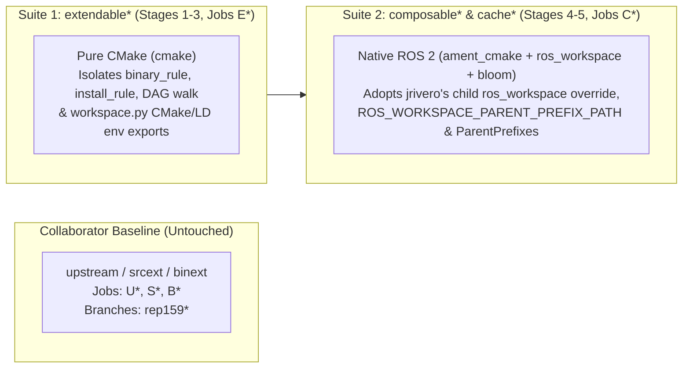
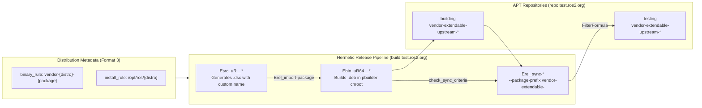
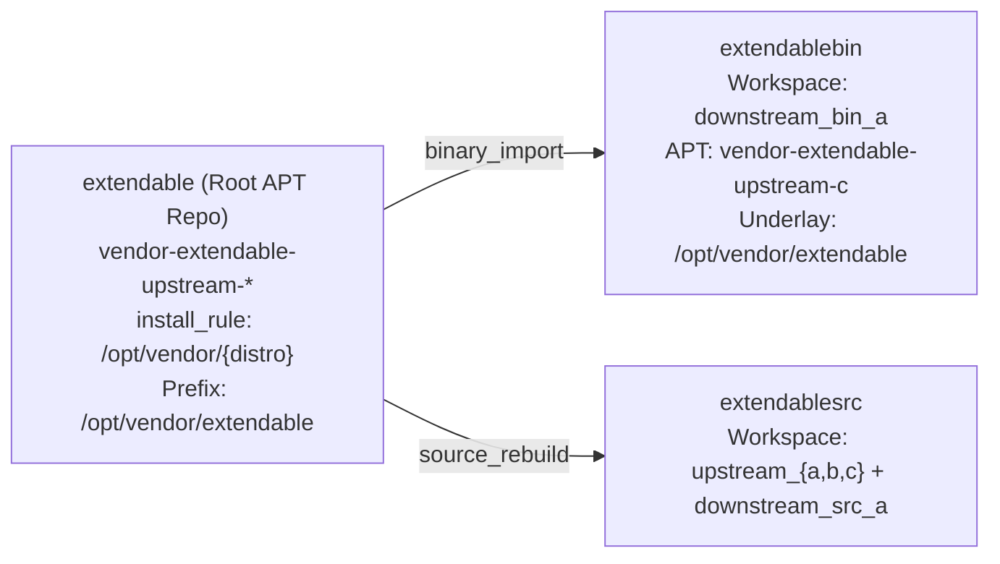
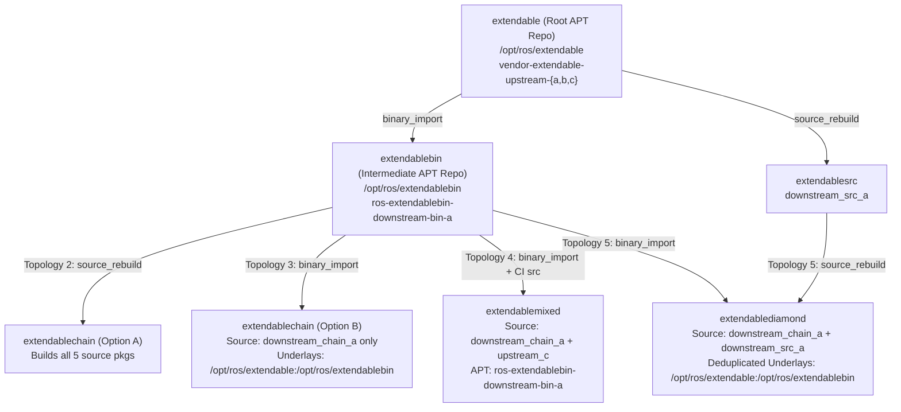
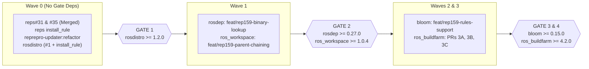

# REP-159: Comprehensive Validation & Evidence Suite

Empirical validation evidence, topological diagrams, branch matrices, and remote testfarm (`https://build.test.ros2.org` & `http://repo.test.ros2.org`) verification across all stages of the **[REP 159](https://github.com/openrobotics/reps/pull/32)** test campaign.

---

## 0. Two-Suite Validation Architecture (`extendable` vs. `composable`)



| Dimension | Collaborator Baseline (`upstream` / `srcext` / `binext`) | Suite 1: `extendable*` (Stages 1–3) | Suite 2: `composable*` & `cache*` (Stages 4–5) |
|---|---|---|---|
| **Jenkins Prefix** | `U*`, `S*`, `B*` *(untouched)* | **`E*`** (`Esrc`, `Ebin`, `Erel`, `Eci`) | **`C*`** (`Csrc`, `Cbin`, `Crel`, `Cci`, `*_rosdistro-cache`) |
| **Package Build Type** | `ament_cmake` + `ros_workspace` | Pure `cmake` (`upstream_{a,b,c}`, `downstream_*`) | `ament_cmake` + `ros_workspace` + `bloom` |
| **Environment Chaining** | `/opt/ros/<distro>/setup.sh` | Buildfarm `workspace.py` (`CMAKE_PREFIX_PATH`, `LD_LIBRARY_PATH`) | Native `/opt/ros/<distro>/setup.sh` + `.dsv` hooks (`ROS_WORKSPACE_PARENT_PREFIX_PATH`) |
| **Packaging Mechanism** | Baseline `ros-<distro>-<pkg>` | Custom `binary_rule` (`vendor-{distro}-{package}`) & `install_rule` (`/opt/vendor/{distro}`) | Automated `git-bloom-generate rosdebian` (`binary_rule` + `install_rule` + `ParentPrefixes`) |
| **Primary Validation Goal** | Foundational 1-tier `source_rebuild` & `binary_import` | Regex binary naming, custom prefixes, 3-tier chains, hybrid & diamond DAGs | Child `ros_workspace` release override, automated `bloom` packaging & cache lifecycle |

---

## Thematic Block 1: Binary Renaming (`binary_rule`), Custom Install Paths & Release Pipeline

### Architecture & Pipeline Flow



### Feature Summary

| Feature | Directive / Flag | Implementation & Verified Invariant |
|---|---|---|
| **Declarative Binary Renaming** | `binary_rule: {search: '^', replace: 'vendor-{distro}-'}` | `rosdistro.get_binary_package_name()` maps `upstream_{a,b,c}` $\to$ `vendor-extendable-upstream-{a,b,c}` using canonical lowercase `{distro}`, `{package}`, `{origin_distro}`. |
| **Prefix-Filtered APT Sync** | `--package-prefix vendor-extendable-` | `reprepro-updater` applies `FilterFormula: Package (% vendor-extendable-*)`, promoting only matching vendor packages from `building` to `testing`. |
| **`rosdep` Binary Delegation** | `gbpdistro_support.py` | Delegates OS binary package lookups to `dist_file.get_binary_package_name(pkg)` with `binary_import` parent fallback. |

### Repository & Branch Matrix

| Repository | Clean Upstream PR Branch (`@ SHA`) | Testfarm Branch (`@ SHA`) | Role |
|---|---|---|---|
| **`reps`** | [`openrobotics/reps#31`](https://github.com/openrobotics/reps/pull/31) (**MERGED**)<br>[`openrobotics/reps#35`](https://github.com/openrobotics/reps/pull/35) (**MERGED** `f683ccc`)<br>[`feature/rep-159-install-rule`](https://github.com/KmoM88/reps/tree/feature/rep-159-install-rule) (`f0118d5`) | N/A | REP-159 Format 3 `extends`, `binary_rule` (`{distro}`, `{package}`, `{origin_distro}`), and `install_rule` spec |
| **`rosdistro`** | [`feature/rep159-binary-naming-regex`](https://github.com/rep159-testing/rosdistro/tree/feature/rep159-binary-naming-regex) (`bfde799`, [`#1`](https://github.com/rep159-testing/rosdistro/pull/1))<br>[`feat/rep159-install-rule`](https://github.com/rep159-testing/rosdistro/tree/feat/rep159-install-rule) (`a8f5543`) | [`feat/rep159-install-rule`](https://github.com/rep159-testing/rosdistro/tree/feat/rep159-install-rule) (`a8f5543`) | Format 3 parser, `extends` DAG, parent cache load (`46a7580`), `binary_rule`, `install_rule`, and child `ros_workspace` override (`aefe17c`, `a8f5543`) |
| **`reprepro-updater`** | [`feat/package-prefix`](https://github.com/rep159-testing/reprepro-updater/tree/feat/package-prefix) (`93ed2dc`) | [`feat/package-prefix`](https://github.com/rep159-testing/reprepro-updater/tree/feat/package-prefix) (`93ed2dc`) | Selective APT promotion via `--package-prefix` (targets upstream `refactor`) |
| **`rosdep`** | [`feat/rep159-binary-lookup`](https://github.com/rep159-testing/rosdep/tree/feat/rep159-binary-lookup) (`5661779`) | [`rep159`](https://github.com/rep159-testing/rosdep/tree/rep159) (`3d52dad`) | Delegates binary package lookup to `rosdistro.get_binary_package_name()` |
| **`ros_buildfarm`** | • **PR 3A**: [`feat/rep159-workspace-walk`](https://github.com/rep159-testing/ros_buildfarm/tree/feat/rep159-workspace-walk) (`486b579`)<br>• **PR 3B**: [`feat/rep159-underlays`](https://github.com/rep159-testing/ros_buildfarm/tree/feat/rep159-underlays) (`a4a5bbd`)<br>• **PR 3C**: [`feat/rep159-binary-naming`](https://github.com/rep159-testing/ros_buildfarm/tree/feat/rep159-binary-naming) (`a271be1`) | [`feat/binary-naming-rule`](https://github.com/rep159-testing/ros_buildfarm/tree/feat/binary-naming-rule) (`797d771`) | Release naming delegation, `--package-prefix`, `ReleaseAndSourceDependencyWalker`, and dynamic underlays |
| **`rep159-rosdistro`** | [`feat/extendable-binary-naming`](https://github.com/rep159-testing/rep159-rosdistro/tree/feat/extendable-binary-naming) (`b2882ed`) | [`feat/extendable-binary-naming`](https://github.com/rep159-testing/rep159-rosdistro/tree/feat/extendable-binary-naming) (`b2882ed`) | Root `extendable` distribution file defining `binary_rule` |
| **`ros_buildfarm_config`** | [`feat/extendable-binary-naming`](https://github.com/rep159-testing/ros_buildfarm_config/tree/feat/extendable-binary-naming) (`30a7f90`) | [`feat/extendable-binary-naming`](https://github.com/rep159-testing/ros_buildfarm_config/tree/feat/extendable-binary-naming) (`30a7f90`) | Release, sync, and CI build files targeting `build.test.ros2.org` |
| **`upstream_{a,b,c}-release`** | [`debian/vendor-extendable/resolute/upstream_{a,b,c}`](https://github.com/rep159-testing/upstream_a-release/tree/debian/vendor-extendable/resolute/upstream_a) | `d290d17`, `65280fc`, `ad6c0e8` | Debian release tracks for `vendor-extendable-upstream-{a,b,c}` (`/opt/ros/extendable`) |

### Executed Jobs & Published Artifacts (`build.test.ros2.org` & `repo.test.ros2.org`)

| Stage / Pipeline Phase | Jenkins Job (`build.test.ros2.org`) | Build & Console | Status | Config / Published APT Artifact (`repo.test.ros2.org`) |
|---|---|---|:---:|---|
| **Source Packaging** | `Esrc_uR__upstream_a__ubuntu_resolute__source` | [#2](https://build.test.ros2.org/job/Esrc_uR__upstream_a__ubuntu_resolute__source/2/) / [#4](https://build.test.ros2.org/job/Esrc_uR__upstream_a__ubuntu_resolute__source/4/) ([Log](https://build.test.ros2.org/job/Esrc_uR__upstream_a__ubuntu_resolute__source/4/console)) | **SUCCESS** | [`release-build.yaml`](https://github.com/rep159-testing/ros_buildfarm_config/blob/feat/extendable-binary-naming/extendable/release-build.yaml) |
| **Source Packaging** | `Esrc_uR__upstream_b__ubuntu_resolute__source` | [#1](https://build.test.ros2.org/job/Esrc_uR__upstream_b__ubuntu_resolute__source/1/) / [#3](https://build.test.ros2.org/job/Esrc_uR__upstream_b__ubuntu_resolute__source/3/) ([Log](https://build.test.ros2.org/job/Esrc_uR__upstream_b__ubuntu_resolute__source/3/console)) | **SUCCESS** | [`release-build.yaml`](https://github.com/rep159-testing/ros_buildfarm_config/blob/feat/extendable-binary-naming/extendable/release-build.yaml) |
| **Source Packaging** | `Esrc_uR__upstream_c__ubuntu_resolute__source` | [#1](https://build.test.ros2.org/job/Esrc_uR__upstream_c__ubuntu_resolute__source/1/) / [#3](https://build.test.ros2.org/job/Esrc_uR__upstream_c__ubuntu_resolute__source/3/) ([Log](https://build.test.ros2.org/job/Esrc_uR__upstream_c__ubuntu_resolute__source/3/console)) | **SUCCESS** | [`release-build.yaml`](https://github.com/rep159-testing/ros_buildfarm_config/blob/feat/extendable-binary-naming/extendable/release-build.yaml) |
| **Binary Packaging** | `Ebin_uR64__upstream_a__ubuntu_resolute_amd64__binary` | [#1](https://build.test.ros2.org/job/Ebin_uR64__upstream_a__ubuntu_resolute_amd64__binary/1/) / [#3](https://build.test.ros2.org/job/Ebin_uR64__upstream_a__ubuntu_resolute_amd64__binary/3/) ([Log](https://build.test.ros2.org/job/Ebin_uR64__upstream_a__ubuntu_resolute_amd64__binary/3/console)) | **SUCCESS** | [`pool/main/v/vendor-extendable-upstream-a/`](http://repo.test.ros2.org/ubuntu/testing/pool/main/v/vendor-extendable-upstream-a/) |
| **Binary Packaging** | `Ebin_uR64__upstream_b__ubuntu_resolute_amd64__binary` | [#1](https://build.test.ros2.org/job/Ebin_uR64__upstream_b__ubuntu_resolute_amd64__binary/1/) / [#4](https://build.test.ros2.org/job/Ebin_uR64__upstream_b__ubuntu_resolute_amd64__binary/4/) ([Log](https://build.test.ros2.org/job/Ebin_uR64__upstream_b__ubuntu_resolute_amd64__binary/4/console)) | **SUCCESS** | [`pool/main/v/vendor-extendable-upstream-b/`](http://repo.test.ros2.org/ubuntu/testing/pool/main/v/vendor-extendable-upstream-b/) |
| **Binary Packaging** | `Ebin_uR64__upstream_c__ubuntu_resolute_amd64__binary` | [#1](https://build.test.ros2.org/job/Ebin_uR64__upstream_c__ubuntu_resolute_amd64__binary/1/) / [#3](https://build.test.ros2.org/job/Ebin_uR64__upstream_c__ubuntu_resolute_amd64__binary/3/) ([Log](https://build.test.ros2.org/job/Ebin_uR64__upstream_c__ubuntu_resolute_amd64__binary/3/console)) | **SUCCESS** | [`pool/main/v/vendor-extendable-upstream-c/`](http://repo.test.ros2.org/ubuntu/testing/pool/main/v/vendor-extendable-upstream-c/) |
| **APT Repo Sync** | `Erel_sync-packages-to-testing_resolute_amd64` | [#8](https://build.test.ros2.org/job/Erel_sync-packages-to-testing_resolute_amd64/8/) / [#10](https://build.test.ros2.org/job/Erel_sync-packages-to-testing_resolute_amd64/10/) ([Log](https://build.test.ros2.org/job/Erel_sync-packages-to-testing_resolute_amd64/10/console)) | **SUCCESS** | [`testing/dists/resolute/main/binary-amd64/Packages.gz`](http://repo.test.ros2.org/ubuntu/testing/dists/resolute/main/binary-amd64/Packages.gz) |
| **Root CI (`extendable`)** | `Eci__nightly-release_ubuntu_resolute_amd64` | [#2](https://build.test.ros2.org/job/Eci__nightly-release_ubuntu_resolute_amd64/2/) ([Log](https://build.test.ros2.org/job/Eci__nightly-release_ubuntu_resolute_amd64/2/console)) | **SUCCESS** | [`ci-nightly-release.yaml`](https://github.com/rep159-testing/ros_buildfarm_config/blob/feat/extendable-binary-naming/extendable/ci-nightly-release.yaml) |
| **Root CI (`extendable`)** | `Eci__source-branches_ubuntu_resolute_amd64` | [#2](https://build.test.ros2.org/job/Eci__source-branches_ubuntu_resolute_amd64/2/) ([Log](https://build.test.ros2.org/job/Eci__source-branches_ubuntu_resolute_amd64/2/console)) | **SUCCESS** | [`ci-source-branches.yaml`](https://github.com/rep159-testing/ros_buildfarm_config/blob/feat/extendable-binary-naming/extendable/ci-source-branches.yaml) |
| **Root CI (`extendable`)** | `Eci__release-branches_ubuntu_resolute_amd64` | [#2](https://build.test.ros2.org/job/Eci__release-branches_ubuntu_resolute_amd64/2/) ([Log](https://build.test.ros2.org/job/Eci__release-branches_ubuntu_resolute_amd64/2/console)) | **SUCCESS** | [`ci-release-branches.yaml`](https://github.com/rep159-testing/ros_buildfarm_config/blob/feat/extendable-binary-naming/extendable/ci-release-branches.yaml) |

---

## Thematic Block 2: Advanced Topological Validations (Pure CMake Suite `extendable*`)

### Master Overview of Topologies 1–5

| Topology | Distribution Hierarchy | Extension Method(s) | Underlay Prefix (`ROS_BUILDFARM_PARENT_RESULT_SPACES`) | Workspace Source Packages | APT Installed Packages (`rosdep`) |
|---|---|---|---|---|---|
| **1. Single-Tier Custom Prefix** | `extendable` $\to$ `extendablebin`<br>`extendable` $\to$ `extendablesrc` | `binary_import`<br>`source_rebuild` | `/opt/vendor/extendable` | `downstream_bin_a`<br>*(or all 4 in `extendablesrc`)* | `vendor-extendable-upstream-{a,b,c}` |
| **2. Chained Source Rebuild (Option A)** | `extendable` $\to$ `extendablebin` $\to$ `extendablechain` | `source_rebuild` (3-tier) | *(None — full source build)* | `upstream_{a,b,c}`, `downstream_bin_a`, `downstream_chain_a` (5 pkgs) | *(System build deps only)* |
| **3. Chained Binary Import (Option B)** | `extendable` $\to$ `extendablebin` $\to$ `extendablechain` | `binary_import` (3-tier) | `/opt/ros/extendable:/opt/ros/extendablebin` | `downstream_chain_a` (1 pkg) | `ros-extendablebin-downstream-bin-a` + `vendor-extendable-upstream-{a,b,c}` |
| **4. Hybrid Mixed Extension** | `extendable` $\to$ `extendablebin` $\to$ `extendablemixed` | `binary_import` + CI source override | `/opt/ros/extendable:/opt/ros/extendablebin` | `downstream_chain_a`, `upstream_c` (2 pkgs) | `ros-extendablebin-downstream-bin-a` (`--ignore-src` skips `upstream_c`) |
| **5. Multi-Parent Diamond DAG** | `extendable` $\to$ `[extendablebin, extendablesrc]` $\to$ `extendablediamond` | `binary_import` + `source_rebuild` | `/opt/ros/extendable:/opt/ros/extendablebin` *(deduplicated)* | `downstream_chain_a`, `downstream_src_a` (2 pkgs) | `ros-extendablebin-downstream-bin-a` + `vendor-extendable-upstream-{a,b,c}` |

---

### Topology 1: Single-Tier Binary Import & Custom Installation Prefix (`/opt/vendor/{distro}`)



| Job / Artifact | Build & Console (`build.test.ros2.org`) | Status | Config / Branch (`@ SHA`) |
|---|---|:---:|---|
| `Esrc_uR__upstream_{a,b,c}__ubuntu_resolute__source` | [`a #3`](https://build.test.ros2.org/job/Esrc_uR__upstream_a__ubuntu_resolute__source/3/), [`b #2`](https://build.test.ros2.org/job/Esrc_uR__upstream_b__ubuntu_resolute__source/2/), [`c #2`](https://build.test.ros2.org/job/Esrc_uR__upstream_c__ubuntu_resolute__source/2/) | **SUCCESS** | `upstream_{a,b,c}-release:debian/vendor-extendable-install-rule/resolute/upstream_*` (`ad87f5b`, `8c33a3d`, `eef2f2b`) |
| `Ebin_uR64__upstream_{a,b,c}__ubuntu_resolute_amd64__binary` | [`a #2`](https://build.test.ros2.org/job/Ebin_uR64__upstream_a__ubuntu_resolute_amd64__binary/2/), [`b #2`](https://build.test.ros2.org/job/Ebin_uR64__upstream_b__ubuntu_resolute_amd64__binary/2/), [`c #2`](https://build.test.ros2.org/job/Ebin_uR64__upstream_c__ubuntu_resolute_amd64__binary/2/) | **SUCCESS** | Installed into `/opt/vendor/extendable` |
| `Erel_sync-packages-to-testing_resolute_amd64` | [#9](https://build.test.ros2.org/job/Erel_sync-packages-to-testing_resolute_amd64/9/) ([Log](https://build.test.ros2.org/job/Erel_sync-packages-to-testing_resolute_amd64/9/console)) | **SUCCESS** | [`rep159-rosdistro:feat/extendable-install-rule`](https://github.com/rep159-testing/rep159-rosdistro/tree/feat/extendable-install-rule) (`6bc24b1`) |
| `Eci__binary-import_ubuntu_resolute_amd64` | [#5](https://build.test.ros2.org/job/Eci__binary-import_ubuntu_resolute_amd64/5/) ([Log](https://build.test.ros2.org/job/Eci__binary-import_ubuntu_resolute_amd64/5/console)) | **SUCCESS** | [`extendablebin/ci-nightly-release.yaml`](https://github.com/rep159-testing/ros_buildfarm_config/blob/feat/extendable-install-rule/extendablebin/ci-nightly-release.yaml) |
| `Eci__source-rebuild_ubuntu_resolute_amd64` | [#2](https://build.test.ros2.org/job/Eci__source-rebuild_ubuntu_resolute_amd64/2/) ([Log](https://build.test.ros2.org/job/Eci__source-rebuild_ubuntu_resolute_amd64/2/console)) | **SUCCESS** | [`extendablesrc/ci-nightly-release.yaml`](https://github.com/rep159-testing/ros_buildfarm_config/blob/feat/extendable-install-rule/extendablesrc/ci-nightly-release.yaml) |

---

### Topologies 2, 3, 4 & 5: Multi-Tier, Hybrid & Diamond Extensions



| Topology | Jenkins Job (`build.test.ros2.org`) | Build & Console | Status | Config & Distro Branch (`@ SHA`) |
|---|---|---|:---:|---|
| **Topology 2 (Option A: 3-Tier Source)** | `Eci__chained-import_ubuntu_resolute_amd64` | [#3](https://build.test.ros2.org/job/Eci__chained-import_ubuntu_resolute_amd64/3/) ([Log](https://build.test.ros2.org/job/Eci__chained-import_ubuntu_resolute_amd64/3/console)) | **SUCCESS** | [`feat/stage3-chained-extensions`](https://github.com/rep159-testing/rep159-rosdistro/tree/feat/stage3-chained-extensions) (`69afb27` / `7fa2b40`) |
| **Topology 3 (Intermediate Release)** | `Esrc_uR__downstream_bin_a__ubuntu_resolute__source`<br>`Ebin_uR64__downstream_bin_a__ubuntu_resolute_amd64__binary`<br>`Erel_sync-packages-to-testing_resolute_amd64` | [#1](https://build.test.ros2.org/job/Esrc_uR__downstream_bin_a__ubuntu_resolute__source/1/) ([Log](https://build.test.ros2.org/job/Esrc_uR__downstream_bin_a__ubuntu_resolute__source/1/console))<br>[#1](https://build.test.ros2.org/job/Ebin_uR64__downstream_bin_a__ubuntu_resolute_amd64__binary/1/) ([Log](https://build.test.ros2.org/job/Ebin_uR64__downstream_bin_a__ubuntu_resolute_amd64__binary/1/console))<br>[#7](https://build.test.ros2.org/job/Erel_sync-packages-to-testing_resolute_amd64/7/) ([Log](https://build.test.ros2.org/job/Erel_sync-packages-to-testing_resolute_amd64/7/console)) | **SUCCESS** | [`extendablebin/release-build.yaml`](https://github.com/rep159-testing/ros_buildfarm_config/blob/feat/stage3-binary-chained/extendablebin/release-build.yaml)<br>[`pool/main/r/ros-extendablebin-downstream-bin-a/`](http://repo.test.ros2.org/ubuntu/testing/pool/main/r/ros-extendablebin-downstream-bin-a/) |
| **Topology 3 (Option B: 3-Tier Binary)** | `Eci__chained-import_ubuntu_resolute_amd64` | [#4](https://build.test.ros2.org/job/Eci__chained-import_ubuntu_resolute_amd64/4/) ([Log](https://build.test.ros2.org/job/Eci__chained-import_ubuntu_resolute_amd64/4/console)) | **SUCCESS** | [`feat/stage3-binary-chained`](https://github.com/rep159-testing/rep159-rosdistro/tree/feat/stage3-binary-chained) (`e63a90a` / `b38d0dc`) |
| **Topology 4 (Hybrid Binary + Source)** | `Eci__mixed-chain_ubuntu_resolute_amd64` | [#1](https://build.test.ros2.org/job/Eci__mixed-chain_ubuntu_resolute_amd64/1/) / [#2](https://build.test.ros2.org/job/Eci__mixed-chain_ubuntu_resolute_amd64/2/) ([Log](https://build.test.ros2.org/job/Eci__mixed-chain_ubuntu_resolute_amd64/2/console)) | **SUCCESS** | [`feat/stage3-mixed`](https://github.com/rep159-testing/rep159-rosdistro/tree/feat/stage3-mixed) (`3e66c48` / `41c5aa9`) |
| **Topology 5 (Multi-Parent Diamond)** | `Eci__diamond-chain_ubuntu_resolute_amd64` | [#1](https://build.test.ros2.org/job/Eci__diamond-chain_ubuntu_resolute_amd64/1/) / [#3](https://build.test.ros2.org/job/Eci__diamond-chain_ubuntu_resolute_amd64/3/) ([Log](https://build.test.ros2.org/job/Eci__diamond-chain_ubuntu_resolute_amd64/3/console)) | **SUCCESS** | [`feat/stage3-diamond`](https://github.com/rep159-testing/rep159-rosdistro/tree/feat/stage3-diamond) (`7ab72c6` / `66de746`) |

> [!WARNING]
> **ABI Governance Note (Topology 4)**: In `distribution.yaml`, `rosdistro` enforces ABI immutability by prohibiting `binary_import` child distributions from overriding inherited parent packages (except `BINARY_IMPORT_OVERRIDABLE = frozenset(['ros_workspace'])`). While CI jobs (`repository_names`) can check out an ancestor package (`upstream_c`) from source alongside an intermediate binary (`downstream_bin_a.deb`) via `rosdep --ignore-src`, production releases requiring upstream changes should use `source_rebuild` to prevent ODR/ABI drift.

---

## Thematic Block 3: Composable Suite (`ros_workspace` + `bloom`) & Cache Lifecycle (Stages 4 & 5)

### Architecture & Underlay Chaining Flow

```mermaid
graph LR
    subgraph Stage4 ["Stage 4: Composable Suite (Native ros_workspace & bloom)"]
        U["upstream (/opt/ros/upstream)<br/>ament_package, ament_cmake_core"] -.->|ROS_WORKSPACE_PARENT_PREFIX_PATH| C["composable (/opt/ros/composable)<br/>binary_rule: vendor-{distro}-{package}<br/>vendor-composable-ros-workspace<br/>vendor-composable-upstream-{a,b,c}"]
        C -->|binary_import| CB["composablebin (/opt/ros/composablebin)<br/>vendor-composablebin-downstream-bin-a"]
    end

    subgraph Stage5 ["Stage 5: Cache Lifecycle & Isolation"]
        CACHE_B["cachebase-cache.yaml.gz<br/>upstream_{a,b,c}"] -->|extends[].index_url<br/>- REMOVE parent pkgs| CACHE_C["cachechild-cache.yaml.gz<br/>Isolated: downstream_bin_a only"]
    end
```

### Collaborative Implementation Matrix (Adopting Jose Luis Rivero's `jrivero` Commits)

| Component | Clean PR Branch (`@ SHA`) | Adopted `jrivero` Commits & Extensions | Verified Behavior |
|---|---|---|---|
| **`rosdistro` Child `ros_workspace` Override & Parent Cache** | [`feat/rep159-install-rule`](https://github.com/rep159-testing/rosdistro/tree/feat/rep159-install-rule) (`a8f5543`) | • `46a7580` (`jrivero`): Load parent caches from `extends[].index_url`<br>• `aefe17c`, `a8f5543` (`jrivero` `4a89ac4`, `78c7db8`): `BINARY_IMPORT_OVERRIDABLE = frozenset(['ros_workspace'])`<br>• `3d301d6`, `bfde799`, `4916cae`: `binary_rule` & `install_rule` | Child `binary_import` distros can release their own `ros_workspace` package while keeping parent packages immutable; `rosdistro_build_cache` strips parent packages (`- REMOVE`) from child cache files. |
| **`ros_workspace` Multi-Parent Chaining** | [`feat/rep159-parent-chaining`](https://github.com/rep159-testing/ros_workspace/tree/feat/rep159-parent-chaining) (`4997f85`) | • `12f93e9` (`jrivero`): Searches `${CMAKE_INSTALL_PREFIX};${ROS_WORKSPACE_PARENT_PREFIX_PATH}` for `ament_package` and writes `parent_prefix_path` ament index<br>• `4997f85`: `PARENT_PREFIX_PATH` CMake variable alias | Sourcing `/opt/ros/composable/setup.sh` evaluates `.dsv` hooks and recursively chains `/opt/ros/upstream`. |
| **`bloom` Automated Debian Generator** | [`feat/rep159-rules-support`](https://github.com/rep159-testing/bloom/tree/feat/rep159-rules-support) (`7af7034`) | • `0189046`..`2877687` (`jrivero`): `get_binary_import_parents()`, `ParentPrefixes` in `debian/rules.em`, `-DROS_WORKSPACE_PARENT_PREFIX_PATH`, `get_ros_workspace_dependencies()`<br>• `1f62809`..`7af7034`: `get_binary_package_name()`, `get_install_prefix()`, `git tag -f -m` GPG fix | `git-bloom-generate rosdebian` generates `debian/control` and `debian/rules` honoring `binary_rule`, `install_rule`, and multi-tier `ParentPrefixes`. |
| **Release & Config Repositories** | [`feat/composable-distro`](https://github.com/rep159-testing/rep159-rosdistro/tree/feat/composable-distro)<br>[`feat/cache-lifecycle-test`](https://github.com/rep159-testing/rep159-rosdistro/tree/feat/cache-lifecycle-test) | • `ros_workspace-release`: [`debian/vendor-composable/resolute/ros_workspace`](https://github.com/rep159-testing/ros_workspace-release/tree/debian/vendor-composable/resolute/ros_workspace)<br>• `upstream_{a,b,c}-release`: [`debian/vendor-composable/resolute/upstream_*`](https://github.com/rep159-testing/upstream_a-release/tree/debian/vendor-composable/resolute/upstream_a)<br>• `downstream_bin_a-release`: [`debian/vendor-composablebin/resolute/downstream_bin_a`](https://github.com/rep159-testing/downstream_bin_a-release/tree/debian/vendor-composablebin/resolute/downstream_bin_a) & [`debian/cachechild/resolute/downstream_bin_a`](https://github.com/rep159-testing/downstream_bin_a-release/tree/debian/cachechild/resolute/downstream_bin_a) | End-to-end `Csrc`, `Cbin`, `Crel`, `Cci`, and `*_rosdistro-cache` pipelines verified (see [`STAGE4_COMPOSABLE_WORKSPACE_PLAN.md`](https://github.com/KmoM88/rep159-testing/blob/main/STAGE4_COMPOSABLE_WORKSPACE_PLAN.md) & [`STAGE5_CACHE_AND_BLOOM_PLAN.md`](https://github.com/KmoM88/rep159-testing/blob/main/STAGE5_CACHE_AND_BLOOM_PLAN.md)). |

---

## Phased Upstream PR Progression & Release-Gate Schedule



* Full stacked PR breakdown, commit lineage, and release-gate matrix: **[`ROLLOUT_PLAN.md`](https://github.com/KmoM88/rep159-testing/blob/main/ROLLOUT_PLAN.md)** and **[`STAGE_PR_AND_ISSUE_MAP.md`](https://github.com/KmoM88/rep159-testing/blob/main/STAGE_PR_AND_ISSUE_MAP.md)**.
