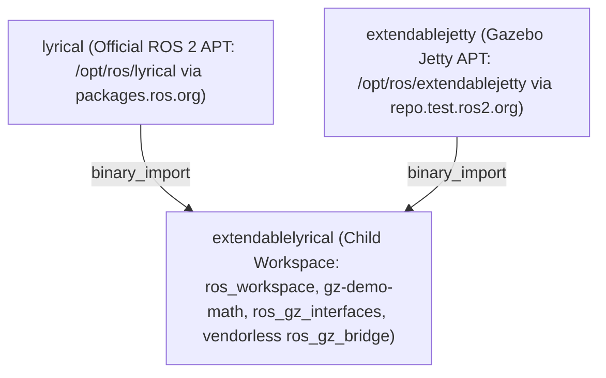

# Multi-Parent Binary Import (`binary_import`) Validation

This scenario validates a **REP-159 multi-parent binary import (`binary_import`)** distribution locally using `vcstool`, `rosdep`, `ros_buildfarm`, `apt`, and `colcon`, combining official ROS 2 `lyrical` binaries with native Gazebo Jetty (`extendablejetty`) binaries to build vendorless `ros_gz_bridge`.

---

## 1. Distribution Topology (`extendablelyrical`)

In [`rep159-testing/rep159-rosdistro`](https://github.com/rep159-testing/rep159-rosdistro/tree/feat/extendable-gazebo):

- **Parent 1 (`lyrical`)**: Official ROS 2 Lyrical distribution (`ros-lyrical-*` under `/opt/ros/lyrical` from `http://packages.ros.org/ros2/ubuntu`).
- **Parent 2 (`extendablejetty`)**: Plain-CMake Gazebo Jetty distribution (`ros-extendablejetty-*` under `/opt/ros/extendablejetty` from `http://repo.test.ros2.org/ubuntu/testing`, `workspace_package: ros_workspace_shell`).
- **Child (`extendablelyrical`)**: Declares `extends: [lyrical (binary_import), extendablejetty (binary_import)]` and defines `gz-demo-math`, `ros_gz_interfaces`, vendorless `ros_gz_bridge`, and `ros_workspace` (overriding `lyrical`'s `ros_workspace` via `BINARY_IMPORT_OVERRIDABLE` to chain both parent prefixes).
- **Expected Multi-Parent `binary_import` Behavior**:
  1. `create_workspace.py` (`ReleaseAndSourceDependencyWalker`) **stops at both `binary_import` boundaries** and checks out only the 4 child packages (`gz-demo-math`, `ros_gz_interfaces`, `ros_gz_bridge`, `ros_workspace`).
  2. `rosdep` resolves ROS 2 dependencies (`ament_cmake`, `rclcpp`, `std_msgs`, `sensor_msgs`, etc.) to **`ros-lyrical-*`** and Gazebo dependencies (`gz-math`, `gz-msgs`, `gz-transport`) to **`ros-extendablejetty-*`** automatically in a single `rosdep install` call.
  3. Sourcing both parent underlays (`/opt/ros/extendablejetty` and `/opt/ros/lyrical`) lets `colcon build` and `colcon test` compile and test vendorless `ros_gz_bridge`, `ros_gz_interfaces`, `gz-demo-math`, and `ros_workspace` directly against both binary prefixes.



---

## 2. Workspace Path Structure

```text
multi_parent_binary/
├── README.md
├── distribution.repos               # Explicit vcstool manifest (4 child packages only)
└── ws/                              # Colcon workspace root
    ├── src/                         # Populated with child packages only
    ├── build/                       # Created by colcon build
    ├── install/                     # Overlay prefix chaining /opt/ros/lyrical and /opt/ros/extendablejetty
    └── log/                         # Created by colcon build / colcon test
```

---

## 3. Step-by-Step Instructions

Ensure you have completed the [One-Time REP-159 Tooling Setup](../README.md#3-one-time-rep-159-tooling-setup) from the repository root and have `.venv` activated:

```bash
# From the repository root:
source .venv/bin/activate
export ROSDISTRO_INDEX_URL="https://raw.githubusercontent.com/rep159-testing/rep159-rosdistro/feat/extendable-gazebo/index-v4.yaml"
```

### Step 1: Add Both Parent APT Repositories (`packages.ros.org` and `repo.test.ros2.org`)

Configure `apt` on Ubuntu 26.04 (`resolute`) to consume both official `ros-lyrical-*` binaries and testfarm `ros-extendablejetty-*` binaries:

```bash
sudo apt-get update
sudo apt-get install -y curl gnupg

# Parent 1: Official ROS 2 (lyrical)
curl -fsSL https://raw.githubusercontent.com/ros/rosdistro/master/ros.key \
  | sudo gpg --dearmor -o /usr/share/keyrings/ros-archive-keyring.gpg
echo "deb [arch=$(dpkg --print-architecture) signed-by=/usr/share/keyrings/ros-archive-keyring.gpg] http://packages.ros.org/ros2/ubuntu $(. /etc/os-release && echo "${UBUNTU_CODENAME}") main" \
  | sudo tee /etc/apt/sources.list.d/ros2.list > /dev/null

# Parent 2: Gazebo Jetty (extendablejetty)
curl -fsSL http://repo.test.ros2.org/repos.key \
  | sudo gpg --dearmor -o /usr/share/keyrings/ros2-test-archive-keyring.gpg
echo "deb [arch=$(dpkg --print-architecture) signed-by=/usr/share/keyrings/ros2-test-archive-keyring.gpg] http://repo.test.ros2.org/ubuntu/testing $(. /etc/os-release && echo "${UBUNTU_CODENAME}") main" \
  | sudo tee /etc/apt/sources.list.d/ros2-test.list > /dev/null

sudo apt-get update
```

### Step 2: Populate `multi_parent_binary/ws/src`

Choose **Option A** (dynamic REP-159 multi-parent boundary resolution via `ros_buildfarm`) or **Option B** (direct `vcstool` import from `distribution.repos`).

#### Option A (Recommended): Dynamic Resolution via REP-159 `create_workspace.py`

Running `create_workspace.py` with `--package-dependencies` resolves `extendablelyrical` against `ROSDISTRO_INDEX_URL`, walks `ros_gz_bridge` -> `ros_gz_interfaces` inside the child distro, stops at both `binary_import` parent boundaries (`lyrical` and `extendablejetty`), writes `multi_parent_binary/ws/repositories-from-rosdistro.repos` with only the 4 child packages, and imports them via `vcstool`:

```bash
python3 -m ros_buildfarm.scripts.ci.create_workspace \
  extendablelyrical \
  --repos-file-urls \
  --package-names gz-demo-math ros_gz_bridge ros_workspace \
  --package-dependencies \
  --workspace-root multi_parent_binary/ws
```

#### Option B: Direct `vcstool` Import from `distribution.repos`

To download the 4 child packages directly with `vcstool`:

```bash
vcs import multi_parent_binary/ws/src < multi_parent_binary/distribution.repos
```

### Step 3: Install Both Parents' Binaries and System Dependencies via REP-159 `rosdep`

Initialize `rosdep` (if not already initialized), update the database for `extendablelyrical`, and let `rosdep` resolve and install `ros-lyrical-*`, `ros-extendablejetty-*`, and Ubuntu system dependencies automatically:

```bash
[ -f /etc/ros/rosdep/sources.list.d/20-default.list ] || sudo .venv/bin/rosdep init
rosdep update --rosdistro extendablelyrical
rosdep install \
  --from-paths multi_parent_binary/ws/src \
  --ignore-src \
  --rosdistro extendablelyrical \
  -y
```

### Step 4: Source Both Parent Underlays and Build with `colcon`

Source both `/opt/ros/extendablejetty/setup.sh` and `/opt/ros/lyrical/setup.sh` (unsetting `AMENT_CURRENT_PREFIX` between them and exporting both prefixes in `CMAKE_PREFIX_PATH` so plain-CMake packages discover `/opt/ros/extendablejetty`), then build all 4 child packages with `ROS_WORKSPACE_PARENT_PREFIX_PATH` configured for `ros_workspace`:

```bash
source /opt/ros/extendablejetty/setup.sh
unset AMENT_CURRENT_PREFIX
source /opt/ros/lyrical/setup.sh
export CMAKE_PREFIX_PATH="/opt/ros/extendablejetty:/opt/ros/lyrical${CMAKE_PREFIX_PATH:+:${CMAKE_PREFIX_PATH}}"

cd multi_parent_binary/ws

colcon build \
  --merge-install \
  --event-handlers console_cohesion+ \
  --cmake-args \
    -DCMAKE_BUILD_TYPE=Release \
    -DBUILD_TESTING=ON \
    "-DROS_WORKSPACE_PARENT_PREFIX_PATH=/opt/ros/lyrical;/opt/ros/extendablejetty" \
    --no-warn-unused-cli
```

### Step 5: Source the Overlay Prefix and Run `colcon test`

```bash
source install/setup.sh

colcon test \
  --merge-install \
  --event-handlers console_direct+ \
  --retest-until-pass 2 \
  --ctest-args -LE xfail -E copyright \
  --pytest-args -m "not xfail"

colcon test-result --verbose
```

---

## 4. One-Command Clean Docker Run (`ubuntu:resolute`)

To execute the entire multi-parent `binary_import` workflow non-interactively in a fresh `ubuntu:resolute` container from the repository root:

```bash
docker run --rm \
  -e DEBIAN_FRONTEND=noninteractive \
  -v "$(pwd)":/src_repo:ro \
  ubuntu:resolute bash -euo pipefail -c '
    apt-get update
    apt-get install -y build-essential cmake curl git gnupg pkg-config python3 python3-pip python3-venv sudo

    curl -fsSL https://raw.githubusercontent.com/ros/rosdistro/master/ros.key \
      | gpg --dearmor -o /usr/share/keyrings/ros-archive-keyring.gpg
    echo "deb [arch=$(dpkg --print-architecture) signed-by=/usr/share/keyrings/ros-archive-keyring.gpg] http://packages.ros.org/ros2/ubuntu $(. /etc/os-release && echo "${UBUNTU_CODENAME}") main" \
      > /etc/apt/sources.list.d/ros2.list

    curl -fsSL http://repo.test.ros2.org/repos.key \
      | gpg --dearmor -o /usr/share/keyrings/ros2-test-archive-keyring.gpg
    echo "deb [arch=$(dpkg --print-architecture) signed-by=/usr/share/keyrings/ros2-test-archive-keyring.gpg] http://repo.test.ros2.org/ubuntu/testing $(. /etc/os-release && echo "${UBUNTU_CODENAME}") main" \
      > /etc/apt/sources.list.d/ros2-test.list

    apt-get update

    cp -a /src_repo /work && cd /work

    python3 -m venv --system-site-packages .venv
    source .venv/bin/activate
    pip install --upgrade pip setuptools wheel "empy<4" vcstool colcon-common-extensions

    vcs import tooling_ws/src < tooling.repos
    pip install \
      tooling_ws/src/rosdistro \
      tooling_ws/src/rosdep \
      tooling_ws/src/bloom \
      tooling_ws/src/ros_buildfarm \
      tooling_ws/src/rosdistro-reviewer

    export ROSDISTRO_INDEX_URL="https://raw.githubusercontent.com/rep159-testing/rep159-rosdistro/feat/extendable-gazebo/index-v4.yaml"

    python3 -m ros_buildfarm.scripts.ci.create_workspace \
      extendablelyrical \
      --repos-file-urls \
      --package-names gz-demo-math ros_gz_bridge ros_workspace \
      --package-dependencies \
      --workspace-root multi_parent_binary/ws

    .venv/bin/rosdep init
    rosdep update --rosdistro extendablelyrical
    rosdep install \
      --from-paths multi_parent_binary/ws/src \
      --ignore-src \
      --rosdistro extendablelyrical \
      -y

    set +u
    source /opt/ros/extendablejetty/setup.sh
    unset AMENT_CURRENT_PREFIX
    source /opt/ros/lyrical/setup.sh
    export CMAKE_PREFIX_PATH="/opt/ros/extendablejetty:/opt/ros/lyrical${CMAKE_PREFIX_PATH:+:${CMAKE_PREFIX_PATH}}"
    set -u

    cd multi_parent_binary/ws
    colcon build \
      --merge-install \
      --event-handlers console_cohesion+ \
      --cmake-args \
        -DCMAKE_BUILD_TYPE=Release \
        -DBUILD_TESTING=ON \
        "-DROS_WORKSPACE_PARENT_PREFIX_PATH=/opt/ros/lyrical;/opt/ros/extendablejetty" \
        --no-warn-unused-cli

    set +u
    source install/setup.sh
    set -u

    colcon test \
      --merge-install \
      --event-handlers console_direct+ \
      --retest-until-pass 2 \
      --ctest-args -LE xfail -E copyright \
      --pytest-args -m "not xfail"

    colcon test-result --verbose
  '
```
