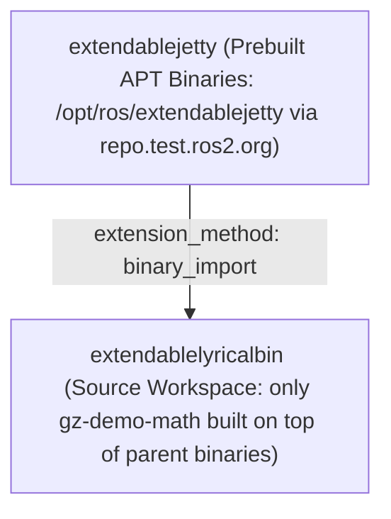

# Single-Parent Binary Import (`binary_import`) Validation

This scenario validates a **REP-159 single-parent binary import (`binary_import`)** distribution locally using `vcstool`, `rosdep`, `ros_buildfarm`, `apt`, and `colcon`.

---

## 1. Distribution Topology (`extendablelyricalbin`)

In [`rep159-testing/rep159-rosdistro`](https://github.com/rep159-testing/rep159-rosdistro/tree/feat/extendable-gazebo):

- **Parent (`extendablejetty`)**: Plain-CMake Gazebo Jetty root distribution (`workspace_package: ros_workspace_shell`) published as `.deb` packages (`ros-extendablejetty-*`) under `/opt/ros/extendablejetty` in `http://repo.test.ros2.org/ubuntu/testing`.
- **Child (`extendablelyricalbin`)**: Declares `extends: [{distro_name: extendablejetty, extension_method: binary_import}]` and defines `gz-demo-math` (which depends on `gz-math`).
- **Expected `binary_import` Behavior**:
  1. `create_workspace.py` (`ReleaseAndSourceDependencyWalker`) **stops at the `binary_import` boundary** and checks out only `gz-demo-math` (none of the parent Gazebo repositories are cloned).
  2. `rosdep` resolves `<depend>gz-math</depend>` inside `extendablelyricalbin` to the parent binary package **`ros-extendablejetty-gz-math`** and installs it into `/opt/ros/extendablejetty`.
  3. Sourcing `/opt/ros/extendablejetty/setup.sh` (from `ros-extendablejetty-ros-workspace-shell`) exposes the parent binary underlay so `colcon build` and `colcon test` compile and test `gz-demo-math` directly against the prebuilt Gazebo libraries.



---

## 2. Workspace Path Structure

```text
single_parent_binary/
├── README.md
├── distribution.repos               # Explicit vcstool manifest (gz-demo-math only)
└── ws/                              # Colcon workspace root
    ├── src/                         # Populated with gz-demo-math only
    ├── build/                       # Created by colcon build
    ├── install/                     # Overlay prefix chaining /opt/ros/extendablejetty
    └── log/                         # Created by colcon build / colcon test
```

---

## 3. Step-by-Step Instructions

Ensure you have completed the [One-Time REP-159 Tooling Setup](../README.md#3-one-time-rep-159-tooling-setup) from the repository root and have `.venv` activated:

```bash
# From the repository root:
source .venv/bin/activate
export ROSDISTRO_INDEX_URL="https://raw.githubusercontent.com/rep159-testing/rep159-rosdistro/feat/extendable-gazebo/index-v4.yaml"
```

### Step 1: Add the `repo.test.ros2.org` APT Repository (Parent Binaries)

Configure `apt` on Ubuntu 26.04 (`resolute`) to consume the prebuilt `ros-extendablejetty-*` packages from `http://repo.test.ros2.org/ubuntu/testing`:

```bash
sudo apt-get update
sudo apt-get install -y curl gnupg

curl -fsSL http://repo.test.ros2.org/repos.key \
  | sudo gpg --dearmor -o /usr/share/keyrings/ros2-test-archive-keyring.gpg

echo "deb [arch=$(dpkg --print-architecture) signed-by=/usr/share/keyrings/ros2-test-archive-keyring.gpg] http://repo.test.ros2.org/ubuntu/testing $(. /etc/os-release && echo "${UBUNTU_CODENAME}") main" \
  | sudo tee /etc/apt/sources.list.d/ros2-test.list > /dev/null

sudo apt-get update
```

### Step 2: Populate `single_parent_binary/ws/src`

Choose **Option A** (dynamic REP-159 boundary resolution via `ros_buildfarm`) or **Option B** (direct `vcstool` import from `distribution.repos`).

#### Option A (Recommended): Dynamic Resolution via REP-159 `create_workspace.py`

Running `create_workspace.py` with `--package-dependencies` resolves `extendablelyricalbin` against `ROSDISTRO_INDEX_URL`, stops at the `binary_import` boundary (`extendablejetty`), writes `single_parent_binary/ws/repositories-from-rosdistro.repos` containing **only `gz-demo-math`**, and imports it via `vcstool`:

```bash
python3 -m ros_buildfarm.scripts.ci.create_workspace \
  extendablelyricalbin \
  --repos-file-urls \
  --package-names gz-demo-math \
  --package-dependencies \
  --workspace-root single_parent_binary/ws
```

#### Option B: Direct `vcstool` Import from `distribution.repos`

To download `gz-demo-math` directly from its upstream source repository with `vcstool`:

```bash
vcs import single_parent_binary/ws/src < single_parent_binary/distribution.repos
```

### Step 3: Install Parent Binaries and System Dependencies via REP-159 `rosdep`

Initialize `rosdep` (if not already initialized), update the database for `extendablelyricalbin`, and let `rosdep` resolve and install `ros-extendablejetty-gz-math` (plus its transitive parent binaries and system libraries):

```bash
[ -f /etc/ros/rosdep/sources.list.d/20-default.list ] || sudo .venv/bin/rosdep init
rosdep update --rosdistro extendablelyricalbin
rosdep install \
  --from-paths single_parent_binary/ws/src \
  --ignore-src \
  --rosdistro extendablelyricalbin \
  -y
```

### Step 4: Source the Parent Binary Underlay and Build with `colcon`

Source `/opt/ros/extendablejetty/setup.sh` (installed by `ros-extendablejetty-ros-workspace-shell`), export `CMAKE_PREFIX_PATH` for plain-CMake package discovery (`ros_workspace_shell` 0.1.0 sets `LD_LIBRARY_PATH`, `PATH`, `PYTHONPATH`, and `AMENT_PREFIX_PATH`, while plain-CMake packages like `gz-demo-math` locate `*-config.cmake` via `CMAKE_PREFIX_PATH` — matching what `ros_buildfarm/workspace.py` exports in CI), and build `gz-demo-math`:

```bash
source /opt/ros/extendablejetty/setup.sh
export CMAKE_PREFIX_PATH="/opt/ros/extendablejetty${CMAKE_PREFIX_PATH:+:${CMAKE_PREFIX_PATH}}"
cd single_parent_binary/ws

colcon build \
  --merge-install \
  --event-handlers console_cohesion+ \
  --cmake-args -DCMAKE_BUILD_TYPE=Release -DBUILD_TESTING=ON --no-warn-unused-cli
```

### Step 5: Source the Overlay Prefix and Run `colcon test`

```bash
source install/setup.sh

colcon test \
  --merge-install \
  --event-handlers console_direct+ \
  --retest-until-pass 2 \
  --ctest-args -LE xfail \
  --pytest-args -m "not xfail"

colcon test-result --verbose
```

---

## 4. One-Command Clean Docker Run (`ubuntu:resolute`)

To execute the entire single-parent `binary_import` workflow non-interactively in a fresh `ubuntu:resolute` container from the repository root:

```bash
docker run --rm \
  -e DEBIAN_FRONTEND=noninteractive \
  -v "$(pwd)":/src_repo:ro \
  ubuntu:resolute bash -euo pipefail -c '
    apt-get update
    apt-get install -y build-essential cmake curl git gnupg pkg-config python3 python3-pip python3-venv sudo

    curl -fsSL http://repo.test.ros2.org/repos.key \
      | gpg --dearmor -o /usr/share/keyrings/ros2-test-archive-keyring.gpg
    echo "deb [arch=$(dpkg --print-architecture) signed-by=/usr/share/keyrings/ros2-test-archive-keyring.gpg] http://repo.test.ros2.org/ubuntu/testing $(. /etc/os-release && echo "${UBUNTU_CODENAME}") main" \
      > /etc/apt/sources.list.d/ros2-test.list
    apt-get update

    cp -a /src_repo /work && cd /work

    python3 -m venv --system-site-packages .venv
    source .venv/bin/activate
    pip install --upgrade pip setuptools wheel "empy<4" vcstool colcon-common-extensions

    vcs import tooling_ws/src < tooling.repos
    pip install \
      tooling_ws/src/rosdistro \
      tooling_ws/src/rosdep \
      tooling_ws/src/bloom \
      tooling_ws/src/ros_buildfarm \
      tooling_ws/src/rosdistro-reviewer

    export ROSDISTRO_INDEX_URL="https://raw.githubusercontent.com/rep159-testing/rep159-rosdistro/feat/extendable-gazebo/index-v4.yaml"

    python3 -m ros_buildfarm.scripts.ci.create_workspace \
      extendablelyricalbin \
      --repos-file-urls \
      --package-names gz-demo-math \
      --package-dependencies \
      --workspace-root single_parent_binary/ws

    .venv/bin/rosdep init
    rosdep update --rosdistro extendablelyricalbin
    rosdep install \
      --from-paths single_parent_binary/ws/src \
      --ignore-src \
      --rosdistro extendablelyricalbin \
      -y

    set +u
    source /opt/ros/extendablejetty/setup.sh
    export CMAKE_PREFIX_PATH="/opt/ros/extendablejetty${CMAKE_PREFIX_PATH:+:${CMAKE_PREFIX_PATH}}"
    set -u

    cd single_parent_binary/ws
    colcon build \
      --merge-install \
      --event-handlers console_cohesion+ \
      --cmake-args -DCMAKE_BUILD_TYPE=Release -DBUILD_TESTING=ON --no-warn-unused-cli

    set +u
    source install/setup.sh
    set -u

    colcon test \
      --merge-install \
      --event-handlers console_direct+ \
      --retest-until-pass 2 \
      --ctest-args -LE xfail \
      --pytest-args -m "not xfail"

    colcon test-result --verbose
  '
```
