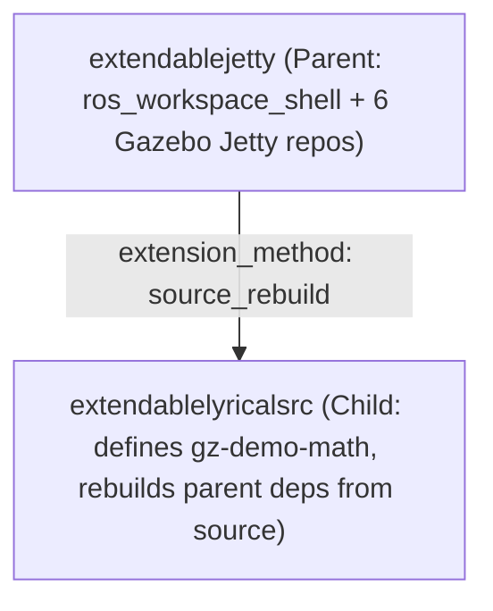

# Single-Parent All-Source (`source_rebuild`) Validation

This scenario validates a **REP-159 single-parent all-source (`source_rebuild`)** distribution locally using `vcstool`, `rosdep`, `ros_buildfarm`, and `colcon`.

---

## 1. Distribution Topology (`extendablelyricalsrc`)

In [`rep159-testing/rep159-rosdistro`](https://github.com/rep159-testing/rep159-rosdistro/tree/feat/extendable-gazebo):

- **Parent (`extendablejetty`)**: Plain-CMake Gazebo Jetty root distribution (`workspace_package: ros_workspace_shell`) defining `ros_workspace_shell`, `gz-cmake`, `gz-utils`, `gz-math`, `gz-tools` (`gz-tools2`), `gz-msgs`, and `gz-transport`.
- **Child (`extendablelyricalsrc`)**: Declares `extends: [{distro_name: extendablejetty, extension_method: source_rebuild}]` and defines only `gz-demo-math`.
- **Expected `source_rebuild` Behavior**: All required packages from `extendablejetty` are inherited into `extendablelyricalsrc` and built from source together with `gz-demo-math` in a single `colcon` workspace (`single_parent_source/ws`), producing a self-contained prefix with `setup.sh` generated by `ros_workspace_shell`.



---

## 2. Workspace Path Structure

```text
single_parent_source/
├── README.md
├── distribution.repos               # Explicit vcstool manifest for all 8 source repositories
└── ws/                              # Colcon workspace root
    ├── src/                         # Populated by create_workspace.py or vcs import
    ├── build/                       # Created by colcon build
    ├── install/                     # Merged prefix (includes setup.sh from ros_workspace_shell)
    └── log/                         # Created by colcon build / colcon test
```

---

## 3. Step-by-Step Instructions

Ensure you have completed the [One-Time REP-159 Tooling Setup](../README.md#3-one-time-rep-159-tooling-setup) from the repository root and have `.venv` activated:

```bash
# From the repository root:
source .venv/bin/activate
export ROSDISTRO_INDEX_URL="https://raw.githubusercontent.com/rep159-testing/rep159-rosdistro/feat/extendable-gazebo/index-v4.yaml"
```

### Step 1: Populate `single_parent_source/ws/src`

Choose **Option A** (dynamic REP-159 resolution via `rosdistro` + `ros_buildfarm`) or **Option B** (direct `vcstool` import from `distribution.repos`).

#### Option A (Recommended): Dynamic Resolution via REP-159 `create_workspace.py`

`extendablelyricalsrc/distribution.yaml` only lists `gz-demo-math`. Running `create_workspace.py` queries `ROSDISTRO_INDEX_URL` on GitHub, resolves `extends: extendablejetty` (`source_rebuild`), walks dependencies across the parent distribution, writes `single_parent_source/ws/repositories-from-rosdistro.repos`, and imports the repositories into `single_parent_source/ws/src` via `vcstool`:

```bash
# Minimal dependency closure (gz-demo-math -> gz-math -> gz-utils -> gz-cmake + ros_workspace_shell):
python3 -m ros_buildfarm.scripts.ci.create_workspace \
  extendablelyricalsrc \
  --repos-file-urls \
  --package-names gz-demo-math ros_workspace_shell \
  --package-dependencies \
  --workspace-root single_parent_source/ws
```

To resolve and import all 8 packages in the merged distribution instead:

```bash
python3 -m ros_buildfarm.scripts.ci.create_workspace \
  extendablelyricalsrc \
  --repos-file-urls \
  --package-names gz-demo-math gz-transport ros_workspace_shell \
  --package-dependencies \
  --workspace-root single_parent_source/ws
```

#### Option B: Direct `vcstool` Import from `distribution.repos`

To download all 8 upstream source repositories directly with `vcstool`:

```bash
vcs import single_parent_source/ws/src < single_parent_source/distribution.repos
```

### Step 2: Install System Dependencies via `rosdep`

Initialize `rosdep` (if not already initialized on your machine), update the `rosdep` database for `extendablelyricalsrc` from `ROSDISTRO_INDEX_URL`, and install system dependencies:

```bash
[ -f /etc/ros/rosdep/sources.list.d/20-default.list ] || sudo .venv/bin/rosdep init
rosdep update --rosdistro extendablelyricalsrc
rosdep install \
  --from-paths single_parent_source/ws/src \
  --ignore-src \
  --rosdistro extendablelyricalsrc \
  -y
```

### Step 3: Build the Distribution with `colcon`

```bash
cd single_parent_source/ws

colcon build \
  --merge-install \
  --event-handlers console_cohesion+ \
  --cmake-args -DCMAKE_BUILD_TYPE=Release -DBUILD_TESTING=ON --no-warn-unused-cli
```

### Step 4: Source the Prefix and Run `colcon test`

Source `install/setup.sh` (installed by `ros_workspace_shell`) and execute the test suite:

```bash
source install/setup.sh

colcon test \
  --merge-install \
  --event-handlers console_direct+ \
  --retest-until-pass 2 \
  --ctest-args -LE xfail \
  --pytest-args -m "not xfail"

colcon test-result --verbose
```
