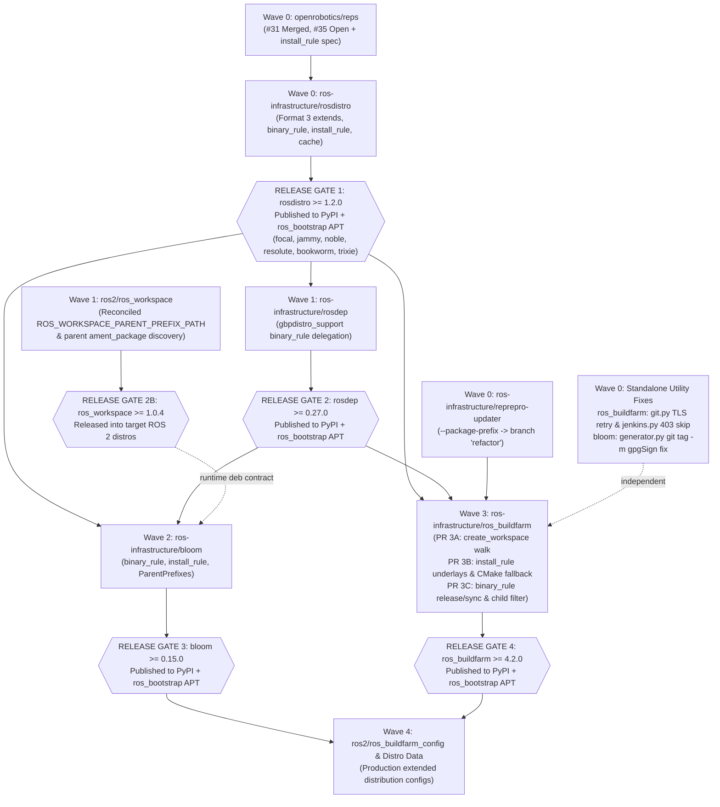

# REP-159 Upstream Roadmap: Release-Gated PR Plan, Branch Features & Fixes

This directory provides the master architectural and release-sequencing plan for landing **[REP 159](https://github.com/openrobotics/reps/pull/32)** (*ROS Enhancement Proposal: rosdistro extension mechanism*) across Open Robotics repositories.

Because downstream packaging and buildfarm tools (`rosdep`, `bloom`, `ros_buildfarm`) run CI against **PyPI** releases and execute hermetic chroot/Docker tasks against **OSRF `ros_bootstrap` APT** Debian packages (`python3-rosdistro*`, `python3-rosdep*`), upstream Pull Requests **cannot all be opened or merged simultaneously**. A published release of package $X$ with feature $Y$ is required before downstream PRs can drop temporary fork overrides, pin minimum versions in `setup.py` / `stdeb.cfg`, and pass upstream CI.

---

## 1. Release-Gated Dependency Graph

---

## 2. Release-Gated Upstream PR & Publication Sequence

| Wave / Gate | Target Upstream Repo | Org Fork Branch (`rep159-testing` / `KmoM88`) | Upstream Target Base | Live PR / Status | Prerequisite Release Gate | Resulting Publication / Gate Unblocked |
|:---:|---|---|:---:|---|---|---|
| **Wave 0** | [`openrobotics/reps`](https://github.com/openrobotics/reps) | `KmoM88:feature/rep-159-binary-name-templating` (`83e4a3f`) | `rosdistro_extension` (feeds [#32](https://github.com/openrobotics/reps/pull/32)) | [#31](https://github.com/openrobotics/reps/pull/31) Merged [#35](https://github.com/openrobotics/reps/pull/35) **OPEN** *(needs `install_rule` section)* | None | Spec consensus for Format 3, `binary_rule`, `install_rule` |
| **Wave 0** | [`ros-infrastructure/reprepro-updater`](https://github.com/ros-infrastructure/reprepro-updater) | `feat/package-prefix` (`93ed2dc`) | **`refactor`** *(org fork: `master`)* | Ready (0 fork deps) | None | **Immediate**: Jenkins sync jobs `git clone -b refactor` directly at runtime (no PyPI/APT package) |
| **Wave 0** | [`ros-infrastructure/ros_buildfarm`](https://github.com/ros-infrastructure/ros_buildfarm) | Cherry-picks from `feat/binary-naming-rule` (`ae8826b`, `199fd98`) | `master` | Ready (standalone bugfixes) | None | Standalone resilience (`wrapper/git.py` TLS retry; `jenkins.py` 403 view skip) |
| **Wave 0** | [`ros-infrastructure/bloom`](https://github.com/ros-infrastructure/bloom) | Cherry-pick `d6fdf9e` from `feat/rep159-rules-support` | `master` | Ready (standalone bugfix) | None | Fixes `git tag -f -m` abort when `tag.gpgSign=true` |
| **Wave 0** | [`ros-infrastructure/rosdistro`](https://github.com/ros-infrastructure/rosdistro) *(currently `1.1.0`)* | `rep159` (`46a7580`) + `feature/rep159-binary-naming-regex` (`3d301d6`) + `feature/rep159-install-rule` (`db021b9`) | `master` *(org fork: `rep159`)* | Org PR [`rosdistro#1`](https://github.com/rep159-testing/rosdistro/pull/1) **OPEN** | REP-159 spec alignment | **Unblocks Gate 1**: Release **`rosdistro >= 1.2.0`** to PyPI + `ros_bootstrap` APT (`python3-rosdistro-modules >= 1.2.0`) |
| **Wave 1** | [`ros-infrastructure/rosdep`](https://github.com/ros-infrastructure/rosdep) *(currently `0.26.0`)* | `rep159` (`3d52dad`) *(cut clean branch off `master`)* | `master` | Blocked on Gate 1 + `setup.py`/`ci.yaml` cleanup | **Gate 1 (`rosdistro >= 1.2.0`)** | **Unblocks Gate 2**: Release **`rosdep >= 0.27.0`** to PyPI + `ros_bootstrap` APT (`python3-rosdep-modules >= 0.27.0`) |
| **Wave 1** | [`ros2/ros_workspace`](https://github.com/ros2/ros_workspace) *(currently `1.0.3`)* | `rep159-parent-chain` (`12f93e9`) + `feat/composable-underlay-chaining` (`032d161`) | `main` | Needs branch reconciliation | None (CMake-only); packaging child `.deb` needs Gate 3 | **Unblocks Gate 2B**: Tag & release **`ros_workspace >= 1.0.4`** |
| **Wave 2** | [`ros-infrastructure/bloom`](https://github.com/ros-infrastructure/bloom) *(currently `0.14.4`)* | `rep159` (`2877687`) + `feat/rep159-rules-support` (`d6fdf9e`) | `master` *(org fork: `rep159`)* | Blocked on Gates 1 & 2 + `get_install_prefix` dict fix | **Gate 1 (`rosdistro >= 1.2.0`) + Gate 2 (`rosdep >= 0.27.0`)** | **Unblocks Gate 3**: Release **`bloom >= 0.15.0`** to PyPI + `ros_bootstrap` APT (`python3-bloom >= 0.15.0`) |
| **Wave 3** | [`ros-infrastructure/ros_buildfarm`](https://github.com/ros-infrastructure/ros_buildfarm) *(currently `4.1.1+master`)* | Combine `rep159` (`9736140`) + `feat/binary-naming-rule` (`4062a66`) | `master` | Blocked on Gates 1 & 2 + `reprepro-updater:refactor` | **Gate 1 + Gate 2 (in `ros_bootstrap` APT & PyPI) + `reprepro-updater:refactor`** | **Unblocks Gate 4**: Release **`ros_buildfarm >= 4.2.0`** to PyPI + `ros_bootstrap` APT (zero Dockerfile pip hacks) |
| **Wave 4** | [`ros2/ros_buildfarm_config`](https://github.com/ros2/ros_buildfarm_config) & Distro Data | `feat/composable-distro`, `feat/cache-lifecycle-test`, `feat/stage3-diamond` | `ros2` / `master` | Testbed validated | **Gates 1–4 deployed** | Production extended ROS 2 distributions |

---

## 3. Separation Beyond `rosdistro`: Core Implementation vs. Required Fixes vs. Pre-Release Overrides

To ensure clean upstream Pull Requests, every repository beyond `rosdistro` is decomposed below into three strict categories:
- **(A) Core Feature Implementation**: New REP-159 capabilities that belong in upstream feature PRs.
- **(B) Required Engineering & Integration Fixes**: Bugfixes discovered during topological/buildfarm validation (already committed on test branches) **plus** remaining pre-PR code fixes/reconciliations required to make the modifications work cleanly upstream.
- **(C) Temporary Pre-Release Bootstrap / Harness Overrides**: Workarounds used only because `rosdistro >= 1.2.0` and `rosdep >= 0.27.0` were not yet published to PyPI / `ros_bootstrap` APT (must **NOT** be included in upstream PRs).

---

### 3.1 `reprepro-updater` (`rep159-testing/reprepro-updater` — `feat/package-prefix` @ `93ed2dc`)

* **(A) Core Feature Implementation**:
  - `scripts/sync_ros_packages.py` & `src/reprepro_updater/helpers.py` (`93ed2dc`, +15/-8 lines): Adds `-p / --package-prefix` CLI argument (defaulting to `ros-<rosdistro>-` and auto-appending a trailing `-` if omitted). Replaces hardcoded `ros-%s-*` patterns across `UpdateElement` naming, `FilterFormula: Package (% <prefix>*)`, `_clear_ros_distro()`, and `run_cleanup()`.
* **(B) Required Fixes & Upstream Target Nuance**:
  - **Critical Branch Target**: In upstream `ros-infrastructure/reprepro-updater`, `scripts/sync_ros_packages.py` exists **only on the `refactor` branch** (not `master`). `rep159-testing/reprepro-updater:master` (`1e7aa5c`) was forked from `ros-infrastructure/reprepro-updater:refactor`. Therefore, the upstream PR **must target `refactor`**.
* **(C) Temporary Pre-Release Overrides**:
  - None. Zero dependency on `rosdistro` or `rosdep`. Can be submitted in **Wave 0**.

---

### 3.2 `rosdep` (`rep159-testing/rosdep` — `rep159` @ `3d52dad`)

* **(A) Core Feature Implementation**:
  - `src/rosdep2/gbpdistro_support.py` (`2d5a548`, `3d52dad`, +16/-3 lines): Replaces hardcoded `'ros-%s-%s' % (release_name, pkg)` with dynamic delegation to `repo.release_repository.get_binary_package_name(pkg)` or `distro_file.get_binary_package_name(pkg)`, retaining a fallback checking `extension_method == 'binary_import'` (`origin_distro` vs. `release_name`) for older objects.
  - `test/test_rosdep_gbpdistro_support.py` & `test/fake_rosdistro/{index-v4.yaml, base/, derived_binary/, derived_source/}` (`07b6647`): Unit tests and Format 3 fixtures verifying `binary_import` vs. `source_rebuild` package resolution.
* **(B) Required Fixes Before Creating Upstream PR**:
  1. **Cut Clean Feature Branch off `master`**: Currently both `origin/rep159` and `origin/feature/rep-2015-tool-integration` point to `3d52dad` (8 commits ahead of `master`).
  2. **Bump Minimum `rosdistro` Dependency (Post-Gate 1)**: Update `setup.py` (`'rosdistro >= 1.2.0'`) and `stdeb.cfg` (`python3-rosdistro-modules (>= 1.2.0)`).
  3. **Add `binary_rule` Unit Test Coverage**: Extend `test/test_rosdep_gbpdistro_support.py` with a Format 3 fixture defining a custom `binary_rule` (e.g., `vendor-{distro}-` and empty prefix `""`) to directly test `get_binary_package_name()` delegation in CI.
* **(C) Temporary Pre-Release Overrides to Drop**:
  - Commits `a83d852`, `366891f`, `e88ba75`, `2b41634`, `b436f33` modified `setup.py` and `.github/workflows/ci.yaml` to install `rosdistro @ git+https://github.com/KmoM88/rosdistro.git@feature/rep-2015-v3-parser` (an older branch lacking `get_binary_package_name`!) and check `ROSDEP_LOCAL_DEV`, replacing `ros-infrastructure/ci/.github/workflows/pytest.yaml@main`. Both files must revert to upstream structure once **Gate 1 (`rosdistro >= 1.2.0`)** is published.

---

### 3.3 `ros_workspace` (`rep159-testing/ros_workspace` — `rep159-parent-chain` @ `12f93e9` & `feat/composable-underlay-chaining` @ `032d161`)

* **(A) Core Feature Implementation**:
  - Allows Debian packages of `ros_workspace` built for an extended `binary_import` child distribution to record parent underlay prefixes in the ament resource index (`parent_prefix_path`) instead of unconditionally setting `SKIP_PARENT_PREFIX_PATH`, so sourcing `/opt/ros/<child>/setup.sh` automatically chains `/opt/ros/<parent>/local_setup.sh`.
* **(B) Required Fixes Before Creating Upstream PR**:
  - **Reconcile Two Divergent Feature Branches** (`origin/rep159-parent-chain` @ `12f93e9` vs. `origin/feat/composable-underlay-chaining` @ `032d161`, both off `main` `db49f0a` v`1.0.3`):
    1. **Preserve Parent `ament_package` Discovery (`12f93e9`)**: `rep159-parent-chain` searches `${CMAKE_INSTALL_PREFIX};${ROS_WORKSPACE_PARENT_PREFIX_PATH}` for `ament_package` Python templates/egg-links. Without this loop, building `ros_workspace` in a `binary_import` child distro that inherits `ament_package` from its parent underlay fails during `cmake` configure.
    2. **Preserve Root Distro Hermetic Default (`12f93e9`)**: Keep `SKIP_PARENT_PREFIX_PATH="SKIP_PARENT_PREFIX_PATH"` by default when neither `ROS_WORKSPACE_PARENT_PREFIX_PATH` nor `PARENT_PREFIX_PATH` is set (whereas `032d161` flipped the default via `DISABLE_PARENT_PREFIX_PATH=OFF`, which would alter standard non-extended ROS 2 Debian builds).
    3. **Unify CMake Variable Contract with Bloom (`12f93e9` + `032d161`)**: Accept `ROS_WORKSPACE_PARENT_PREFIX_PATH` (passed by `bloom`) and `PARENT_PREFIX_PATH`, convert `;` to `:`, and register the `parent_prefix_path` resource cleanly.
* **(C) Temporary Pre-Release Overrides**:
  - None. Pure `CMakeLists.txt` logic.

---

### 3.4 `bloom` (`rep159-testing/bloom` — `feat/rep159-rules-support` @ `d6fdf9e` stacked on `rep159` @ `2877687`)

* **(A) Core Feature Implementation (Two Stacked Layers)**:
  1. **Parent Underlay Chaining & `ros_workspace` Dependency (`origin/rep159`: `0189046`, `29a329c`, `db66bf6`, `2877687`)**:
     - `bloom/rosdistro_api.py`: `get_binary_import_parents()` recursively collects `binary_import` ancestor distributions; `get_ros_workspace_dependencies()` injects the child/parent `ros_workspace` dependency for ROS 2 packages.
     - `bloom/generators/debian/templates/{ament_cmake,cmake}/rules.em`: Iterates over `ParentPrefixes` to source parent `<prefix>/setup.sh`, prepend parent prefixes to `CMAKE_PREFIX_PATH` and `PKG_CONFIG_PATH`, and pass `-DROS_WORKSPACE_PARENT_PREFIX_PATH="..."` when packaging `ros_workspace`.
  2. **Declarative `binary_rule` & `install_rule` Support (`feat/rep159-rules-support`: `1f62809`)**:
     - `bloom/rosdistro_api.py`: Adds `get_binary_package_name()` and `get_install_prefix()`.
     - `bloom/generators/rosdebian.py`: Updates `RosDebianGenerator.handle_arguments()`, `rosify_package_name()`, `ParentPrefixes` resolution, and `get_subs()` so `InstallationPrefix` (`CMAKE_INSTALL_PREFIX`) and all `debian/control` `Package:` / `Depends:` stanzas honor `install_rule` and `binary_rule`.
     - Comprehensive unit & golden template tests (`test/unit_tests/test_rosdistro_api.py`, `test_rosdebian.py`, `test_rules_templates.py`, `test_generator.py`).
* **(B) Required Engineering Fixes**:
  1. **GPG-Signed Tag Fix (Committed in `d6fdf9e`)**: `bloom/generators/debian/generator.py` (line 869) passes `-m "<tag_name>"` to `git tag -f`, preventing `fatal: no tag message?` aborts when developers have `tag.gpgSign=true` enabled. *(Can be upstreamed immediately in Wave 0).*
  2. **Regex Dictionary `install_rule` Fix (Still Required Before Upstream PR)**: In `bloom/rosdistro_api.py:get_install_prefix()` (lines 269–270), the code calls `dist_file.install_rule.replace('{distro}', distro)`, which assumes `install_rule` is a `str`. If a distribution defines `install_rule` as a regex `dict` (`{'search': ..., 'replace': ...}`), `.replace()` raises `AttributeError` and silently falls back to `/opt/ros/<distro>`. **Fix**: Delegate directly to `dist_file.get_install_prefix()` before falling back to string interpolation.
  3. **Child `ros_workspace` Policy Alignment & Dependency Pins**: Align `get_ros_workspace_dependencies()` with `rosdistro` (`rep159` vs. `rep159-child-ros-workspace` policy on whether a `binary_import` child releases its own `ros_workspace`), and bump `rosdistro >= 1.2.0` and `rosdep >= 0.27.0` in `setup.py` and `stdeb.cfg` (Post-Gates 1 & 2).
  4. **RPM Generator Scope Note**: `rosrpm.py` / `dynrpm` currently retain `ros-<distro>-<pkg>` naming; either document Debian-first scope in the PR or extend parity to `rosrpm.py` as a follow-up.
* **(C) Temporary Pre-Release Overrides**:
  - None in repository files (local virtualenv testing required reinstalling editable `submodules/rosdistro` only because `rosdistro >= 1.2.0` was not yet on PyPI).

---

### 3.5 `ros_buildfarm` (`rep159-testing/ros_buildfarm` — `rep159` @ `9736140`, `feat/install-prefixes` @ `4f4b059`, `feat/binary-naming-rule` @ `4062a66`, `feat/cache-job-rep159` @ `6f62d7b`)

> [!IMPORTANT]
> **Branch Lineage Note (Do Not Rebase Active Branches)**:
> `origin/rep159` (`9736140`, off `219d1a4`) and the `origin/feat/*` branches (`feat/install-prefixes` `4f4b059`, `feat/binary-naming-rule` `4062a66`, `feat/cache-job-rep159` `6f62d7b`, off `origin/master` `7daa2b1`) hold **complementary** parts of the implementation. `origin/rep159` contains the CI workspace dependency walk (`create_workspace.py`), while `feat/binary-naming-rule` contains dynamic install prefixes, pure-CMake underlay exports, and release/sync `binary_rule` delegation. When cutting final Wave 3 PRs (after Gates 1 & 2), cherry-pick from both lineages onto fresh upstream PR branches without rebasing existing testbed branches.

* **(A) Core Feature Implementation (Decomposed into 3 Modular Wave 3 PRs)**:
  1. **PR 3A — CI Workspace Dependency Walk Across Extended Distributions** (from `origin/rep159`: `52b51d8`, `9736140`):
     - `scripts/ci/create_workspace.py` & `test/test_rep159_create_workspace.py`: Walks source-only repositories during dependency resolution and halts source checkout traversal at `binary_import` parent boundaries so parent packages are satisfied from APT via `rosdep`.
  2. **PR 3B — Dynamic Install Prefixes & Recursive Ancestor Underlays** (from `feat/install-prefixes` / `feat/binary-naming-rule`: `006a4a1`, `80e1e0b`, `aa9f572`):
     - `ros_buildfarm/common.py`, `ci_job.py`, `scripts/ci/build_and_test.py`, `test/test_rep159_underlay.py`: Implements `get_distribution_install_prefix()`, recursive `get_binary_import_underlays(dist_file, index)` across multi-tier and convergent diamond DAGs, `get_default_parent_result_spaces()`, and `ROS_BUILDFARM_PARENT_RESULT_SPACES` container injection.
  3. **PR 3C — Binary Naming Rule Delegation & Prefix-Filtered Sync** (from `feat/binary-naming-rule`: `857b025`, `61b8d29`, `ceaaef7`, `c907db2`):
     - `ros_buildfarm/common.py`, `argument.py`, `release_job.py`, `sourcedeb_job.py`, `sourcerpm_job.py`, `binarydeb_job.py`, `binaryrpm_job.py`, `trigger_job.py`: Delegates `get_os_package_name()` and `get_os_package_name_prefix()` to `dist_file.get_binary_package_name()` / `binary_rule`.
     - `scripts/release/{append_build_timestamp.py, build_binarydeb.py, check_sync_criteria.py, create_binarydeb_task_generator.py}`, `templates/release/deb/binarypkg_task.Dockerfile.em`, `templates/release/deb/sync_packages_to_{testing,main}_job.xml.em`, `test/test_binary_naming_rule.py`: Propagates `--debian-package-name` through binary builds and passes `--package-prefix` to `reprepro-updater`.
     - `setup.py` & `stdeb.cfg`: Bumps `rosdistro >= 1.2.0` and `python3-rosdistro-modules (>= 1.2.0)` so all task containers (including `rosdistro_cache_task.Dockerfile.em` and `release_check_sync_criteria_task.Dockerfile.em`) pull the REP-159 `rosdistro` release automatically from `ros_bootstrap` APT.

* **(B) Required Engineering Fixes Discovered During Validation (MUST Be Upstreamed)**:
  1. **Child Release Job Isolation (`ros_buildfarm/release_job.py`, commit `4062a66` — fold into PR 3C)**:
     - Skips packages in `ordered_pkg_tuples` not present in `dist_file.release_packages`. Without this fix, generating release jobs for a `binary_import` child distribution erroneously creates duplicate `*src_*` / `*bin_*` Jenkins jobs for every inherited parent package.
  2. **Empty `--parent-result-space` Fallback (`scripts/ci/build_and_install.py`, commit `dd2825e` — fold into PR 3B)**:
     - Falls back to `get_default_parent_result_spaces(args.rosdistro_name)` when `--parent-result-space` is `None`, ensuring `build_and_install` CI jobs do not silently drop chained parent underlays.
  3. **Pure-CMake Underlay Environment & Multiarch `LD_LIBRARY_PATH` Fallback (`ros_buildfarm/workspace.py`, commits `12982be`, `2a869d8` — fold into PR 3B)**:
     - When an underlay prefix in `parent_result_spaces` exists on disk without `setup.sh` (non-ament pure-CMake packages), automatically exports `CMAKE_PREFIX_PATH`, `COLCON_PREFIX_PATH`, `PATH`, and multiarch `LD_LIBRARY_PATH` (`lib`, `lib/x86_64-linux-gnu`, `lib/aarch64-linux-gnu`) so `find_package()` and runtime `ctest` dynamic linking succeed.
  4. **Renamed Package Subfolder & Assertion Lookup (`ros_buildfarm/binarydeb_job.py`, `binaryrpm_job.py`, `scripts/release/get_binarydeb.py`, commit `3397a12` — fold into PR 3C)**:
     - Fixes assertion formatting (`debian_package_name` vs. `package_name`) and fallback workspace directory / `.src.rpm` glob lookup when `binary_rule` renames packages away from `ros-<distro>-<pkg>`.
  5. **Git Wrapper TLS Retry (`scripts/wrapper/git.py`, commit `ae8826b` — Wave 0 standalone PR)**:
     - Retries transient `GnuTLS recv error`, `TLS connection was non-properly terminated`, `Connection reset by peer`, and `RPC failed; curl` errors during container git operations.
  6. **Jenkins View Permission Fallback (`ros_buildfarm/jenkins.py`, commits `2823cf1`, `199fd98`, `40231f3` — Wave 0 standalone PR)**:
     - Gracefully warns and skips Jenkins view creation/reconfiguration on `403 Forbidden` when deploying jobs with restricted user credentials on shared testfarms.
  7. **Task Container Base OS Codename Note (`rosdistro_cache_task.Dockerfile.em` & `release_check_sync_criteria_task.Dockerfile.em`)**:
     - Upstream hardcodes `FROM ubuntu:focal` in both templates. Because `rosdistro/stdeb.cfg` still builds `Suite3: focal jammy noble resolute bookworm trixie`, publishing Gate 1 (`python3-rosdistro >= 1.2.0`) to `ros_bootstrap` updates Focal automatically; however, if OSRF drops Focal from `ros_bootstrap` before Gate 1, upgrading these two task templates from `ubuntu:focal` to `ubuntu:noble` (or `jammy`) becomes a required upstream change.

* **(C) Temporary Pre-Release Bootstrap / Harness Overrides (Do NOT Upstream)**:
  1. **Tarball `pip3 install` Injections in 6 `*.Dockerfile.em` Templates** (commits `fc7b990`, `aa4d978`, `1fd12c0`, `4b3072b`, `68369e9`, `efcbab3`, `40231f3`, `4f4b059`, `6f62d7b` across `create_workspace.Dockerfile.em`, `sourcepkg_task.Dockerfile.em`, `binarypkg_create_task.Dockerfile.em`, `binarypkg_task.Dockerfile.em`, `release_check_sync_criteria_task.Dockerfile.em`, and `rosdistro_cache_task.Dockerfile.em`): Replaced completely once Gates 1 & 2 land in `ros_bootstrap` APT.
  2. **Fork `reprepro-updater` URL & Branch in Sync Job Templates** (`c907db2` in `templates/release/deb/sync_packages_to_{testing,main}_job.xml.em`): Revert `https://github.com/rep159-testing/reprepro-updater.git` / `feat/package-prefix` back to `https://github.com/ros-infrastructure/reprepro-updater.git` / `refactor` once Wave 0 merges `reprepro-updater`.
  3. **Cache Job Node Label Override** (`8c1f978`, `6f62d7b` in `templates/misc/rosdistro_cache_job.xml.em`): Revert `<assignedNode>building_repository</assignedNode>` back to `built-in || master` (local Jenkins master lacked Docker CLI).

---

## 4. Stage-by-Stage Documentation Index

Each validation stage is documented in its dedicated file with design rationale, core vs. fix vs. harness separation, empirical validation evidence, and release-gated PR mapping:

* **[Stage 1: ROSDistro Format 3 & Binary Naming Rules](stage1_binary_naming_and_format3.md)** — `binary_rule` regex engine, `rosdep` delegation, `reprepro-updater` `--package-prefix`, `ros_buildfarm` release naming & child release isolation.
* **[Stage 2: Custom Install Rules & Dynamic Underlays](stage2_install_rule_and_underlays.md)** — `install_rule` prefixes, recursive `get_binary_import_underlays()`, `ROS_BUILDFARM_PARENT_RESULT_SPACES`.
* **[Stage 3: Multi-Tier Topological Extensions & Hybrid Overlays](stage3_topological_extensions.md)** — `create_workspace.py` boundary walk, `build_and_install.py` underlay fallback, `workspace.py` pure-CMake & multiarch `LD_LIBRARY_PATH` exports, diamond DAGs.
* **[Stage 4: Composable Suite, Native Sourcing & Bloom Integration](stage4_composable_workspace.md)** — `ros_workspace` underlay chaining & branch reconciliation, `bloom` `binary_rule` / `install_rule` / `ParentPrefixes` packaging & `get_install_prefix()` dict fix.
* **[Stage 5: Distribution Cache Lifecycle & Automated Packaging](stage5_cache_lifecycle_and_bloom_release.md)** — `rosdistro_build_cache` parent inheritance & `- REMOVE` isolation, `ros_bootstrap` APT dependency path vs. temporary Focal container override, `bloom` `tag.gpgSign` fix.
