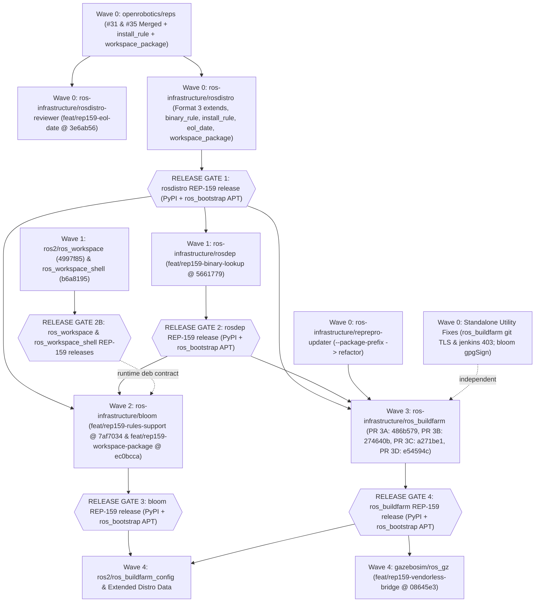

# REP-159 Upstream Roadmap: Release-Gated PR Plan, Branch Features & Fixes

This directory provides the master architectural and release-sequencing plan for landing **[REP 159](https://github.com/openrobotics/reps/pull/32)** (*ROS Enhancement Proposal: rosdistro extension mechanism*) across Open Robotics repositories.

Because downstream packaging and buildfarm tools (`rosdep`, `bloom`, `ros_buildfarm`) run CI against **PyPI** releases and execute hermetic chroot/Docker tasks against **OSRF `ros_bootstrap` APT** Debian packages (`python3-rosdistro*`, `python3-rosdep*`), upstream Pull Requests **cannot all be opened or merged simultaneously**. A published release of package $X$ with feature $Y$ is required before downstream PRs can drop temporary fork overrides, pin minimum versions in `setup.py` / `stdeb.cfg`, and pass upstream CI.

---

## 1. Release-Gated Dependency Graph

---

## 2. Unified `extendable*` (`E*`) Distribution Suite Across All Validation Stages

All validation stages (Stages 1–6) execute inside the unified **`extendable*` (`E*`)** namespace on `https://build.test.ros2.org`, keeping zero overlap with `cargotest` (`C*`) and `jrivero` (`U*`/`S*`/`B*`/`G*`/`D*`):

| Distribution Suite (`extendable*`) | Stage Scope | Jenkins Job Prefix | Build System & Environment | Verification Objectives |
|---|---|:---:|---|---|
| **`extendable*` Pure-CMake Topologies** (`extendable`, `extendablesrc`, `extendablebin`, `extendablechain`, `extendablemixed`, `extendablediamond`) | **Stages 1–3** | **`E*`** (`Eci`, `Esrc`, `Ebin`, `Erel`) | **Pure CMake** (`<build_type>cmake</build_type>`). Underlays injected via buildfarm environment exports (`CMAKE_PREFIX_PATH`, `LD_LIBRARY_PATH`). | Validates core REP-159 algorithms in isolation: APT package naming (`binary_rule`), custom prefix installation (`install_rule`), recursive DAG traversal, workspace checkout boundary pruning, and multi-tier/diamond chaining. |
| **`extendable` & `extendablebin` (`extbin`) Workspace Stack** | **Stage 4** | **`E*`** (`Eci__workspace-*`, `Esrc_uR__*`, `Ebin_uR64__*`, `Erel_extbin_sync-*`) | **Native ROS 2 Environment** (`ament_package`, `ament_cmake_core`, `ros_workspace`, `setup.sh`, `.dsv` hooks, `AMENT_PREFIX_PATH`) + Automated **`bloom`** packaging generator. | Validates complete ROS 2 runtime lifecycle: recursive bash setup sourcing of parent underlays (`ROS_WORKSPACE_PARENT_PREFIX_PATH`), child `ros_workspace` release override, and automated Debian packaging via `bloom`. |
| **`extendable` & `extendablebin` Cache Lifecycle** | **Stage 5** | **`extendable_rosdistro-cache`** **`extendablebin_rosdistro-cache`** | Distribution cache generation (`rosdistro_build_cache`). | Validates cache inheritance across Format 3 hierarchies, boundary package stripping (`- REMOVE`), and child `ros_workspace` retention. |
| **`extendablejetty`, `extendablelyricalsrc` & `extendablelyrical` (ROS 2 + Gazebo)** | **Stage 6** | **`E*`** (`Esrc_uR__extjetty_*`, `Ebin_uR64__extjetty_*`, `Esrc_uR__extlyrical_*`, `Ebin_uR64__extlyrical_*`, `Eci__gazebo-*`) | **`workspace_package: ros_workspace_shell`** (Gazebo Jetty, 0 Ament packages) + **Multi-Parent `[lyrical, extendablejetty]`** (`ros_workspace` override + vendorless `ros_gz_bridge`). | Validates Index v4 `distribution_eol_date`, `rosdistro-reviewer` checks, plain-CMake `ros_workspace_shell` underlays, `AMENT_CURRENT_PREFIX` isolation across multi-parent setups, and vendorless `ros_gz_bridge` compilation against `repo.ros2.org` (`lyrical`) + `repo.test.ros2.org` (`extendablejetty`). |

---

## 3. Release-Gated Upstream PR & Publication Sequence

| Wave / Gate | Target Upstream Repo | Org Fork Branch (`rep159-testing` / `KmoM88`) | Upstream Target Base | Live PR / Status | Prerequisite Release Gate | Resulting Publication / Gate Unblocked |
|:---:|---|---|:---:|---|---|---|
| **Wave 0** | [`openrobotics/reps`](https://github.com/openrobotics/reps) | • `KmoM88:feature/rep-159-binary-name-templating` (`f683ccc`) • `KmoM88:feature/rep-159-install-rule` (`1aef980`) • `KmoM88:feature/rep-159-workspace-package` (`0905caa`) | `rosdistro_extension` (feeds [#32](https://github.com/openrobotics/reps/pull/32)) | • [#31](https://github.com/openrobotics/reps/pull/31) **MERGED** • [#35](https://github.com/openrobotics/reps/pull/35) **MERGED** (`f683ccc`) • `1aef980` & `0905caa` **Branches Ready** | None | Spec consensus for Format 3, `binary_rule`, `install_rule`, `workspace_package`, `distribution_eol_date` |
| **Wave 0** | [`ros-infrastructure/reprepro-updater`](https://github.com/ros-infrastructure/reprepro-updater) | `feat/package-prefix` (`93ed2dc`) | **`refactor`** *(org fork: `master`)* | **Branch Ready** (0 fork deps) | None | **Immediate**: Jenkins sync jobs `git clone -b refactor` directly at runtime |
| **Wave 0** | [`ros-infrastructure/rosdistro-reviewer`](https://github.com/ros-infrastructure/rosdistro-reviewer) | `feat/rep159-eol-date` (`3e6ab56`) | `main` | **Branch Ready** (200/200 unit & linter tests pass) | None | Enforces ISO 8601 `YYYY-MM-DD` `distribution_eol_date` validation in `index-v4.yaml` PRs |
| **Wave 0** | [`ros-infrastructure/ros_buildfarm`](https://github.com/ros-infrastructure/ros_buildfarm) | Cherry-picks `ae8826b` (`wrapper/git.py`) & `199fd98` (`jenkins.py`) | `master` | **Ready** (standalone bugfixes) | None | Standalone resilience (`wrapper/git.py` TLS retry; `jenkins.py` 403 view skip) |
| **Wave 0** | [`ros-infrastructure/bloom`](https://github.com/ros-infrastructure/bloom) | Cherry-pick `d6fdf9e` from `feat/rep159-rules-support` | `master` | **Ready** (standalone bugfix) | None | Fixes `git tag -f -m` abort when `tag.gpgSign=true` |
| **Wave 0** | [`ros-infrastructure/rosdistro`](https://github.com/ros-infrastructure/rosdistro) | • `rep159` (`46a7580`) • `feature/rep159-binary-naming-regex` (`bfde799`) • `feat/rep159-install-rule` (`a8f5543`) • `feat/rep159-eol-date` (`5ec62f9`) • `feat/rep159-workspace-package` (`3670bd8`) | `master` *(org fork: `rep159`)* | Org PR [`rosdistro#1`](https://github.com/rep159-testing/rosdistro/pull/1) **OPEN** + stacked `a8f5543` (96/96), `5ec62f9` (`distribution_eol_date`), and `3670bd8` (`workspace_package` + hyphenated package lookup, **106/106 tests pass**) | REP-159 spec alignment | **Unblocks Gate 1**: New `rosdistro` release published to PyPI + `ros_bootstrap` APT (`python3-rosdistro-modules`) |
| **Wave 1** | [`ros-infrastructure/rosdep`](https://github.com/ros-infrastructure/rosdep) | `feat/rep159-binary-lookup` (`5661779`, PR-ready clean off `master`) *(testbed: `rep159` @ `3d52dad`)* | `master` | Org PR [`rosdep#2`](https://github.com/rep159-testing/rosdep/pull/2) **OPEN** (zero CI hacks); upstream PR blocked on Gate 1 PyPI publication | **Gate 1 (`rosdistro` REP-159 release)** | **Unblocks Gate 2**: New `rosdep` release published to PyPI + `ros_bootstrap` APT (`python3-rosdep-modules`) |
| **Wave 1** | [`ros2/ros_workspace`](https://github.com/ros2/ros_workspace) & `ros_workspace_shell` | • `ros_workspace:feat/rep159-parent-chaining` (`4997f85`, stacked on `12f93e9`) • `ros_workspace_shell:feat/rep159-unset-current-prefix` (`b6a8195`, stacked on `a89cc7b`) | `main` | **Branches Ready** (0 hacks): `ros_workspace` (`4997f85`) for Ament distros; `ros_workspace_shell` (`b6a8195`) for non-Ament plain-CMake distros (`unset AMENT_CURRENT_PREFIX`) | None (CMake-only) | **Unblocks Gate 2B**: Tag & release `ros_workspace` and `ros_workspace_shell` |
| **Wave 2** | [`ros-infrastructure/bloom`](https://github.com/ros-infrastructure/bloom) | • `feat/rep159-rules-support` (`7af7034`, 26/26 tests) • `feat/rep159-workspace-package` (`ec0bcca`, stacked, **37/37 tests**) | `master` *(org fork: `rep159`)* | Stacked on `jrivero`'s `rep159` (`2877687`) + `binary_rule`, `install_rule`, `workspace_package`, `get_distribution_file` `extends` resolution, and `unset AMENT_CURRENT_PREFIX` | **Gate 1 (`rosdistro` release) + Gate 2 (`rosdep` release)** | **Unblocks Gate 3**: New `bloom` release published to PyPI + `ros_bootstrap` APT (`python3-bloom`) |
| **Wave 3** | [`ros-infrastructure/ros_buildfarm`](https://github.com/ros-infrastructure/ros_buildfarm) | • **PR 3A**: `feat/rep159-workspace-walk` (`486b579`, 7/7 tests) • **PR 3B**: `feat/rep159-underlays` (`274640b`, 11/11 tests) • **PR 3C**: `feat/rep159-binary-naming` (`a271be1`, 6/6 tests) • **PR 3D**: `feat/rep159-workspace-package` (`e54594c`, stacked on `a271be1`) | `master` | All 4 PR-ready branches clean off `master` (`7daa2b1`, 0 Dockerfile pip hacks, 100% test coverage; includes `CMAKE_PREFIX_PATH` & `unset AMENT_CURRENT_PREFIX` fixes in `274640b` and `get_workspace_package()` in `e54594c`) | **Gate 1 + Gate 2 (in `ros_bootstrap` APT & PyPI) + `reprepro-updater:refactor`** | **Unblocks Gate 4**: New `ros_buildfarm` release published to PyPI + `ros_bootstrap` APT |
| **Wave 4** | [`gazebosim/ros_gz`](https://github.com/gazebosim/ros_gz) & [`ros2/ros_buildfarm_config`](https://github.com/ros2/ros_buildfarm_config) | • `ros_gz:feat/rep159-vendorless-bridge` (`08645e3`, clean 3-file diff off `3.0.12`) • `ros_buildfarm_config:feat/extendable-*` | `ros2` / `master` | Validated end-to-end on `build.test.ros2.org` (`E*` jobs) | **Gates 1–4 deployed** | Production extended ROS 2 + Gazebo distributions without `gz_*_vendor` wrapper packages |

---

## 4. Separation Beyond `rosdistro`: Core Implementation vs. Required Fixes vs. Pre-Release Overrides

To ensure clean upstream Pull Requests, every repository beyond `rosdistro` is decomposed below into three strict categories:
- **(A) Core Feature Implementation**: New REP-159 capabilities that belong in upstream feature PRs.
- **(B) Required Engineering & Integration Fixes**: Bugfixes discovered during topological/buildfarm validation (already committed on clean PR branches).
- **(C) Temporary Pre-Release Bootstrap / Harness Overrides**: Workarounds used only on testbed branches because the REP-159 releases of `rosdistro` and `rosdep` were not yet published to PyPI / `ros_bootstrap` APT (must **NOT** be included in upstream PRs).

---

### 4.1 `reprepro-updater` (`rep159-testing/reprepro-updater` — `feat/package-prefix` @ `93ed2dc`)

* **(A) Core Feature Implementation**:
  - `scripts/sync_ros_packages.py` & `src/reprepro_updater/helpers.py` (`93ed2dc`, +15/-8 lines): Adds `-p / --package-prefix` CLI argument (defaulting to `ros-<rosdistro>-` and auto-appending a trailing `-` if omitted). Replaces hardcoded `ros-%s-*` patterns across `UpdateElement` naming, `FilterFormula: Package (% <prefix>*)`, `_clear_ros_distro()`, and `run_cleanup()`.
* **(B) Required Fixes & Upstream Target Nuance**:
  - **Critical Branch Target**: In upstream `ros-infrastructure/reprepro-updater`, `scripts/sync_ros_packages.py` exists **only on the `refactor` branch** (not `master`). Therefore, the upstream PR **must target `refactor`**.
* **(C) Temporary Pre-Release Overrides**:
  - None. Zero dependency on `rosdistro` or `rosdep`. Can be submitted in **Wave 0**.

---

### 4.2 `rosdistro-reviewer` (`rep159-testing/rosdistro-reviewer` — `feat/rep159-eol-date` @ `3e6ab56`)

* **(A) Core Feature Implementation**:
  - `rosdistro_reviewer/index_yaml_check.py` & `test/rosdistro_reviewer/test_index_yaml_check.py` (`3e6ab56`): Validates optional `distribution_eol_date` entries in `index-v4.yaml` against ISO 8601 `YYYY-MM-DD` format using `datetime.date.fromisoformat()` (200/200 unit & linter tests pass).
* **(B) Required Fixes**:
  - None.
* **(C) Temporary Pre-Release Overrides**:
  - None. Zero dependency on a new `rosdistro` release. Can be submitted in **Wave 0**.

---

### 4.3 `rosdep` (`rep159-testing/rosdep` — Clean PR: `feat/rep159-binary-lookup` @ `5661779`; Testbed: `rep159` @ `3d52dad`)

* **(A) Core Feature Implementation**:
  - `src/rosdep2/gbpdistro_support.py` (`5661779`): Replaces hardcoded `'ros-%s-%s' % (release_name, pkg)` with dynamic delegation to `repo.release_repository.get_binary_package_name(pkg)` or `distro_file.get_binary_package_name(pkg)`, retaining a fallback checking `extension_method == 'binary_import'` (`origin_distro` vs. `release_name`) for older objects.
  - `test/test_rosdep_gbpdistro_support.py` & `test/fake_rosdistro/` (`5661779`): Unit tests and Format 3 fixtures (`base`, `derived_binary`, `derived_source`, `derived_naming`) verifying `binary_import`, `source_rebuild`, and `binary_rule` package resolution.
* **(B) Post-Gate 1 Dependency Pin**:
  - Once **Gate 1 (`rosdistro` REP-159 release)** is published, pin the minimum `rosdistro` version in `setup.py` and `python3-rosdistro-modules` in `stdeb.cfg`.
* **(C) Temporary Pre-Release Overrides Excluded from `feat/rep159-binary-lookup`**:
  - Commits `a83d852`..`b436f33` on testbed branch `rep159` (`3d52dad`) that modified `setup.py` and `.github/workflows/ci.yaml` to install `rosdistro` from a git URL are completely excluded from `feat/rep159-binary-lookup` (`5661779`).

---

### 4.4 `ros_workspace` (`feat/rep159-parent-chaining` @ `4997f85`) & `ros_workspace_shell` (`feat/rep159-unset-current-prefix` @ `b6a8195`)

* **(A) Core Feature Implementation**:
  - **`ros_workspace` (`4997f85`, stacked on Jose's `12f93e9`)**: Searches `${CMAKE_INSTALL_PREFIX};${ROS_WORKSPACE_PARENT_PREFIX_PATH}` for `ament_package` templates, preserves `SKIP_PARENT_PREFIX_PATH` default for root distros, accepts `ROS_WORKSPACE_PARENT_PREFIX_PATH` / `PARENT_PREFIX_PATH`, and registers `parent_prefix_path` in the ament index.
  - **`ros_workspace_shell` (`b6a8195`, stacked on Jose's `a89cc7b` tag `0.1.0`)**: Provides `/opt/ros/<distro>/{setup.sh,local_setup.sh,setup.bash,setup.zsh}` for plain-CMake distributions without `ament_package`. Commit `b6a8195` unsets `AMENT_CURRENT_PREFIX` after sourcing each parent prefix in `templates/setup.sh.in` so parent Ament distributions (`lyrical`) do not leak `AMENT_CURRENT_PREFIX` into plain-CMake or child prefixes.
* **(C) Temporary Pre-Release Overrides**:
  - None.

---

### 4.5 `bloom` (`feat/rep159-rules-support` @ `7af7034` & `feat/rep159-workspace-package` @ `ec0bcca`)

* **(A) Core Feature Implementation (Stacked Clean PR Branches)**:
  1. **Parent Underlay Chaining & `ros_workspace` Dependency (`origin/rep159`: `0189046`..`2877687` by Jose Luis Rivero)**:
     - `bloom/rosdistro_api.py`: `get_binary_import_parents()` and `get_ros_workspace_dependencies()`.
     - `bloom/generators/debian/templates/{ament_cmake,cmake}/rules.em`: Iterates over `ParentPrefixes` to source parent `<prefix>/setup.sh`, prepend parent prefixes to `CMAKE_PREFIX_PATH` and `PKG_CONFIG_PATH`, and pass `-DROS_WORKSPACE_PARENT_PREFIX_PATH="..."`.
  2. **Declarative `binary_rule` & `install_rule` Support (`feat/rep159-rules-support` @ `7af7034`, 26/26 unit tests pass)**:
     - `bloom/rosdistro_api.py` & `bloom/generators/rosdebian.py`: Adds `get_binary_package_name()` and `get_install_prefix()` (with direct `dist_file.get_install_prefix()` delegation in `45fb575` for regex `dict` support), plus `git tag -f -m` GPG fix (`d6fdf9e`).
  3. **Configurable `workspace_package` & Multi-Parent Isolation (`feat/rep159-workspace-package` @ `ec0bcca`, 37/37 unit tests pass)**:
     - `aa5133e` (Jose Luis Rivero, cherry-picked from `2cb93dc`): Adds `get_workspace_package(distro)` and generalizes `get_ros_workspace_dependencies()` and `rules.em` for `ros_workspace_shell` / `ros_workspace`.
     - `ebfa37a`: Uses `rosdistro.get_distribution_file()` in `bloom/rosdistro_api.py` so `extends` and `workspace_package` metadata are preserved when generating Debian tracks for extended distributions without a pre-built child cache.
     - `ec0bcca`: Adds `unset AMENT_CURRENT_PREFIX;` after sourcing each parent `setup.sh` in `bloom/generators/debian/templates/{ament_cmake,cmake}/rules.em`.
* **(C) Temporary Pre-Release Overrides**:
  - None in repository files.

---

### 4.6 `ros_buildfarm` (Clean PRs 3A–3D: `486b579`, `274640b`, `a271be1`, `e54594c`; Testbeds: `797d771`, `ca13954`, `b242685`)

* **(A) Core Feature Implementation & Engineering Fixes (4 Clean PR Branches off `master` `7daa2b1`, 0 Dockerfile Hacks)**:
  1. **PR 3A — CI Workspace Dependency Walk (`feat/rep159-workspace-walk` @ `486b579`, 7/7 tests pass)**:
     - Adopts Jose Luis Rivero's `ReleaseAndSourceDependencyWalker` (`1334bf9`, `486b579`) in `scripts/ci/create_workspace.py` and `test/test_rep159_create_workspace.py`.
  2. **PR 3B — Dynamic Install Prefixes, Recursive Underlays & Multi-Parent Isolation (`feat/rep159-underlays` @ `274640b`, 11/11 tests pass)**:
     - Adopts Jose Luis Rivero's `get_binary_import_distros()` (`83fd534`) + `get_distribution_install_prefix()` and recursive `get_binary_import_underlays(dist_file, index)` (`0ee8e49`, `7d23292`).
     - Includes `scripts/devel/build_and_install.py` fallback (`4c70fdc`), pure-CMake `CMAKE_PREFIX_PATH`/`COLCON_PREFIX_PATH`/`LD_LIBRARY_PATH` exports (`6b7dc03`, `a63a39d`, `a4a5bbd`), `CMAKE_PREFIX_PATH` export for `ros_workspace_shell` parent spaces with `setup.sh` (`a9a60e2`), and `unset AMENT_CURRENT_PREFIX` after sourcing each parent `setup.sh` in `call_build_tool()` (`274640b`).
  3. **PR 3C — Binary Naming Rule Delegation & Child Release Isolation (`feat/rep159-binary-naming` @ `a271be1`, 6/6 tests pass)**:
     - Delegates `get_os_package_name()` and `get_os_package_name_prefix()` to `dist_file.get_binary_package_name()`, passes `--package-prefix` to `reprepro-updater`, fixes renamed subfolder lookups (`79cc19a`), and filters `release_job.py` so `binary_import` child distros only generate release jobs for their own `dist_file.release_packages` (`9b02768`).
  4. **PR 3D — Configurable `workspace_package` Release Job Filtering (`feat/rep159-workspace-package` @ `e54594c`, stacked on `a271be1`)**:
     - Adopts Jose Luis Rivero's `146d05f` commit in `ros_buildfarm/release_job.py`: queries `dist_file.get_workspace_package()` when filtering inherited `binary_import` packages.
* **(C) Temporary Pre-Release Overrides Excluded from Clean PRs 3A–3D**:
  - All Dockerfile `pip3 install --break-system-packages` tarball overrides, fork `reprepro-updater` git URLs, `<assignedNode>building_repository</assignedNode>` overrides, and `ext*` Jenkins job prefixes remain strictly isolated on the testbed branches (`feat/binary-naming-rule` @ `797d771`, `feat/extendable-workspace` @ `ca13954`, `feat/extendable-workspace-package` @ `b242685`).

---

### 4.7 `ros_gz` (Clean PR: `feat/rep159-vendorless-bridge` @ `08645e3`; Testbed: `feat/rep159-no-vendor` @ `efec554`)

* **(A) Core Feature Implementation (`feat/rep159-vendorless-bridge` @ `08645e3`, off tag `3.0.12` `04a4544`)**:
  - Modifies **only 3 files** (`ros_gz_interfaces/package.xml`, `ros_gz_bridge/package.xml`, `ros_gz_bridge/CMakeLists.txt`, +17/-22 lines) to replace `<depend>gz_cmake_vendor</depend>`, `<depend>gz_math_vendor</depend>`, `<depend>gz_msgs_vendor</depend>`, and `<depend>gz_transport_vendor</depend>` with direct REP-159 dependencies (`gz-cmake`, `gz-math`, `gz-msgs`, `gz-transport`) and direct `find_package(gz-math / gz-msgs / gz-transport REQUIRED)`. All sibling directories (`ros_gz_sim`, `ros_gz_image`, etc.) remain 100% intact.
* **(C) Testbed-Only Pruning Excluded from Clean Branch**:
  - Testbed branch `feat/rep159-no-vendor` (`efec554`) removed sibling subdirectories so `create_workspace.py` in CI only builds `ros_gz_interfaces` and `ros_gz_bridge`.

---

## 5. Stage-by-Stage Documentation Index

Each validation stage is documented in its dedicated file inside `roadmap/` with design rationale, a GitHub Mermaid diagram separating Core Implementation (Clean PR Branches) from Testbed Overrides, empirical validation evidence on `https://build.test.ros2.org`, and `tools/stage_runner.py` commands:

* **[Stage 1: ROSDistro Format 3 & Binary Naming Rules](stage1_binary_naming_and_format3.md)** — `binary_rule` regex engine, `rosdep` delegation, `reprepro-updater` `--package-prefix`, `ros_buildfarm` release naming & child release isolation.
* **[Stage 2: Custom Install Rules & Dynamic Underlays](stage2_install_rule_and_underlays.md)** — `install_rule` prefixes, recursive `get_binary_import_underlays()`, `ROS_BUILDFARM_PARENT_RESULT_SPACES`, `ReleaseAndSourceDependencyWalker`.
* **[Stage 3: Multi-Tier Topological Extensions & Hybrid Overlays](stage3_topological_extensions.md)** — `build_and_install.py` underlay fallback, `workspace.py` pure-CMake & multiarch `LD_LIBRARY_PATH` exports, 3-tier chains, hybrid mixed, and diamond DAGs.
* **[Stage 4: Composable Suite, Native Sourcing & Bloom Integration](stage4_composable_workspace.md)** — `ros_workspace` underlay chaining (`4997f85`), child `ros_workspace` override (`a8f5543`), `bloom` `binary_rule` / `install_rule` / `ParentPrefixes` packaging (`7af7034`).
* **[Stage 5: Distribution Cache Lifecycle & Automated Packaging](stage5_cache_lifecycle_and_bloom_release.md)** — `rosdistro_build_cache` parent inheritance & `- REMOVE` isolation, `ros_bootstrap` APT dependency path vs. temporary container override, `bloom` `tag.gpgSign` fix.
* **[Stage 6: Index v4 `distribution_eol_date`, `workspace_package` (`ros_workspace_shell`), and Composable ROS 2 + Gazebo](stage6_ros_gazebo_and_eol.md)** — `distribution_eol_date` (`5ec62f9`, `3e6ab56`), `workspace_package: ros_workspace_shell` (`3670bd8`, `b6a8195`, `ec0bcca`, `274640b`, `e54594c`), Single-Parent Gazebo Jetty (`6B-1`, `6B-2a`), and Multi-Parent `[lyrical, extendablejetty]` + Vendorless `ros_gz_bridge` (`6B-2b`, `08645e3`).
