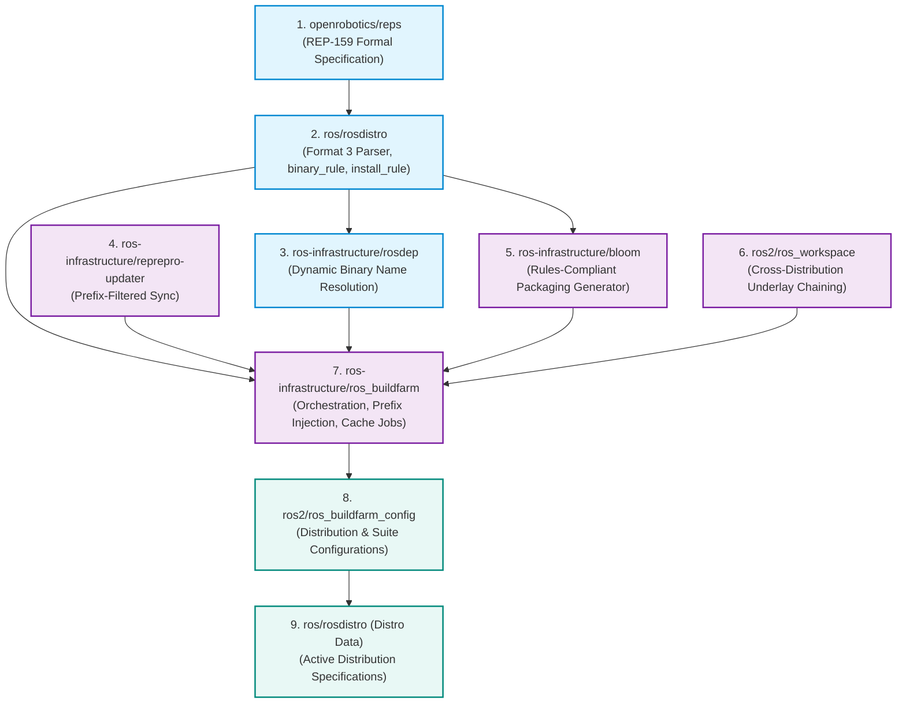

# REP-159 Upstream Roadmap: PRs, Branches, Features & Release Sequence

This directory provides the master architectural roadmap for landing **[REP 159](https://github.com/openrobotics/reps/pull/32)** (*ROS Enhancement Proposal: rosdistro extension mechanism*) into upstream Open Robotics repositories.

It organizes all features into **5 distinct stages**, establishes the exact PR and release dependency graph, and provides dedicated sub-documents detailing **Design Decisions**, **Core Implementation vs. Testing Tweaks**, and **Empirical Validation**.

---

## 1. Upstream Merge & Release Dependency Graph

The modifications must be merged and released across upstream tools in strict topological order. Foundational packages (`reps`, `rosdistro`, `rosdep`) must be published to PyPI and system APT before downstream buildfarm tooling and release generators (`bloom`, `ros_buildfarm`) can utilize them.

---

## 2. Upstream PR & Release Manifest

| Stage | Target Upstream Repo | Feature Branch | Target Base Branch | Core Deliverable | Required Release Order |
|---|---|---|---|---|:---:|
| **Spec** | [`openrobotics/reps`](https://github.com/openrobotics/reps) | `feature/rep-2015-naming-and-install-rules` | `main` | Formal specification, regex rationale, and install path resolution | Release 0 |
| **Stage 1** | [`ros/rosdistro`](https://github.com/ros/rosdistro) | `feature/rep159-binary-naming-regex` | `master` | Format 3 schema, `binary_rule` regex engine, reverse alias mapping | Release 1 (PyPI) |
| **Stage 1** | [`ros-infrastructure/rosdep`](https://github.com/ros-infrastructure/rosdep) | `rep159` | `master` | OS binary name query delegation to `rosdistro` | Release 2 (PyPI) |
| **Stage 1** | [`ros-infrastructure/reprepro-updater`](https://github.com/ros-infrastructure/reprepro-updater) | `feat/package-prefix` | `master` | Selective repository sync via `--package-prefix` | Release 3 (PyPI) |
| **Stage 2** | [`ros/rosdistro`](https://github.com/ros/rosdistro) | `feature/rep159-install-rule` | `master` | `install_rule` specification, path templates (`/opt/vendor/{distro}`) | Included in Rel 1 |
| **Stage 2 & 3** | [`ros-infrastructure/ros_buildfarm`](https://github.com/ros-infrastructure/ros_buildfarm) | `feat/binary-naming-rule` `feat/install-prefixes` | `master` | Package naming propagation, underlay prefix injection, multiarch runtime paths | Release 4 (PyPI) |
| **Stage 4** | [`ros2/ros_workspace`](https://github.com/ros2/ros_workspace) | `feat/composable-underlay-chaining` | `main` | Native underlay chaining via `/opt/ros/<parent>` setup hooks | Release 5 (Debian) |
| **Stage 4 & 5** | [`ros-infrastructure/bloom`](https://github.com/ros-infrastructure/bloom) | `feat/rep159-rules-support` | `master` | Automated Debian packaging honoring `binary_rule`, `install_rule`, and setup sourcing | Release 6 (PyPI) |
| **Stage 5** | [`ros-infrastructure/ros_buildfarm`](https://github.com/ros-infrastructure/ros_buildfarm) | `feat/cache-job-rep159` | `master` | Cache container updating to REP-159 `rosdistro` engine, agent node assignment | Included in Rel 4 |

---

## 3. Disentangling Core Implementation from Testing Tweaks

During the extensive local cluster and testfarm validation campaign, numerous solutions were implemented. To ensure clean, upstreamable Pull Requests, it is critical to distinguish **Core Engine Features** from **Test Harness & Infrastructure Tweaks**:

### What Belongs in Core Upstream PRs:
1. **Generic Rules Evaluation**: Clean, general-purpose regex evaluation (`re.sub`) without hardcoded distro assumptions.
2. **Dynamic Path Calculation**: Computing underlay paths dynamically via `get_binary_import_underlays()` and `install_rule` templates.
3. **Packaging Tooling Extensions**: Updating Bloom's Debian generator to query `rosdistro` instead of string formatting `ros-<distro>-<pkg>`.
4. **Environment Propagation**: Injecting standard CMake and Colcon environment variables (`CMAKE_PREFIX_PATH`, `LD_LIBRARY_PATH`) when native setup scripts are absent.

### What Was Harness / Test-Specific (Do NOT Upstream Directly):
1. **Docker Task Container Overrides**: Injecting `pip install https://github.com/.../archive.tar.gz` in `rosdistro_cache_task.Dockerfile.em` and `sourcepkg_task.Dockerfile.em`. (Upstream will simply depend on the newly released PyPI packages).
2. **Local Mirror Configurations**: Hardcoded IP endpoints (`192.168.30.202:8088`), local GPG signing keys, and `index-local.yaml` mirrors.
3. **Node Label Overrides**: Switching `rosdistro_cache_job.xml.em` assignedNode from `built-in || master` to `building_repository`. (In official OSRF buildfarms, master or dedicated agent nodes have git and docker configured as standard).
4. **Local Cluster Script Approvals**: Whitelisting Groovy post-build regex scanners in Jenkins `scriptApproval.xml`.

---

## 4. Stage-by-Stage Documentation Index

Each validation stage is thoroughly documented in its dedicated file:

* 📄 **[Stage 1: ROSDistro Format 3 & Binary Naming Rules](stage1_binary_naming_and_format3.md)**
  * *Focus*: Declarative binary renaming (`binary_rule`), rosdep delegation, reprepro prefix sync.
  * *Artifacts*: `feature/rep159-binary-naming-regex`, `test_binary_naming_rule.py`, `Usrc` #11, `Ubin` #7.

* 📄 **[Stage 2: Custom Install Rules & Dynamic Underlays](stage2_install_rule_and_underlays.md)**
  * *Focus*: Custom install paths (`install_rule`), dynamic parent result spaces, multi-repository release pipeline.
  * *Artifacts*: `feature/rep159-install-rule`, `feat/install-prefixes`, `Bci` #2, `Bci` #7.

* 📄 **[Stage 3: Multi-Tier Topological Extensions & Hybrid Overlays](stage3_topological_extensions.md)**
  * *Focus*: Chained source rebuild ($A \to B \to C$), chained binary import, and workspace overrides (`--ignore-src`).
  * *Artifacts*: `feat/stage3-binary-chained`, `feat/stage3-mixed`, `Eci` #13, Remote `Eci` #2.

* 📄 **[Stage 4: Composable Suite, Native Sourcing & Bloom Integration](stage4_composable_workspace.md)**
  * *Focus*: Native environment hooks via `ros_workspace`, underlay chaining, parameterizing Bloom Debian generator.
  * *Artifacts*: `feat/composable-underlay-chaining`, `feat/rep159-rules-support`, `Cci` #3, `Cci` #4.

* 📄 **[Stage 5: Distribution Cache Lifecycle & Automated Packaging](stage5_cache_lifecycle_and_bloom_release.md)**
  * *Focus*: `rosdistro_build_cache` generation, parent cache inheritance, downstream boundary isolation (`- REMOVE`), invalidation detection, and automated Bloom release verification.
  * *Artifacts*: `feat/cache-job-rep159`, `debian/cachechild/resolute/downstream_bin_a`, `cachebase_rosdistro-cache` #18, `cachechild_rosdistro-cache` #18.
