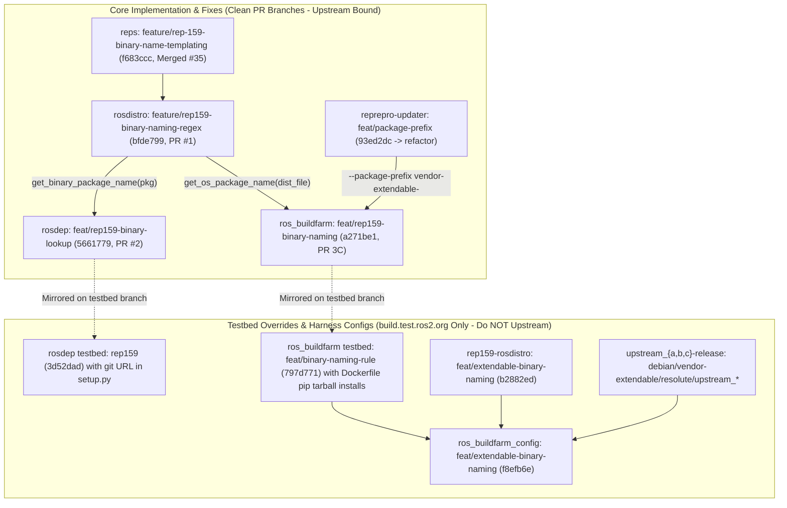

# Stage 1: ROSDistro Format 3 & Binary Naming Rules

## 1. Executive Summary & Problem Statement

In standard ROS 2, binary Debian and RPM package names are hardcoded to the strict pattern `ros-{distro}-{pkg_name}` (with underscores replaced by dashes).
This assumption breaks in three major operational scenarios:
1. **Vendor & Corporate Namespaces**: Organizations building proprietary or domain-specific overlays require packages under distinct prefixes (e.g., `vendor-{distro}-{pkg_name}`).
2. **Independent / Standalone Ecosystems**: Integration with software that publishes without a `ros-` prefix or under custom distribution names.
3. **Cross-Distribution Inheritance (`binary_import`)**: When distribution `B` extends distribution `A` via `binary_import`, package managers and buildfarms must resolve the exact binary package name published by parent `A` from APT repositories.

Stage 1 establishes the **Format 3 ROSDistro specification**, introduces declarative binary package name transformation via **`binary_rule`**, and integrates resolution across `rosdistro`, `rosdep`, `reprepro-updater`, and `ros_buildfarm`.

Reproduction command via the repository stage runner:
```bash
./tools/stage_runner.py --stage stage1 --verify-branches
./tools/stage_runner.py --stage stage1 --status
```

---

## 2. Implementation Architecture: Core PR Code vs. Testbed Overrides



---

## 3. Design Decisions & Technical Rationale

### Decision 1: Declarative Regex (`re.sub`) vs. Templating Engines (EmPy / Jinja2)
* **Exploration**: Prototypes were built on dedicated exploration branches using EmPy (`exploration/binary-naming-empy`) and Jinja2 (`exploration/binary-naming-jinja`).
* **Evaluation**: While templating engines provide conditionals and arbitrary Python execution, they introduce heavyweight external dependencies into minimal bootstrapping environments (`rosdistro`, `rosdep`, `bloom`, chroot build containers). Furthermore, arbitrary code execution in distribution metadata poses a security concern.
* **Adopted Solution**: A declarative search-and-replace rule powered by Python's built-in `re` module (`feature/rep159-binary-naming-regex`):
  ```yaml
  binary_rule:
    search: '^'
    replace: 'vendor-{distro}-'
  ```
* **Rationale**: Zero external runtime dependencies, deterministic evaluation, immune to arbitrary code execution, and easily parsed across multiple programming languages.

### Decision 2: In-Memory Inverted Index for Reverse Mapping
* **Problem**: Build tools and dependency checkers frequently start from a binary package name (e.g., `vendor-extendable-upstream-a`) and need to determine the underlying ROS package name (`upstream_a`).
* **Adopted Solution**: `DistributionFile.get_package_name_from_binary(binary_name)` constructs an in-memory inverted mapping table when the distribution is loaded.
* **Rationale**: Eliminates costly repeated regex evaluations during large workspace walks while preserving $O(1)$ dictionary lookups.

### Decision 3: Hierarchical Precedence of Rules
* Rule evaluation follows a strict cascading hierarchy:
  1. Explicit per-package override: `binary_name` in `release/packages/<pkg>`.
  2. Repository-level override: `binary_rule` under `repositories/<repo>/release`.
  3. Distribution-level default: Top-level `binary_rule` in `distribution.yaml`.
  4. Fallback: Standard `ros-{distro}-{pkg_name}` convention.

---

## 4. Implementation Breakdown: Core Code vs. Required Fixes vs. Pre-Release Overrides

### Core Feature Implementation (To Be Merged Upstream)

1. **`ros-infrastructure/rosdistro` (Branch: `feature/rep159-binary-naming-regex` @ `bfde799` stacked on `rep159` @ `46a7580`; Org PR [`rosdistro#1`](https://github.com/rep159-testing/rosdistro/pull/1))**:
   - `DistributionFile`: Adds Format 3 parsing, `extends:` DAG resolution, `binary_rule` schema validation, and `get_binary_package_name(pkg_name)`.
   - `ReleaseRepositorySpecification`: Adds repository-level `binary_rule` support.
   - Normalization: Automatically converts underscores to hyphens and interpolates canonical lowercase context variables (`{distro}`, `{package}`, `{origin_distro}`).
   - Reverse Lookup: Implements `get_package_name_from_binary(binary_name)`.

2. **`ros-infrastructure/reprepro-updater` (Branch: `feat/package-prefix` @ `93ed2dc` off `master`/`refactor` `1e7aa5c`)**:
   - `scripts/sync_ros_packages.py` & `src/reprepro_updater/helpers.py`: Adds `-p / --package-prefix` CLI option (defaulting to `ros-<rosdistro>-`, auto-appending `-`) for `UpdateElement` naming, `FilterFormula: Package (% <prefix>*)`, `_clear_ros_distro()`, and `run_cleanup()`.
   - Zero `rosdistro` dependency; targets **`refactor`** upstream (which `ros_buildfarm` clones directly at sync job runtime).

3. **`ros-infrastructure/rosdep` (Clean PR Branch: `feat/rep159-binary-lookup` @ `5661779`; Org PR [`rosdep#2`](https://github.com/rep159-testing/rosdep/pull/2))**:
   - `src/rosdep2/gbpdistro_support.py`: Delegates binary package queries to `repo.release_repository.get_binary_package_name(pkg)` or `distro_file.get_binary_package_name(pkg)`, with fallback checking `extension_method == 'binary_import'`.
   - `test/test_rosdep_gbpdistro_support.py` & `test/fake_rosdistro/`: Format 3 extended distribution unit tests (including `derived_naming`).
   - Leaves `setup.py` and `.github/workflows/ci.yaml` untouched from upstream `master`.

4. **`ros-infrastructure/ros_buildfarm` (Clean PR Branch: `feat/rep159-binary-naming` @ `a271be1` — PR 3C)**:
   - `ros_buildfarm/common.py`: Updates `get_os_package_name()` and `get_os_package_name_prefix()` to accept optional `dist_file=dist_file` and query `dist_file.get_binary_package_name()`.
   - Release & sync pipeline (`argument.py`, `release_job.py`, `sourcedeb_job.py`, `sourcerpm_job.py`, `binarydeb_job.py`, `binaryrpm_job.py`, `trigger_job.py`, `append_build_timestamp.py`, `build_binarydeb.py`, `check_sync_criteria.py`, `create_binarydeb_task_generator.py`, `binarypkg_task.Dockerfile.em`, `sync_packages_to_{testing,main}_job.xml.em`): Propagates `dist_file`, `--debian-package-name`, and `--package-prefix`.
   - 6/6 unit tests in `test/test_binary_naming_rule.py` passing.

### Required Engineering Fixes Discovered During Validation

1. **Child Release Job Isolation in `ros_buildfarm` (`release_job.py`, commit `9b02768` on `feat/rep159-binary-naming`)**:
   - Skips packages in `ordered_pkg_tuples` not present in `dist_file.release_packages`, preventing a `binary_import` child distribution from generating duplicate `*src_*` / `*bin_*` jobs for inherited parent packages.
2. **Renamed Package Subfolder & Assertion Lookup in `ros_buildfarm` (`binarydeb_job.py`, `binaryrpm_job.py`, `get_binarydeb.py`, commit `0547082`)**:
   - Fixes assertion variable formatting (`debian_package_name`) and workspace subfolder / `.src.rpm` lookup when `binary_rule` renames packages away from `ros-<distro>-<pkg>`.
3. **Standalone Buildfarm Resilience Fixes (`wrapper/git.py` `ae8826b`; `jenkins.py` `199fd98`)**:
   - Retries transient TLS/GnuTLS container git errors and gracefully skips Jenkins view creation on `403 Forbidden` (Wave 0 standalone PRs).

### Temporary Pre-Release Overrides (Test Harness Only — Do NOT Upstream)

1. **`rosdep` Testbed Branch (`rep159` @ `3d52dad`)**:
   - Hardcoded git URL for `rosdistro` in `setup.py` and `ROSDEP_LOCAL_DEV` in `.github/workflows/ci.yaml`. Excluded from clean PR branch `feat/rep159-binary-lookup` (`5661779`).
2. **Direct Tarball `pip3 install` & Fork URLs in `ros_buildfarm` Testbed Branch (`feat/binary-naming-rule` @ `797d771`)**:
   - Tarball `pip3 install` blocks in `sourcepkg_task.Dockerfile.em`, `binarypkg_create_task.Dockerfile.em`, `binarypkg_task.Dockerfile.em`, and `release_check_sync_criteria_task.Dockerfile.em`, plus the `rep159-testing/reprepro-updater` URL in `sync_packages_to_{testing,main}_job.xml.em`. Excluded from clean PR branch `feat/rep159-binary-naming` (`a271be1`).

---

## 5. Empirical Validation & Test Evidence (`https://build.test.ros2.org`)

### Local Test Suites
* **`tools/validate_binary_naming.py` (Suite 6)**: 100% pass across all regex replacement edge cases (prefixing, suffixing, token substitution, hyphen normalization).
* **`test/test_binary_naming_rule.py`**: 6/6 unit tests passed in `ros_buildfarm`.

### Jenkins Release & CI Pipeline Evidence (`extendable` / `E*`)
* **Source Release Jobs**:
  - [`Esrc_uR__upstream_a__ubuntu_resolute__source #2`](https://build.test.ros2.org/job/Esrc_uR__upstream_a__ubuntu_resolute__source/2/) ([Console](https://build.test.ros2.org/job/Esrc_uR__upstream_a__ubuntu_resolute__source/2/console)): **SUCCESS** — Built `vendor-extendable-upstream-a_0.1.0-1resolute.dsc`.
  - [`Esrc_uR__upstream_b__ubuntu_resolute__source #1`](https://build.test.ros2.org/job/Esrc_uR__upstream_b__ubuntu_resolute__source/1/) ([Console](https://build.test.ros2.org/job/Esrc_uR__upstream_b__ubuntu_resolute__source/1/console)): **SUCCESS** — Built `vendor-extendable-upstream-b_0.1.0-1resolute.dsc`.
  - [`Esrc_uR__upstream_c__ubuntu_resolute__source #1`](https://build.test.ros2.org/job/Esrc_uR__upstream_c__ubuntu_resolute__source/1/) ([Console](https://build.test.ros2.org/job/Esrc_uR__upstream_c__ubuntu_resolute__source/1/console)): **SUCCESS** — Built `vendor-extendable-upstream-c_0.1.0-1resolute.dsc`.
* **Binary Packaging Jobs**:
  - [`Ebin_uR64__upstream_a__ubuntu_resolute_amd64__binary #1`](https://build.test.ros2.org/job/Ebin_uR64__upstream_a__ubuntu_resolute_amd64__binary/1/) ([Console](https://build.test.ros2.org/job/Ebin_uR64__upstream_a__ubuntu_resolute_amd64__binary/1/console)): **SUCCESS**
  - [`Ebin_uR64__upstream_b__ubuntu_resolute_amd64__binary #1`](https://build.test.ros2.org/job/Ebin_uR64__upstream_b__ubuntu_resolute_amd64__binary/1/) ([Console](https://build.test.ros2.org/job/Ebin_uR64__upstream_b__ubuntu_resolute_amd64__binary/1/console)): **SUCCESS**
  - [`Ebin_uR64__upstream_c__ubuntu_resolute_amd64__binary #1`](https://build.test.ros2.org/job/Ebin_uR64__upstream_c__ubuntu_resolute_amd64__binary/1/) ([Console](https://build.test.ros2.org/job/Ebin_uR64__upstream_c__ubuntu_resolute_amd64__binary/1/console)): **SUCCESS**
* **Repository Sync & Root CI Jobs**:
  - [`Erel_sync-packages-to-testing_resolute_amd64 #8`](https://build.test.ros2.org/job/Erel_sync-packages-to-testing_resolute_amd64/8/) ([Console](https://build.test.ros2.org/job/Erel_sync-packages-to-testing_resolute_amd64/8/console)): **SUCCESS** (`FilterFormula: Package (% vendor-extendable-*)`)
  - [`Eci__nightly-release_ubuntu_resolute_amd64 #2`](https://build.test.ros2.org/job/Eci__nightly-release_ubuntu_resolute_amd64/2/) ([Console](https://build.test.ros2.org/job/Eci__nightly-release_ubuntu_resolute_amd64/2/console)): **SUCCESS** (3/3 CTest suites passed)
  - [`Eci__source-branches_ubuntu_resolute_amd64 #2`](https://build.test.ros2.org/job/Eci__source-branches_ubuntu_resolute_amd64/2/) ([Console](https://build.test.ros2.org/job/Eci__source-branches_ubuntu_resolute_amd64/2/console)): **SUCCESS** (3/3 CTest suites passed)
  - [`Eci__release-branches_ubuntu_resolute_amd64 #2`](https://build.test.ros2.org/job/Eci__release-branches_ubuntu_resolute_amd64/2/) ([Console](https://build.test.ros2.org/job/Eci__release-branches_ubuntu_resolute_amd64/2/console)): **SUCCESS** (3/3 CTest suites passed)

---

## 6. Known Limitations & Edge Cases in Reprepro Synchronization (`--package-prefix`)

While `reprepro-updater --package-prefix` validates vendor prefixing for anchor rules (`search: '^'`, `replace: 'vendor-{distro}-'`), `ros_buildfarm.common.get_os_package_name_prefix()` has known edge cases for future follow-up:
1. **Non-Anchor Regexes (`search != '^'`)**: Falls back to `ros-{distro}-`.
2. **Per-Repository Overrides**: Evaluates only the global distribution-level `binary_rule`.
3. **Empty Prefix (`replace: ''`)**: Empty string is falsy in `sync_ros_packages.py` and falls back to `ros-%s-`.
4. **Future Resolution**: Construct an explicit `FilterFormula` enumerating evaluated binary names from `dist_file.release_packages` or pass multiple `--package-prefix` values.
