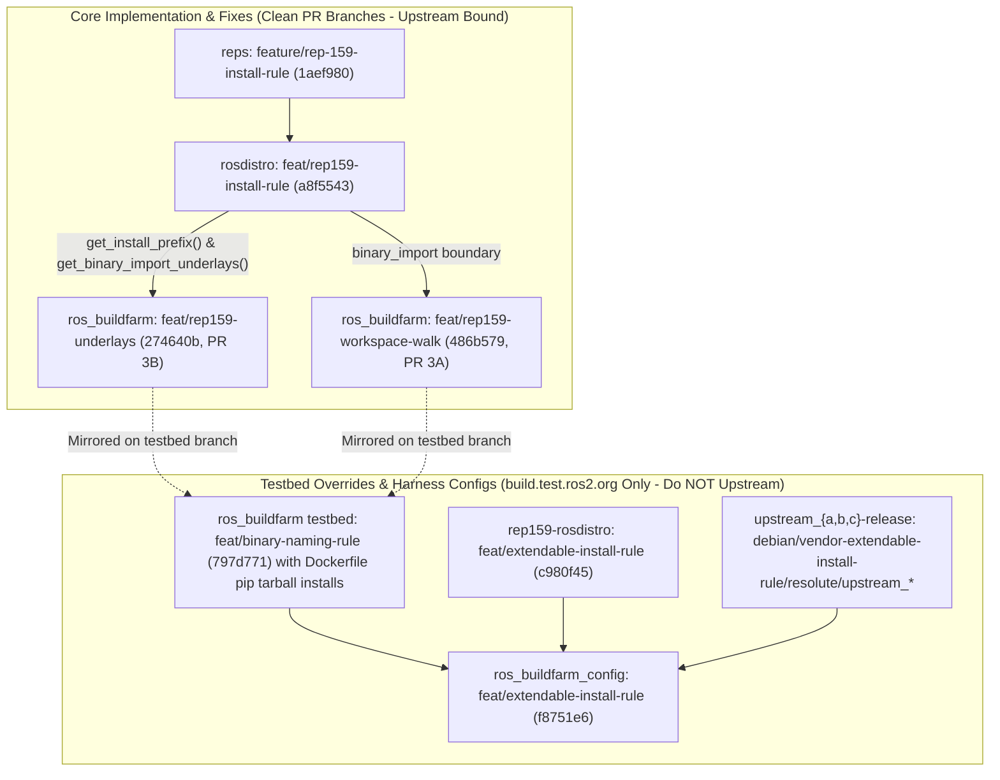

# Stage 2: Custom Install Rules & Dynamic Underlays

## 1. Executive Summary & Problem Statement

In earlier iterations of REP-159, the buildfarm assumed all parent distributions resided under the standard path `/opt/ros/%s`.
This assumption fails in two critical scenarios:
1. **Custom Vendor Installation Hierarchies**: Enterprise deployments that install ROS software into custom prefixes such as `/opt/vendor/{distro}`, `/opt/acme/ros2`, or `/usr`.
2. **Dynamic Underlay Resolution in `binary_import`**: When an overlay distribution imports pre-built binaries from a parent, the build environment must automatically identify where the parent packages are installed, source their setup hooks, and expose their CMake and shared library directories.

Stage 2 introduces the **`install_rule`** specification in `rosdistro` and the **`ROS_BUILDFARM_PARENT_RESULT_SPACES`** dynamic underlay injection mechanism in `ros_buildfarm`.

Reproduction command via the repository stage runner:
```bash
./tools/stage_runner.py --stage stage2 --verify-branches
./tools/stage_runner.py --stage stage2 --status
```

---

## 2. Implementation Architecture: Core PR Code vs. Testbed Overrides



---

## 3. Design Decisions & Technical Rationale

### Decision 1: Declarative `install_rule` Schema
* **Specification**: Added `install_rule` at distribution and repository levels supporting both simple path templates and regex substitutions:
  ```yaml
  install_rule: /opt/vendor/{distro}
  ```
  Or using explicit regex transformation:
  ```yaml
  install_rule:
    search: '^'
    replace: '/opt/vendor/'
  ```
* **Rationale**: Simple string templating covers 99% of ROS use cases, while regex support provides uniformity with `binary_rule`.

### Decision 2: Dynamic Parent Result Space Calculation (`ROS_BUILDFARM_PARENT_RESULT_SPACES`)
* **Problem**: How to communicate the parent installation paths to CI containers without hardcoding them in Dockerfiles or job scripts.
* **Adopted Solution**: `ros_buildfarm.common.get_binary_import_underlays()` recursively inspects the `extends:` tree in `distribution.yaml`, computes the prefix for each parent distribution using its `install_rule`, and exports them in the environment variable `ROS_BUILDFARM_PARENT_RESULT_SPACES`.
* **CI Job Execution Flow**:
  1. `ros_buildfarm` calculates parent prefixes: e.g., `ROS_BUILDFARM_PARENT_RESULT_SPACES=/opt/vendor/extendable`.
  2. Inside the container, `build_and_install.py` and `build_and_test.py` inspect `ROS_BUILDFARM_PARENT_RESULT_SPACES`.
  3. `workspace.py` exports `CMAKE_PREFIX_PATH`, `COLCON_PREFIX_PATH`, `LD_LIBRARY_PATH`, and `PATH` (and sources `setup.sh` followed by `unset AMENT_CURRENT_PREFIX` when `setup.sh` is present).

---

## 4. Implementation Breakdown: Core Code vs. Testbed Tweaks

### Core Implementation (To Be Merged Upstream)

1. **`ros-infrastructure/rosdistro` (Branch: `feat/rep159-install-rule` @ `a8f5543`)**:
   - Stacked cleanly on `feature/rep159-binary-naming-regex` (`bfde799`).
   - `DistributionFile`: Adds `install_rule` parsing, `get_install_prefix()`, recursive `get_binary_import_underlays()`, and Jose Luis Rivero's `BINARY_IMPORT_OVERRIDABLE = frozenset(['ros_workspace'])` (`aefe17c`, `a8f5543`).
   - `ReleaseRepositorySpecification`: Adds repository-level `install_rule` support.
   - Context evaluation: Replaces canonical lowercase `{distro}`, `{package}`, and `{origin_distro}` placeholders.
   - Verification: 96/96 unit tests passing.

2. **`ros-infrastructure/ros_buildfarm` (Branch: `feat/rep159-underlays` @ `274640b` — PR 3B, and `feat/rep159-workspace-walk` @ `486b579` — PR 3A)**:
   - Clean PR-ready branches cut directly off `origin/master` (`7daa2b1`), starting with Jose Luis Rivero's commits (`83fd534` on `feat/rep159-underlays`, `1334bf9` & `486b579` on `feat/rep159-workspace-walk`) and zero Dockerfile pip hacks.
   - `common.py`: Implements `get_distribution_install_prefix(dist_file)` and recursive `get_binary_import_underlays(dist_file, rosdistro_name)`.
   - `release_job.py` and `ci_job.py`: Export `ROS_BUILDFARM_PARENT_RESULT_SPACES`.
   - `workspace.py`: Dynamic environment export (`CMAKE_PREFIX_PATH`, `COLCON_PREFIX_PATH`, multiarch `LD_LIBRARY_PATH`) for both pure-CMake underlays lacking `setup.sh` and plain-CMake `setup.sh` underlays (`ros_workspace_shell`), plus `unset AMENT_CURRENT_PREFIX` after sourcing each parent `setup.sh`.
   - Verification: 11/11 underlay tests (`test_rep159_underlay.py`) and 7/7 workspace walk tests (`test_rep159_create_workspace.py`) passing.

### Testing Tweaks & Harness Configurations (Testfarm Only — Do NOT Upstream)

1. **Dedicated `/opt/vendor/extendable` Debian Release Tracks**:
   - Branches `debian/vendor-extendable-install-rule/resolute/upstream_{a,b,c}` (`ad87f5b`, `8c33a3d`, `eef2f2b`) in `upstream_{a,b,c}-release` install into `-DCMAKE_INSTALL_PREFIX="/opt/vendor/extendable"`.
2. **Container Pip Injections on Testbed Branch (`feat/binary-naming-rule` @ `797d771`)**:
   - Injected git tarball install of `rosdistro` and `rosdep` into `*.Dockerfile.em` templates during testfarm validation prior to Gate 1 & Gate 2 APT publication.

---

## 5. Empirical Validation & Test Evidence (`https://build.test.ros2.org`)

### Local Test Suites
* **`tools/validate_install_prefixes.py` (Suite 7)**: 100% pass across custom paths, templated variables, and fallback to default `/opt/ros/{distro}`.
* **`test/test_rep159_underlay.py`**: 11/11 unit tests passing.

### Jenkins Release & CI Job Evidence (`extendable` / `extendablebin` / `extendablesrc`)
* **Custom Prefix Release & Sync Pipeline (`/opt/vendor/extendable`)**:
  - [`Esrc_uR__upstream_a #3`](https://build.test.ros2.org/job/Esrc_uR__upstream_a__ubuntu_resolute__source/3/) ([Console](https://build.test.ros2.org/job/Esrc_uR__upstream_a__ubuntu_resolute__source/3/console)), [`Esrc_uR__upstream_b #2`](https://build.test.ros2.org/job/Esrc_uR__upstream_b__ubuntu_resolute__source/2/) ([Console](https://build.test.ros2.org/job/Esrc_uR__upstream_b__ubuntu_resolute__source/2/console)), [`Esrc_uR__upstream_c #2`](https://build.test.ros2.org/job/Esrc_uR__upstream_c__ubuntu_resolute__source/2/) ([Console](https://build.test.ros2.org/job/Esrc_uR__upstream_c__ubuntu_resolute__source/2/console)): **SUCCESS**
  - [`Ebin_uR64__upstream_a #2`](https://build.test.ros2.org/job/Ebin_uR64__upstream_a__ubuntu_resolute_amd64__binary/2/) ([Console](https://build.test.ros2.org/job/Ebin_uR64__upstream_a__ubuntu_resolute_amd64__binary/2/console)), [`Ebin_uR64__upstream_b #2`](https://build.test.ros2.org/job/Ebin_uR64__upstream_b__ubuntu_resolute_amd64__binary/2/) ([Console](https://build.test.ros2.org/job/Ebin_uR64__upstream_b__ubuntu_resolute_amd64__binary/2/console)), [`Ebin_uR64__upstream_c #2`](https://build.test.ros2.org/job/Ebin_uR64__upstream_c__ubuntu_resolute_amd64__binary/2/) ([Console](https://build.test.ros2.org/job/Ebin_uR64__upstream_c__ubuntu_resolute_amd64__binary/2/console)): **SUCCESS**
  - [`Erel_sync-packages-to-testing_resolute_amd64 #9`](https://build.test.ros2.org/job/Erel_sync-packages-to-testing_resolute_amd64/9/) ([Console](https://build.test.ros2.org/job/Erel_sync-packages-to-testing_resolute_amd64/9/console)): **SUCCESS**
* **Downstream CI Validation (`binary_import` & `source_rebuild`)**:
  - [`Eci__binary-import_ubuntu_resolute_amd64 #5`](https://build.test.ros2.org/job/Eci__binary-import_ubuntu_resolute_amd64/5/) ([Console](https://build.test.ros2.org/job/Eci__binary-import_ubuntu_resolute_amd64/5/console)): **SUCCESS** — Halted source walk at `binary_import` boundary (cloning only `downstream_bin_a`), installed `vendor-extendable-upstream-c` via APT into `/opt/vendor/extendable`, injected `ROS_BUILDFARM_PARENT_RESULT_SPACES=/opt/vendor/extendable`, exported `CMAKE_PREFIX_PATH` & `LD_LIBRARY_PATH`, and passed 1/1 CTest report.
  - [`Eci__source-rebuild_ubuntu_resolute_amd64 #2`](https://build.test.ros2.org/job/Eci__source-rebuild_ubuntu_resolute_amd64/2/) ([Console](https://build.test.ros2.org/job/Eci__source-rebuild_ubuntu_resolute_amd64/2/console)): **SUCCESS** — Cloned and built all 4 source packages (`upstream_{a,b,c}` + `downstream_src_a`) and passed 4/4 CTest reports.
