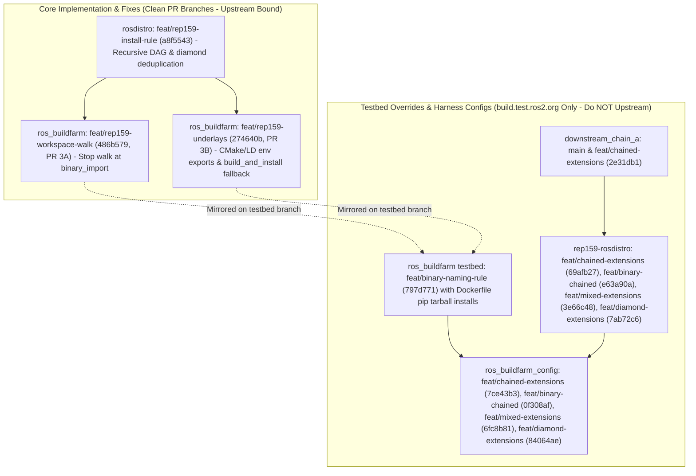

# Stage 3: Multi-Tier Topological Extensions & Hybrid Overlays

## 1. Executive Summary & Problem Statement

Stages 1 and 2 validated direct parent-child relationships ($A \to B$). However, real-world robotic deployments require multi-tier layering and hybrid development workflows:
1. **Multi-Tier Chaining ($A \to B \to C$)**: An intermediate overlay distribution (`extendablebin`) imports binaries from root (`extendable`), and a downstream leaf distribution (`extendablechain`) imports binaries from `extendablebin`, requiring transitive resolution of headers, libraries, and runtime search paths.
2. **Hybrid / Mixed Workflows (`extendablemixed`)**: A developer workspace imports heavy dependencies as pre-built binaries from APT, while checking out a specific upstream dependency from source to apply a patch, requiring the source package to override the binary package cleanly (`rosdep --ignore-src`).
3. **Multi-Parent Diamond DAGs (`extendablediamond`)**: A leaf distribution extends multiple parents (`[extendablebin, extendablesrc]`) that converge on a common ancestor (`extendable`), requiring deduplicated underlay calculation.

Reproduction commands via the repository stage runner:
```bash
./tools/stage_runner.py --stage stage3a --status
./tools/stage_runner.py --stage stage3b --status
./tools/stage_runner.py --stage stage3c --status
./tools/stage_runner.py --stage stage3d --status
```

---

## 2. Implementation Architecture: Core PR Code vs. Testbed Overrides



---

## 3. Design Decisions & Technical Rationale

### Decision 1: Pure CMake Packages & Environment Fallbacks
* **Context**: The test packages (`upstream_{a,b,c}`, `downstream_bin_a`, `downstream_chain_a`) were implemented as pure CMake packages (`<build_type>cmake</build_type>`) rather than `ament_cmake`.
* **Technical Issue**: Pure CMake packages installed into an underlay prefix (e.g., `/opt/ros/extendablebin`) do not automatically generate a ROS `setup.sh` shell script. As a result, standard ROS underlay sourcing fails to find downstream CMake targets.
* **Adopted Solution**: Updated `ros_buildfarm` (`workspace.py`) to detect underlays without `setup.sh` and dynamically construct and export:
  - `CMAKE_PREFIX_PATH`
  - `COLCON_PREFIX_PATH`
  - `LD_LIBRARY_PATH` (including multiarch `/lib/x86_64-linux-gnu` and `/lib/aarch64-linux-gnu`)
* **Rationale**: Enables buildfarms to support non-ament pure CMake repositories (Gazebo, system utilities) as first-class citizens in underlay chains.

### Decision 2: ABI Immutability Guardrails & Hybrid Override Caveat
* **Problem**: In an initial hybrid topology test (`extendablemixed`), `upstream_c` was re-declared under `binary_import` while also present in the source workspace.
* **Result**: `rosdep` and `colcon` encountered ambiguous dependency graphs, violating REP-159's core invariant that a downstream distribution cannot redefine or mutate an upstream distribution's ABI.
* **Adopted Solution**: Enforced clean distribution inheritance where downstream distributions declare only new or explicitly overridden packages, while `colcon build` and `rosdep --ignore-src` handle local workspace shadowing cleanly.
* **Governance Caveat (Enforcing Binary Upstream)**: In production distribution engineering, any `binary_import` boundary strictly mandates binary resolution for all upstream ancestors, forcing a `source_rebuild` cascade whenever an ancestor package needs source patching.

### Decision 3: Multi-Parent Diamond Deduplication
* **Context**: In multi-parent convergent diamond topologies (`extendablediamond` extending `extendablebin` via `binary_import` and `extendablesrc` via `source_rebuild`), both branches share the common ancestor `extendable`.
* **Adopted Solution**: `get_binary_import_underlays()` deduplicates ancestor prefixes in topological order (`/opt/ros/extendable:/opt/ros/extendablebin`).

---

## 4. Implementation Breakdown: Core Code vs. Required Fixes vs. Testing Tweaks

### Core Feature Implementation & Required Fixes (To Be Merged Upstream)

1. **`ros-infrastructure/ros_buildfarm` — CI Workspace Dependency Walk (`feat/rep159-workspace-walk` @ `486b579`, PR 3A)**:
   - **`scripts/ci/create_workspace.py` & `test/test_rep159_create_workspace.py` (Commits `1334bf9`, `486b579` by Jose Luis Rivero)**: Walks source-only repositories during dependency resolution (`ReleaseAndSourceDependencyWalker`) and stops workspace source checkout traversal at `binary_import` parent boundaries (leaving parent binaries to be installed via `rosdep` from APT).
   - Clean PR-ready branch cut directly off `origin/master` (`7daa2b1`, zero Dockerfile pip hacks, 7/7 tests passing).

2. **`ros-infrastructure/ros_buildfarm` — Underlay & Pure-CMake Engineering Fixes (`feat/rep159-underlays` @ `274640b`, PR 3B)**:
   - **Commit `83fd534` (by Jose Luis Rivero, from `9807b32`)**: `BINARY_IMPORT_DISTROS_ENV`, `get_binary_import_distros(dist_file)`, and 4 baseline unit tests in `test/test_rep159_underlay.py`.
   - **Commits `0ee8e49`, `7d23292`**: `install_rule` prefix evaluation (`get_distribution_install_prefix`) and recursive multi-tier/diamond `get_binary_import_underlays(dist_file, index)`.
   - **`scripts/devel/build_and_install.py` (Commit `4c70fdc`)**: Added fallback to `get_default_parent_result_spaces(args.rosdistro_name)` when `--parent-result-space` is `None`.
   - **`ros_buildfarm/workspace.py` (Commits `6b7dc03`..`274640b`)**: Added dynamic export of `CMAKE_PREFIX_PATH`, `COLCON_PREFIX_PATH`, `PATH`, and multiarch `LD_LIBRARY_PATH` when underlays exist on disk without `setup.sh`, plus `CMAKE_PREFIX_PATH` export and `unset AMENT_CURRENT_PREFIX` for underlays with `setup.sh`.
   - Clean PR-ready branch cut directly off `origin/master` (`7daa2b1`, 11/11 underlay tests passing).

3. **`ros-infrastructure/rosdistro` (Branch: `feat/rep159-install-rule` @ `a8f5543`)**:
   - Transitive topological DAG walk & multi-parent diamond deduplication: Recursively traverses multi-tier parent hierarchies ($C \to B \to A$ and convergent diamonds) without circular dependency deadlocks or false collision errors, plus Jose Luis Rivero's `BINARY_IMPORT_OVERRIDABLE = frozenset(['ros_workspace'])` (`aefe17c`, `a8f5543`).
   - Stacked cleanly on `feature/rep159-binary-naming-regex` (`bfde799`), 96/96 tests passing.

### Testing Tweaks & Harness Configurations (Testfarm Only — Do NOT Upstream)

1. **Container Tarball `pip3 install` Commits on Testbed Branch (`feat/binary-naming-rule` @ `797d771`)**:
   - Temporary pre-release overrides dropped once **Gate 1 (`rosdistro >= 1.2.0`)** and **Gate 2 (`rosdep >= 0.27.0`)** land in `ros_bootstrap` APT.
2. **Test Harness Chained Distributions**:
   - `extendablechain`, `extendablemixed`, and `extendablediamond` distribution specifications and `downstream_chain_a` (`2e31db1`) in `rep159-testing`.

---

## 5. Empirical Validation & Test Evidence (`https://build.test.ros2.org`)

### Stage 3A: Chained Source Rebuild ($A \xrightarrow{\text{src}} B \xrightarrow{\text{src}} C$)
* [`Eci__chained-import_ubuntu_resolute_amd64 #3`](https://build.test.ros2.org/job/Eci__chained-import_ubuntu_resolute_amd64/3/) ([Console](https://build.test.ros2.org/job/Eci__chained-import_ubuntu_resolute_amd64/3/console)) — **SUCCESS**. Compiled all 5 repositories (`upstream_{a,b,c}`, `downstream_bin_a`, `downstream_chain_a`) from source in cascading colcon workspace and passed 5/5 CTest suites.

### Stage 3B: Chained Binary Import ($A \xrightarrow{\text{bin}} B \xrightarrow{\text{bin}} C$)
* **Sourcedeb & Binarydeb**: [`Esrc_uR__downstream_bin_a #1`](https://build.test.ros2.org/job/Esrc_uR__downstream_bin_a__ubuntu_resolute__source/1/) and [`Ebin_uR64__downstream_bin_a #1`](https://build.test.ros2.org/job/Ebin_uR64__downstream_bin_a__ubuntu_resolute_amd64__binary/1/) built and published `ros-extendablebin-downstream-bin-a_0.2.0-1resolute_amd64.deb` into `building`.
* **Sync**: [`Erel_sync-packages-to-testing_resolute_amd64 #7`](https://build.test.ros2.org/job/Erel_sync-packages-to-testing_resolute_amd64/7/) (and `#10` for root `/opt/ros/extendable`) promoted the packages to `http://repo.test.ros2.org/ubuntu/testing`.
* **CI Execution**: [`Eci__chained-import_ubuntu_resolute_amd64 #4`](https://build.test.ros2.org/job/Eci__chained-import_ubuntu_resolute_amd64/4/) ([Console](https://build.test.ros2.org/job/Eci__chained-import_ubuntu_resolute_amd64/4/console)) — **SUCCESS** — Clean binary install from APT, compiled `downstream_chain_a`, linked against `libdownstream_bin_a.so` and `libupstream_c.so`, and passed all CTest suites.

### Stage 3C: Hybrid Binary + Source Overriding (`--ignore-src`)
* [`Eci__mixed-chain_ubuntu_resolute_amd64 #1`](https://build.test.ros2.org/job/Eci__mixed-chain_ubuntu_resolute_amd64/1/) / [`#2`](https://build.test.ros2.org/job/Eci__mixed-chain_ubuntu_resolute_amd64/2/) ([Console](https://build.test.ros2.org/job/Eci__mixed-chain_ubuntu_resolute_amd64/2/console)) — **SUCCESS**. `downstream_bin_a` installed from APT binaries; `upstream_c` compiled from source in workspace, passing 2/2 test suites.

### Stage 3D: Multi-Parent Convergent Diamond DAG
* [`Eci__diamond-chain_ubuntu_resolute_amd64 #1`](https://build.test.ros2.org/job/Eci__diamond-chain_ubuntu_resolute_amd64/1/) / [`#3`](https://build.test.ros2.org/job/Eci__diamond-chain_ubuntu_resolute_amd64/3/) ([Console](https://build.test.ros2.org/job/Eci__diamond-chain_ubuntu_resolute_amd64/3/console)) — **SUCCESS**. Deduplicated underlays `/opt/ros/extendable:/opt/ros/extendablebin` and passed 2/2 test suites.
