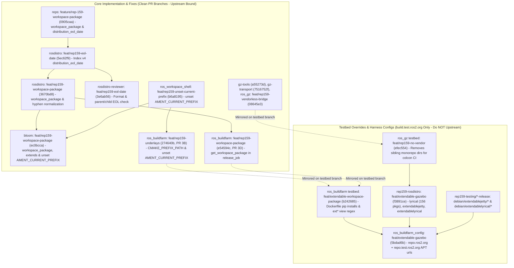

# Stage 6: Index v4 `distribution_eol_date`, `workspace_package` (`ros_workspace_shell`), and Composable ROS 2 + Gazebo (`ros_gz_bridge`)

## 1. Executive Summary & Evolution of Workspace Setup (Stages 1 -> 6)

Across our REP-159 testing campaign, we iterated through three distinct mechanisms for managing prefix setup files (`/opt/ros/<distro>/setup.bash`) and parent underlay chaining:

| Aspect | Stages 1–3 (Pure CMake, No Workspace Pkg) | Stages 4–5 (Full `ros_workspace`) | Stage 6+ (Adopted `workspace_package` / `ros_workspace_shell`) |
| :--- | :--- | :--- | :--- |
| **Bootstrap packages in Root / `source_rebuild` non-ROS distro** | **0** | **3** (`ament_package`, `ament_cmake_core`, `ros_workspace`) | **1** (`ros_workspace_shell` — plain CMake, no Ament) |
| **Bootstrap packages in `binary_import` child distro** | **0** | **1** (`ros_workspace`) | **1** (`ros_workspace` for ROS 2 child, or `ros_workspace_shell` for CMake child) |
| **Manual `PYTHONPATH` patch in `ament_cmake_core-release`?** | No | **Yes** | **No** |
| **Installs `/opt/ros/<distro>/setup.bash` for end users?** | **No** | **Yes** | **Yes** |
| **Recursive runtime underlay chaining (`parent_prefix_path`)?** | No (buildfarm env export only) | **Yes** | **Yes** (works across mixed `ros_workspace` and `ros_workspace_shell` layers) |
| **Supports `binary_rule`, `install_rule`, & `distribution_eol_date`?** | **Yes** | **Yes** | **Yes** (unified on `feat/rep159-workspace-package`) |

Stage 6 unifies:
1. **Index v4 `distribution_eol_date` (`openrobotics/reps#37`) & `rosdistro-reviewer` EOL Validation**: Parses `distribution_eol_date` in `rosdistro` (`5ec62f9`) and validates ISO 8601 format + parent/child EOL consistency (`parent_eol >= child_eol`) in `rosdistro-reviewer` (`3e6ab56`).
2. **`workspace_package` (`ros_workspace_shell`)**: Adopts Jose Luis Rivero's `ros_workspace_shell` (`a89cc7b`) and `workspace_package` key across `rosdistro` (`3670bd8`), `bloom` (`ec0bcca`), and `ros_buildfarm` (`e54594c` clean / `b242685` testbed).
3. **Composable ROS 2 + Gazebo Demonstrations on `build.test.ros2.org` (`E*` Namespace)**:
   - **Step 6B-1 (`stage6-gazebo-step1`)**: Minimal 3-package Gazebo root (`extendablejetty`: `ros_workspace_shell`, `gz-cmake`, `gz-utils`, `gz-math`) + single-parent `extendablelyrical` (`gz-demo-math`) (**17/17 `SUCCESS`**).
   - **Step 6B-2a (`stage6-gazebo-step2a`)**: Full 6-package Gazebo Jetty root (`extendablejetty`: `ros_workspace_shell`, `gz-cmake`, `gz-utils`, `gz-math`, `gz-tools2`, `gz-msgs`, `gz-transport`) + single-parent `extendablelyricalsrc` and `extendablelyrical` (**23/23 `SUCCESS`**).
   - **Step 6B-2b (`stage6-gazebo-step2b`)**: Multi-parent ROS 2 + Gazebo child (`extendablelyrical` extending `[lyrical, extendablejetty]` via `binary_import`), pulling 156 ROS 2 Lyrical binaries from `http://repo.ros2.org/ubuntu/testing` (`build.ros2.org`) and 7 Gazebo Jetty binaries from `http://repo.test.ros2.org/ubuntu/testing` (`build.test.ros2.org`), and building `ros_workspace`, `gz-demo-math`, `ros_gz_interfaces`, and vendorless `ros_gz_bridge` (**18/18 `SUCCESS`**).

Reproduction commands via the repository stage runner:
```bash
./tools/stage_runner.py --stage stage6-gazebo-step1 --status
./tools/stage_runner.py --stage stage6-gazebo-step2a --status
./tools/stage_runner.py --stage stage6-gazebo-step2b --status
./tools/bloom_stage6_gazebo.py --push
```

---

## 2. Implementation Architecture: Core PR Code vs. Testbed Overrides



---

## 3. Stacked Branch Matrix for Stage 6

| Submodule / Repository | Base Branch (Untouched) | Clean PR / Stacked Branch (`@ SHA`) | Adopted `jrivero` Commit & Unified Features | Unit Tests |
| :--- | :--- | :--- | :--- | :---: |
| **[submodules/rosdistro](file:///usr/local/google/home/rossif/github/kmom88/rep159-testing/submodules/rosdistro)** | `feat/rep159-eol-date` (`5ec62f9`)<br>*(on `feat/rep159-install-rule` `a8f5543`)* | [`feat/rep159-workspace-package`](https://github.com/rep159-testing/rosdistro/tree/feat/rep159-workspace-package) (`3670bd8`) | Cherry-picks `bc0600f` (`Jose Luis Rivero`): parses `workspace_package` in v3 `distribution.yaml`, sets `binary_import_overridable = frozenset([self.workspace_package or 'ros_workspace'])`, and normalizes hyphenated package names (`pkg_name.replace('-', '_')`) in `get_binary_package_name()` and `get_install_prefix()`. | **106 / 106 PASS** |
| **[submodules/bloom](file:///usr/local/google/home/rossif/github/kmom88/rep159-testing/submodules/bloom)** | `feat/rep159-rules-support` (`7af7034`) | [`feat/rep159-workspace-package`](https://github.com/rep159-testing/bloom/tree/feat/rep159-workspace-package) (`ec0bcca`) | Cherry-picks `2cb93dc` (`Jose Luis Rivero`): `get_workspace_package()`, `get_binary_import_parent_workspace_packages()`, and `get_workspace_dependencies()`, resolves parent `extends` in `get_distribution_file()`, and unsets `AMENT_CURRENT_PREFIX` after each parent `setup.sh` in `debian/rules.em`. | **37 / 37 PASS** |
| **[submodules/ros_buildfarm](file:///usr/local/google/home/rossif/github/kmom88/rep159-testing/submodules/ros_buildfarm)** *(Clean PRs)* | `feat/rep159-binary-naming` (`a271be1`) & `feat/rep159-underlays` (`a4a5bbd`) | [`feat/rep159-workspace-package`](https://github.com/rep159-testing/ros_buildfarm/tree/feat/rep159-workspace-package) (`e54594c`) & [`feat/rep159-underlays`](https://github.com/rep159-testing/ros_buildfarm/tree/feat/rep159-underlays) (`274640b`) | Cherry-picks `146d05f` (`Jose Luis Rivero`): `_get_and_parse_distribution_cache` in `release_job.py` uses `get_workspace_package(dist_cache.distribution_file)`, plus `CMAKE_PREFIX_PATH` export and `unset AMENT_CURRENT_PREFIX` in `workspace.py` (`274640b`). Zero Dockerfile pip hacks. | **34 / 34 PASS** |
| **[submodules/ros_buildfarm](file:///usr/local/google/home/rossif/github/kmom88/rep159-testing/submodules/ros_buildfarm)** *(Testbed)* | `feat/extendable-workspace` (`ca13954`) | [`feat/extendable-workspace-package`](https://github.com/rep159-testing/ros_buildfarm/tree/feat/extendable-workspace-package) (`b242685`) | Cherry-picks `146d05f` (`3f127b7`), pins `rosdistro` `3670bd8` across task Dockerfile templates, supports `ext*` release build prefixes inside `Esrc_uR` and `Ebin_uR64`, exports `CMAKE_PREFIX_PATH` in `workspace.py`, and unsets `AMENT_CURRENT_PREFIX` between chained `setup.sh` calls (`b242685`). | **34 / 34 PASS** |
| **[submodules/reps](file:///usr/local/google/home/rossif/github/kmom88/rep159-testing/submodules/reps)** | `feature/rep-159-install-rule` (`1aef980`) | [`feature/rep-159-workspace-package`](https://github.com/KmoM88/reps/tree/feature/rep-159-workspace-package) (`0905caa`) | Documents `workspace_package` (`ros_workspace_shell` vs `ros_workspace`) in Distribution File v3 and `distribution_eol_date` in Index File v4 (`openrobotics/reps#37`). | Spec Verified |
| **[submodules/rosdistro-reviewer](file:///usr/local/google/home/rossif/github/kmom88/rep159-testing/submodules/rosdistro-reviewer)** | `main` (`7b95cf2`) | [`feat/rep159-eol-date`](https://github.com/rep159-testing/rosdistro-reviewer/tree/feat/rep159-eol-date) (`3e6ab56`) | Implements `_check_eol_dates` in `RosdistroAnalyzer` validating `distribution_eol_date` ISO 8601 format (`YYYY-MM-DD` / `YYYY-MM`) and detecting parent/child EOL mismatches (`parent_eol < child_eol`) across `extends`. | **200 / 200 PASS** |
| **[submodules/ros_workspace_shell](file:///usr/local/google/home/rossif/github/kmom88/rep159-testing/submodules/ros_workspace_shell)** | `main` (`a89cc7b`, tag `0.1.0`) | [`feat/rep159-unset-current-prefix`](https://github.com/rep159-testing/ros_workspace_shell/tree/feat/rep159-unset-current-prefix) (`b6a8195`) | Jose's plain-CMake prefix setup package (`ros_workspace_shell`), plus `unset AMENT_CURRENT_PREFIX` after sourcing `local_setup.sh` in `templates/prefix_level/setup.sh.in`. | Verified |
| **[submodules/gz-tools](file:///usr/local/google/home/rossif/github/kmom88/rep159-testing/submodules/gz-tools)** | `gz-tools2_2.0.4` (`7a9e679`) | [`feat/rep159-jetty`](https://github.com/rep159-testing/gz-tools/tree/feat/rep159-jetty) (`a55273d`) | Updates `package.xml` (`gz-cmake` dependency, `<build_type>cmake</build_type>`) for Gazebo Jetty (`rep159-testing/gz-tools2-release.git`). | Verified |
| **[submodules/gz-transport](file:///usr/local/google/home/rossif/github/kmom88/rep159-testing/submodules/gz-transport)** | `gz-transport15_15.0.3` (`26368955`) | [`feat/rep159-jetty`](https://github.com/rep159-testing/gz-transport/tree/feat/rep159-jetty) (`7516752f`) | Updates `package.xml` (`gz-cmake` build dependency, removes optional unported zenoh keys) for Gazebo Jetty (`rep159-testing/gz-transport-release.git`). | Verified |
| **[submodules/ros_gz](file:///usr/local/google/home/rossif/github/kmom88/rep159-testing/submodules/ros_gz)** | `3.0.12` (`04a4544`) | [`feat/rep159-vendorless-bridge`](https://github.com/rep159-testing/ros_gz/tree/feat/rep159-vendorless-bridge) (`08645e3`, clean) / [`feat/rep159-no-vendor`](https://github.com/rep159-testing/ros_gz/tree/feat/rep159-no-vendor) (`efec554`, testbed) | Removes `gz_msgs_vendor` and `gz_transport_vendor` from `ros_gz_bridge/package.xml` and `CMakeLists.txt`, calling `find_package(gz-msgs12 REQUIRED)` and `find_package(gz-transport15 REQUIRED)` directly against the `extendablejetty` underlay (`rep159-testing/ros_gz-release.git`). | Verified |
| **[submodules/rep159-rosdistro](file:///usr/local/google/home/rossif/github/kmom88/rep159-testing/submodules/rep159-rosdistro)** | `feat/extendable-workspace` (`19aedba`) | [`feat/extendable-gazebo`](https://github.com/rep159-testing/rep159-rosdistro/tree/feat/extendable-gazebo) (`f3891ce`) | Adds `lyrical` (156-package ROS 2 Lyrical parent subset), `extendablejetty` (6-package Gazebo root with `workspace_package: ros_workspace_shell`), `extendablelyricalsrc` (`source_rebuild`), and multi-parent `extendablelyrical` (`extends: [lyrical, extendablejetty]`, `ros_workspace`, `gz-demo-math`, `ros_gz_interfaces`, vendorless `ros_gz_bridge`). | Cache Verified |
| **[submodules/ros_buildfarm_config](file:///usr/local/google/home/rossif/github/kmom88/rep159-testing/submodules/ros_buildfarm_config)** | `feat/extendable-workspace` (`c80b6f7`) | [`feat/extendable-gazebo`](https://github.com/rep159-testing/ros_buildfarm_config/tree/feat/extendable-gazebo) (`5bdad6b`) | Adds `extendablejetty` (`extjetty`), `extendablelyricalsrc`, and `extendablelyrical` (`extlyrical`) CI and release build configs under `E*`. | Live Jobs Verified |

---

## 4. Empirical Validation on `https://build.test.ros2.org` (`E*` Namespace)

### 4.1 Step 6B-1: Minimal Gazebo `ros_workspace_shell` + `gz-demo-math` Smoke Test (`17/17 SUCCESS`)
- `Esrc_uR__extjetty_{ros_workspace_shell,gz-cmake,gz-utils,gz-math}__ubuntu_resolute__source` (`#1`) — **SUCCESS**
- `Ebin_uR64__extjetty_{ros_workspace_shell #1, gz-cmake #2, gz-utils #2, gz-math #2}__ubuntu_resolute_amd64__binary` — **SUCCESS**
- `Erel_extjetty_sync-packages-to-testing_resolute_amd64` [#2](https://build.test.ros2.org/job/Erel_extjetty_sync-packages-to-testing_resolute_amd64/2/) — **SUCCESS**
- `Esrc_uR__extlyrical_{ros_workspace_shell #1, gz-demo-math #1}` & `Ebin_uR64__extlyrical_{ros_workspace_shell #2, gz-demo-math #3}` — **SUCCESS**
- `Erel_extlyrical_sync-packages-to-testing_resolute_amd64` [#2](https://build.test.ros2.org/job/Erel_extlyrical_sync-packages-to-testing_resolute_amd64/2/) — **SUCCESS**
- `Eci__gazebo-jetty-release_ubuntu_resolute_amd64` [#1](https://build.test.ros2.org/job/Eci__gazebo-jetty-release_ubuntu_resolute_amd64/1/), `Eci__gazebo-lyrical-source-rebuild_ubuntu_resolute_amd64` [#1](https://build.test.ros2.org/job/Eci__gazebo-lyrical-source-rebuild_ubuntu_resolute_amd64/1/), `Eci__gazebo-lyrical-binary-import_ubuntu_resolute_amd64` [#2](https://build.test.ros2.org/job/Eci__gazebo-lyrical-binary-import_ubuntu_resolute_amd64/2/) — **SUCCESS**

### 4.2 Step 6B-2a: Single-Parent Full 6-Package Gazebo `extendablejetty` -> `extendablelyrical` / `extendablelyricalsrc` (`23/23 SUCCESS`)
- `Esrc_uR__extjetty_{ros_workspace_shell,gz-cmake,gz-utils,gz-math,gz-tools2,gz-msgs,gz-transport}__ubuntu_resolute__source` — **SUCCESS**
- `Ebin_uR64__extjetty_{ros_workspace_shell,gz-cmake,gz-utils,gz-math,gz-tools2,gz-msgs,gz-transport}__ubuntu_resolute_amd64__binary` — **SUCCESS**
- `Erel_extjetty_sync-packages-to-testing_resolute_amd64` [#4](https://build.test.ros2.org/job/Erel_extjetty_sync-packages-to-testing_resolute_amd64/4/) — **SUCCESS**
- `Erel_extlyrical_sync-packages-to-testing_resolute_amd64` [#3](https://build.test.ros2.org/job/Erel_extlyrical_sync-packages-to-testing_resolute_amd64/3/) — **SUCCESS**
- `Eci__gazebo-jetty-release_ubuntu_resolute_amd64` [#2](https://build.test.ros2.org/job/Eci__gazebo-jetty-release_ubuntu_resolute_amd64/2/) (6/6 packages green) — **SUCCESS**
- `Eci__gazebo-lyrical-source-rebuild_ubuntu_resolute_amd64` [#2](https://build.test.ros2.org/job/Eci__gazebo-lyrical-source-rebuild_ubuntu_resolute_amd64/2/) (7/7 packages green) — **SUCCESS**
- `Eci__gazebo-lyrical-binary-import_ubuntu_resolute_amd64` [#3](https://build.test.ros2.org/job/Eci__gazebo-lyrical-binary-import_ubuntu_resolute_amd64/3/) — **SUCCESS**

### 4.3 Step 6B-2b: Multi-Parent `extends: [lyrical, extendablejetty]` + Vendorless `ros_gz_bridge` (`18/18 SUCCESS`)

| Wave / Phase | Jenkins Job (`build.test.ros2.org`) | Build & Console | Status | Verified Artifact / Outcome |
| :--- | :--- | :---: | :---: | :--- |
| **Wave 1 (Sourcedebs)** | `Esrc_uR__extjetty_ros_workspace_shell__ubuntu_resolute__source`<br>`Esrc_uR__extlyrical_ros_workspace__ubuntu_resolute__source`<br>`Esrc_uR__extlyrical_gz-demo-math__ubuntu_resolute__source`<br>`Esrc_uR__extlyrical_ros_gz_interfaces__ubuntu_resolute__source`<br>`Esrc_uR__extlyrical_ros_gz_bridge__ubuntu_resolute__source` | [#2](https://build.test.ros2.org/job/Esrc_uR__extjetty_ros_workspace_shell__ubuntu_resolute__source/2/)<br>[#2](https://build.test.ros2.org/job/Esrc_uR__extlyrical_ros_workspace__ubuntu_resolute__source/2/)<br>[#3](https://build.test.ros2.org/job/Esrc_uR__extlyrical_gz-demo-math__ubuntu_resolute__source/3/)<br>[#2](https://build.test.ros2.org/job/Esrc_uR__extlyrical_ros_gz_interfaces__ubuntu_resolute__source/2/)<br>[#2](https://build.test.ros2.org/job/Esrc_uR__extlyrical_ros_gz_bridge__ubuntu_resolute__source/2/) | **SUCCESS** | Generates `.dsc` files chaining `[lyrical, extendablejetty]` |
| **Waves 2–7 (Gazebo & Child Binarydebs)** | `Ebin_uR64__extjetty_ros_workspace_shell__ubuntu_resolute_amd64__binary`<br>`Ebin_uR64__extjetty_gz-cmake__ubuntu_resolute_amd64__binary`<br>`Ebin_uR64__extlyrical_ros_workspace__ubuntu_resolute_amd64__binary`<br>`Ebin_uR64__extjetty_gz-utils__ubuntu_resolute_amd64__binary`<br>`Ebin_uR64__extjetty_gz-tools2__ubuntu_resolute_amd64__binary`<br>`Ebin_uR64__extlyrical_ros_gz_interfaces__ubuntu_resolute_amd64__binary`<br>`Ebin_uR64__extjetty_gz-math__ubuntu_resolute_amd64__binary`<br>`Ebin_uR64__extjetty_gz-msgs__ubuntu_resolute_amd64__binary`<br>`Ebin_uR64__extlyrical_gz-demo-math__ubuntu_resolute_amd64__binary`<br>`Ebin_uR64__extjetty_gz-transport__ubuntu_resolute_amd64__binary` | [#2](https://build.test.ros2.org/job/Ebin_uR64__extjetty_ros_workspace_shell__ubuntu_resolute_amd64__binary/2/)<br>[#3](https://build.test.ros2.org/job/Ebin_uR64__extjetty_gz-cmake__ubuntu_resolute_amd64__binary/3/)<br>[#4](https://build.test.ros2.org/job/Ebin_uR64__extlyrical_ros_workspace__ubuntu_resolute_amd64__binary/4/)<br>[#3](https://build.test.ros2.org/job/Ebin_uR64__extjetty_gz-utils__ubuntu_resolute_amd64__binary/3/)<br>[#2](https://build.test.ros2.org/job/Ebin_uR64__extjetty_gz-tools2__ubuntu_resolute_amd64__binary/2/)<br>[#4](https://build.test.ros2.org/job/Ebin_uR64__extlyrical_ros_gz_interfaces__ubuntu_resolute_amd64__binary/4/)<br>[#3](https://build.test.ros2.org/job/Ebin_uR64__extjetty_gz-math__ubuntu_resolute_amd64__binary/3/)<br>[#3](https://build.test.ros2.org/job/Ebin_uR64__extjetty_gz-msgs__ubuntu_resolute_amd64__binary/3/)<br>[#9](https://build.test.ros2.org/job/Ebin_uR64__extlyrical_gz-demo-math__ubuntu_resolute_amd64__binary/9/)<br>[#4](https://build.test.ros2.org/job/Ebin_uR64__extjetty_gz-transport__ubuntu_resolute_amd64__binary/4/) | **SUCCESS** | Builds all Gazebo Jetty binaries (`ros-extendablejetty-*`) and `ros-extendablelyrical-{ros-workspace,ros-gz-interfaces,gz-demo-math}` |
| **Waves 8–9 (`ros_gz_bridge` & APT Syncs)** | `Erel_extjetty_sync-packages-to-testing_resolute_amd64`<br>`Ebin_uR64__extlyrical_ros_gz_bridge__ubuntu_resolute_amd64__binary`<br>`Erel_extlyrical_sync-packages-to-testing_resolute_amd64` | [#7](https://build.test.ros2.org/job/Erel_extjetty_sync-packages-to-testing_resolute_amd64/7/) ([Log](https://build.test.ros2.org/job/Erel_extjetty_sync-packages-to-testing_resolute_amd64/7/console))<br>[#3](https://build.test.ros2.org/job/Ebin_uR64__extlyrical_ros_gz_bridge__ubuntu_resolute_amd64__binary/3/) ([Log](https://build.test.ros2.org/job/Ebin_uR64__extlyrical_ros_gz_bridge__ubuntu_resolute_amd64/3/console))<br>[#6](https://build.test.ros2.org/job/Erel_extlyrical_sync-packages-to-testing_resolute_amd64/6/) ([Log](https://build.test.ros2.org/job/Erel_extlyrical_sync-packages-to-testing_resolute_amd64/6/console)) | **SUCCESS** | Compiles vendorless `ros-extendablelyrical-ros-gz-bridge` against `ros-lyrical-*` (`repo.ros2.org`) + `ros-extendablejetty-gz-{msgs,transport}` (`repo.test.ros2.org`) and syncs to `testing` |
| **Wave 10 (Multi-Parent CI)** | `Eci__gazebo-lyrical-binary-import_ubuntu_resolute_amd64` | [#6](https://build.test.ros2.org/job/Eci__gazebo-lyrical-binary-import_ubuntu_resolute_amd64/6/) ([Log](https://build.test.ros2.org/job/Eci__gazebo-lyrical-binary-import_ubuntu_resolute_amd64/6/console)) | **SUCCESS** | Builds and tests `gz-demo-math`, `ros_gz_interfaces`, and `ros_gz_bridge` in colcon CI (7/7 C++ GoogleTest suites & 37/37 xunit tests passing) |
